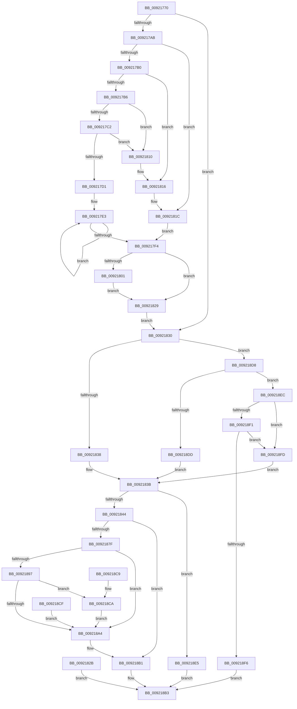

# NtQuerySection

- RVA: `0x00921770`–`0x00921907` (길이 `407` bytes)
- VA: `0x0000000140921770`
- 실행 섹션: `PAGE`
- PDB 이름 있음: `예`; PDB Function 태그: `아니요`
- unwind 정보 RVA: `0x0008D008`
- 디코드: `111`개 명령, `407/407` bytes 표시
- 미해석 바이트: `0` (있으면 어셈블리에 `.byte`로 보존)

> 이 문서는 커널 이미지의 기계어와 PDB 기호를 분석해 생성했습니다. 4번과 5번은 함수 원형과 자료형을 바이너리 사용 방식에서 추정한 C 해석이며 원본 소스 복구 결과는 아닙니다.

## 1. Dependencies

- 직접 호출 지점: **5**; 고유 호출 대상: **5**
- 직접 호출자로 확인된 함수: **0**
- RIP 상대 이미지 참조: **1**

### Outgoing calls
- `0x00921810` → [ExRaiseAccessViolation](../8E/ExRaiseAccessViolation_function_008E9240.md) (function, `0x008E9240`)
- `0x00921816` → [ExRaiseDatatypeMisalignment](../89/ExRaiseDatatypeMisalignment_function_00899FD0.md) (function, `0x00899FD0`)
- `0x00921874` → [ObpReferenceObjectByHandleWithTag](../86/ObpReferenceObjectByHandleWithTag_function_00869650.md) (function, `0x00869650`)
- `0x0092188C` → [MmGetSectionInformation](MmGetSectionInformation_function_00921910.md) (function, `0x00921910`)
- `0x009218AC` → [ObfDereferenceObjectWithTag](../../text/2F/ObfDereferenceObjectWithTag_function_002F78E0.md) (function, `0x002F78E0`)

### Direct callers
- 이 함수 시작 RVA로 연결되는 직접 call은 확인되지 않았습니다. 간접 호출은 완전히 역산할 수 없습니다.

### Static image references
- `0x00921844` → RVA `0x00FC6BD8` (`ALMOSTRO`; read)

## 2. Other-region calls and transfers

- 다른 실행 섹션으로 향하는 call: **1**
  - `0x009218AC` → [ObfDereferenceObjectWithTag](../../text/2F/ObfDereferenceObjectWithTag_function_002F78E0.md) (`PAGE` → `.text`)
- 별도 외부 분기/꼬리 이동을 확인하지 못했습니다.

## 3. Assembly (complete function range)

```asm
00921770  48 8B C4                        mov rax, rsp
00921773  48 89 58 08                     mov qword ptr [rax + 8], rbx
00921777  48 89 70 10                     mov qword ptr [rax + 0x10], rsi
0092177B  48 89 78 18                     mov qword ptr [rax + 0x18], rdi
0092177F  41 56                           push r14
00921781  48 83 EC 50                     sub rsp, 0x50
00921785  4D 8B F0                        mov r14, r8
00921788  8B F2                           mov esi, edx
0092178A  4C 8B D9                        mov r11, rcx
0092178D  48 83 60 E8 00                  and qword ptr [rax - 0x18], 0
00921792  65 48 8B 04 25 88 01 00 00      mov rax, qword ptr gs:[0x188]
0092179B  44 8A 90 32 02 00 00            mov r10b, byte ptr [rax + 0x232]
009217A2  45 84 D2                        test r10b, r10b
009217A5  0F 84 85 00 00 00               je 0x140921830
009217AB  4D 85 C9                        test r9, r9
009217AE  74 6C                           je 0x14092181c
009217B0  41 F6 C6 03                     test r14b, 3
009217B4  75 60                           jne 0x140921816
009217B6  49 8D 49 FF                     lea rcx, [r9 - 1]
009217BA  49 03 C8                        add rcx, r8
009217BD  4C 3B C1                        cmp r8, rcx
009217C0  77 4E                           ja 0x140921810
009217C2  48 BA 00 00 FF FF FF 7F 00 00   movabs rdx, 0x7fffffff0000
009217CC  48 3B CA                        cmp rcx, rdx
009217CF  73 3F                           jae 0x140921810
009217D1  48 C7 C3 00 F0 FF FF            mov rbx, 0xfffffffffffff000
009217D8  48 23 CB                        and rcx, rbx
009217DB  BF 00 10 00 00                  mov edi, 0x1000
009217E0  48 03 CF                        add rcx, rdi
009217E3  41 8A 00                        mov al, byte ptr [r8]
009217E6  41 88 00                        mov byte ptr [r8], al
009217E9  4C 23 C3                        and r8, rbx
009217EC  4C 03 C7                        add r8, rdi
009217EF  4C 3B C1                        cmp r8, rcx
009217F2  75 EF                           jne 0x1409217e3
009217F4  48 8B 84 24 80 00 00 00         mov rax, qword ptr [rsp + 0x80]
009217FC  48 85 C0                        test rax, rax
009217FF  74 28                           je 0x140921829
00921801  48 3B C2                        cmp rax, rdx
00921804  48 0F 42 D0                     cmovb rdx, rax
00921808  48 8B 02                        mov rax, qword ptr [rdx]
0092180B  48 89 02                        mov qword ptr [rdx], rax
0092180E  EB 19                           jmp 0x140921829
00921810  E8 2B 7A FC FF                  call 0x1408e9240
00921815  CC                              int3
00921816  E8 B5 87 F7 FF                  call 0x140899fd0
0092181B  CC                              int3
0092181C  90                              nop
0092181D  48 BA 00 00 FF FF FF 7F 00 00   movabs rdx, 0x7fffffff0000
00921827  EB CB                           jmp 0x1409217f4
00921829  EB 05                           jmp 0x140921830
0092182B  E9 83 00 00 00                  jmp 0x1409218b3
00921830  85 F6                           test esi, esi
00921832  0F 85 A0 00 00 00               jne 0x1409218d8
00921838  8D 5E 18                        lea ebx, [rsi + 0x18]
0092183B  4C 3B CB                        cmp r9, rbx
0092183E  0F 82 A1 00 00 00               jb 0x1409218e5
00921844  4C 8B 05 8D 53 6A 00            mov r8, qword ptr [rip + 0x6a538d]
0092184B  48 83 64 24 38 00               and qword ptr [rsp + 0x38], 0
00921851  48 83 64 24 30 00               and qword ptr [rsp + 0x30], 0
00921857  48 8D 44 24 40                  lea rax, [rsp + 0x40]
0092185C  48 89 44 24 28                  mov qword ptr [rsp + 0x28], rax
00921861  C7 44 24 20 4D 6D 56 6D         mov dword ptr [rsp + 0x20], 0x6d566d4d
00921869  45 8A CA                        mov r9b, r10b
0092186C  BA 01 00 00 00                  mov edx, 1
00921871  49 8B CB                        mov rcx, r11
00921874  E8 D7 7D F4 FF                  call 0x140869650
00921879  8B F8                           mov edi, eax
0092187B  85 C0                           test eax, eax
0092187D  78 32                           js 0x1409218b1
0092187F  4D 8B C6                        mov r8, r14
00921882  8B D6                           mov edx, esi
00921884  48 8B 74 24 40                  mov rsi, qword ptr [rsp + 0x40]
00921889  48 8B CE                        mov rcx, rsi
0092188C  E8 7F 00 00 00                  call 0x140921910
00921891  8B F8                           mov edi, eax
00921893  85 C0                           test eax, eax
00921895  78 0D                           js 0x1409218a4
00921897  48 8B 84 24 80 00 00 00         mov rax, qword ptr [rsp + 0x80]
0092189F  48 85 C0                        test rax, rax
009218A2  75 26                           jne 0x1409218ca
009218A4  BA 4D 6D 56 6D                  mov edx, 0x6d566d4d
009218A9  48 8B CE                        mov rcx, rsi
009218AC  E8 2F 60 9D FF                  call 0x1402f78e0
009218B1  8B C7                           mov eax, edi
009218B3  48 8B 5C 24 60                  mov rbx, qword ptr [rsp + 0x60]
009218B8  48 8B 74 24 68                  mov rsi, qword ptr [rsp + 0x68]
009218BD  48 8B 7C 24 70                  mov rdi, qword ptr [rsp + 0x70]
009218C2  48 83 C4 50                     add rsp, 0x50
009218C6  41 5E                           pop r14
009218C8  C3                              ret
009218C9  CC                              int3
009218CA  48 89 18                        mov qword ptr [rax], rbx
009218CD  EB D5                           jmp 0x1409218a4
009218CF  8B F8                           mov edi, eax
009218D1  48 8B 74 24 40                  mov rsi, qword ptr [rsp + 0x40]
009218D6  EB CC                           jmp 0x1409218a4
009218D8  83 FE 01                        cmp esi, 1
009218DB  75 0F                           jne 0x1409218ec
009218DD  8D 5E 3F                        lea ebx, [rsi + 0x3f]
009218E0  E9 56 FF FF FF                  jmp 0x14092183b
009218E5  B8 04 00 00 C0                  mov eax, 0xc0000004
009218EA  EB C7                           jmp 0x1409218b3
009218EC  83 FE 02                        cmp esi, 2
009218EF  74 0C                           je 0x1409218fd
009218F1  83 FE 03                        cmp esi, 3
009218F4  74 07                           je 0x1409218fd
009218F6  B8 03 00 00 C0                  mov eax, 0xc0000003
009218FB  EB B6                           jmp 0x1409218b3
009218FD  BB 08 00 00 00                  mov ebx, 8
00921902  E9 34 FF FF FF                  jmp 0x14092183b
```

## 4. C-style interpretation (structured pseudocode)

```c
__int64 __fastcall NtQuerySection(__int64 a1, int a2, __int64 a3, __int64 a4, __int64 a5)
{
    __int64 result;
    __int64 v_rsp;
    unsigned __int64 v_stack_m18;
    unsigned __int64 v_stack_m20;
    unsigned __int64 v_stack_m28;
    unsigned __int64 v_stack_m30;
    unsigned int v_stack_m38;
    unsigned __int64 v_stack_p10;
    unsigned __int64 v_stack_p18;
    unsigned __int64 v_stack_p40;
    unsigned __int64 v_stack_p8;

    *(unsigned __int64 *)(v_rsp + 8) = v_rbx;
    *(unsigned __int64 *)(v_rsp + 16) = v_rsi;
    *(unsigned __int64 *)(v_rsp + 24) = v_rdi;
    v_rsp = (v_rsp) - (80);
    if ((unsigned __int8)(*(unsigned __int8 *)(*(unsigned __int64 *)(gs_base + (0 + 392)) + 562)) == 0) goto loc_00921830;
    if (a4 == 0) goto loc_0092181C;
    if ((((unsigned __int8)(a3)) & (3)) != 0) goto loc_00921816;
    a1 = (a4 - 1) + (a3);
    if (a3 > a1) goto loc_00921810;
    if (a1 >= a2) goto loc_00921810;
    a1 = (a1) & (0xFFFFFFFFFFFFF000ULL);
    a1 = (a1) + ((unsigned int)(0x1000ULL));
loc_009217E3:
    *(unsigned __int8 *)(a3) = (unsigned __int8)(*(unsigned __int8 *)(a3));
    a3 = (a3) & (0xFFFFFFFFFFFFF000ULL);
    a3 = (a3) + ((unsigned int)(0x1000ULL));
    if (a3 != a1) goto loc_009217E3;
loc_009217F4:
    if (a5 == 0) goto loc_00921829;
    if (a5 < a2) { a2 = a5; }
    *(unsigned __int64 *)(a2) = *(unsigned __int64 *)(a2);
    goto loc_00921829;
loc_00921810:
    result = ExRaiseAccessViolation(a1, a2, a3, a4);
loc_00921816:
    result = ExRaiseDatatypeMisalignment(a1, a2, a3, a4);
loc_0092181C:
    goto loc_009217F4;
loc_00921829:
    goto loc_00921830;
loc_00921830:
    if ((unsigned int)((unsigned int)(a2)) != 0) goto loc_009218D8;
loc_0092183B:
    if (a4 < ((unsigned int)(a2) + 24)) goto loc_009218E5;
    v_stack_m30 = v_stack_m18;
    v_stack_m38 = 0x6D566D4DULL;
    result = ObpReferenceObjectByHandleWithTag(a1, 1, *(unsigned __int64 *)(v_rip + 6968205), (unsigned __int8)(*(unsigned __int8 *)(*(unsigned __int64 *)(gs_base + (0 + 392)) + 562)));
    if (sign_flag) goto loc_009218B1;
    result = MmGetSectionInformation(v_stack_m18, (unsigned int)((unsigned int)((unsigned int)(a2))), a3, (unsigned __int8)(*(unsigned __int8 *)(*(unsigned __int64 *)(gs_base + (0 + 392)) + 562)));
    if (sign_flag) goto loc_009218A4;
    if (a5 != 0) goto loc_009218CA;
loc_009218A4:
    result = ObfDereferenceObjectWithTag(v_stack_m18, (unsigned int)(0x6D566D4DULL), a3, (unsigned __int8)(*(unsigned __int8 *)(*(unsigned __int64 *)(gs_base + (0 + 392)) + 562)));
loc_009218B1:
loc_009218B3:
    v_rsp = (v_rsp) + (80);
    return (unsigned int)((unsigned int)((unsigned int)((unsigned int)(result))));
loc_009218CA:
    *(unsigned __int64 *)((unsigned int)((unsigned int)((unsigned int)((unsigned int)(result))))) = v_stack_p8;
    goto loc_009218A4;
loc_009218D8:
    if (((unsigned int)(v_stack_p10)) != 1) goto loc_009218EC;
    goto loc_0092183B;
loc_009218E5:
    goto loc_009218B3;
loc_009218EC:
    if (((unsigned int)(v_stack_p10)) == 2) goto loc_009218FD;
    if (((unsigned int)(v_stack_p10)) == 3) goto loc_009218FD;
    goto loc_009218B3;
loc_009218FD:
    goto loc_0092183B;
}
```

## 5. (Beta) C Style

```c
int64_t NtQuerySection(int64_t Arg1, int32_t Arg2, int64_t Arg3, int64_t Arg4, int64_t Arg5)
{
    int64_t result;
    int64_t local_rsp;
    uint64_t v_stack_m18;
    uint64_t v_stack_m20;
    uint64_t v_stack_m28;
    uint64_t v_stack_m30;
    uint32_t v_stack_m38;
    uint64_t v_stack_p10;
    uint64_t v_stack_p18;
    uint64_t v_stack_p40;
    uint64_t v_stack_p8;

    *(uint64_t *)(local_rsp + 0x8) = local_rbx;
    *(uint64_t *)(local_rsp + 0x10) = local_rsi;
    *(uint64_t *)(local_rsp + 0x18) = local_rdi;
    local_rsp = (local_rsp) - (80);
    if ((uint8_t)(*(uint8_t *)(*(uint64_t *)(gs_base + (0 + 0x188)) + 0x232)) == 0) goto loc_00921830;
    if (Arg4 == 0) goto loc_0092181C;
    if ((((uint8_t)(Arg3)) & (3)) != 0) goto loc_00921816;
    Arg1 = (Arg4 - 1) + (Arg3);
    if (Arg3 > Arg1) goto loc_00921810;
    if (Arg1 >= Arg2) goto loc_00921810;
    Arg1 = (Arg1) & (0xFFFFFFFFFFFFF000ULL);
    Arg1 = (Arg1) + ((uint32_t)(0x1000ULL));
loc_009217E3:
    *(uint8_t *)(Arg3) = (uint8_t)(*(uint8_t *)(Arg3));
    Arg3 = (Arg3) & (0xFFFFFFFFFFFFF000ULL);
    Arg3 = (Arg3) + ((uint32_t)(0x1000ULL));
    if (Arg3 != Arg1) goto loc_009217E3;
loc_009217F4:
    if (Arg5 == 0) goto loc_00921829;
    if (Arg5 < Arg2) { Arg2 = Arg5; }
    *(uint64_t *)(Arg2) = *(uint64_t *)(Arg2);
    goto loc_00921829;
loc_00921810:
    result = ExRaiseAccessViolation(Arg1, Arg2, Arg3, Arg4);
loc_00921816:
    result = ExRaiseDatatypeMisalignment(Arg1, Arg2, Arg3, Arg4);
loc_0092181C:
    goto loc_009217F4;
loc_00921829:
    goto loc_00921830;
loc_00921830:
    if ((uint32_t)((uint32_t)(Arg2)) != 0) goto loc_009218D8;
loc_0092183B:
    if (Arg4 < ((uint32_t)(Arg2) + 24)) goto loc_009218E5;
    v_stack_m30 = v_stack_m18;
    v_stack_m38 = 0x6D566D4DULL;
    result = ObpReferenceObjectByHandleWithTag(Arg1, 1, *(uint64_t *)(v_rip + 0x6A538D), (uint8_t)(*(uint8_t *)(*(uint64_t *)(gs_base + (0 + 0x188)) + 0x232)));
    if (sign_flag) goto loc_009218B1;
    result = MmGetSectionInformation(v_stack_m18, (uint32_t)((uint32_t)((uint32_t)(Arg2))), Arg3, (uint8_t)(*(uint8_t *)(*(uint64_t *)(gs_base + (0 + 0x188)) + 0x232)));
    if (sign_flag) goto loc_009218A4;
    if (Arg5 != 0) goto loc_009218CA;
loc_009218A4:
    result = ObfDereferenceObjectWithTag(v_stack_m18, (uint32_t)(0x6D566D4DULL), Arg3, (uint8_t)(*(uint8_t *)(*(uint64_t *)(gs_base + (0 + 0x188)) + 0x232)));
loc_009218B1:
loc_009218B3:
    local_rsp = (local_rsp) + (80);
    return (uint32_t)((uint32_t)((uint32_t)((uint32_t)(result))));
loc_009218CA:
    *(uint64_t *)((uint32_t)((uint32_t)((uint32_t)((uint32_t)(result))))) = v_stack_p8;
    goto loc_009218A4;
loc_009218D8:
    if (((uint32_t)(v_stack_p10)) != 1) goto loc_009218EC;
    goto loc_0092183B;
loc_009218E5:
    goto loc_009218B3;
loc_009218EC:
    if (((uint32_t)(v_stack_p10)) == 2) goto loc_009218FD;
    if (((uint32_t)(v_stack_p10)) == 3) goto loc_009218FD;
    goto loc_009218B3;
loc_009218FD:
    goto loc_0092183B;
}
```

## 6. Execution-region graph

[열기: 2D/3D 그래프와 함수 탐색 컨트롤 패널](../../../control-panel.html?section=page&rva=0x00921770&view=graph)

- 2D 그래프는 위에서 아래로 흐르고, 3D 그래프는 빈 공간을 드래그해 회전합니다. Shift+드래그는 이동, 휠은 확대·축소, 함수 노드 선택은 대상 보고서 이동입니다.

### Static fallback


