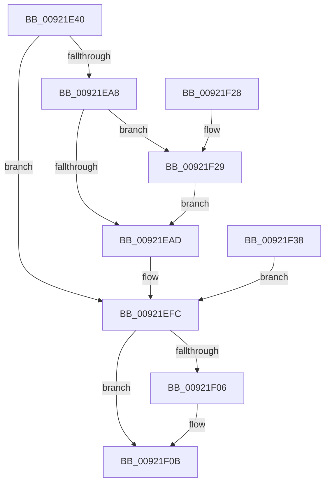

# NtRequestWaitReplyPort

- RVA: `0x00921E40`–`0x00921F3C` (길이 `252` bytes)
- VA: `0x0000000140921E40`
- 실행 섹션: `PAGE`
- PDB 이름 있음: `예`; PDB Function 태그: `아니요`
- unwind 정보 RVA: `0x0008D0B0`
- 디코드: `62`개 명령, `252/252` bytes 표시
- 미해석 바이트: `0` (있으면 어셈블리에 `.byte`로 보존)

> 이 문서는 커널 이미지의 기계어와 PDB 기호를 분석해 생성했습니다. 4번과 5번은 함수 원형과 자료형을 바이너리 사용 방식에서 추정한 C 해석이며 원본 소스 복구 결과는 아닙니다.

## 1. Dependencies

- 직접 호출 지점: **5**; 고유 호출 대상: **5**
- 직접 호출자로 확인된 함수: **0**
- RIP 상대 이미지 참조: **1**

### Outgoing calls
- `0x00921E9D` → [ObReferenceObjectByHandle](../86/ObReferenceObjectByHandle_function_00868DB0.md) (function, `0x00868DB0`)
- `0x00921ED9` → [AlpcpProcessSynchronousRequest](AlpcpProcessSynchronousRequest_function_00921FCC.md) (function, `0x00921FCC`)
- `0x00921F06` → [ObfDereferenceObject](../../text/2F/ObfDereferenceObject_function_002F9350.md) (function, `0x002F9350`)
- `0x00921F0B` → [KeLeaveCriticalRegion](../../text/25/KeLeaveCriticalRegion_function_0025D8B0.md) (function, `0x0025D8B0`)
- `0x00921F2E` → [AlpcpProbeForWriteMessageHeader](../89/AlpcpProbeForWriteMessageHeader_function_00898660.md) (function, `0x00898660`)

### Direct callers
- 이 함수 시작 RVA로 연결되는 직접 call은 확인되지 않았습니다. 간접 호출은 완전히 역산할 수 없습니다.

### Static image references
- `0x00921E7C` → RVA `0x00FC6C18` (`ALMOSTRO`; read)

## 2. Other-region calls and transfers

- 다른 실행 섹션으로 향하는 call: **2**
  - `0x00921F06` → [ObfDereferenceObject](../../text/2F/ObfDereferenceObject_function_002F9350.md) (`PAGE` → `.text`)
  - `0x00921F0B` → [KeLeaveCriticalRegion](../../text/25/KeLeaveCriticalRegion_function_0025D8B0.md) (`PAGE` → `.text`)
- 별도 외부 분기/꼬리 이동을 확인하지 못했습니다.

## 3. Assembly (complete function range)

```asm
00921E40  4C 8B DC                        mov r11, rsp
00921E43  49 89 5B 08                     mov qword ptr [r11 + 8], rbx
00921E47  49 89 73 10                     mov qword ptr [r11 + 0x10], rsi
00921E4B  4D 89 73 18                     mov qword ptr [r11 + 0x18], r14
00921E4F  41 57                           push r15
00921E51  48 83 EC 50                     sub rsp, 0x50
00921E55  4D 8B F0                        mov r14, r8
00921E58  4C 8B FA                        mov r15, rdx
00921E5B  65 48 8B 04 25 88 01 00 00      mov rax, qword ptr gs:[0x188]
00921E64  66 FF 88 E4 01 00 00            dec word ptr [rax + 0x1e4]
00921E6B  90                              nop
00921E6C  65 48 8B 04 25 88 01 00 00      mov rax, qword ptr gs:[0x188]
00921E75  40 8A B0 32 02 00 00            mov sil, byte ptr [rax + 0x232]
00921E7C  4C 8B 05 95 4D 6A 00            mov r8, qword ptr [rip + 0x6a4d95]
00921E83  49 83 63 20 00                  and qword ptr [r11 + 0x20], 0
00921E88  49 83 63 D0 00                  and qword ptr [r11 - 0x30], 0
00921E8D  49 8D 43 20                     lea rax, [r11 + 0x20]
00921E91  49 89 43 C8                     mov qword ptr [r11 - 0x38], rax
00921E95  44 8A CE                        mov r9b, sil
00921E98  BA 01 00 00 00                  mov edx, 1
00921E9D  E8 0E 6F F4 FF                  call 0x140868db0
00921EA2  8B D8                           mov ebx, eax
00921EA4  85 C0                           test eax, eax
00921EA6  78 54                           js 0x140921efc
00921EA8  40 84 F6                        test sil, sil
00921EAB  75 7C                           jne 0x140921f29
00921EAD  40 88 74 24 40                  mov byte ptr [rsp + 0x40], sil
00921EB2  48 83 64 24 38 00               and qword ptr [rsp + 0x38], 0
00921EB8  48 83 64 24 30 00               and qword ptr [rsp + 0x30], 0
00921EBE  48 83 64 24 28 00               and qword ptr [rsp + 0x28], 0
00921EC4  4C 89 74 24 20                  mov qword ptr [rsp + 0x20], r14
00921EC9  45 33 C9                        xor r9d, r9d
00921ECC  4D 8B C7                        mov r8, r15
00921ECF  BA 00 00 02 00                  mov edx, 0x20000
00921ED4  48 8B 4C 24 78                  mov rcx, qword ptr [rsp + 0x78]
00921ED9  E8 EE 00 00 00                  call 0x140921fcc
00921EDE  8B D8                           mov ebx, eax
00921EE0  B8 37 00 00 C0                  mov eax, 0xc0000037
00921EE5  81 FB 03 07 00 C0               cmp ebx, 0xc0000703
00921EEB  0F 44 D8                        cmove ebx, eax
00921EEE  B8 53 02 00 C0                  mov eax, 0xc0000253
00921EF3  81 FB 01 07 00 C0               cmp ebx, 0xc0000701
00921EF9  0F 44 D8                        cmove ebx, eax
00921EFC  48 8B 4C 24 78                  mov rcx, qword ptr [rsp + 0x78]
00921F01  48 85 C9                        test rcx, rcx
00921F04  74 05                           je 0x140921f0b
00921F06  E8 45 74 9D FF                  call 0x1402f9350
00921F0B  E8 A0 B9 93 FF                  call 0x14025d8b0
00921F10  8B C3                           mov eax, ebx
00921F12  48 8B 5C 24 60                  mov rbx, qword ptr [rsp + 0x60]
00921F17  48 8B 74 24 68                  mov rsi, qword ptr [rsp + 0x68]
00921F1C  4C 8B 74 24 70                  mov r14, qword ptr [rsp + 0x70]
00921F21  48 83 C4 50                     add rsp, 0x50
00921F25  41 5F                           pop r15
00921F27  C3                              ret
00921F28  CC                              int3
00921F29  33 D2                           xor edx, edx
00921F2B  49 8B CE                        mov rcx, r14
00921F2E  E8 2D 67 F7 FF                  call 0x140898660
00921F33  E9 75 FF FF FF                  jmp 0x140921ead
00921F38  8B D8                           mov ebx, eax
00921F3A  EB C0                           jmp 0x140921efc
```

## 4. C-style interpretation (structured pseudocode)

```c
__int64 __fastcall NtRequestWaitReplyPort(__int64 a1, __int64 a2, __int64 a3)
{
    __int64 result;
    __int64 v_rbx;
    __int64 v_rsp;
    unsigned __int8 v_stack_m18;
    unsigned __int64 v_stack_m20;
    unsigned __int64 v_stack_m28;
    unsigned __int64 v_stack_m30;
    unsigned __int64 v_stack_m38;
    unsigned __int64 v_stack_p10;
    unsigned __int64 v_stack_p18;
    unsigned __int64 v_stack_p20;
    unsigned __int64 v_stack_p8;

    *(unsigned __int64 *)(v_rsp + 8) = v_rbx;
    *(unsigned __int64 *)(v_rsp + 16) = v_rsi;
    *(unsigned __int64 *)(v_rsp + 24) = v_r14;
    v_rsp = (v_rsp) - (80);
    *(unsigned __int64 *)(v_rsp - 56) = v_rsp + 32;
    result = ObReferenceObjectByHandle(a1, 1, *(unsigned __int64 *)(v_rip + 6966677), (unsigned __int8)(*(unsigned __int8 *)(*(unsigned __int64 *)(gs_base + (0 + 392)) + 562)));
    if (sign_flag) goto loc_00921EFC;
    if ((unsigned __int8)(*(unsigned __int8 *)(*(unsigned __int64 *)(gs_base + (0 + 392)) + 562)) != 0) goto loc_00921F29;
loc_00921EAD:
    v_stack_m18 = (unsigned __int8)(*(unsigned __int8 *)(*(unsigned __int64 *)(gs_base + (0 + 392)) + 562));
    v_stack_m38 = a3;
    a4 = 0;
    result = AlpcpProcessSynchronousRequest(v_stack_p20, (unsigned int)(0x20000ULL), a2, a4);
    v_rbx = (unsigned int)((unsigned int)(result));
    if (((unsigned int)((unsigned int)((unsigned int)(result)))) == 0xC0000703ULL) { v_rbx = (unsigned int)((unsigned int)(0xC0000037ULL)); }
    if (((unsigned int)(v_rbx)) == 0xC0000701ULL) { v_rbx = (unsigned int)((unsigned int)(0xC0000253ULL)); }
loc_00921EFC:
    result = (unsigned int)(0xC0000253ULL);
    if (v_stack_p20 != 0) {
        result = ObfDereferenceObject(v_stack_p20, (unsigned int)(0x20000ULL), a2, a4);
    }
    result = KeLeaveCriticalRegion(v_stack_p20, (unsigned int)(0x20000ULL), a2, a4);
    v_rsp = (v_rsp) + (80);
    return (unsigned int)((unsigned int)(v_rbx));
loc_00921F29:
    a2 = 0;
    result = AlpcpProbeForWriteMessageHeader(v_stack_p18, a2, a2, a4);
    goto loc_00921EAD;
}
```

## 5. (Beta) C Style

```c
int64_t NtRequestWaitReplyPort(int64_t Arg1, int64_t Arg2, int64_t Arg3)
{
    int64_t result;
    int64_t local_rbx;
    int64_t local_rsp;
    uint8_t v_stack_m18;
    uint64_t v_stack_m20;
    uint64_t v_stack_m28;
    uint64_t v_stack_m30;
    uint64_t v_stack_m38;
    uint64_t v_stack_p10;
    uint64_t v_stack_p18;
    uint64_t v_stack_p20;
    uint64_t v_stack_p8;

    *(uint64_t *)(local_rsp + 0x8) = local_rbx;
    *(uint64_t *)(local_rsp + 0x10) = local_rsi;
    *(uint64_t *)(local_rsp + 0x18) = local_r14;
    local_rsp = (local_rsp) - (80);
    *(uint64_t *)(local_rsp - 0x38) = local_rsp + 32;
    result = ObReferenceObjectByHandle(Arg1, 1, *(uint64_t *)(v_rip + 0x6A4D95), (uint8_t)(*(uint8_t *)(*(uint64_t *)(gs_base + (0 + 0x188)) + 0x232)));
    if (sign_flag) goto loc_00921EFC;
    if ((uint8_t)(*(uint8_t *)(*(uint64_t *)(gs_base + (0 + 0x188)) + 0x232)) != 0) goto loc_00921F29;
loc_00921EAD:
    v_stack_m18 = (uint8_t)(*(uint8_t *)(*(uint64_t *)(gs_base + (0 + 0x188)) + 0x232));
    v_stack_m38 = Arg3;
    a4 = 0;
    result = AlpcpProcessSynchronousRequest(v_stack_p20, (uint32_t)(0x20000ULL), Arg2, a4);
    local_rbx = (uint32_t)((uint32_t)(result));
    if (((uint32_t)((uint32_t)((uint32_t)(result)))) == 0xC0000703ULL) { local_rbx = (uint32_t)((uint32_t)(0xC0000037ULL)); }
    if (((uint32_t)(local_rbx)) == 0xC0000701ULL) { local_rbx = (uint32_t)((uint32_t)(0xC0000253ULL)); }
loc_00921EFC:
    result = (uint32_t)(0xC0000253ULL);
    if (v_stack_p20 != 0) {
        result = ObfDereferenceObject(v_stack_p20, (uint32_t)(0x20000ULL), Arg2, a4);
    }
    result = KeLeaveCriticalRegion(v_stack_p20, (uint32_t)(0x20000ULL), Arg2, a4);
    local_rsp = (local_rsp) + (80);
    return (uint32_t)((uint32_t)(local_rbx));
loc_00921F29:
    Arg2 = 0;
    result = AlpcpProbeForWriteMessageHeader(v_stack_p18, Arg2, Arg2, a4);
    goto loc_00921EAD;
}
```

## 6. Execution-region graph

[열기: 2D/3D 그래프와 함수 탐색 컨트롤 패널](../../../control-panel.html?section=page&rva=0x00921E40&view=graph)

- 2D 그래프는 위에서 아래로 흐르고, 3D 그래프는 빈 공간을 드래그해 회전합니다. Shift+드래그는 이동, 휠은 확대·축소, 함수 노드 선택은 대상 보고서 이동입니다.

### Static fallback


