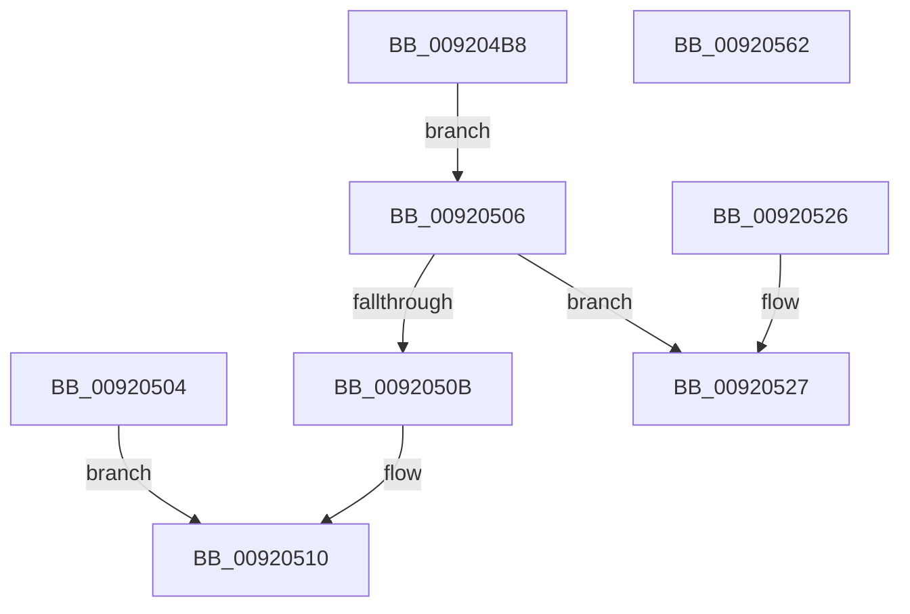

# ObQueryTypeName

- RVA: `0x009204B8`–`0x00920567` (길이 `175` bytes)
- VA: `0x00000001409204B8`
- 실행 섹션: `PAGE`
- PDB 이름 있음: `예`; PDB Function 태그: `예`
- unwind 정보 RVA: `0x0008B634`
- 디코드: `47`개 명령, `175/175` bytes 표시
- 미해석 바이트: `0` (있으면 어셈블리에 `.byte`로 보존)

> 이 문서는 커널 이미지의 기계어와 PDB 기호를 분석해 생성했습니다. 4번과 5번은 함수 원형과 자료형을 바이너리 사용 방식에서 추정한 C 해석이며 원본 소스 복구 결과는 아닙니다.

## 1. Dependencies

- 직접 호출 지점: **1**; 고유 호출 대상: **1**
- 직접 호출자로 확인된 함수: **3**
- RIP 상대 이미지 참조: **2**

### Outgoing calls
- `0x00920549` → [memcpy](../../text/6C/memcpy_function_006C6840.md) (function, `0x006C6840`)

### Direct callers
- [SepQueryTypeString](SepQueryTypeString_function_00920420.md) at `0x0092044C`
- [SepQueryTypeString](SepQueryTypeString_function_00920420.md) at `0x00920495`
- [ObGetObjectInformation](../9D/ObGetObjectInformation_function_009DADE0.md) at `0x009DB00C`
- [VfCheckUserHandle](../../pagevrfy/BB/VfCheckUserHandle_function_00BB9218.md) at `0x00BB932B`

### Static image references
- `0x009204E3` → RVA `0x00FC6E4C` (`ALMOSTRO`; read)
- `0x009204ED` → RVA `0x00FC7800` (`ALMOSTRO`; read)

## 2. Other-region calls and transfers

- 다른 실행 섹션으로 향하는 call: **1**
  - `0x00920549` → [memcpy](../../text/6C/memcpy_function_006C6840.md) (`PAGE` → `.text`)
- call이 아닌 외부 분기/꼬리 이동: **2**
  - `0x0092055D` → [sub_00B2259C](../B2/Unknown_function_00B2259C.md) (`tail-transfer`)
  - `0x00920562` → [sub_00B2259C](../B2/Unknown_function_00B2259C.md) (`tail-transfer`)

## 3. Assembly (complete function range)

```asm
009204B8  48 89 5C 24 08                  mov qword ptr [rsp + 8], rbx
009204BD  48 89 74 24 10                  mov qword ptr [rsp + 0x10], rsi
009204C2  48 89 7C 24 18                  mov qword ptr [rsp + 0x18], rdi
009204C7  41 56                           push r14
009204C9  48 83 EC 20                     sub rsp, 0x20
009204CD  48 8B FA                        mov rdi, rdx
009204D0  48 8D 41 D0                     lea rax, [rcx - 0x30]
009204D4  48 C1 E8 08                     shr rax, 8
009204D8  44 0F B6 D0                     movzx r10d, al
009204DC  0F B6 41 E8                     movzx eax, byte ptr [rcx - 0x18]
009204E0  4C 33 D0                        xor r10, rax
009204E3  0F B6 05 62 69 6A 00            movzx eax, byte ptr [rip + 0x6a6962]
009204EA  4C 33 D0                        xor r10, rax
009204ED  48 8D 15 0C 73 6A 00            lea rdx, [rip + 0x6a730c]
009204F4  4A 8B 14 D2                     mov rdx, qword ptr [rdx + r10*8]
009204F8  0F B7 72 10                     movzx esi, word ptr [rdx + 0x10]
009204FC  8D 46 12                        lea eax, [rsi + 0x12]
009204FF  41 89 01                        mov dword ptr [r9], eax
00920502  EB 02                           jmp 0x140920506
00920504  EB 0A                           jmp 0x140920510
00920506  44 3B C0                        cmp r8d, eax
00920509  73 1C                           jae 0x140920527
0092050B  B8 04 00 00 C0                  mov eax, 0xc0000004
00920510  48 8B 5C 24 30                  mov rbx, qword ptr [rsp + 0x30]
00920515  48 8B 74 24 38                  mov rsi, qword ptr [rsp + 0x38]
0092051A  48 8B 7C 24 40                  mov rdi, qword ptr [rsp + 0x40]
0092051F  48 83 C4 20                     add rsp, 0x20
00920523  41 5E                           pop r14
00920525  C3                              ret
00920526  CC                              int3
00920527  8B D8                           mov ebx, eax
00920529  48 03 DF                        add rbx, rdi
0092052C  41 BE 02 00 00 00               mov r14d, 2
00920532  49 2B DE                        sub rbx, r14
00920535  33 C0                           xor eax, eax
00920537  66 89 03                        mov word ptr [rbx], ax
0092053A  44 0F B7 42 10                  movzx r8d, word ptr [rdx + 0x10]
0092053F  49 2B D8                        sub rbx, r8
00920542  48 8B 52 18                     mov rdx, qword ptr [rdx + 0x18]
00920546  48 8B CB                        mov rcx, rbx
00920549  E8 F2 62 DA FF                  call 0x1406c6840
0092054E  66 89 37                        mov word ptr [rdi], si
00920551  66 41 03 F6                     add si, r14w
00920555  66 89 77 02                     mov word ptr [rdi + 2], si
00920559  48 89 5F 08                     mov qword ptr [rdi + 8], rbx
0092055D  E9 3A 20 20 00                  jmp 0x140b2259c
00920562  E9 35 20 20 00                  jmp 0x140b2259c
```

## 4. C-style interpretation (structured pseudocode)

```c
__int64 __fastcall ObQueryTypeName(__int64 a1, __int64 a2, int a3, __int64 a4)
{
    __int64 result;
    __int64 v_r10;
    __int64 v_rbx;
    __int64 v_rsi;
    __int64 v_rsp;
    unsigned __int64 v_stack_p10;
    unsigned __int64 v_stack_p18;
    unsigned __int64 v_stack_p8;

    v_stack_p8 = v_rbx;
    v_stack_p10 = v_rsi;
    v_stack_p18 = v_rdi;
    v_rsp = (v_rsp) - (32);
    result = (a1 - 48) >> (8);
    v_r10 = ((unsigned __int8)(result)) ^ (*(unsigned __int8 *)(a1 - 24));
    v_r10 = (v_r10) ^ (*(unsigned __int8 *)(v_rip + 6973794));
    *(unsigned int *)(a4) = (unsigned int)(*(unsigned __int16 *)(*(unsigned __int64 *)(v_rip + 6976268 + v_r10 * 8) + 16) + 18);
    goto loc_00920506;
loc_00920506:
    if (a3 >= ((unsigned int)(*(unsigned __int16 *)(*(unsigned __int64 *)(v_rip + 6976268 + v_r10 * 8) + 16) + 18))) goto loc_00920527;
loc_00920510:
    v_rsp = (v_rsp) + (32);
    return (unsigned int)(0xC0000004ULL);
loc_00920527:
    v_rbx = ((unsigned int)((unsigned int)((unsigned int)(0xC0000004ULL)))) + (v_stack_p18);
    v_rbx = (v_rbx) - (2);
    result = 0;
    *(unsigned __int16 *)(v_rbx) = 0;
    v_rbx = (v_rbx) - (*(unsigned __int16 *)(*(unsigned __int64 *)(v_rip + 6976268 + v_r10 * 8) + 16));
    result = memcpy(v_rbx, *(unsigned __int64 *)(*(unsigned __int64 *)(v_rip + 6976268 + v_r10 * 8) + 24), *(unsigned __int16 *)(*(unsigned __int64 *)(v_rip + 6976268 + v_r10 * 8) + 16), a4);
    *(unsigned __int16 *)(v_stack_p18) = (unsigned __int16)(v_stack_p10);
    v_rsi = (unsigned __int16)((v_stack_p10) + (2));
    *(unsigned __int16 *)(v_stack_p18 + 2) = (unsigned __int16)(v_rsi);
    *(unsigned __int64 *)(v_stack_p18 + 8) = v_rbx;
}
```

## 5. (Beta) C Style

```c
int64_t ObQueryTypeName(void *Arg1, void *Arg2, int32_t Arg3, void *Arg4)
{
    uint8_t *arg1 = (uint8_t *)Arg1;
    uint8_t *arg2 = (uint8_t *)Arg2;
    uint8_t *arg4 = (uint8_t *)Arg4;

    int64_t result;
    int64_t local_r10;
    int64_t local_rbx;
    int64_t local_rsi;
    int64_t local_rsp;
    uint64_t v_stack_p10;
    uint64_t v_stack_p18;
    uint64_t v_stack_p8;

    v_stack_p8 = local_rbx;
    v_stack_p10 = local_rsi;
    v_stack_p18 = local_rdi;
    local_rsp = (local_rsp) - (32);
    result = (Arg1 - 48) >> (8);
    local_r10 = ((uint8_t)(result)) ^ (*(uint8_t *)(arg1 - 0x18));
    local_r10 = (local_r10) ^ (*(uint8_t *)(v_rip + 0x6A6962));
    *(uint32_t *)(arg4) = (uint32_t)(*(uint16_t *)(*(uint64_t *)(v_rip + 0x6A730C + local_r10 * 8) + 0x10) + 18);
    goto loc_00920506;
loc_00920506:
    if (Arg3 >= ((uint32_t)(*(uint16_t *)(*(uint64_t *)(v_rip + 0x6A730C + local_r10 * 8) + 0x10) + 18))) goto loc_00920527;
loc_00920510:
    local_rsp = (local_rsp) + (32);
    return (uint32_t)(0xC0000004ULL);
loc_00920527:
    local_rbx = ((uint32_t)((uint32_t)((uint32_t)(0xC0000004ULL)))) + (v_stack_p18);
    local_rbx = (local_rbx) - (2);
    result = 0;
    *(uint16_t *)(local_rbx) = 0;
    local_rbx = (local_rbx) - (*(uint16_t *)(*(uint64_t *)(v_rip + 0x6A730C + local_r10 * 8) + 0x10));
    result = memcpy(local_rbx, *(uint64_t *)(*(uint64_t *)(v_rip + 0x6A730C + local_r10 * 8) + 0x18), *(uint16_t *)(*(uint64_t *)(v_rip + 0x6A730C + local_r10 * 8) + 0x10), Arg4);
    *(uint16_t *)(v_stack_p18) = (uint16_t)(v_stack_p10);
    local_rsi = (uint16_t)((v_stack_p10) + (2));
    *(uint16_t *)(v_stack_p18 + 0x2) = (uint16_t)(local_rsi);
    *(uint64_t *)(v_stack_p18 + 0x8) = local_rbx;
}
```

### 관측된 메모리 오프셋

구조체 형식이 확인되지 않은 접근은 인자 기준의 오프셋으로만 기록했습니다.

| 기준 인자 | 오프셋 표현 | 폭 (bit) | 접근 |
|---|---:|---:|---|
| `Arg1` | `- 0x30` | `64` | `R` |
| `Arg1` | `- 0x18` | `8` | `R` |
| `Arg2` | `+ 0x0` | `16` | `W` |
| `Arg2` | `+ 0x2` | `16` | `W` |
| `Arg2` | `+ 0x8` | `64` | `W` |
| `Arg4` | `+ 0x0` | `32` | `W` |

## 6. Execution-region graph

[열기: 2D/3D 그래프와 함수 탐색 컨트롤 패널](../../../control-panel.html?section=page&rva=0x009204B8&view=graph)

- 2D 그래프는 위에서 아래로 흐르고, 3D 그래프는 빈 공간을 드래그해 회전합니다. Shift+드래그는 이동, 휠은 확대·축소, 함수 노드 선택은 대상 보고서 이동입니다.

### Static fallback


