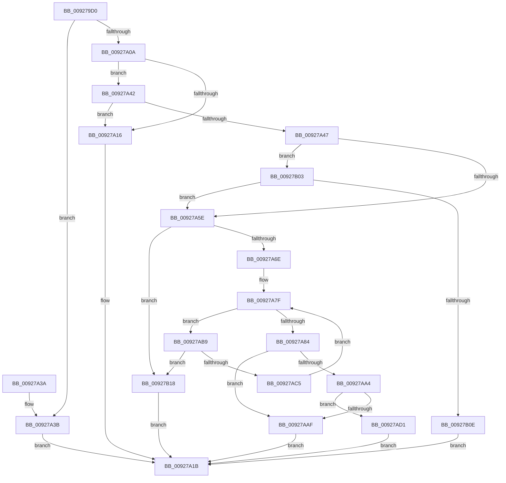

# RtlAddAccessAllowedAceEx

- RVA: `0x009279D0`–`0x00927B22` (길이 `338` bytes)
- VA: `0x00000001409279D0`
- 실행 섹션: `PAGE`
- PDB 이름 있음: `예`; PDB Function 태그: `아니요`
- unwind 정보 RVA: `0x0008D674`
- 디코드: `98`개 명령, `338/338` bytes 표시
- 미해석 바이트: `0` (있으면 어셈블리에 `.byte`로 보존)

> 이 문서는 커널 이미지의 기계어와 PDB 기호를 분석해 생성했습니다. 4번과 5번은 함수 원형과 자료형을 바이너리 사용 방식에서 추정한 C 해석이며 원본 소스 복구 결과는 아닙니다.

## 1. Dependencies

- 직접 호출 지점: **3**; 고유 호출 대상: **3**
- 직접 호출자로 확인된 함수: **3**
- RIP 상대 이미지 참조: **0**

### Outgoing calls
- `0x009279FF` → [RtlValidSid](RtlValidSid_function_00929710.md) (function, `0x00929710`)
- `0x00927A61` → [RtlValidAcl](RtlValidAcl_function_0092A7A0.md) (function, `0x0092A7A0`)
- `0x00927AF1` → [RtlCopySid](../9A/RtlCopySid_function_009A9A50.md) (function, `0x009A9A50`)

### Direct callers
- [PiAuCreateLocalSystemSecurityObject](../../init/C3/PiAuCreateLocalSystemSecurityObject_function_00C34570.md) at `0x00C345FF`
- [PiAuCreateStandardSecurityObject](../../init/C3/PiAuCreateStandardSecurityObject_function_00C34710.md) at `0x00C34A0F`
- [PiAuCreateStandardSecurityObject](../../init/C3/PiAuCreateStandardSecurityObject_function_00C34710.md) at `0x00C34A5C`
- [PiAuCreateStandardSecurityObject](../../init/C3/PiAuCreateStandardSecurityObject_function_00C34710.md) at `0x00C34A83`
- [PiAuCreateStandardSecurityObject](../../init/C3/PiAuCreateStandardSecurityObject_function_00C34710.md) at `0x00C34AA8`
- [PiAuCreateStandardSecurityObject](../../init/C3/PiAuCreateStandardSecurityObject_function_00C34710.md) at `0x00C34ACD`
- [PiAuCreateStandardSecurityObject](../../init/C3/PiAuCreateStandardSecurityObject_function_00C34710.md) at `0x00C34AFE`
- [PiAuCreateStandardSecurityObject](../../init/C3/PiAuCreateStandardSecurityObject_function_00C34710.md) at `0x00C34B35`
- [PiAuGetDriverDataDirectorySecurityObject](../../init/C3/PiAuGetDriverDataDirectorySecurityObject_function_00C34EEC.md) at `0x00C34FB1`
- [PiAuGetDriverDataDirectorySecurityObject](../../init/C3/PiAuGetDriverDataDirectorySecurityObject_function_00C34EEC.md) at `0x00C34FDC`
- [PiAuGetDriverDataDirectorySecurityObject](../../init/C3/PiAuGetDriverDataDirectorySecurityObject_function_00C34EEC.md) at `0x00C3500E`

### Static image references
- 디코드된 RIP-relative 메모리 참조가 없습니다.

## 2. Other-region calls and transfers

- 다른 실행 섹션으로 향하는 call: **0**
- 별도 외부 분기/꼬리 이동을 확인하지 못했습니다.

## 3. Assembly (complete function range)

```asm
009279D0  48 89 5C 24 08                  mov qword ptr [rsp + 8], rbx
009279D5  48 89 6C 24 10                  mov qword ptr [rsp + 0x10], rbp
009279DA  48 89 74 24 18                  mov qword ptr [rsp + 0x18], rsi
009279DF  57                              push rdi
009279E0  41 54                           push r12
009279E2  41 55                           push r13
009279E4  41 56                           push r14
009279E6  41 57                           push r15
009279E8  48 83 EC 20                     sub rsp, 0x20
009279EC  48 8B 6C 24 70                  mov rbp, qword ptr [rsp + 0x70]
009279F1  48 8B F9                        mov rdi, rcx
009279F4  48 8B CD                        mov rcx, rbp
009279F7  45 8B F9                        mov r15d, r9d
009279FA  45 8B F0                        mov r14d, r8d
009279FD  8B F2                           mov esi, edx
009279FF  E8 0C 1D 00 00                  call 0x140929710
00927A04  33 DB                           xor ebx, ebx
00927A06  84 C0                           test al, al
00927A08  74 31                           je 0x140927a3b
00927A0A  0F B6 0F                        movzx ecx, byte ptr [rdi]
00927A0D  44 8D 63 04                     lea r12d, [rbx + 4]
00927A11  41 3B F4                        cmp esi, r12d
00927A14  76 2C                           jbe 0x140927a42
00927A16  BB 59 00 00 C0                  mov ebx, 0xc0000059
00927A1B  48 8B 6C 24 58                  mov rbp, qword ptr [rsp + 0x58]
00927A20  8B C3                           mov eax, ebx
00927A22  48 8B 5C 24 50                  mov rbx, qword ptr [rsp + 0x50]
00927A27  48 8B 74 24 60                  mov rsi, qword ptr [rsp + 0x60]
00927A2C  48 83 C4 20                     add rsp, 0x20
00927A30  41 5F                           pop r15
00927A32  41 5E                           pop r14
00927A34  41 5D                           pop r13
00927A36  41 5C                           pop r12
00927A38  5F                              pop rdi
00927A39  C3                              ret
00927A3A  CC                              int3
00927A3B  BB 78 00 00 C0                  mov ebx, 0xc0000078
00927A40  EB D9                           jmp 0x140927a1b
00927A42  41 3A CC                        cmp cl, r12b
00927A45  77 CF                           ja 0x140927a16
00927A47  40 0F B6 C6                     movzx eax, sil
00927A4B  8B F1                           mov esi, ecx
00927A4D  3A C8                           cmp cl, al
00927A4F  0F 46 F0                        cmovbe esi, eax
00927A52  41 8B C6                        mov eax, r14d
00927A55  83 E0 E0                        and eax, 0xffffffe0
00927A58  0F 85 A5 00 00 00               jne 0x140927b03
00927A5E  48 8B CF                        mov rcx, rdi
00927A61  E8 3A 2D 00 00                  call 0x14092a7a0
00927A66  84 C0                           test al, al
00927A68  0F 84 AA 00 00 00               je 0x140927b18
00927A6E  44 0F B7 47 04                  movzx r8d, word ptr [rdi + 4]
00927A73  48 8D 57 08                     lea rdx, [rdi + 8]
00927A77  8B CB                           mov ecx, ebx
00927A79  41 BD 01 00 00 00               mov r13d, 1
00927A7F  41 3B C8                        cmp ecx, r8d
00927A82  72 35                           jb 0x140927ab9
00927A84  44 0F B7 47 02                  movzx r8d, word ptr [rdi + 2]
00927A89  0F B6 4D 01                     movzx ecx, byte ptr [rbp + 1]
00927A8D  4C 03 C7                        add r8, rdi
00927A90  49 3B D0                        cmp rdx, r8
00927A93  48 0F 47 D3                     cmova rdx, rbx
00927A97  66 41 03 CC                     add cx, r12w
00927A9B  66 C1 E1 02                     shl cx, 2
00927A9F  48 85 D2                        test rdx, rdx
00927AA2  74 0B                           je 0x140927aaf
00927AA4  0F B7 C1                        movzx eax, cx
00927AA7  48 03 C2                        add rax, rdx
00927AAA  49 3B C0                        cmp rax, r8
00927AAD  76 22                           jbe 0x140927ad1
00927AAF  BB 99 00 00 C0                  mov ebx, 0xc0000099
00927AB4  E9 62 FF FF FF                  jmp 0x140927a1b
00927AB9  0F B7 47 02                     movzx eax, word ptr [rdi + 2]
00927ABD  48 03 C7                        add rax, rdi
00927AC0  48 3B D0                        cmp rdx, rax
00927AC3  73 53                           jae 0x140927b18
00927AC5  0F B7 42 02                     movzx eax, word ptr [rdx + 2]
00927AC9  41 03 CD                        add ecx, r13d
00927ACC  48 03 D0                        add rdx, rax
00927ACF  EB AE                           jmp 0x140927a7f
00927AD1  66 89 4A 02                     mov word ptr [rdx + 2], cx
00927AD5  4C 8B C5                        mov r8, rbp
00927AD8  44 88 72 01                     mov byte ptr [rdx + 1], r14b
00927ADC  88 1A                           mov byte ptr [rdx], bl
00927ADE  44 89 7A 04                     mov dword ptr [rdx + 4], r15d
00927AE2  48 83 C2 08                     add rdx, 8
00927AE6  0F B6 4D 01                     movzx ecx, byte ptr [rbp + 1]
00927AEA  8D 0C 8D 08 00 00 00            lea ecx, [rcx*4 + 8]
00927AF1  E8 5A 1F 08 00                  call 0x1409a9a50
00927AF6  66 44 01 6F 04                  add word ptr [rdi + 4], r13w
00927AFB  40 88 37                        mov byte ptr [rdi], sil
00927AFE  E9 18 FF FF FF                  jmp 0x140927a1b
00927B03  A9 DF FF FF FF                  test eax, 0xffffffdf
00927B08  0F 84 50 FF FF FF               je 0x140927a5e
00927B0E  BB 0D 00 00 C0                  mov ebx, 0xc000000d
00927B13  E9 03 FF FF FF                  jmp 0x140927a1b
00927B18  BB 77 00 00 C0                  mov ebx, 0xc0000077
00927B1D  E9 F9 FE FF FF                  jmp 0x140927a1b
```

## 4. C-style interpretation (structured pseudocode)

```c
__int64 __fastcall RtlAddAccessAllowedAceEx(__int64 a1, int a2, int a3, int a4, __int64 a5)
{
    __int64 result;
    __int64 v_rbx;
    __int64 v_rsi;
    __int64 v_rsp;
    unsigned __int64 v_stack_p10;
    unsigned __int64 v_stack_p18;
    unsigned __int64 v_stack_p8;

    v_stack_p8 = v_rbx;
    v_stack_p10 = v_rbp;
    v_stack_p18 = v_rsi;
    v_rsp = (v_rsp) - (32);
    result = RtlValidSid(a5, a2, a3, a4);
    v_rbx = 0;
    if ((unsigned __int8)(result) == 0) goto loc_00927A3B;
    if (((unsigned int)((unsigned int)(a2))) <= ((unsigned int)(v_rbx + 4))) goto loc_00927A42;
loc_00927A16:
loc_00927A1B:
    v_rsp = (v_rsp) + (32);
    return (unsigned int)((unsigned int)((unsigned int)(0xC0000059ULL)));
loc_00927A3B:
    goto loc_00927A1B;
loc_00927A42:
    if (((unsigned __int8)(*(unsigned __int8 *)(a1))) > ((unsigned __int8)(v_rbx + 4))) goto loc_00927A16;
    v_rsi = (unsigned int)((unsigned int)(*(unsigned __int8 *)(a1)));
    if (((unsigned __int8)(*(unsigned __int8 *)(a1))) <= ((unsigned __int8)((unsigned __int8)(v_stack_p18)))) { v_rsi = (unsigned int)((unsigned __int8)(v_stack_p18)); }
    result = (unsigned int)(((unsigned int)((unsigned int)((unsigned int)(a3)))) & (0xFFFFFFE0ULL));
    if (condition_is_not_equal) goto loc_00927B03;
loc_00927A5E:
    result = RtlValidAcl(a1, a2, a3, a4);
    if ((unsigned __int8)(result) == 0) goto loc_00927B18;
loc_00927A7F:
    if (((unsigned int)((unsigned int)((unsigned int)((unsigned int)(0xC0000078ULL))))) < ((unsigned int)(*(unsigned __int16 *)(a1 + 4)))) goto loc_00927AB9;
    a3 = (*(unsigned __int16 *)(a1 + 2)) + (a1);
    a2 = a1 + 8;
    if ((a1 + 8) > a3) { a2 = (unsigned int)(0xC0000078ULL); }
    a1 = (unsigned __int16)((*(unsigned __int8 *)(v_stack_p10 + 1)) + ((unsigned __int16)(v_rbx + 4)));
    a1 = (unsigned __int16)((a1) << (2));
    if (a2 == 0) goto loc_00927AAF;
    result = ((unsigned __int16)(a1)) + (a2);
    if (result <= a3) goto loc_00927AD1;
loc_00927AAF:
    goto loc_00927A1B;
loc_00927AB9:
    result = (*(unsigned __int16 *)(a1 + 2)) + (a1);
    if (a2 >= result) goto loc_00927B18;
    a1 = (unsigned int)((a1) + (1));
    a2 = (a2) + (*(unsigned __int16 *)(a2 + 2));
    goto loc_00927A7F;
loc_00927AD1:
    *(unsigned __int16 *)(a2 + 2) = (unsigned __int16)(a1);
    *(unsigned __int8 *)(a2 + 1) = (unsigned __int8)((unsigned int)(a3));
    *(unsigned __int8 *)(a2) = (unsigned __int8)((unsigned int)(0xC0000099ULL));
    *(unsigned int *)(a2 + 4) = (unsigned int)((unsigned int)(a4));
    a2 = (a2) + (8);
    result = RtlCopySid(*(unsigned __int8 *)(v_stack_p10 + 1) * 4 + 8, a2, v_stack_p10, a4);
    *(unsigned __int8 *)(a1) = (unsigned __int8)(v_rsi);
    goto loc_00927A1B;
loc_00927B03:
    if ((((unsigned int)(result)) & (0xFFFFFFDFULL)) == 0) goto loc_00927A5E;
    goto loc_00927A1B;
loc_00927B18:
    goto loc_00927A1B;
}
```

## 5. (Beta) C Style

```c
int64_t RtlAddAccessAllowedAceEx(void *Arg1, int32_t Arg2, int32_t Arg3, int32_t Arg4, void *Arg5)
{
    uint8_t *arg1 = (uint8_t *)Arg1;
    uint8_t *arg5 = (uint8_t *)Arg5;

    int64_t result;
    int64_t local_rbx;
    int64_t local_rsi;
    int64_t local_rsp;
    uint64_t v_stack_p10;
    uint64_t v_stack_p18;
    uint64_t v_stack_p8;

    v_stack_p8 = local_rbx;
    v_stack_p10 = local_rbp;
    v_stack_p18 = local_rsi;
    local_rsp = (local_rsp) - (32);
    result = RtlValidSid(Arg5, Arg2, Arg3, Arg4);
    local_rbx = 0;
    if ((uint8_t)(result) == 0) goto loc_00927A3B;
    if (((uint32_t)((uint32_t)(Arg2))) <= ((uint32_t)(local_rbx + 4))) goto loc_00927A42;
loc_00927A16:
loc_00927A1B:
    local_rsp = (local_rsp) + (32);
    return (uint32_t)((uint32_t)((uint32_t)(0xC0000059ULL)));
loc_00927A3B:
    goto loc_00927A1B;
loc_00927A42:
    if (((uint8_t)(*(uint8_t *)(arg1))) > ((uint8_t)(local_rbx + 4))) goto loc_00927A16;
    local_rsi = (uint32_t)((uint32_t)(*(uint8_t *)(arg1)));
    if (((uint8_t)(*(uint8_t *)(arg1))) <= ((uint8_t)((uint8_t)(v_stack_p18)))) { local_rsi = (uint32_t)((uint8_t)(v_stack_p18)); }
    result = (uint32_t)(((uint32_t)((uint32_t)((uint32_t)(Arg3)))) & (0xFFFFFFE0ULL));
    if (condition_is_not_equal) goto loc_00927B03;
loc_00927A5E:
    result = RtlValidAcl(Arg1, Arg2, Arg3, Arg4);
    if ((uint8_t)(result) == 0) goto loc_00927B18;
loc_00927A7F:
    if (((uint32_t)((uint32_t)((uint32_t)((uint32_t)(0xC0000078ULL))))) < ((uint32_t)(*(uint16_t *)(arg1 + 0x4)))) goto loc_00927AB9;
    Arg3 = (*(uint16_t *)(arg1 + 0x2)) + (Arg1);
    Arg2 = Arg1 + 8;
    if ((Arg1 + 8) > Arg3) { Arg2 = (uint32_t)(0xC0000078ULL); }
    Arg1 = (uint16_t)((*(uint8_t *)(v_stack_p10 + 0x1)) + ((uint16_t)(local_rbx + 4)));
    Arg1 = (uint16_t)((Arg1) << (2));
    if (Arg2 == 0) goto loc_00927AAF;
    result = ((uint16_t)(Arg1)) + (Arg2);
    if (result <= Arg3) goto loc_00927AD1;
loc_00927AAF:
    goto loc_00927A1B;
loc_00927AB9:
    result = (*(uint16_t *)(arg1 + 0x2)) + (Arg1);
    if (Arg2 >= result) goto loc_00927B18;
    Arg1 = (uint32_t)((Arg1) + (1));
    Arg2 = (Arg2) + (*(uint16_t *)(Arg2 + 0x2));
    goto loc_00927A7F;
loc_00927AD1:
    *(uint16_t *)(Arg2 + 0x2) = (uint16_t)(Arg1);
    *(uint8_t *)(Arg2 + 0x1) = (uint8_t)((uint32_t)(Arg3));
    *(uint8_t *)(Arg2) = (uint8_t)((uint32_t)(0xC0000099ULL));
    *(uint32_t *)(Arg2 + 0x4) = (uint32_t)((uint32_t)(Arg4));
    Arg2 = (Arg2) + (8);
    result = RtlCopySid(*(uint8_t *)(v_stack_p10 + 0x1) * 4 + 8, Arg2, v_stack_p10, Arg4);
    *(uint8_t *)(arg1) = (uint8_t)(local_rsi);
    goto loc_00927A1B;
loc_00927B03:
    if ((((uint32_t)(result)) & (0xFFFFFFDFULL)) == 0) goto loc_00927A5E;
    goto loc_00927A1B;
loc_00927B18:
    goto loc_00927A1B;
}
```

### 관측된 메모리 오프셋

구조체 형식이 확인되지 않은 접근은 인자 기준의 오프셋으로만 기록했습니다.

| 기준 인자 | 오프셋 표현 | 폭 (bit) | 접근 |
|---|---:|---:|---|
| `Arg1` | `+ 0x0` | `8` | `R` |
| `Arg1` | `+ 0x0` | `8` | `W` |
| `Arg1` | `+ 0x2` | `16` | `R` |
| `Arg1` | `+ 0x4` | `16` | `R` |
| `Arg1` | `+ 0x4` | `16` | `R/W` |
| `Arg1` | `+ 0x8` | `64` | `R` |
| `Arg5` | `+ 0x1` | `8` | `R` |

## 6. Execution-region graph

[열기: 2D/3D 그래프와 함수 탐색 컨트롤 패널](../../../control-panel.html?section=page&rva=0x009279D0&view=graph)

- 2D 그래프는 위에서 아래로 흐르고, 3D 그래프는 빈 공간을 드래그해 회전합니다. Shift+드래그는 이동, 휠은 확대·축소, 함수 노드 선택은 대상 보고서 이동입니다.

### Static fallback


