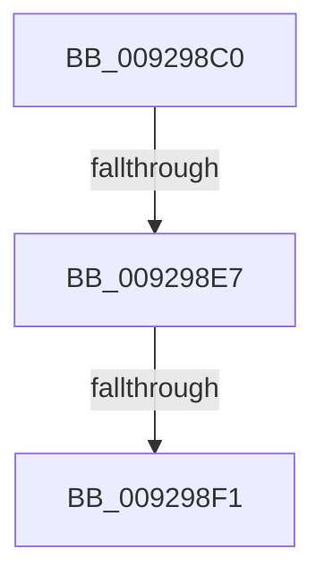

# RtlAddAccessAllowedAce

- RVA: `0x009298C0`–`0x009298F8` (길이 `56` bytes)
- VA: `0x00000001409298C0`
- 실행 섹션: `PAGE`
- PDB 이름 있음: `예`; PDB Function 태그: `아니요`
- unwind 정보 RVA: `0x0008D8DC`
- 디코드: `16`개 명령, `56/56` bytes 표시
- 미해석 바이트: `0` (있으면 어셈블리에 `.byte`로 보존)

> 이 문서는 커널 이미지의 기계어와 PDB 기호를 분석해 생성했습니다. 4번과 5번은 함수 원형과 자료형을 바이너리 사용 방식에서 추정한 C 해석이며 원본 소스 복구 결과는 아닙니다.

## 1. Dependencies

- 직접 호출 지점: **0**; 고유 호출 대상: **0**
- 직접 호출자로 확인된 함수: **19**
- RIP 상대 이미지 참조: **0**

### Outgoing calls
- 직접 디코드된 call 명령이 없습니다.

### Direct callers
- [RtlCheckTokenCapability](../../text/3A/RtlCheckTokenCapability_function_003A5520.md) at `0x003A56D6`
- [RtlCheckTokenCapability](../../text/3A/RtlCheckTokenCapability_function_003A5520.md) at `0x003A56EE`
- [RtlCheckTokenMembershipEx](../../text/3A/RtlCheckTokenMembershipEx_function_003A5A30.md) at `0x003A5B46`
- [RtlCheckTokenMembershipEx](../../text/3A/RtlCheckTokenMembershipEx_function_003A5A30.md) at `0x003A5B7E`
- [RtlCheckTokenMembershipEx](../../text/3A/RtlCheckTokenMembershipEx_function_003A5A30.md) at `0x003A5D8E`
- [SepAppendAceToTokenDefaultDacl](../../text/40/SepAppendAceToTokenDefaultDacl_function_004002F8.md) at `0x00400440`
- [SepInitProcessAuditSd](../../text/60/SepInitProcessAuditSd_function_00606230.md) at `0x006063D9`
- [SepInitProcessAuditSd](../../text/60/SepInitProcessAuditSd_function_00606230.md) at `0x006063F6`
- [SepInitProcessAuditSd](../../text/60/SepInitProcessAuditSd_function_00606230.md) at `0x00606413`
- [SepInitProcessAuditSd](../../text/60/SepInitProcessAuditSd_function_00606230.md) at `0x00606430`
- [WdipAccessCheck](../../text/64/WdipAccessCheck_function_0064E084.md) at `0x0064E1F5`
- [WdipAccessCheck](../../text/64/WdipAccessCheck_function_0064E084.md) at `0x0064E215`
- [WdipAccessCheck](../../text/64/WdipAccessCheck_function_0064E084.md) at `0x0064E22D`
- [ExpPlRunOnceInit](../../text/65/ExpPlRunOnceInit_function_006571E0.md) at `0x00657216`
- [ViInitializeLocalSystemDescriptor](../../pagevrfy/B9/ViInitializeLocalSystemDescriptor_function_00B936F8.md) at `0x00B937AA`
- [IopCreateUmdfDirectory](../../init/C2/IopCreateUmdfDirectory_function_00C2C818.md) at `0x00C2C940`
- [IopCreateUmdfDirectory](../../init/C2/IopCreateUmdfDirectory_function_00C2C818.md) at `0x00C2C95D`
- [IopApplySystemPartitionProt](../../init/C2/IopApplySystemPartitionProt_function_00C2E398.md) at `0x00C2E475`
- [IopApplySystemPartitionProt](../../init/C2/IopApplySystemPartitionProt_function_00C2E398.md) at `0x00C2E499`
- [PopUmpoInitializeChannel](../../init/C4/PopUmpoInitializeChannel_function_00C428F0.md) at `0x00C429F2`
- [SshpAlpcInitialize](../../init/C4/SshpAlpcInitialize_function_00C448B4.md) at `0x00C44A1B`
- [PspInitializeCpuPartitionsDefaultSd](../../init/C4/PspInitializeCpuPartitionsDefaultSd_function_00C457D4.md) at `0x00C458FE`
- [PspInitializeCpuPartitionsDefaultSd](../../init/C4/PspInitializeCpuPartitionsDefaultSd_function_00C457D4.md) at `0x00C4591D`
- [PspInitializeSystemPartitionPhase0](../../init/C4/PspInitializeSystemPartitionPhase0_function_00C46898.md) at `0x00C46959`
- [SepInitSystemDacls](../../init/C4/SepInitSystemDacls_function_00C478DC.md) at `0x00C47C2F`
- [SepInitSystemDacls](../../init/C4/SepInitSystemDacls_function_00C478DC.md) at `0x00C47C47`
- [SepInitSystemDacls](../../init/C4/SepInitSystemDacls_function_00C478DC.md) at `0x00C47C68`
- [SepInitSystemDacls](../../init/C4/SepInitSystemDacls_function_00C478DC.md) at `0x00C47C85`
- [SepInitSystemDacls](../../init/C4/SepInitSystemDacls_function_00C478DC.md) at `0x00C47C9D`
- [SepInitSystemDacls](../../init/C4/SepInitSystemDacls_function_00C478DC.md) at `0x00C47CB5`
- [SepInitSystemDacls](../../init/C4/SepInitSystemDacls_function_00C478DC.md) at `0x00C47CD3`
- [SepInitSystemDacls](../../init/C4/SepInitSystemDacls_function_00C478DC.md) at `0x00C47CF0`
- [SepInitSystemDacls](../../init/C4/SepInitSystemDacls_function_00C478DC.md) at `0x00C47D08`
- [SepInitSystemDacls](../../init/C4/SepInitSystemDacls_function_00C478DC.md) at `0x00C47D29`
- [SepInitSystemDacls](../../init/C4/SepInitSystemDacls_function_00C478DC.md) at `0x00C47D41`
- [SepInitSystemDacls](../../init/C4/SepInitSystemDacls_function_00C478DC.md) at `0x00C47D59`
- [SepInitSystemDacls](../../init/C4/SepInitSystemDacls_function_00C478DC.md) at `0x00C47D71`
- [SepInitSystemDacls](../../init/C4/SepInitSystemDacls_function_00C478DC.md) at `0x00C47D89`
- [SepInitSystemDacls](../../init/C4/SepInitSystemDacls_function_00C478DC.md) at `0x00C47DA6`
- [SepInitSystemDacls](../../init/C4/SepInitSystemDacls_function_00C478DC.md) at `0x00C47DBE`
- [SepInitSystemDacls](../../init/C4/SepInitSystemDacls_function_00C478DC.md) at `0x00C47DD6`
- [SepInitSystemDacls](../../init/C4/SepInitSystemDacls_function_00C478DC.md) at `0x00C47DF7`
- [SepInitSystemDacls](../../init/C4/SepInitSystemDacls_function_00C478DC.md) at `0x00C47E0F`
- [SepInitSystemDacls](../../init/C4/SepInitSystemDacls_function_00C478DC.md) at `0x00C47E27`
- [SepInitSystemDacls](../../init/C4/SepInitSystemDacls_function_00C478DC.md) at `0x00C47E42`
- [SepInitSystemDacls](../../init/C4/SepInitSystemDacls_function_00C478DC.md) at `0x00C47E5A`
- [SepInitSystemDacls](../../init/C4/SepInitSystemDacls_function_00C478DC.md) at `0x00C47E72`
- [SepInitSystemDacls](../../init/C4/SepInitSystemDacls_function_00C478DC.md) at `0x00C47E8A`
- [SepInitSystemDacls](../../init/C4/SepInitSystemDacls_function_00C478DC.md) at `0x00C47EAB`
- [SepInitSystemDacls](../../init/C4/SepInitSystemDacls_function_00C478DC.md) at `0x00C47EC3`
- [SepInitSystemDacls](../../init/C4/SepInitSystemDacls_function_00C478DC.md) at `0x00C47EDB`
- [SepInitSystemDacls](../../init/C4/SepInitSystemDacls_function_00C478DC.md) at `0x00C47EF6`
- [SepInitSystemDacls](../../init/C4/SepInitSystemDacls_function_00C478DC.md) at `0x00C47F0E`
- [SepInitSystemDacls](../../init/C4/SepInitSystemDacls_function_00C478DC.md) at `0x00C47F26`
- [SepInitSystemDacls](../../init/C4/SepInitSystemDacls_function_00C478DC.md) at `0x00C47F43`
- [SepInitSystemDacls](../../init/C4/SepInitSystemDacls_function_00C478DC.md) at `0x00C47F5B`
- [SepInitSystemDacls](../../init/C4/SepInitSystemDacls_function_00C478DC.md) at `0x00C47F73`
- [SepInitSystemDacls](../../init/C4/SepInitSystemDacls_function_00C478DC.md) at `0x00C47F8B`
- [SepInitSystemDacls](../../init/C4/SepInitSystemDacls_function_00C478DC.md) at `0x00C47FA3`
- [SepInitSystemDacls](../../init/C4/SepInitSystemDacls_function_00C478DC.md) at `0x00C47FBB`
- [SepInitSystemDacls](../../init/C4/SepInitSystemDacls_function_00C478DC.md) at `0x00C47FD3`
- [SepInitSystemDacls](../../init/C4/SepInitSystemDacls_function_00C478DC.md) at `0x00C47FEB`
- [SepInitSystemDacls](../../init/C4/SepInitSystemDacls_function_00C478DC.md) at `0x00C48003`
- [SepInitSystemDacls](../../init/C4/SepInitSystemDacls_function_00C478DC.md) at `0x00C4801B`
- [SepInitSystemDacls](../../init/C4/SepInitSystemDacls_function_00C478DC.md) at `0x00C48036`
- [SeMakeAnonymousLogonToken](../../init/C4/SeMakeAnonymousLogonToken_function_00C4A8D8.md) at `0x00C4AA03`
- [SeMakeAnonymousLogonToken](../../init/C4/SeMakeAnonymousLogonToken_function_00C4A8D8.md) at `0x00C4AA1A`
- [SeMakeAnonymousLogonTokenNoEveryone](../../init/C4/SeMakeAnonymousLogonTokenNoEveryone_function_00C4AB5C.md) at `0x00C4AC62`
- [SeMakeAnonymousLogonTokenNoEveryone](../../init/C4/SeMakeAnonymousLogonTokenNoEveryone_function_00C4AB5C.md) at `0x00C4AC77`
- [SeMakeSystemToken](../../init/C4/SeMakeSystemToken_function_00C4ADBC.md) at `0x00C4B1B5`
- [WmipInitializeSecurity](../../init/C4/WmipInitializeSecurity_function_00C4D840.md) at `0x00C4D916`
- [WmipInitializeSecurity](../../init/C4/WmipInitializeSecurity_function_00C4D840.md) at `0x00C4D937`
- [WmipInitializeSecurity](../../init/C4/WmipInitializeSecurity_function_00C4D840.md) at `0x00C4D958`
- [WmipInitializeSecurity](../../init/C4/WmipInitializeSecurity_function_00C4D840.md) at `0x00C4D97D`
- [WmipInitializeSecurity](../../init/C4/WmipInitializeSecurity_function_00C4D840.md) at `0x00C4D9A2`
- [ExpKeyedEventInitialization](../../init/C5/ExpKeyedEventInitialization_function_00C5460C.md) at `0x00C54783`
- [ExpKeyedEventInitialization](../../init/C5/ExpKeyedEventInitialization_function_00C5460C.md) at `0x00C5479E`
- [ExpKeyedEventInitialization](../../init/C5/ExpKeyedEventInitialization_function_00C5460C.md) at `0x00C547B9`

### Static image references
- 디코드된 RIP-relative 메모리 참조가 없습니다.

## 2. Other-region calls and transfers

- 다른 실행 섹션으로 향하는 call: **0**
- call이 아닌 외부 분기/꼬리 이동: **3**
  - `0x009298E5` → [sub_0092991F + 0x1](Unknown_function_0092991F.md) (`tail-transfer`)
  - `0x009298EF` → [sub_0092991F + 0x1](Unknown_function_0092991F.md) (`tail-transfer`)
  - `0x009298F6` → [sub_0092991F + 0x1](Unknown_function_0092991F.md) (`tail-transfer`)

## 3. Assembly (complete function range)

```asm
009298C0  48 89 5C 24 18                  mov qword ptr [rsp + 0x18], rbx
009298C5  48 89 74 24 20                  mov qword ptr [rsp + 0x20], rsi
009298CA  57                              push rdi
009298CB  48 83 EC 20                     sub rsp, 0x20
009298CF  48 B8 00 00 FF FF FF 7F 00 00   movabs rax, 0x7fffffff0000
009298D9  49 8B D9                        mov rbx, r9
009298DC  41 8B F0                        mov esi, r8d
009298DF  48 8B F9                        mov rdi, rcx
009298E2  4C 3B C8                        cmp r9, rax
009298E5  76 39                           jbe 0x140929920
009298E7  41 0F B6 01                     movzx eax, byte ptr [r9]
009298EB  24 0F                           and al, 0xf
009298ED  3C 01                           cmp al, 1
009298EF  75 2F                           jne 0x140929920
009298F1  41 80 79 01 0F                  cmp byte ptr [r9 + 1], 0xf
009298F6  77 28                           ja 0x140929920
```

## 4. C-style interpretation (structured pseudocode)

```c
__int64 __fastcall RtlAddAccessAllowedAce(__int64 a1, __int64 a2, int a3, __int64 a4)
{
    __int64 result;
    __int64 v_rsp;
    unsigned __int64 v_stack_p18;
    unsigned __int64 v_stack_p20;

    v_stack_p18 = v_rbx;
    v_stack_p20 = v_rsi;
    v_rsp = (v_rsp) - (32);
    result = (unsigned __int8)((*(unsigned __int8 *)(a4)) & (15));
}
```

## 5. (Beta) C Style

```c
int64_t RtlAddAccessAllowedAce(int64_t Arg1, int64_t Arg2, int32_t Arg3, int64_t Arg4)
{
    int64_t result;
    int64_t local_rsp;
    uint64_t v_stack_p18;
    uint64_t v_stack_p20;

    v_stack_p18 = local_rbx;
    v_stack_p20 = local_rsi;
    local_rsp = (local_rsp) - (32);
    result = (uint8_t)((*(uint8_t *)(Arg4)) & (15));
}
```

## 6. Execution-region graph

[열기: 2D/3D 그래프와 함수 탐색 컨트롤 패널](../../../control-panel.html?section=page&rva=0x009298C0&view=graph)

- 2D 그래프는 위에서 아래로 흐르고, 3D 그래프는 빈 공간을 드래그해 회전합니다. Shift+드래그는 이동, 휠은 확대·축소, 함수 노드 선택은 대상 보고서 이동입니다.

### Static fallback


