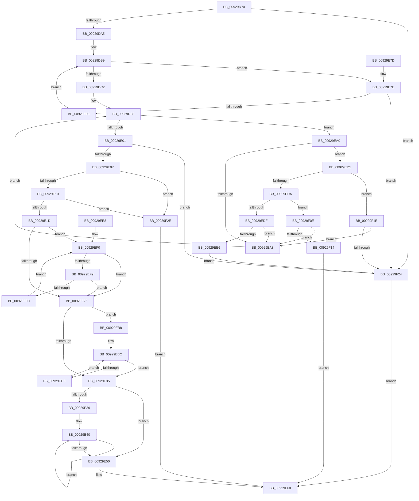

# RtlAddAce

- RVA: `0x00929D70`–`0x00929F38` (길이 `456` bytes)
- VA: `0x0000000140929D70`
- 실행 섹션: `PAGE`
- PDB 이름 있음: `예`; PDB Function 태그: `아니요`
- unwind 정보 RVA: `0x0008DA38`
- 디코드: `122`개 명령, `456/456` bytes 표시
- 미해석 바이트: `0` (있으면 어셈블리에 `.byte`로 보존)

> 이 문서는 커널 이미지의 기계어와 PDB 기호를 분석해 생성했습니다. 4번과 5번은 함수 원형과 자료형을 바이너리 사용 방식에서 추정한 C 해석이며 원본 소스 복구 결과는 아닙니다.

## 1. Dependencies

- 직접 호출 지점: **1**; 고유 호출 대상: **1**
- 직접 호출자로 확인된 함수: **6**
- RIP 상대 이미지 참조: **0**

### Outgoing calls
- `0x00929D98` → [RtlValidAcl](RtlValidAcl_function_0092A7A0.md) (function, `0x0092A7A0`)

### Direct callers
- [SepAppendAceToTokenDefaultDacl](../../text/40/SepAppendAceToTokenDefaultDacl_function_004002F8.md) at `0x00400427`
- [sub_00400840](../../text/40/Unknown_function_00400840.md) at `0x004008BB`
- [AdtpBuildAccessReasonAuditStringInternal](../../text/40/AdtpBuildAccessReasonAuditStringInternal_function_0040F344.md) at `0x0040F6E3`
- [LocalGetAclForString](LocalGetAclForString_function_00927F30.md) at `0x00928A21`
- [PiDevCfgGetKeySecurityDescriptor](../99/PiDevCfgGetKeySecurityDescriptor_function_00996240.md) at `0x009964BE`
- [sub_00B22C34](../B2/Unknown_function_00B22C34.md) at `0x00B22DAE`

### Static image references
- 디코드된 RIP-relative 메모리 참조가 없습니다.

## 2. Other-region calls and transfers

- 다른 실행 섹션으로 향하는 call: **0**
- 별도 외부 분기/꼬리 이동을 확인하지 못했습니다.

## 3. Assembly (complete function range)

```asm
00929D70  48 89 5C 24 08                  mov qword ptr [rsp + 8], rbx
00929D75  48 89 6C 24 10                  mov qword ptr [rsp + 0x10], rbp
00929D7A  48 89 74 24 18                  mov qword ptr [rsp + 0x18], rsi
00929D7F  57                              push rdi
00929D80  41 54                           push r12
00929D82  41 55                           push r13
00929D84  41 56                           push r14
00929D86  41 57                           push r15
00929D88  48 83 EC 30                     sub rsp, 0x30
00929D8C  49 8B D9                        mov rbx, r9
00929D8F  41 8B F0                        mov esi, r8d
00929D92  44 8B FA                        mov r15d, edx
00929D95  4C 8B E1                        mov r12, rcx
00929D98  E8 03 0A 00 00                  call 0x14092a7a0
00929D9D  84 C0                           test al, al
00929D9F  0F 84 7F 01 00 00               je 0x140929f24
00929DA5  41 0F B7 7C 24 04               movzx edi, word ptr [r12 + 4]
00929DAB  49 8D 44 24 08                  lea rax, [r12 + 8]
00929DB0  45 33 DB                        xor r11d, r11d
00929DB3  4C 8B C8                        mov r9, rax
00929DB6  45 8B D3                        mov r10d, r11d
00929DB9  44 3B D7                        cmp r10d, edi
00929DBC  0F 82 BC 00 00 00               jb 0x140929e7e
00929DC2  41 0F B6 0C 24                  movzx ecx, byte ptr [r12]
00929DC7  48 8B D3                        mov rdx, rbx
00929DCA  8B AC 24 80 00 00 00            mov ebp, dword ptr [rsp + 0x80]
00929DD1  45 0F B7 74 24 02               movzx r14d, word ptr [r12 + 2]
00929DD7  44 8B C5                        mov r8d, ebp
00929DDA  4D 03 F4                        add r14, r12
00929DDD  45 0F B6 EF                     movzx r13d, r15b
00929DE1  4D 3B CE                        cmp r9, r14
00929DE4  44 89 5C 24 20                  mov dword ptr [rsp + 0x20], r11d
00929DE9  4C 8D 14 2B                     lea r10, [rbx + rbp]
00929DED  4D 0F 47 CB                     cmova r9, r11
00929DF1  44 3A E9                        cmp r13b, cl
00929DF4  44 0F 46 E9                     cmovbe r13d, ecx
00929DF8  49 3B D2                        cmp rdx, r10
00929DFB  0F 82 9F 00 00 00               jb 0x140929ea0
00929E01  0F 87 1D 01 00 00               ja 0x140929f24
00929E07  4D 85 C9                        test r9, r9
00929E0A  0F 84 1E 01 00 00               je 0x140929f2e
00929E10  49 8D 0C 29                     lea rcx, [r9 + rbp]
00929E14  49 3B CE                        cmp rcx, r14
00929E17  0F 87 11 01 00 00               ja 0x140929f2e
00929E1D  85 F6                           test esi, esi
00929E1F  0F 85 CB 00 00 00               jne 0x140929ef0
00929E25  44 2B C8                        sub r9d, eax
00929E28  41 83 E9 01                     sub r9d, 1
00929E2C  4D 63 D1                        movsxd r10, r9d
00929E2F  0F 89 83 00 00 00               jns 0x140929eb8
00929E35  85 ED                           test ebp, ebp
00929E37  74 17                           je 0x140929e50
00929E39  48 2B D8                        sub rbx, rax
00929E3C  0F 1F 40 00                     nop dword ptr [rax]
00929E40  0F B6 0C 03                     movzx ecx, byte ptr [rbx + rax]
00929E44  88 08                           mov byte ptr [rax], cl
00929E46  48 8D 40 01                     lea rax, [rax + 1]
00929E4A  49 83 E8 01                     sub r8, 1
00929E4E  75 F0                           jne 0x140929e40
00929E50  8B 44 24 20                     mov eax, dword ptr [rsp + 0x20]
00929E54  66 41 01 44 24 04               add word ptr [r12 + 4], ax
00929E5A  33 C0                           xor eax, eax
00929E5C  45 88 2C 24                     mov byte ptr [r12], r13b
00929E60  48 8B 5C 24 60                  mov rbx, qword ptr [rsp + 0x60]
00929E65  48 8B 6C 24 68                  mov rbp, qword ptr [rsp + 0x68]
00929E6A  48 8B 74 24 70                  mov rsi, qword ptr [rsp + 0x70]
00929E6F  48 83 C4 30                     add rsp, 0x30
00929E73  41 5F                           pop r15
00929E75  41 5E                           pop r14
00929E77  41 5D                           pop r13
00929E79  41 5C                           pop r12
00929E7B  5F                              pop rdi
00929E7C  C3                              ret
00929E7D  CC                              int3
00929E7E  41 0F B7 4C 24 02               movzx ecx, word ptr [r12 + 2]
00929E84  49 03 CC                        add rcx, r12
00929E87  4C 3B C9                        cmp r9, rcx
00929E8A  0F 83 94 00 00 00               jae 0x140929f24
00929E90  41 0F B7 49 02                  movzx ecx, word ptr [r9 + 2]
00929E95  41 FF C2                        inc r10d
00929E98  4C 03 C9                        add r9, rcx
00929E9B  E9 19 FF FF FF                  jmp 0x140929db9
00929EA0  0F B6 0A                        movzx ecx, byte ptr [rdx]
00929EA3  80 F9 03                        cmp cl, 3
00929EA6  77 2D                           ja 0x140929ed5
00929EA8  0F B7 4A 02                     movzx ecx, word ptr [rdx + 2]
00929EAC  48 03 D1                        add rdx, rcx
00929EAF  FF 44 24 20                     inc dword ptr [rsp + 0x20]
00929EB3  E9 40 FF FF FF                  jmp 0x140929df8
00929EB8  45 8D 1C 29                     lea r11d, [r9 + rbp]
00929EBC  41 0F B6 0C 02                  movzx ecx, byte ptr [r10 + rax]
00929EC1  49 83 EA 01                     sub r10, 1
00929EC5  41 88 0C 03                     mov byte ptr [r11 + rax], cl
00929EC9  45 8D 5B FF                     lea r11d, [r11 - 1]
00929ECD  0F 88 62 FF FF FF               js 0x140929e35
00929ED3  EB E7                           jmp 0x140929ebc
00929ED5  80 F9 04                        cmp cl, 4
00929ED8  76 44                           jbe 0x140929f1e
00929EDA  80 F9 08                        cmp cl, 8
00929EDD  76 2F                           jbe 0x140929f0e
00929EDF  66 44 39 5A 02                  cmp word ptr [rdx + 2], r11w
00929EE4  75 C2                           jne 0x140929ea8
00929EE6  EB 3C                           jmp 0x140929f24
00929EE8  0F 1F 84 00 00 00 00 00         nop dword ptr [rax + rax]
00929EF0  44 3B DF                        cmp r11d, edi
00929EF3  0F 83 2C FF FF FF               jae 0x140929e25
00929EF9  0F B7 48 02                     movzx ecx, word ptr [rax + 2]
00929EFD  41 FF C3                        inc r11d
00929F00  48 03 C1                        add rax, rcx
00929F03  44 3B DE                        cmp r11d, esi
00929F06  0F 83 19 FF FF FF               jae 0x140929e25
00929F0C  EB E2                           jmp 0x140929ef0
00929F0E  41 83 FF 04                     cmp r15d, 4
00929F12  73 94                           jae 0x140929ea8
00929F14  B8 0D 00 00 C0                  mov eax, 0xc000000d
00929F19  E9 42 FF FF FF                  jmp 0x140929e60
00929F1E  41 83 FF 03                     cmp r15d, 3
00929F22  73 84                           jae 0x140929ea8
00929F24  B8 0D 00 00 C0                  mov eax, 0xc000000d
00929F29  E9 32 FF FF FF                  jmp 0x140929e60
00929F2E  B8 23 00 00 C0                  mov eax, 0xc0000023
00929F33  E9 28 FF FF FF                  jmp 0x140929e60
```

## 4. C-style interpretation (structured pseudocode)

```c
__int64 __fastcall RtlAddAce(__int64 a1, int a2, int a3, __int64 a4, unsigned int a5)
{
    __int64 result;
    __int64 v_r10;
    __int64 v_r11;
    __int64 v_r13;
    __int64 v_r14;
    __int64 v_rbx;
    __int64 v_rsp;
    unsigned int v_stack_m38;
    unsigned __int64 v_stack_p10;
    unsigned __int64 v_stack_p18;
    unsigned int v_stack_p20;
    unsigned __int64 v_stack_p8;

    v_stack_p8 = v_rbx;
    v_stack_p10 = v_rbp;
    v_stack_p18 = v_rsi;
    v_rsp = (v_rsp) - (48);
    result = RtlValidAcl(a1, a2, a3, a4);
    if ((unsigned __int8)(result) == 0) goto loc_00929F24;
    v_r11 = 0;
loc_00929DB9:
    if (0 < ((unsigned int)(*(unsigned __int16 *)(a1 + 4)))) goto loc_00929E7E;
    v_r14 = (*(unsigned __int16 *)(a1 + 2)) + (a1);
    v_stack_m38 = 0;
    a4 = a1 + 8;
    if ((a1 + 8) > v_r14) { a4 = 0; }
    v_r13 = (unsigned __int8)((unsigned int)(a2));
    if (((unsigned __int8)((unsigned __int8)((unsigned int)(a2)))) <= ((unsigned __int8)(*(unsigned __int8 *)(a1)))) { v_r13 = (unsigned int)(*(unsigned __int8 *)(a1)); }
loc_00929DF8:
    if (a4 < (a4 + (unsigned int)(a5) * 1)) goto loc_00929EA0;
    if (a4 > (a4 + (unsigned int)(a5) * 1)) goto loc_00929F24;
    if (a4 == 0) goto loc_00929F2E;
    if ((a4 + (unsigned int)(a5) * 1) > v_r14) goto loc_00929F2E;
    if ((unsigned int)((unsigned int)(a3)) != 0) goto loc_00929EF0;
loc_00929E25:
    a4 = (unsigned int)((a4) - ((unsigned int)(a1 + 8)));
    a4 = (unsigned int)((a4) - (1));
    if (!sign_flag) goto loc_00929EB8;
loc_00929E35:
    if ((unsigned int)((unsigned int)(a5)) == 0) goto loc_00929E50;
    v_rbx = (a4) - (a1 + 8);
loc_00929E40:
    *(unsigned __int8 *)(a1 + 8) = (unsigned __int8)(*(unsigned __int8 *)(v_rbx + a1 + 8 * 1));
    a3 = ((unsigned int)((unsigned int)((unsigned int)(a5)))) - (1);
    if (condition_is_not_equal) goto loc_00929E40;
loc_00929E50:
    result = 0;
    *(unsigned __int8 *)(a1) = (unsigned __int8)(v_r13);
loc_00929E60:
    v_rsp = (v_rsp) + (48);
    return result;
loc_00929E7E:
    a1 = (*(unsigned __int16 *)(a1 + 2)) + (a1);
    if (a4 >= a1) goto loc_00929F24;
    v_r10 = (unsigned int)(((int)((unsigned int)(a4))) + 1);
    a4 = (a4) + (*(unsigned __int16 *)(a4 + 2));
    goto loc_00929DB9;
loc_00929EA0:
    if (((unsigned __int8)(*(unsigned __int8 *)(a4))) > 3) goto loc_00929ED5;
loc_00929EA8:
    a2 = (a4) + (*(unsigned __int16 *)(a4 + 2));
    goto loc_00929DF8;
loc_00929EB8:
loc_00929EBC:
    v_r10 = (v_r10) - (1);
    *(unsigned __int8 *)(a4 + v_stack_p10 * 1 + result * 1) = (unsigned __int8)(*(unsigned __int8 *)(v_r10 + result * 1));
    if (sign_flag) goto loc_00929E35;
    goto loc_00929EBC;
loc_00929ED5:
    if (((unsigned __int8)(*(unsigned __int8 *)(v_r10 + result * 1))) <= 4) goto loc_00929F1E;
    if (((unsigned __int8)(*(unsigned __int8 *)(v_r10 + result * 1))) <= 8) goto loc_00929F0E;
    if ((*(unsigned __int16 *)(a2 + 2)) != ((unsigned __int16)(a4 + v_stack_p10 * 1 - 1))) goto loc_00929EA8;
    goto loc_00929F24;
loc_00929EF0:
    if (((unsigned int)(a4 + v_stack_p10 * 1 - 1)) >= ((unsigned int)(*(unsigned __int16 *)(a1 + 4)))) goto loc_00929E25;
    v_r11 = (unsigned int)((a4 + v_stack_p10 * 1 - 1) + 1);
    result = (result) + (*(unsigned __int16 *)(result + 2));
    if (((unsigned int)(v_r11)) >= ((unsigned int)(v_stack_p18))) goto loc_00929E25;
    goto loc_00929EF0;
loc_00929F0E:
    if (((unsigned int)((unsigned int)(a2))) >= 4) goto loc_00929EA8;
    goto loc_00929E60;
loc_00929F1E:
    if (((unsigned int)((unsigned int)(a2))) >= 3) goto loc_00929EA8;
loc_00929F24:
    goto loc_00929E60;
loc_00929F2E:
    goto loc_00929E60;
}
```

## 5. (Beta) C Style

```c
int64_t RtlAddAce(void *Arg1, int32_t Arg2, int32_t Arg3, void *Arg4, uint32_t Arg5)
{
    uint8_t *arg1 = (uint8_t *)Arg1;
    uint8_t *arg4 = (uint8_t *)Arg4;

    int64_t result;
    int64_t local_r10;
    int64_t local_r11;
    int64_t local_r13;
    int64_t local_r14;
    int64_t local_rbx;
    int64_t local_rsp;
    uint32_t v_stack_m38;
    uint64_t v_stack_p10;
    uint64_t v_stack_p18;
    uint32_t v_stack_p20;
    uint64_t v_stack_p8;

    v_stack_p8 = local_rbx;
    v_stack_p10 = local_rbp;
    v_stack_p18 = local_rsi;
    local_rsp = (local_rsp) - (48);
    result = RtlValidAcl(Arg1, Arg2, Arg3, Arg4);
    if ((uint8_t)(result) == 0) goto loc_00929F24;
    local_r11 = 0;
loc_00929DB9:
    if (0 < ((uint32_t)(*(uint16_t *)(arg1 + 0x4)))) goto loc_00929E7E;
    local_r14 = (*(uint16_t *)(arg1 + 0x2)) + (Arg1);
    v_stack_m38 = 0;
    Arg4 = Arg1 + 8;
    if ((Arg1 + 8) > local_r14) { Arg4 = 0; }
    local_r13 = (uint8_t)((uint32_t)(Arg2));
    if (((uint8_t)((uint8_t)((uint32_t)(Arg2)))) <= ((uint8_t)(*(uint8_t *)(arg1)))) { local_r13 = (uint32_t)(*(uint8_t *)(arg1)); }
loc_00929DF8:
    if (Arg4 < (Arg4 + (uint32_t)(Arg5) * 1)) goto loc_00929EA0;
    if (Arg4 > (Arg4 + (uint32_t)(Arg5) * 1)) goto loc_00929F24;
    if (Arg4 == NULL) goto loc_00929F2E;
    if ((Arg4 + (uint32_t)(Arg5) * 1) > local_r14) goto loc_00929F2E;
    if ((uint32_t)((uint32_t)(Arg3)) != 0) goto loc_00929EF0;
loc_00929E25:
    Arg4 = (uint32_t)((Arg4) - ((uint32_t)(Arg1 + 8)));
    Arg4 = (uint32_t)((Arg4) - (1));
    if (!sign_flag) goto loc_00929EB8;
loc_00929E35:
    if ((uint32_t)((uint32_t)(Arg5)) == 0) goto loc_00929E50;
    local_rbx = (Arg4) - (Arg1 + 8);
loc_00929E40:
    *(uint8_t *)(arg1 + 0x8) = (uint8_t)(*(uint8_t *)(local_rbx + arg1 + 0x8 * 1));
    Arg3 = ((uint32_t)((uint32_t)((uint32_t)(Arg5)))) - (1);
    if (condition_is_not_equal) goto loc_00929E40;
loc_00929E50:
    result = 0;
    *(uint8_t *)(arg1) = (uint8_t)(local_r13);
loc_00929E60:
    local_rsp = (local_rsp) + (48);
    return result;
loc_00929E7E:
    Arg1 = (*(uint16_t *)(arg1 + 0x2)) + (Arg1);
    if (Arg4 >= Arg1) goto loc_00929F24;
    local_r10 = (uint32_t)(((int32_t)((uint32_t)(Arg4))) + 1);
    Arg4 = (Arg4) + (*(uint16_t *)(arg4 + 0x2));
    goto loc_00929DB9;
loc_00929EA0:
    if (((uint8_t)(*(uint8_t *)(arg4))) > 3) goto loc_00929ED5;
loc_00929EA8:
    Arg2 = (Arg4) + (*(uint16_t *)(arg4 + 0x2));
    goto loc_00929DF8;
loc_00929EB8:
loc_00929EBC:
    local_r10 = (local_r10) - (1);
    *(uint8_t *)(arg4 + v_stack_p10 * 1 + result * 1) = (uint8_t)(*(uint8_t *)(local_r10 + result * 1));
    if (sign_flag) goto loc_00929E35;
    goto loc_00929EBC;
loc_00929ED5:
    if (((uint8_t)(*(uint8_t *)(local_r10 + result * 1))) <= 4) goto loc_00929F1E;
    if (((uint8_t)(*(uint8_t *)(local_r10 + result * 1))) <= 8) goto loc_00929F0E;
    if ((*(uint16_t *)(Arg2 + 0x2)) != ((uint16_t)(Arg4 + v_stack_p10 * 1 - 1))) goto loc_00929EA8;
    goto loc_00929F24;
loc_00929EF0:
    if (((uint32_t)(Arg4 + v_stack_p10 * 1 - 1)) >= ((uint32_t)(*(uint16_t *)(arg1 + 0x4)))) goto loc_00929E25;
    local_r11 = (uint32_t)((Arg4 + v_stack_p10 * 1 - 1) + 1);
    result = (result) + (*(uint16_t *)(result + 0x2));
    if (((uint32_t)(local_r11)) >= ((uint32_t)(v_stack_p18))) goto loc_00929E25;
    goto loc_00929EF0;
loc_00929F0E:
    if (((uint32_t)((uint32_t)(Arg2))) >= 4) goto loc_00929EA8;
    goto loc_00929E60;
loc_00929F1E:
    if (((uint32_t)((uint32_t)(Arg2))) >= 3) goto loc_00929EA8;
loc_00929F24:
    goto loc_00929E60;
loc_00929F2E:
    goto loc_00929E60;
}
```

### 관측된 메모리 오프셋

구조체 형식이 확인되지 않은 접근은 인자 기준의 오프셋으로만 기록했습니다.

| 기준 인자 | 오프셋 표현 | 폭 (bit) | 접근 |
|---|---:|---:|---|
| `Arg1` | `+ 0x0` | `8` | `R` |
| `Arg1` | `+ 0x0` | `8` | `W` |
| `Arg1` | `+ 0x0` | `32` | `R` |
| `Arg1` | `+ 0x1` | `64` | `R` |
| `Arg1` | `+ 0x2` | `16` | `R` |
| `Arg1` | `+ 0x4` | `16` | `R` |
| `Arg1` | `+ 0x4` | `16` | `R/W` |
| `Arg1` | `+ 0x8` | `64` | `R` |
| `Arg4` | `+ 0x0 + rax*1` | `8` | `R` |
| `Arg4` | `+ 0x0 + rbp*1` | `64` | `R` |

## 6. Execution-region graph

[열기: 2D/3D 그래프와 함수 탐색 컨트롤 패널](../../../control-panel.html?section=page&rva=0x00929D70&view=graph)

- 2D 그래프는 위에서 아래로 흐르고, 3D 그래프는 빈 공간을 드래그해 회전합니다. Shift+드래그는 이동, 휠은 확대·축소, 함수 노드 선택은 대상 보고서 이동입니다.

### Static fallback


