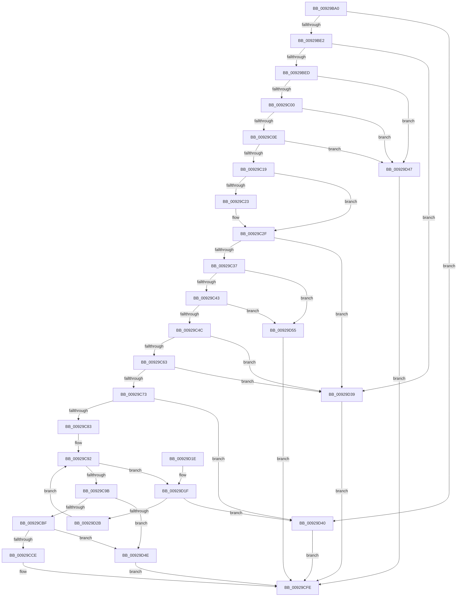

# RtlAddMandatoryAce

- RVA: `0x00929BA0`–`0x00929D5C` (길이 `444` bytes)
- VA: `0x0000000140929BA0`
- 실행 섹션: `PAGE`
- PDB 이름 있음: `예`; PDB Function 태그: `아니요`
- unwind 정보 RVA: `0x0008DA18`
- 디코드: `113`개 명령, `444/444` bytes 표시
- 미해석 바이트: `0` (있으면 어셈블리에 `.byte`로 보존)

> 이 문서는 커널 이미지의 기계어와 PDB 기호를 분석해 생성했습니다. 4번과 5번은 함수 원형과 자료형을 바이너리 사용 방식에서 추정한 C 해석이며 원본 소스 복구 결과는 아닙니다.

## 1. Dependencies

- 직접 호출 지점: **3**; 고유 호출 대상: **3**
- 직접 호출자로 확인된 함수: **6**
- RIP 상대 이미지 참조: **1**

### Outgoing calls
- `0x00929C76` → [RtlValidAcl](RtlValidAcl_function_0092A7A0.md) (function, `0x0092A7A0`)
- `0x00929CF0` → [memcpy](../../text/6C/memcpy_function_006C6840.md) (function, `0x006C6840`)
- `0x00929D06` → [_security_check_cookie](../../text/6A/_security_check_cookie_function_006AC640.md) (function, `0x006AC640`)

### Direct callers
- [CmpGenerateAppHiveSecurityDescriptor](../7E/CmpGenerateAppHiveSecurityDescriptor_function_007ECEAC.md) at `0x007ED056`
- [ObpVerifyAccessToBoundaryEntry](../A5/ObpVerifyAccessToBoundaryEntry_function_00A5E500.md) at `0x00A5E5F1`
- [IopCreateSecurityDescriptorPerType](../AD/IopCreateSecurityDescriptorPerType_function_00ADCC6C.md) at `0x00ADCD74`
- [sub_00B3E006](../B3/Unknown_function_00B3E006.md) at `0x00B3E04D`
- [SepInitSystemDacls](../../init/C4/SepInitSystemDacls_function_00C478DC.md) at `0x00C48057`
- [ExpKeyedEventInitialization](../../init/C5/ExpKeyedEventInitialization_function_00C5460C.md) at `0x00C5485C`

### Static image references
- `0x00929BB2` → RVA `0x00E0A740` (`.data`; read)

## 2. Other-region calls and transfers

- 다른 실행 섹션으로 향하는 call: **2**
  - `0x00929CF0` → [memcpy](../../text/6C/memcpy_function_006C6840.md) (`PAGE` → `.text`)
  - `0x00929D06` → [_security_check_cookie](../../text/6A/_security_check_cookie_function_006AC640.md) (`PAGE` → `.text`)
- 별도 외부 분기/꼬리 이동을 확인하지 못했습니다.

## 3. Assembly (complete function range)

```asm
00929BA0  48 89 5C 24 10                  mov qword ptr [rsp + 0x10], rbx
00929BA5  48 89 6C 24 18                  mov qword ptr [rsp + 0x18], rbp
00929BAA  56                              push rsi
00929BAB  57                              push rdi
00929BAC  41 56                           push r14
00929BAE  48 83 EC 30                     sub rsp, 0x30
00929BB2  48 8B 05 87 0B 4E 00            mov rax, qword ptr [rip + 0x4e0b87]
00929BB9  48 33 C4                        xor rax, rsp
00929BBC  48 89 44 24 28                  mov qword ptr [rsp + 0x28], rax
00929BC1  C7 44 24 20 00 00 00 00         mov dword ptr [rsp + 0x20], 0
00929BC9  49 8B F9                        mov rdi, r9
00929BCC  66 C7 44 24 24 00 10            mov word ptr [rsp + 0x24], 0x1000
00929BD3  45 8B F0                        mov r14d, r8d
00929BD6  48 8B D9                        mov rbx, rcx
00929BD9  48 85 C9                        test rcx, rcx
00929BDC  0F 84 5E 01 00 00               je 0x140929d40
00929BE2  80 7C 24 70 11                  cmp byte ptr [rsp + 0x70], 0x11
00929BE7  0F 85 4C 01 00 00               jne 0x140929d39
00929BED  48 B8 00 00 FF FF FF 7F 00 00   movabs rax, 0x7fffffff0000
00929BF7  4C 3B C8                        cmp r9, rax
00929BFA  0F 86 47 01 00 00               jbe 0x140929d47
00929C00  41 0F B6 01                     movzx eax, byte ptr [r9]
00929C04  24 0F                           and al, 0xf
00929C06  3C 01                           cmp al, 1
00929C08  0F 85 39 01 00 00               jne 0x140929d47
00929C0E  41 80 79 01 0F                  cmp byte ptr [r9 + 1], 0xf
00929C13  0F 87 2E 01 00 00               ja 0x140929d47
00929C19  41 8B 49 02                     mov ecx, dword ptr [r9 + 2]
00929C1D  2B 4C 24 20                     sub ecx, dword ptr [rsp + 0x20]
00929C21  75 0C                           jne 0x140929c2f
00929C23  41 0F B7 49 06                  movzx ecx, word ptr [r9 + 6]
00929C28  0F B7 44 24 24                  movzx eax, word ptr [rsp + 0x24]
00929C2D  2B C8                           sub ecx, eax
00929C2F  85 C9                           test ecx, ecx
00929C31  0F 85 02 01 00 00               jne 0x140929d39
00929C37  0F B6 0B                        movzx ecx, byte ptr [rbx]
00929C3A  80 F9 04                        cmp cl, 4
00929C3D  0F 87 12 01 00 00               ja 0x140929d55
00929C43  83 FA 04                        cmp edx, 4
00929C46  0F 87 09 01 00 00               ja 0x140929d55
00929C4C  0F B6 C2                        movzx eax, dl
00929C4F  8B F1                           mov esi, ecx
00929C51  3A C8                           cmp cl, al
00929C53  0F 46 F0                        cmovbe esi, eax
00929C56  41 F7 C6 E0 FF FF FF            test r14d, 0xffffffe0
00929C5D  0F 85 D6 00 00 00               jne 0x140929d39
00929C63  8B 6C 24 78                     mov ebp, dword ptr [rsp + 0x78]
00929C67  F7 C5 F8 FF FF FF               test ebp, 0xfffffff8
00929C6D  0F 85 C6 00 00 00               jne 0x140929d39
00929C73  48 8B CB                        mov rcx, rbx
00929C76  E8 25 0B 00 00                  call 0x14092a7a0
00929C7B  84 C0                           test al, al
00929C7D  0F 84 BD 00 00 00               je 0x140929d40
00929C83  44 0F B7 43 04                  movzx r8d, word ptr [rbx + 4]
00929C88  48 8D 4B 08                     lea rcx, [rbx + 8]
00929C8C  45 33 C9                        xor r9d, r9d
00929C8F  41 8B D1                        mov edx, r9d
00929C92  41 3B D0                        cmp edx, r8d
00929C95  0F 82 84 00 00 00               jb 0x140929d1f
00929C9B  44 0F B7 43 02                  movzx r8d, word ptr [rbx + 2]
00929CA0  0F B6 57 01                     movzx edx, byte ptr [rdi + 1]
00929CA4  4C 03 C3                        add r8, rbx
00929CA7  49 3B C8                        cmp rcx, r8
00929CAA  49 0F 47 C9                     cmova rcx, r9
00929CAE  66 83 C2 04                     add dx, 4
00929CB2  66 C1 E2 02                     shl dx, 2
00929CB6  48 85 C9                        test rcx, rcx
00929CB9  0F 84 8F 00 00 00               je 0x140929d4e
00929CBF  0F B7 C2                        movzx eax, dx
00929CC2  48 03 C1                        add rax, rcx
00929CC5  49 3B C0                        cmp rax, r8
00929CC8  0F 87 80 00 00 00               ja 0x140929d4e
00929CCE  66 89 51 02                     mov word ptr [rcx + 2], dx
00929CD2  48 8B D7                        mov rdx, rdi
00929CD5  44 88 71 01                     mov byte ptr [rcx + 1], r14b
00929CD9  C6 01 11                        mov byte ptr [rcx], 0x11
00929CDC  89 69 04                        mov dword ptr [rcx + 4], ebp
00929CDF  48 83 C1 08                     add rcx, 8
00929CE3  44 0F B6 47 01                  movzx r8d, byte ptr [rdi + 1]
00929CE8  4E 8D 04 85 08 00 00 00         lea r8, [r8*4 + 8]
00929CF0  E8 4B CB D9 FF                  call 0x1406c6840
00929CF5  66 FF 43 04                     inc word ptr [rbx + 4]
00929CF9  33 C0                           xor eax, eax
00929CFB  40 88 33                        mov byte ptr [rbx], sil
00929CFE  48 8B 4C 24 28                  mov rcx, qword ptr [rsp + 0x28]
00929D03  48 33 CC                        xor rcx, rsp
00929D06  E8 35 29 D8 FF                  call 0x1406ac640
00929D0B  48 8B 5C 24 58                  mov rbx, qword ptr [rsp + 0x58]
00929D10  48 8B 6C 24 60                  mov rbp, qword ptr [rsp + 0x60]
00929D15  48 83 C4 30                     add rsp, 0x30
00929D19  41 5E                           pop r14
00929D1B  5F                              pop rdi
00929D1C  5E                              pop rsi
00929D1D  C3                              ret
00929D1E  CC                              int3
00929D1F  0F B7 43 02                     movzx eax, word ptr [rbx + 2]
00929D23  48 03 C3                        add rax, rbx
00929D26  48 3B C8                        cmp rcx, rax
00929D29  73 15                           jae 0x140929d40
00929D2B  0F B7 41 02                     movzx eax, word ptr [rcx + 2]
00929D2F  FF C2                           inc edx
00929D31  48 03 C8                        add rcx, rax
00929D34  E9 59 FF FF FF                  jmp 0x140929c92
00929D39  B8 0D 00 00 C0                  mov eax, 0xc000000d
00929D3E  EB BE                           jmp 0x140929cfe
00929D40  B8 77 00 00 C0                  mov eax, 0xc0000077
00929D45  EB B7                           jmp 0x140929cfe
00929D47  B8 78 00 00 C0                  mov eax, 0xc0000078
00929D4C  EB B0                           jmp 0x140929cfe
00929D4E  B8 99 00 00 C0                  mov eax, 0xc0000099
00929D53  EB A9                           jmp 0x140929cfe
00929D55  B8 59 00 00 C0                  mov eax, 0xc0000059
00929D5A  EB A2                           jmp 0x140929cfe
```

## 4. C-style interpretation (structured pseudocode)

```c
__int64 __fastcall RtlAddMandatoryAce(__int64 a1, int a2, int a3, __int64 a4, unsigned __int8 a5, unsigned int a6)
{
    __int64 result;
    __int64 v_rsi;
    __int64 v_rsp;
    unsigned __int64 v_stack_m20;
    unsigned __int16 v_stack_m24;
    unsigned int v_stack_m28;
    unsigned __int64 v_stack_p10;
    unsigned __int64 v_stack_p18;

    v_stack_p10 = v_rbx;
    v_stack_p18 = v_rbp;
    v_rsp = (v_rsp) - (48);
    result = (*(unsigned __int64 *)(v_rip + 5114759)) ^ (v_rsp);
    v_stack_m20 = result;
    v_stack_m28 = 0;
    v_stack_m24 = 0x1000ULL;
    if (a1 == 0) goto loc_00929D40;
    if (a5 != 17) goto loc_00929D39;
    if (a4 <= result) goto loc_00929D47;
    result = (unsigned __int8)((*(unsigned __int8 *)(a4)) & (15));
    if (((unsigned __int8)(result)) != 1) goto loc_00929D47;
    if ((*(unsigned __int8 *)(a4 + 1)) > 15) goto loc_00929D47;
    a1 = (unsigned int)(((unsigned int)(*(unsigned int *)(a4 + 2))) - (v_stack_m28));
    if (!(condition_is_not_equal)) {
        a1 = *(unsigned __int16 *)(a4 + 6);
        result = v_stack_m24;
        a1 = (unsigned int)((a1) - ((unsigned int)(result)));
    }
    if ((unsigned int)(a1) != 0) goto loc_00929D39;
    if (((unsigned __int8)(*(unsigned __int8 *)(a1))) > 4) goto loc_00929D55;
    if (a2 > 4) goto loc_00929D55;
    v_rsi = (unsigned int)((unsigned int)(*(unsigned __int8 *)(a1)));
    if (((unsigned __int8)(*(unsigned __int8 *)(a1))) <= ((unsigned __int8)((unsigned __int8)(a2)))) { v_rsi = (unsigned int)((unsigned __int8)(a2)); }
    if ((((unsigned int)((unsigned int)(a3))) & (0xFFFFFFE0ULL)) != 0) goto loc_00929D39;
    if ((((unsigned int)((unsigned int)(a6))) & (0xFFFFFFF8ULL)) != 0) goto loc_00929D39;
    result = RtlValidAcl(a1, a2, a3, a4);
    if ((unsigned __int8)(result) == 0) goto loc_00929D40;
    a4 = 0;
loc_00929C92:
    if (0 < ((unsigned int)(*(unsigned __int16 *)(a1 + 4)))) goto loc_00929D1F;
    a3 = (*(unsigned __int16 *)(a1 + 2)) + (a1);
    a1 = a1 + 8;
    if ((a1 + 8) > a3) { a1 = 0; }
    a2 = (unsigned __int16)((*(unsigned __int8 *)(a4 + 1)) + (4));
    a2 = (unsigned __int16)((a2) << (2));
    if (a1 == 0) goto loc_00929D4E;
    result = ((unsigned __int16)(a2)) + (a1);
    if (result > a3) goto loc_00929D4E;
    *(unsigned __int16 *)(a1 + 2) = (unsigned __int16)(a2);
    *(unsigned __int8 *)(a1 + 1) = (unsigned __int8)((unsigned int)(a3));
    *(unsigned __int8 *)(a1) = 17;
    *(unsigned int *)(a1 + 4) = (unsigned int)((unsigned int)(a6));
    a1 = (a1) + (8);
    result = memcpy(a1, 0, *(unsigned __int8 *)(a4 + 1) * 4 + 8, a4);
    result = 0;
    *(unsigned __int8 *)(a1) = (unsigned __int8)(v_rsi);
loc_00929CFE:
    a1 = (v_stack_m20) ^ (v_rsp);
    result = _security_check_cookie(a1, 0, *(unsigned __int8 *)(a4 + 1) * 4 + 8, a4);
    v_rsp = (v_rsp) + (48);
    return result;
loc_00929D1F:
    result = (*(unsigned __int16 *)(v_stack_p10 + 2)) + (v_stack_p10);
    if (a1 >= result) goto loc_00929D40;
    a2 = (unsigned int)((0) + 1);
    a1 = (a1) + (*(unsigned __int16 *)(a1 + 2));
    goto loc_00929C92;
loc_00929D39:
    goto loc_00929CFE;
loc_00929D40:
    goto loc_00929CFE;
loc_00929D47:
    goto loc_00929CFE;
loc_00929D4E:
    goto loc_00929CFE;
loc_00929D55:
    goto loc_00929CFE;
}
```

## 5. (Beta) C Style

```c
int64_t RtlAddMandatoryAce(void *Arg1, int32_t Arg2, int32_t Arg3, void *Arg4, uint8_t Arg5, uint32_t Arg6)
{
    uint8_t *arg1 = (uint8_t *)Arg1;
    uint8_t *arg4 = (uint8_t *)Arg4;

    int64_t result;
    int64_t local_rsi;
    int64_t local_rsp;
    uint64_t v_stack_m20;
    uint16_t v_stack_m24;
    uint32_t v_stack_m28;
    uint64_t v_stack_p10;
    uint64_t v_stack_p18;

    v_stack_p10 = local_rbx;
    v_stack_p18 = local_rbp;
    local_rsp = (local_rsp) - (48);
    result = (*(uint64_t *)(v_rip + 0x4E0B87)) ^ (local_rsp);
    v_stack_m20 = result;
    v_stack_m28 = 0;
    v_stack_m24 = 0x1000ULL;
    if (Arg1 == NULL) goto loc_00929D40;
    if (Arg5 != 17) goto loc_00929D39;
    if (Arg4 <= result) goto loc_00929D47;
    result = (uint8_t)((*(uint8_t *)(arg4)) & (15));
    if (((uint8_t)(result)) != 1) goto loc_00929D47;
    if ((*(uint8_t *)(arg4 + 0x1)) > 15) goto loc_00929D47;
    Arg1 = (uint32_t)(((uint32_t)(*(uint32_t *)(arg4 + 0x2))) - (v_stack_m28));
    if (!(condition_is_not_equal)) {
        Arg1 = *(uint16_t *)(arg4 + 0x6);
        result = v_stack_m24;
        Arg1 = (uint32_t)((Arg1) - ((uint32_t)(result)));
    }
    if ((uint32_t)(Arg1) != 0) goto loc_00929D39;
    if (((uint8_t)(*(uint8_t *)(arg1))) > 4) goto loc_00929D55;
    if (Arg2 > 4) goto loc_00929D55;
    local_rsi = (uint32_t)((uint32_t)(*(uint8_t *)(arg1)));
    if (((uint8_t)(*(uint8_t *)(arg1))) <= ((uint8_t)((uint8_t)(Arg2)))) { local_rsi = (uint32_t)((uint8_t)(Arg2)); }
    if ((((uint32_t)((uint32_t)(Arg3))) & (0xFFFFFFE0ULL)) != 0) goto loc_00929D39;
    if ((((uint32_t)((uint32_t)(Arg6))) & (0xFFFFFFF8ULL)) != 0) goto loc_00929D39;
    result = RtlValidAcl(Arg1, Arg2, Arg3, Arg4);
    if ((uint8_t)(result) == 0) goto loc_00929D40;
    Arg4 = 0;
loc_00929C92:
    if (0 < ((uint32_t)(*(uint16_t *)(arg1 + 0x4)))) goto loc_00929D1F;
    Arg3 = (*(uint16_t *)(arg1 + 0x2)) + (Arg1);
    Arg1 = Arg1 + 8;
    if ((Arg1 + 8) > Arg3) { Arg1 = 0; }
    Arg2 = (uint16_t)((*(uint8_t *)(arg4 + 0x1)) + (4));
    Arg2 = (uint16_t)((Arg2) << (2));
    if (Arg1 == NULL) goto loc_00929D4E;
    result = ((uint16_t)(Arg2)) + (Arg1);
    if (result > Arg3) goto loc_00929D4E;
    *(uint16_t *)(arg1 + 0x2) = (uint16_t)(Arg2);
    *(uint8_t *)(arg1 + 0x1) = (uint8_t)((uint32_t)(Arg3));
    *(uint8_t *)(arg1) = 17;
    *(uint32_t *)(arg1 + 0x4) = (uint32_t)((uint32_t)(Arg6));
    Arg1 = (Arg1) + (8);
    result = memcpy(Arg1, 0, *(uint8_t *)(arg4 + 0x1) * 4 + 8, Arg4);
    result = 0;
    *(uint8_t *)(arg1) = (uint8_t)(local_rsi);
loc_00929CFE:
    Arg1 = (v_stack_m20) ^ (local_rsp);
    result = _security_check_cookie(Arg1, 0, *(uint8_t *)(arg4 + 0x1) * 4 + 8, Arg4);
    local_rsp = (local_rsp) + (48);
    return result;
loc_00929D1F:
    result = (*(uint16_t *)(v_stack_p10 + 0x2)) + (v_stack_p10);
    if (Arg1 >= result) goto loc_00929D40;
    Arg2 = (uint32_t)((0) + 1);
    Arg1 = (Arg1) + (*(uint16_t *)(arg1 + 0x2));
    goto loc_00929C92;
loc_00929D39:
    goto loc_00929CFE;
loc_00929D40:
    goto loc_00929CFE;
loc_00929D47:
    goto loc_00929CFE;
loc_00929D4E:
    goto loc_00929CFE;
loc_00929D55:
    goto loc_00929CFE;
}
```

### 관측된 메모리 오프셋

구조체 형식이 확인되지 않은 접근은 인자 기준의 오프셋으로만 기록했습니다.

| 기준 인자 | 오프셋 표현 | 폭 (bit) | 접근 |
|---|---:|---:|---|
| `Arg1` | `+ 0x0` | `8` | `R` |
| `Arg1` | `+ 0x0` | `8` | `W` |
| `Arg1` | `+ 0x2` | `16` | `R` |
| `Arg1` | `+ 0x4` | `16` | `R` |
| `Arg1` | `+ 0x4` | `16` | `R/W` |
| `Arg1` | `+ 0x8` | `64` | `R` |
| `Arg4` | `+ 0x1` | `8` | `R` |

## 6. Execution-region graph

[열기: 2D/3D 그래프와 함수 탐색 컨트롤 패널](../../../control-panel.html?section=page&rva=0x00929BA0&view=graph)

- 2D 그래프는 위에서 아래로 흐르고, 3D 그래프는 빈 공간을 드래그해 회전합니다. Shift+드래그는 이동, 휠은 확대·축소, 함수 노드 선택은 대상 보고서 이동입니다.

### Static fallback


