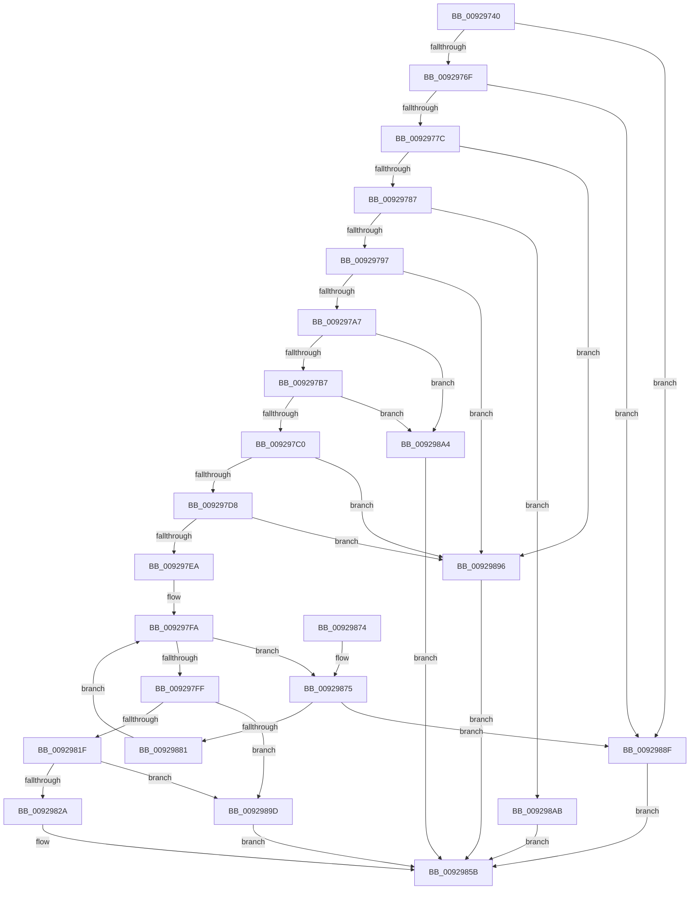

# RtlAddProcessTrustLabelAce

- RVA: `0x00929740`–`0x009298B2` (길이 `370` bytes)
- VA: `0x0000000140929740`
- 실행 섹션: `PAGE`
- PDB 이름 있음: `예`; PDB Function 태그: `아니요`
- unwind 정보 RVA: `0x0008D8C0`
- 디코드: `100`개 명령, `370/370` bytes 표시
- 미해석 바이트: `0` (있으면 어셈블리에 `.byte`로 보존)

> 이 문서는 커널 이미지의 기계어와 PDB 기호를 분석해 생성했습니다. 4번과 5번은 함수 원형과 자료형을 바이너리 사용 방식에서 추정한 C 해석이며 원본 소스 복구 결과는 아닙니다.

## 1. Dependencies

- 직접 호출 지점: **4**; 고유 호출 대상: **4**
- 직접 호출자로 확인된 함수: **3**
- RIP 상대 이미지 참조: **0**

### Outgoing calls
- `0x0092976F` → [RtlValidAcl](RtlValidAcl_function_0092A7A0.md) (function, `0x0092A7A0`)
- `0x0092978A` → [RtlValidSid](RtlValidSid_function_00929710.md) (function, `0x00929710`)
- `0x0092979A` → [RtlIsValidProcessTrustLabelSid](../../text/3E/RtlIsValidProcessTrustLabelSid_function_003EE070.md) (function, `0x003EE070`)
- `0x0092984D` → [memcpy](../../text/6C/memcpy_function_006C6840.md) (function, `0x006C6840`)

### Direct callers
- [sub_00400840](../../text/40/Unknown_function_00400840.md) at `0x004008E0`
- [RtlpNewSecurityObject](RtlpNewSecurityObject_function_0092AB50.md) at `0x0092C8CD`
- [SeMakeSystemToken](../../init/C4/SeMakeSystemToken_function_00C4ADBC.md) at `0x00C4B1D7`

### Static image references
- 디코드된 RIP-relative 메모리 참조가 없습니다.

## 2. Other-region calls and transfers

- 다른 실행 섹션으로 향하는 call: **2**
  - `0x0092979A` → [RtlIsValidProcessTrustLabelSid](../../text/3E/RtlIsValidProcessTrustLabelSid_function_003EE070.md) (`PAGE` → `.text`)
  - `0x0092984D` → [memcpy](../../text/6C/memcpy_function_006C6840.md) (`PAGE` → `.text`)
- 별도 외부 분기/꼬리 이동을 확인하지 못했습니다.

## 3. Assembly (complete function range)

```asm
00929740  48 89 5C 24 08                  mov qword ptr [rsp + 8], rbx
00929745  48 89 6C 24 10                  mov qword ptr [rsp + 0x10], rbp
0092974A  48 89 74 24 18                  mov qword ptr [rsp + 0x18], rsi
0092974F  57                              push rdi
00929750  41 56                           push r14
00929752  41 57                           push r15
00929754  48 83 EC 20                     sub rsp, 0x20
00929758  45 33 FF                        xor r15d, r15d
0092975B  49 8B F9                        mov rdi, r9
0092975E  45 8B F0                        mov r14d, r8d
00929761  8B F2                           mov esi, edx
00929763  48 8B D9                        mov rbx, rcx
00929766  48 85 C9                        test rcx, rcx
00929769  0F 84 20 01 00 00               je 0x14092988f
0092976F  E8 2C 10 00 00                  call 0x14092a7a0
00929774  84 C0                           test al, al
00929776  0F 84 13 01 00 00               je 0x14092988f
0092977C  80 7C 24 60 14                  cmp byte ptr [rsp + 0x60], 0x14
00929781  0F 85 0F 01 00 00               jne 0x140929896
00929787  48 8B CF                        mov rcx, rdi
0092978A  E8 81 FF FF FF                  call 0x140929710
0092978F  84 C0                           test al, al
00929791  0F 84 14 01 00 00               je 0x1409298ab
00929797  48 8B CF                        mov rcx, rdi
0092979A  E8 D1 48 AC FF                  call 0x1403ee070
0092979F  84 C0                           test al, al
009297A1  0F 84 EF 00 00 00               je 0x140929896
009297A7  0F B6 03                        movzx eax, byte ptr [rbx]
009297AA  45 8D 57 04                     lea r10d, [r15 + 4]
009297AE  41 3A C2                        cmp al, r10b
009297B1  0F 87 ED 00 00 00               ja 0x1409298a4
009297B7  41 3B F2                        cmp esi, r10d
009297BA  0F 87 E4 00 00 00               ja 0x1409298a4
009297C0  3B C6                           cmp eax, esi
009297C2  8B E8                           mov ebp, eax
009297C4  40 0F B6 C6                     movzx eax, sil
009297C8  0F 46 E8                        cmovbe ebp, eax
009297CB  41 F7 C6 E0 FF FF FF            test r14d, 0xffffffe0
009297D2  0F 85 BE 00 00 00               jne 0x140929896
009297D8  44 8B 44 24 68                  mov r8d, dword ptr [rsp + 0x68]
009297DD  41 F7 C0 00 00 00 FF            test r8d, 0xff000000
009297E4  0F 85 AC 00 00 00               jne 0x140929896
009297EA  44 0F B7 4B 04                  movzx r9d, word ptr [rbx + 4]
009297EF  48 8D 4B 08                     lea rcx, [rbx + 8]
009297F3  41 8B D7                        mov edx, r15d
009297F6  41 8D 77 01                     lea esi, [r15 + 1]
009297FA  41 3B D1                        cmp edx, r9d
009297FD  72 76                           jb 0x140929875
009297FF  44 0F B7 4B 02                  movzx r9d, word ptr [rbx + 2]
00929804  0F B6 57 01                     movzx edx, byte ptr [rdi + 1]
00929808  4C 03 CB                        add r9, rbx
0092980B  49 3B C9                        cmp rcx, r9
0092980E  49 0F 47 CF                     cmova rcx, r15
00929812  66 41 03 D2                     add dx, r10w
00929816  66 C1 E2 02                     shl dx, 2
0092981A  48 85 C9                        test rcx, rcx
0092981D  74 7E                           je 0x14092989d
0092981F  0F B7 C2                        movzx eax, dx
00929822  48 03 C1                        add rax, rcx
00929825  49 3B C1                        cmp rax, r9
00929828  77 73                           ja 0x14092989d
0092982A  66 89 51 02                     mov word ptr [rcx + 2], dx
0092982E  48 8B D7                        mov rdx, rdi
00929831  44 89 41 04                     mov dword ptr [rcx + 4], r8d
00929835  44 88 71 01                     mov byte ptr [rcx + 1], r14b
00929839  C6 01 14                        mov byte ptr [rcx], 0x14
0092983C  48 83 C1 08                     add rcx, 8
00929840  44 0F B6 47 01                  movzx r8d, byte ptr [rdi + 1]
00929845  4E 8D 04 85 08 00 00 00         lea r8, [r8*4 + 8]
0092984D  E8 EE CF D9 FF                  call 0x1406c6840
00929852  66 01 73 04                     add word ptr [rbx + 4], si
00929856  33 C0                           xor eax, eax
00929858  40 88 2B                        mov byte ptr [rbx], bpl
0092985B  48 8B 5C 24 40                  mov rbx, qword ptr [rsp + 0x40]
00929860  48 8B 6C 24 48                  mov rbp, qword ptr [rsp + 0x48]
00929865  48 8B 74 24 50                  mov rsi, qword ptr [rsp + 0x50]
0092986A  48 83 C4 20                     add rsp, 0x20
0092986E  41 5F                           pop r15
00929870  41 5E                           pop r14
00929872  5F                              pop rdi
00929873  C3                              ret
00929874  CC                              int3
00929875  0F B7 43 02                     movzx eax, word ptr [rbx + 2]
00929879  48 03 C3                        add rax, rbx
0092987C  48 3B C8                        cmp rcx, rax
0092987F  73 0E                           jae 0x14092988f
00929881  0F B7 41 02                     movzx eax, word ptr [rcx + 2]
00929885  03 D6                           add edx, esi
00929887  48 03 C8                        add rcx, rax
0092988A  E9 6B FF FF FF                  jmp 0x1409297fa
0092988F  B8 77 00 00 C0                  mov eax, 0xc0000077
00929894  EB C5                           jmp 0x14092985b
00929896  B8 0D 00 00 C0                  mov eax, 0xc000000d
0092989B  EB BE                           jmp 0x14092985b
0092989D  B8 99 00 00 C0                  mov eax, 0xc0000099
009298A2  EB B7                           jmp 0x14092985b
009298A4  B8 59 00 00 C0                  mov eax, 0xc0000059
009298A9  EB B0                           jmp 0x14092985b
009298AB  B8 78 00 00 C0                  mov eax, 0xc0000078
009298B0  EB A9                           jmp 0x14092985b
```

## 4. C-style interpretation (structured pseudocode)

```c
__int64 __fastcall RtlAddProcessTrustLabelAce(__int64 a1, int a2, int a3, __int64 a4, unsigned __int8 a5, unsigned int a6)
{
    __int64 result;
    __int64 v_r15;
    __int64 v_rbp;
    __int64 v_rsp;
    unsigned __int64 v_stack_p10;
    unsigned __int64 v_stack_p18;
    unsigned __int64 v_stack_p8;

    v_stack_p8 = v_rbx;
    v_stack_p10 = v_rbp;
    v_stack_p18 = v_rsi;
    v_rsp = (v_rsp) - (32);
    v_r15 = 0;
    if (a1 == 0) goto loc_0092988F;
    result = RtlValidAcl(a1, a2, a3, a4);
    if ((unsigned __int8)(result) == 0) goto loc_0092988F;
    if (a5 != 20) goto loc_00929896;
    result = RtlValidSid(a4, a2, a3, a4);
    if ((unsigned __int8)(result) == 0) goto loc_009298AB;
    result = RtlIsValidProcessTrustLabelSid(a4, a2, a3, a4);
    if ((unsigned __int8)(result) == 0) goto loc_00929896;
    if (((unsigned __int8)(*(unsigned __int8 *)(a1))) > ((unsigned __int8)(v_r15 + 4))) goto loc_009298A4;
    if (((unsigned int)((unsigned int)(a2))) > ((unsigned int)(v_r15 + 4))) goto loc_009298A4;
    v_rbp = (unsigned int)((unsigned int)(*(unsigned __int8 *)(a1)));
    if (((unsigned int)(*(unsigned __int8 *)(a1))) <= ((unsigned int)((unsigned int)(a2)))) { v_rbp = (unsigned int)((unsigned __int8)((unsigned int)(a2))); }
    if ((((unsigned int)((unsigned int)(a3))) & (0xFFFFFFE0ULL)) != 0) goto loc_00929896;
    if ((((unsigned int)((unsigned int)(a6))) & (0xFF000000ULL)) != 0) goto loc_00929896;
loc_009297FA:
    if (0 < ((unsigned int)(*(unsigned __int16 *)(a1 + 4)))) goto loc_00929875;
    a4 = (*(unsigned __int16 *)(a1 + 2)) + (a1);
    a1 = a1 + 8;
    if ((a1 + 8) > a4) { a1 = 0; }
    a2 = (unsigned __int16)((*(unsigned __int8 *)(a4 + 1)) + ((unsigned __int16)(v_r15 + 4)));
    a2 = (unsigned __int16)((a2) << (2));
    if (a1 == 0) goto loc_0092989D;
    result = ((unsigned __int16)(a2)) + (a1);
    if (result > a4) goto loc_0092989D;
    *(unsigned __int16 *)(a1 + 2) = (unsigned __int16)(a2);
    *(unsigned int *)(a1 + 4) = (unsigned int)((unsigned int)(a6));
    *(unsigned __int8 *)(a1 + 1) = (unsigned __int8)((unsigned int)(a3));
    *(unsigned __int8 *)(a1) = 20;
    a1 = (a1) + (8);
    result = memcpy(a1, a4, *(unsigned __int8 *)(a4 + 1) * 4 + 8, a4);
    result = 0;
    *(unsigned __int8 *)(a1) = (unsigned __int8)(v_rbp);
loc_0092985B:
    v_rsp = (v_rsp) + (32);
    return result;
loc_00929875:
    result = (*(unsigned __int16 *)(v_stack_p8 + 2)) + (v_stack_p8);
    if (a1 >= result) goto loc_0092988F;
    a2 = (unsigned int)((a4) + ((unsigned int)(v_stack_p18)));
    a1 = (a1) + (*(unsigned __int16 *)(a1 + 2));
    goto loc_009297FA;
loc_0092988F:
    goto loc_0092985B;
loc_00929896:
    goto loc_0092985B;
loc_0092989D:
    goto loc_0092985B;
loc_009298A4:
    goto loc_0092985B;
loc_009298AB:
    goto loc_0092985B;
}
```

## 5. (Beta) C Style

```c
int64_t RtlAddProcessTrustLabelAce(void *Arg1, int32_t Arg2, int32_t Arg3, void *Arg4, uint8_t Arg5, uint32_t Arg6)
{
    uint8_t *arg1 = (uint8_t *)Arg1;
    uint8_t *arg4 = (uint8_t *)Arg4;

    int64_t result;
    int64_t local_r15;
    int64_t local_rbp;
    int64_t local_rsp;
    uint64_t v_stack_p10;
    uint64_t v_stack_p18;
    uint64_t v_stack_p8;

    v_stack_p8 = local_rbx;
    v_stack_p10 = local_rbp;
    v_stack_p18 = local_rsi;
    local_rsp = (local_rsp) - (32);
    local_r15 = 0;
    if (Arg1 == NULL) goto loc_0092988F;
    result = RtlValidAcl(Arg1, Arg2, Arg3, Arg4);
    if ((uint8_t)(result) == 0) goto loc_0092988F;
    if (Arg5 != 20) goto loc_00929896;
    result = RtlValidSid(Arg4, Arg2, Arg3, Arg4);
    if ((uint8_t)(result) == 0) goto loc_009298AB;
    result = RtlIsValidProcessTrustLabelSid(Arg4, Arg2, Arg3, Arg4);
    if ((uint8_t)(result) == 0) goto loc_00929896;
    if (((uint8_t)(*(uint8_t *)(arg1))) > ((uint8_t)(local_r15 + 4))) goto loc_009298A4;
    if (((uint32_t)((uint32_t)(Arg2))) > ((uint32_t)(local_r15 + 4))) goto loc_009298A4;
    local_rbp = (uint32_t)((uint32_t)(*(uint8_t *)(arg1)));
    if (((uint32_t)(*(uint8_t *)(arg1))) <= ((uint32_t)((uint32_t)(Arg2)))) { local_rbp = (uint32_t)((uint8_t)((uint32_t)(Arg2))); }
    if ((((uint32_t)((uint32_t)(Arg3))) & (0xFFFFFFE0ULL)) != 0) goto loc_00929896;
    if ((((uint32_t)((uint32_t)(Arg6))) & (0xFF000000ULL)) != 0) goto loc_00929896;
loc_009297FA:
    if (0 < ((uint32_t)(*(uint16_t *)(arg1 + 0x4)))) goto loc_00929875;
    Arg4 = (*(uint16_t *)(arg1 + 0x2)) + (Arg1);
    Arg1 = Arg1 + 8;
    if ((Arg1 + 8) > Arg4) { Arg1 = 0; }
    Arg2 = (uint16_t)((*(uint8_t *)(arg4 + 0x1)) + ((uint16_t)(local_r15 + 4)));
    Arg2 = (uint16_t)((Arg2) << (2));
    if (Arg1 == NULL) goto loc_0092989D;
    result = ((uint16_t)(Arg2)) + (Arg1);
    if (result > Arg4) goto loc_0092989D;
    *(uint16_t *)(arg1 + 0x2) = (uint16_t)(Arg2);
    *(uint32_t *)(arg1 + 0x4) = (uint32_t)((uint32_t)(Arg6));
    *(uint8_t *)(arg1 + 0x1) = (uint8_t)((uint32_t)(Arg3));
    *(uint8_t *)(arg1) = 20;
    Arg1 = (Arg1) + (8);
    result = memcpy(Arg1, Arg4, *(uint8_t *)(arg4 + 0x1) * 4 + 8, Arg4);
    result = 0;
    *(uint8_t *)(arg1) = (uint8_t)(local_rbp);
loc_0092985B:
    local_rsp = (local_rsp) + (32);
    return result;
loc_00929875:
    result = (*(uint16_t *)(v_stack_p8 + 0x2)) + (v_stack_p8);
    if (Arg1 >= result) goto loc_0092988F;
    Arg2 = (uint32_t)((Arg4) + ((uint32_t)(v_stack_p18)));
    Arg1 = (Arg1) + (*(uint16_t *)(arg1 + 0x2));
    goto loc_009297FA;
loc_0092988F:
    goto loc_0092985B;
loc_00929896:
    goto loc_0092985B;
loc_0092989D:
    goto loc_0092985B;
loc_009298A4:
    goto loc_0092985B;
loc_009298AB:
    goto loc_0092985B;
}
```

### 관측된 메모리 오프셋

구조체 형식이 확인되지 않은 접근은 인자 기준의 오프셋으로만 기록했습니다.

| 기준 인자 | 오프셋 표현 | 폭 (bit) | 접근 |
|---|---:|---:|---|
| `Arg1` | `+ 0x0` | `8` | `R` |
| `Arg1` | `+ 0x0` | `8` | `W` |
| `Arg1` | `+ 0x2` | `16` | `R` |
| `Arg1` | `+ 0x4` | `16` | `R` |
| `Arg1` | `+ 0x4` | `16` | `R/W` |
| `Arg1` | `+ 0x8` | `64` | `R` |
| `Arg4` | `+ 0x1` | `8` | `R` |

## 6. Execution-region graph

[열기: 2D/3D 그래프와 함수 탐색 컨트롤 패널](../../../control-panel.html?section=page&rva=0x00929740&view=graph)

- 2D 그래프는 위에서 아래로 흐르고, 3D 그래프는 빈 공간을 드래그해 회전합니다. Shift+드래그는 이동, 휠은 확대·축소, 함수 노드 선택은 대상 보고서 이동입니다.

### Static fallback


