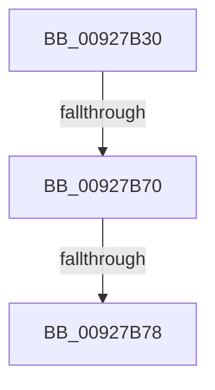

# RtlConvertSidToUnicodeString

- RVA: `0x00927B30`–`0x00927B7F` (길이 `79` bytes)
- VA: `0x0000000140927B30`
- 실행 섹션: `PAGE`
- PDB 이름 있음: `예`; PDB Function 태그: `아니요`
- unwind 정보 RVA: `0x0008D694`
- 디코드: `19`개 명령, `79/79` bytes 표시
- 미해석 바이트: `0` (있으면 어셈블리에 `.byte`로 보존)

> 이 문서는 커널 이미지의 기계어와 PDB 기호를 분석해 생성했습니다. 4번과 5번은 함수 원형과 자료형을 바이너리 사용 방식에서 추정한 C 해석이며 원본 소스 복구 결과는 아닙니다.

## 1. Dependencies

- 직접 호출 지점: **1**; 고유 호출 대상: **1**
- 직접 호출자로 확인된 함수: **12**
- RIP 상대 이미지 참조: **2**

### Outgoing calls
- `0x00927B63` → [RtlValidSid](RtlValidSid_function_00929710.md) (function, `0x00929710`)

### Direct callers
- [OpenGlobalizationUserSettingsKey_ForMua](../../text/65/OpenGlobalizationUserSettingsKey_ForMua_function_0065D0C8.md) at `0x0065D1A0`
- [RtlpGetTokenNamedObjectPath](../78/RtlpGetTokenNamedObjectPath_function_0078ED40.md) at `0x0078EF30`
- [RtlpGetTokenNamedObjectPath](../78/RtlpGetTokenNamedObjectPath_function_0078ED40.md) at `0x0078EF9A`
- [RtlpGetTokenNamedObjectPath](../78/RtlpGetTokenNamedObjectPath_function_0078ED40.md) at `0x0078F02F`
- [AdtpBuildSidListString](../82/AdtpBuildSidListString_function_00822440.md) at `0x008225AB`
- [SysCtxRegOpenCurrentUserKey](../8F/SysCtxRegOpenCurrentUserKey_function_008F455C.md) at `0x008F46CC`
- [SepValidateReferencedCachedHandles](../8F/SepValidateReferencedCachedHandles_function_008F4BB0.md) at `0x008F4EB6`
- [RtlFormatCurrentUserKeyPath](RtlFormatCurrentUserKeyPath_function_00927820.md) at `0x0092790D`
- [CmpGetVirtualizationID](../99/CmpGetVirtualizationID_function_00990338.md) at `0x009903A3`
- [PiDqOpenUserObjectRegKey](../99/PiDqOpenUserObjectRegKey_function_00990444.md) at `0x0099054E`
- [LocalConvertSidToStringSidW](../A0/LocalConvertSidToStringSidW_function_00A0191C.md) at `0x00A0194E`
- [PspReadUserQuotaLimits](../A6/PspReadUserQuotaLimits_function_00A68108.md) at `0x00A68196`
- [ExpWnfGetPermanentPerUserDataStoreHandle](../A7/ExpWnfGetPermanentPerUserDataStoreHandle_function_00A7A35C.md) at `0x00A7A41F`
- [sub_00B1E93A](../B1/Unknown_function_00B1E93A.md) at `0x00B1EA6D`

### Static image references
- `0x00927B3C` → RVA `0x00E0A740` (`.data`; read)
- `0x00927B78` → RVA `0x00B055E0` (` ?? ::NNGAKEGL::`string'`; read)

## 2. Other-region calls and transfers

- 다른 실행 섹션으로 향하는 call: **0**
- call이 아닌 외부 분기/꼬리 이동: **2**
  - `0x00927B6A` → [sub_00927D77](Unknown_function_00927D77.md) (`tail-transfer`)
  - `0x00927B72` → [sub_00927D77](Unknown_function_00927D77.md) (`tail-transfer`)

## 3. Assembly (complete function range)

```asm
00927B30  40 55                           push rbp
00927B32  56                              push rsi
00927B33  41 56                           push r14
00927B35  48 81 EC 60 02 00 00            sub rsp, 0x260
00927B3C  48 8B 05 FD 2B 4E 00            mov rax, qword ptr [rip + 0x4e2bfd]
00927B43  48 33 C4                        xor rax, rsp
00927B46  48 89 84 24 40 02 00 00         mov qword ptr [rsp + 0x240], rax
00927B4E  48 8B E9                        mov rbp, rcx
00927B51  0F 57 C0                        xorps xmm0, xmm0
00927B54  48 8B CA                        mov rcx, rdx
00927B57  45 0F B6 F0                     movzx r14d, r8b
00927B5B  0F 11 44 24 28                  movups xmmword ptr [rsp + 0x28], xmm0
00927B60  48 8B F2                        mov rsi, rdx
00927B63  E8 A8 1B 00 00                  call 0x140929710
00927B68  3C 01                           cmp al, 1
00927B6A  0F 85 07 02 00 00               jne 0x140927d77
00927B70  38 06                           cmp byte ptr [rsi], al
00927B72  0F 85 FF 01 00 00               jne 0x140927d77
00927B78  4C 8D 05 61 DA 1D 00            lea r8, [rip + 0x1dda61]
```

## 4. C-style interpretation (structured pseudocode)

```c
__int64 __fastcall RtlConvertSidToUnicodeString(__int64 a1, __int64 a2, unsigned __int8 a3)
{
    __int64 result;
    __int64 v_rsp;
    unsigned __int64 v_stack_m250;
    unsigned __int64 v_stack_m38;

    v_rsp = (v_rsp) - (608);
    result = (*(unsigned __int64 *)(v_rip + 5123069)) ^ (v_rsp);
    v_stack_m38 = result;
    v_stack_m250 = v_xmm0;
    result = RtlValidSid(a2, a2, a3, a4);
    return result;
}
```

## 5. (Beta) C Style

```c
int64_t RtlConvertSidToUnicodeString(int64_t Arg1, void *Arg2, uint8_t Arg3)
{
    uint8_t *arg2 = (uint8_t *)Arg2;

    int64_t result;
    int64_t local_rsp;
    uint64_t v_stack_m250;
    uint64_t v_stack_m38;

    local_rsp = (local_rsp) - (608);
    result = (*(uint64_t *)(v_rip + 0x4E2BFD)) ^ (local_rsp);
    v_stack_m38 = result;
    v_stack_m250 = v_xmm0;
    result = RtlValidSid(Arg2, Arg2, Arg3, a4);
    return result;
}
```

### 관측된 메모리 오프셋

구조체 형식이 확인되지 않은 접근은 인자 기준의 오프셋으로만 기록했습니다.

| 기준 인자 | 오프셋 표현 | 폭 (bit) | 접근 |
|---|---:|---:|---|
| `Arg2` | `+ 0x0` | `8` | `R` |

## 6. Execution-region graph

[열기: 2D/3D 그래프와 함수 탐색 컨트롤 패널](../../../control-panel.html?section=page&rva=0x00927B30&view=graph)

- 2D 그래프는 위에서 아래로 흐르고, 3D 그래프는 빈 공간을 드래그해 회전합니다. Shift+드래그는 이동, 휠은 확대·축소, 함수 노드 선택은 대상 보고서 이동입니다.

### Static fallback


