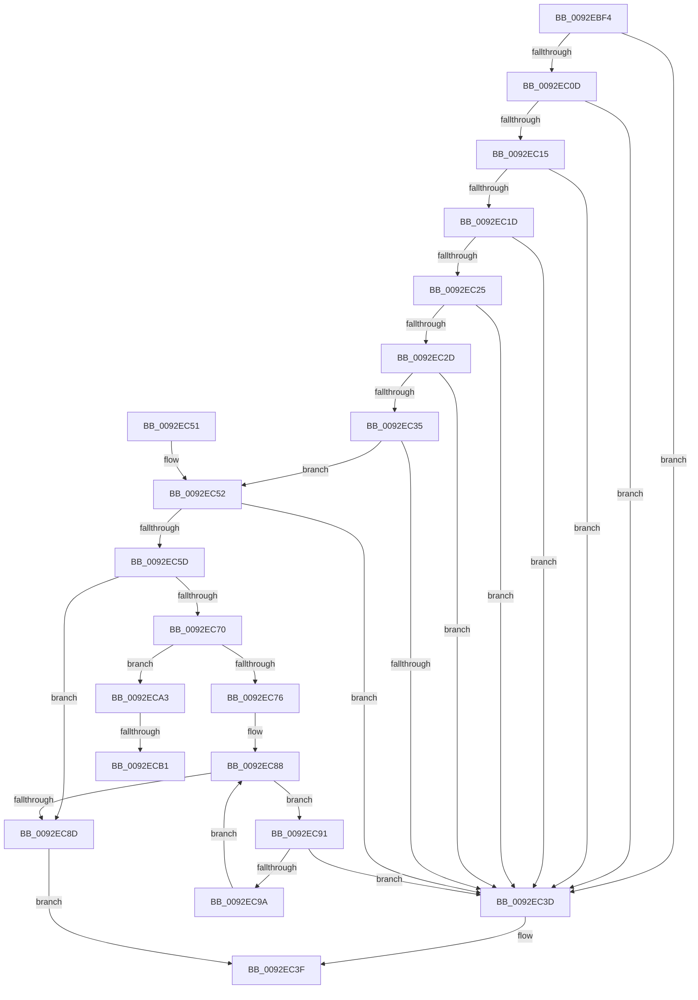

# RtlEqualPrefixSid

- RVA: `0x0092EBF4`–`0x0092ECC3` (길이 `207` bytes)
- VA: `0x000000014092EBF4`
- 실행 섹션: `PAGE`
- PDB 이름 있음: `예`; PDB Function 태그: `예`
- unwind 정보 RVA: `0x0008DD38`
- 디코드: `64`개 명령, `207/207` bytes 표시
- 미해석 바이트: `0` (있으면 어셈블리에 `.byte`로 보존)

> 이 문서는 커널 이미지의 기계어와 PDB 기호를 분석해 생성했습니다. 4번과 5번은 함수 원형과 자료형을 바이너리 사용 방식에서 추정한 C 해석이며 원본 소스 복구 결과는 아닙니다.

## 1. Dependencies

- 직접 호출 지점: **1**; 고유 호출 대상: **1**
- 직접 호출자로 확인된 함수: **2**
- RIP 상대 이미지 참조: **1**

### Outgoing calls
- `0x0092EC47` → [_security_check_cookie](../../text/6A/_security_check_cookie_function_006AC640.md) (function, `0x006AC640`)

### Direct callers
- [RtlpCopyEffectiveAce](RtlpCopyEffectiveAce_function_0092E530.md) at `0x0092E90B`
- [sub_00B22F88](../B2/Unknown_function_00B22F88.md) at `0x00B22FCD`

### Static image references
- `0x0092EBF8` → RVA `0x00E0A740` (`.data`; read)

## 2. Other-region calls and transfers

- 다른 실행 섹션으로 향하는 call: **1**
  - `0x0092EC47` → [_security_check_cookie](../../text/6A/_security_check_cookie_function_006AC640.md) (`PAGE` → `.text`)
- call이 아닌 외부 분기/꼬리 이동: **2**
  - `0x0092ECAB` → [sub_00B2333C](../B2/Unknown_function_00B2333C.md) (`tail-transfer`)
  - `0x0092ECBE` → [sub_00B2333C](../B2/Unknown_function_00B2333C.md) (`tail-transfer`)

## 3. Assembly (complete function range)

```asm
0092EBF4  48 83 EC 18                     sub rsp, 0x18
0092EBF8  48 8B 05 41 BB 4D 00            mov rax, qword ptr [rip + 0x4dbb41]
0092EBFF  48 33 C4                        xor rax, rsp
0092EC02  48 89 44 24 08                  mov qword ptr [rsp + 8], rax
0092EC07  8A 02                           mov al, byte ptr [rdx]
0092EC09  38 01                           cmp byte ptr [rcx], al
0092EC0B  75 30                           jne 0x14092ec3d
0092EC0D  8A 42 02                        mov al, byte ptr [rdx + 2]
0092EC10  38 41 02                        cmp byte ptr [rcx + 2], al
0092EC13  75 28                           jne 0x14092ec3d
0092EC15  8A 42 03                        mov al, byte ptr [rdx + 3]
0092EC18  38 41 03                        cmp byte ptr [rcx + 3], al
0092EC1B  75 20                           jne 0x14092ec3d
0092EC1D  8A 42 04                        mov al, byte ptr [rdx + 4]
0092EC20  38 41 04                        cmp byte ptr [rcx + 4], al
0092EC23  75 18                           jne 0x14092ec3d
0092EC25  8A 42 05                        mov al, byte ptr [rdx + 5]
0092EC28  38 41 05                        cmp byte ptr [rcx + 5], al
0092EC2B  75 10                           jne 0x14092ec3d
0092EC2D  8A 42 06                        mov al, byte ptr [rdx + 6]
0092EC30  38 41 06                        cmp byte ptr [rcx + 6], al
0092EC33  75 08                           jne 0x14092ec3d
0092EC35  8A 42 07                        mov al, byte ptr [rdx + 7]
0092EC38  38 41 07                        cmp byte ptr [rcx + 7], al
0092EC3B  74 15                           je 0x14092ec52
0092EC3D  32 C0                           xor al, al
0092EC3F  48 8B 4C 24 08                  mov rcx, qword ptr [rsp + 8]
0092EC44  48 33 CC                        xor rcx, rsp
0092EC47  E8 F4 D9 D7 FF                  call 0x1406ac640
0092EC4C  48 83 C4 18                     add rsp, 0x18
0092EC50  C3                              ret
0092EC51  CC                              int3
0092EC52  44 0F B6 51 01                  movzx r10d, byte ptr [rcx + 1]
0092EC57  44 3A 52 01                     cmp r10b, byte ptr [rdx + 1]
0092EC5B  75 E0                           jne 0x14092ec3d
0092EC5D  45 33 C0                        xor r8d, r8d
0092EC60  66 C7 44 24 04 00 0B            mov word ptr [rsp + 4], 0xb00
0092EC67  44 89 04 24                     mov dword ptr [rsp], r8d
0092EC6B  45 84 D2                        test r10b, r10b
0092EC6E  74 1D                           je 0x14092ec8d
0092EC70  41 80 FA 0B                     cmp r10b, 0xb
0092EC74  74 2D                           je 0x14092eca3
0092EC76  B8 01 00 00 00                  mov eax, 1
0092EC7B  45 8B DA                        mov r11d, r10d
0092EC7E  4C 8D 49 08                     lea r9, [rcx + 8]
0092EC82  44 2B D8                        sub r11d, eax
0092EC85  48 2B D1                        sub rdx, rcx
0092EC88  45 3B C3                        cmp r8d, r11d
0092EC8B  7C 04                           jl 0x14092ec91
0092EC8D  B0 01                           mov al, 1
0092EC8F  EB AE                           jmp 0x14092ec3f
0092EC91  42 8B 04 0A                     mov eax, dword ptr [rdx + r9]
0092EC95  41 39 01                        cmp dword ptr [r9], eax
0092EC98  75 A3                           jne 0x14092ec3d
0092EC9A  41 FF C0                        inc r8d
0092EC9D  49 83 C1 04                     add r9, 4
0092ECA1  EB E5                           jmp 0x14092ec88
0092ECA3  44 8B 49 02                     mov r9d, dword ptr [rcx + 2]
0092ECA7  44 2B 0C 24                     sub r9d, dword ptr [rsp]
0092ECAB  0F 85 8B 46 1F 00               jne 0x140b2333c
0092ECB1  44 0F B7 49 06                  movzx r9d, word ptr [rcx + 6]
0092ECB6  0F B7 44 24 04                  movzx eax, word ptr [rsp + 4]
0092ECBB  44 2B C8                        sub r9d, eax
0092ECBE  E9 79 46 1F 00                  jmp 0x140b2333c
```

## 4. C-style interpretation (structured pseudocode)

```c
__int64 __fastcall RtlEqualPrefixSid(__int64 a1, __int64 a2, int a3)
{
    __int64 result;
    __int64 v_r11;
    __int64 v_rsp;
    unsigned __int64 v_stack_m10;
    unsigned int v_stack_p0;
    unsigned __int16 v_stack_p4;

    v_rsp = (v_rsp) - (24);
    result = (*(unsigned __int64 *)(v_rip + 5094209)) ^ (v_rsp);
    v_stack_m10 = result;
    if ((*(unsigned __int8 *)(a1)) != ((unsigned __int8)(*(unsigned __int8 *)(a2)))) goto loc_0092EC3D;
    if ((*(unsigned __int8 *)(a1 + 2)) != ((unsigned __int8)(*(unsigned __int8 *)(a2 + 2)))) goto loc_0092EC3D;
    if ((*(unsigned __int8 *)(a1 + 3)) != ((unsigned __int8)(*(unsigned __int8 *)(a2 + 3)))) goto loc_0092EC3D;
    if ((*(unsigned __int8 *)(a1 + 4)) != ((unsigned __int8)(*(unsigned __int8 *)(a2 + 4)))) goto loc_0092EC3D;
    if ((*(unsigned __int8 *)(a1 + 5)) != ((unsigned __int8)(*(unsigned __int8 *)(a2 + 5)))) goto loc_0092EC3D;
    if ((*(unsigned __int8 *)(a1 + 6)) != ((unsigned __int8)(*(unsigned __int8 *)(a2 + 6)))) goto loc_0092EC3D;
    if ((*(unsigned __int8 *)(a1 + 7)) == ((unsigned __int8)(*(unsigned __int8 *)(a2 + 7)))) goto loc_0092EC52;
loc_0092EC3D:
    result = 0;
loc_0092EC3F:
    a1 = (v_stack_m10) ^ (v_rsp);
    result = _security_check_cookie(a1, a2, a3, a4);
    v_rsp = (v_rsp) + (24);
    return result;
loc_0092EC52:
    if (((unsigned __int8)(*(unsigned __int8 *)(a1 + 1))) != (*(unsigned __int8 *)(a2 + 1))) goto loc_0092EC3D;
    a3 = 0;
    v_stack_p4 = 0xB00ULL;
    v_stack_p0 = 0;
    if ((unsigned __int8)(*(unsigned __int8 *)(a1 + 1)) == 0) goto loc_0092EC8D;
    if (((unsigned __int8)(*(unsigned __int8 *)(a1 + 1))) == 11) goto loc_0092ECA3;
    v_r11 = (unsigned int)(((unsigned int)((unsigned int)(*(unsigned __int8 *)(a1 + 1)))) - (1));
    a2 = (a2) - (a1);
loc_0092EC88:
    if (0 < ((unsigned int)(v_r11))) goto loc_0092EC91;
loc_0092EC8D:
    goto loc_0092EC3F;
loc_0092EC91:
    if ((*(unsigned int *)(a1 + 8)) != ((unsigned int)((unsigned int)(*(unsigned int *)(a2 + a1 + 8 * 1))))) goto loc_0092EC3D;
    a3 = (unsigned int)((a3) + 1);
    a4 = (a1 + 8) + (4);
    goto loc_0092EC88;
loc_0092ECA3:
    a4 = (unsigned int)(((unsigned int)(*(unsigned int *)(a1 + 2))) - (v_stack_p0));
    a4 = (unsigned int)((*(unsigned __int16 *)(a1 + 6)) - ((unsigned int)(v_stack_p4)));
}
```

## 5. (Beta) C Style

```c
int64_t RtlEqualPrefixSid(void *Arg1, void *Arg2, int32_t Arg3)
{
    uint8_t *arg1 = (uint8_t *)Arg1;
    uint8_t *arg2 = (uint8_t *)Arg2;

    int64_t result;
    int64_t local_r11;
    int64_t local_rsp;
    uint64_t v_stack_m10;
    uint32_t v_stack_p0;
    uint16_t v_stack_p4;

    local_rsp = (local_rsp) - (24);
    result = (*(uint64_t *)(v_rip + 0x4DBB41)) ^ (local_rsp);
    v_stack_m10 = result;
    if ((*(uint8_t *)(arg1)) != ((uint8_t)(*(uint8_t *)(arg2)))) goto loc_0092EC3D;
    if ((*(uint8_t *)(arg1 + 0x2)) != ((uint8_t)(*(uint8_t *)(arg2 + 0x2)))) goto loc_0092EC3D;
    if ((*(uint8_t *)(arg1 + 0x3)) != ((uint8_t)(*(uint8_t *)(arg2 + 0x3)))) goto loc_0092EC3D;
    if ((*(uint8_t *)(arg1 + 0x4)) != ((uint8_t)(*(uint8_t *)(arg2 + 0x4)))) goto loc_0092EC3D;
    if ((*(uint8_t *)(arg1 + 0x5)) != ((uint8_t)(*(uint8_t *)(arg2 + 0x5)))) goto loc_0092EC3D;
    if ((*(uint8_t *)(arg1 + 0x6)) != ((uint8_t)(*(uint8_t *)(arg2 + 0x6)))) goto loc_0092EC3D;
    if ((*(uint8_t *)(arg1 + 0x7)) == ((uint8_t)(*(uint8_t *)(arg2 + 0x7)))) goto loc_0092EC52;
loc_0092EC3D:
    result = 0;
loc_0092EC3F:
    Arg1 = (v_stack_m10) ^ (local_rsp);
    result = _security_check_cookie(Arg1, Arg2, Arg3, a4);
    local_rsp = (local_rsp) + (24);
    return result;
loc_0092EC52:
    if (((uint8_t)(*(uint8_t *)(arg1 + 0x1))) != (*(uint8_t *)(arg2 + 0x1))) goto loc_0092EC3D;
    Arg3 = 0;
    v_stack_p4 = 0xB00ULL;
    v_stack_p0 = 0;
    if ((uint8_t)(*(uint8_t *)(arg1 + 0x1)) == 0) goto loc_0092EC8D;
    if (((uint8_t)(*(uint8_t *)(arg1 + 0x1))) == 11) goto loc_0092ECA3;
    local_r11 = (uint32_t)(((uint32_t)((uint32_t)(*(uint8_t *)(arg1 + 0x1)))) - (1));
    Arg2 = (Arg2) - (Arg1);
loc_0092EC88:
    if (0 < ((uint32_t)(local_r11))) goto loc_0092EC91;
loc_0092EC8D:
    goto loc_0092EC3F;
loc_0092EC91:
    if ((*(uint32_t *)(arg1 + 0x8)) != ((uint32_t)((uint32_t)(*(uint32_t *)(arg2 + arg1 + 0x8 * 1))))) goto loc_0092EC3D;
    Arg3 = (uint32_t)((Arg3) + 1);
    a4 = (Arg1 + 8) + (4);
    goto loc_0092EC88;
loc_0092ECA3:
    a4 = (uint32_t)(((uint32_t)(*(uint32_t *)(arg1 + 0x2))) - (v_stack_p0));
    a4 = (uint32_t)((*(uint16_t *)(arg1 + 0x6)) - ((uint32_t)(v_stack_p4)));
}
```

### 관측된 메모리 오프셋

구조체 형식이 확인되지 않은 접근은 인자 기준의 오프셋으로만 기록했습니다.

| 기준 인자 | 오프셋 표현 | 폭 (bit) | 접근 |
|---|---:|---:|---|
| `Arg1` | `+ 0x0` | `8` | `R` |
| `Arg1` | `+ 0x0` | `32` | `R` |
| `Arg1` | `+ 0x1` | `8` | `R` |
| `Arg1` | `+ 0x2` | `8` | `R` |
| `Arg1` | `+ 0x2` | `32` | `R` |
| `Arg1` | `+ 0x3` | `8` | `R` |
| `Arg1` | `+ 0x4` | `8` | `R` |
| `Arg1` | `+ 0x5` | `8` | `R` |
| `Arg1` | `+ 0x6` | `8` | `R` |
| `Arg1` | `+ 0x6` | `16` | `R` |
| `Arg1` | `+ 0x7` | `8` | `R` |
| `Arg1` | `+ 0x8` | `64` | `R` |
| `Arg2` | `+ 0x0` | `8` | `R` |
| `Arg2` | `+ 0x0 + r9*1` | `32` | `R` |
| `Arg2` | `+ 0x1` | `8` | `R` |
| `Arg2` | `+ 0x2` | `8` | `R` |
| `Arg2` | `+ 0x3` | `8` | `R` |
| `Arg2` | `+ 0x4` | `8` | `R` |
| `Arg2` | `+ 0x5` | `8` | `R` |
| `Arg2` | `+ 0x6` | `8` | `R` |
| `Arg2` | `+ 0x7` | `8` | `R` |

## 6. Execution-region graph

[열기: 2D/3D 그래프와 함수 탐색 컨트롤 패널](../../../control-panel.html?section=page&rva=0x0092EBF4&view=graph)

- 2D 그래프는 위에서 아래로 흐르고, 3D 그래프는 빈 공간을 드래그해 회전합니다. Shift+드래그는 이동, 휠은 확대·축소, 함수 노드 선택은 대상 보고서 이동입니다.

### Static fallback


