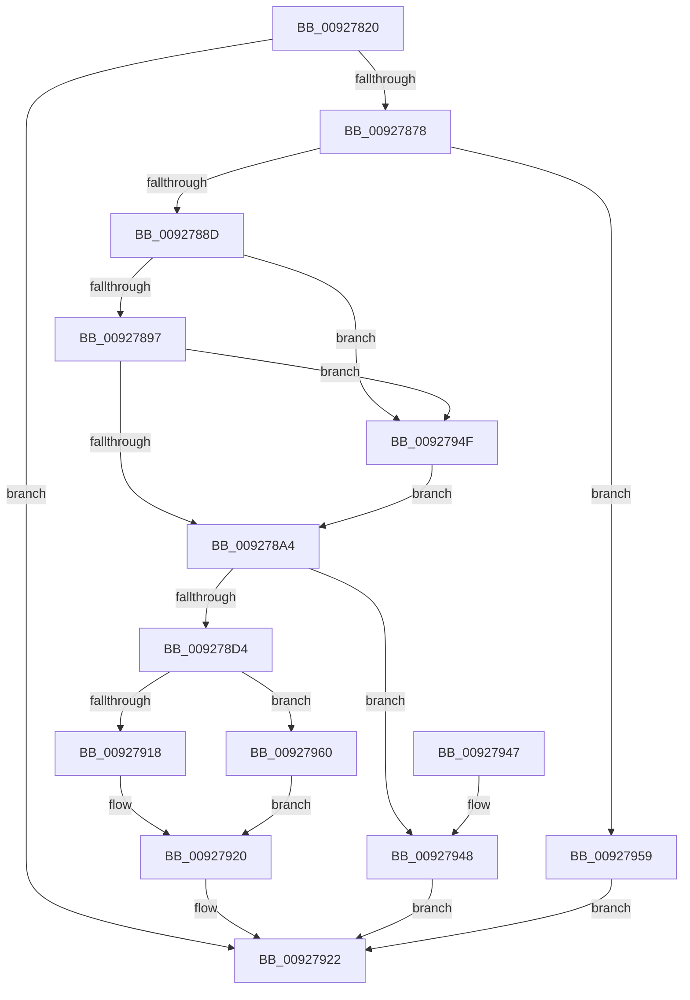

# RtlFormatCurrentUserKeyPath

- RVA: `0x00927820`–`0x0092796A` (길이 `330` bytes)
- VA: `0x0000000140927820`
- 실행 섹션: `PAGE`
- PDB 이름 있음: `예`; PDB Function 태그: `아니요`
- unwind 정보 RVA: `0x0008D654`
- 디코드: `82`개 명령, `330/330` bytes 표시
- 미해석 바이트: `0` (있으면 어셈블리에 `.byte`로 보존)

> 이 문서는 커널 이미지의 기계어와 PDB 기호를 분석해 생성했습니다. 4번과 5번은 함수 원형과 자료형을 바이너리 사용 방식에서 추정한 C 해석이며 원본 소스 복구 결과는 아닙니다.

## 1. Dependencies

- 직접 호출 지점: **7**; 고유 호출 대상: **7**
- 직접 호출자로 확인된 함수: **4**
- RIP 상대 이미지 참조: **2**

### Outgoing calls
- `0x0092786B` → [ZwQueryInformationToken](../../text/6A/ZwQueryInformationToken_function_006AD4F0.md) (function, `0x006AD4F0`)
- `0x00927880` → [RtlValidSid](RtlValidSid_function_00929710.md) (function, `0x00929710`)
- `0x009278C6` → [ExAllocatePool2](../../poolcode/B8/ExAllocatePool2_function_00B820F0.md) (function, `0x00B820F0`)
- `0x009278DE` → [RtlAppendUnicodeToString](../../text/40/RtlAppendUnicodeToString_function_0040F990.md) (function, `0x0040F990`)
- `0x0092790D` → [RtlConvertSidToUnicodeString](RtlConvertSidToUnicodeString_function_00927B30.md) (function, `0x00927B30`)
- `0x0092792D` → [_security_check_cookie](../../text/6A/_security_check_cookie_function_006AC640.md) (function, `0x006AC640`)
- `0x00927963` → [RtlFreeAnsiString](../9C/RtlFreeAnsiString_function_009C0800.md) (function, `0x009C0800`)

### Direct callers
- [RtlOpenCurrentUser](../78/RtlOpenCurrentUser_function_0078F940.md) at `0x0078F978`
- [AslRegistryBuildUserPath](../81/AslRegistryBuildUserPath_function_00819DB0.md) at `0x00819DDA`
- [RegRtlOpenPredefinedKey](../83/RegRtlOpenPredefinedKey_function_00832A14.md) at `0x00832A84`
- [RtlpGetRegistryHandle](../8C/RtlpGetRegistryHandle_function_008C955C.md) at `0x008C9728`

### Static image references
- `0x00927832` → RVA `0x00E0A740` (`.data`; read)
- `0x009278D4` → RVA `0x00AFE5A0` (` ?? ::NNGAKEGL::`string'`; read)

## 2. Other-region calls and transfers

- 다른 실행 섹션으로 향하는 call: **4**
  - `0x0092786B` → [ZwQueryInformationToken](../../text/6A/ZwQueryInformationToken_function_006AD4F0.md) (`PAGE` → `.text`)
  - `0x009278C6` → [ExAllocatePool2](../../poolcode/B8/ExAllocatePool2_function_00B820F0.md) (`PAGE` → `POOLCODE`)
  - `0x009278DE` → [RtlAppendUnicodeToString](../../text/40/RtlAppendUnicodeToString_function_0040F990.md) (`PAGE` → `.text`)
  - `0x0092792D` → [_security_check_cookie](../../text/6A/_security_check_cookie_function_006AC640.md) (`PAGE` → `.text`)
- 별도 외부 분기/꼬리 이동을 확인하지 못했습니다.

## 3. Assembly (complete function range)

```asm
00927820  48 89 5C 24 10                  mov qword ptr [rsp + 0x10], rbx
00927825  48 89 74 24 18                  mov qword ptr [rsp + 0x18], rsi
0092782A  57                              push rdi
0092782B  48 81 EC C0 00 00 00            sub rsp, 0xc0
00927832  48 8B 05 07 2F 4E 00            mov rax, qword ptr [rip + 0x4e2f07]
00927839  48 33 C4                        xor rax, rsp
0092783C  48 89 84 24 B0 00 00 00         mov qword ptr [rsp + 0xb0], rax
00927844  33 F6                           xor esi, esi
00927846  48 8D 44 24 30                  lea rax, [rsp + 0x30]
0092784B  48 8B D9                        mov rbx, rcx
0092784E  89 74 24 30                     mov dword ptr [rsp + 0x30], esi
00927852  4C 8D 44 24 50                  lea r8, [rsp + 0x50]
00927857  89 74 24 3C                     mov dword ptr [rsp + 0x3c], esi
0092785B  48 89 44 24 20                  mov qword ptr [rsp + 0x20], rax
00927860  44 8D 4E 58                     lea r9d, [rsi + 0x58]
00927864  8D 56 01                        lea edx, [rsi + 1]
00927867  48 8D 4E FA                     lea rcx, [rsi - 6]
0092786B  E8 80 5C D8 FF                  call 0x1406ad4f0
00927870  85 C0                           test eax, eax
00927872  0F 88 AA 00 00 00               js 0x140927922
00927878  48 8B 7C 24 50                  mov rdi, qword ptr [rsp + 0x50]
0092787D  48 8B CF                        mov rcx, rdi
00927880  E8 8B 1E 00 00                  call 0x140929710
00927885  3C 01                           cmp al, 1
00927887  0F 85 CC 00 00 00               jne 0x140927959
0092788D  40 38 77 02                     cmp byte ptr [rdi + 2], sil
00927891  0F 85 B8 00 00 00               jne 0x14092794f
00927897  8D 56 1C                        lea edx, [rsi + 0x1c]
0092789A  40 38 77 03                     cmp byte ptr [rdi + 3], sil
0092789E  0F 85 AB 00 00 00               jne 0x14092794f
009278A4  0F B6 47 01                     movzx eax, byte ptr [rdi + 1]
009278A8  B9 00 01 00 00                  mov ecx, 0x100
009278AD  6B F8 16                        imul edi, eax, 0x16
009278B0  41 B8 53 74 72 67               mov r8d, 0x67727453
009278B6  66 89 33                        mov word ptr [rbx], si
009278B9  66 03 FA                        add di, dx
009278BC  8D 47 22                        lea eax, [rdi + 0x22]
009278BF  0F B7 D0                        movzx edx, ax
009278C2  66 89 53 02                     mov word ptr [rbx + 2], dx
009278C6  E8 25 A8 25 00                  call 0x140b820f0
009278CB  48 89 43 08                     mov qword ptr [rbx + 8], rax
009278CF  48 85 C0                        test rax, rax
009278D2  74 74                           je 0x140927948
009278D4  48 8D 15 C5 6C 1D 00            lea rdx, [rip + 0x1d6cc5]
009278DB  48 8B CB                        mov rcx, rbx
009278DE  E8 AD 80 AE FF                  call 0x14040f990
009278E3  0F B7 13                        movzx edx, word ptr [rbx]
009278E6  48 8D 4C 24 38                  lea rcx, [rsp + 0x38]
009278EB  48 8B 43 08                     mov rax, qword ptr [rbx + 8]
009278EF  45 33 C0                        xor r8d, r8d
009278F2  48 D1 EA                        shr rdx, 1
009278F5  66 89 7C 24 3A                  mov word ptr [rsp + 0x3a], di
009278FA  66 89 74 24 38                  mov word ptr [rsp + 0x38], si
009278FF  48 8D 14 50                     lea rdx, [rax + rdx*2]
00927903  48 89 54 24 40                  mov qword ptr [rsp + 0x40], rdx
00927908  48 8B 54 24 50                  mov rdx, qword ptr [rsp + 0x50]
0092790D  E8 1E 02 00 00                  call 0x140927b30
00927912  8B F8                           mov edi, eax
00927914  85 C0                           test eax, eax
00927916  78 48                           js 0x140927960
00927918  0F B7 44 24 38                  movzx eax, word ptr [rsp + 0x38]
0092791D  66 01 03                        add word ptr [rbx], ax
00927920  8B C7                           mov eax, edi
00927922  48 8B 8C 24 B0 00 00 00         mov rcx, qword ptr [rsp + 0xb0]
0092792A  48 33 CC                        xor rcx, rsp
0092792D  E8 0E 4D D8 FF                  call 0x1406ac640
00927932  4C 8D 9C 24 C0 00 00 00         lea r11, [rsp + 0xc0]
0092793A  49 8B 5B 18                     mov rbx, qword ptr [r11 + 0x18]
0092793E  49 8B 73 20                     mov rsi, qword ptr [r11 + 0x20]
00927942  49 8B E3                        mov rsp, r11
00927945  5F                              pop rdi
00927946  C3                              ret
00927947  CC                              int3
00927948  B8 17 00 00 C0                  mov eax, 0xc0000017
0092794D  EB D3                           jmp 0x140927922
0092794F  BA 24 00 00 00                  mov edx, 0x24
00927954  E9 4B FF FF FF                  jmp 0x1409278a4
00927959  B8 78 00 00 C0                  mov eax, 0xc0000078
0092795E  EB C2                           jmp 0x140927922
00927960  48 8B CB                        mov rcx, rbx
00927963  E8 98 8E 09 00                  call 0x1409c0800
00927968  EB B6                           jmp 0x140927920
```

## 4. C-style interpretation (structured pseudocode)

```c
__int64 __fastcall RtlFormatCurrentUserKeyPath(__int64 a1)
{
    __int64 result;
    __int64 v_rdi;
    __int64 v_rsi;
    __int64 v_rsp;
    unsigned __int64 v_stack_m18;
    unsigned __int64 v_stack_m78;
    unsigned __int64 v_stack_m8;
    unsigned __int64 v_stack_m88;
    unsigned int v_stack_m8C;
    unsigned __int16 v_stack_m8E;
    unsigned __int64 v_stack_m90;
    unsigned __int64 v_stack_m98;
    unsigned __int64 v_stack_mA8;
    unsigned __int64 v_stack_p10;
    unsigned __int64 v_stack_p18;

    v_stack_p10 = v_rbx;
    v_stack_p18 = v_rsi;
    v_rsp = (v_rsp) - (192);
    result = (*(unsigned __int64 *)(v_rip + 5123847)) ^ (v_rsp);
    v_stack_m18 = result;
    v_rsi = 0;
    v_stack_m98 = 0;
    v_stack_m8C = 0;
    v_stack_mA8 = v_stack_m98;
    result = ZwQueryInformationToken(v_rsi - 6, v_rsi + 1, v_stack_m78, v_rsi + 88);
    if (sign_flag) goto loc_00927922;
    result = RtlValidSid(v_stack_m78, v_rsi + 1, v_stack_m78, v_rsi + 88);
    if (((unsigned __int8)(result)) != 1) goto loc_00927959;
    if ((*(unsigned __int8 *)(v_stack_m78 + 2)) != 0) goto loc_0092794F;
    if ((*(unsigned __int8 *)(v_stack_m78 + 3)) != 0) goto loc_0092794F;
loc_009278A4:
    v_rdi = (unsigned int)((v_stack_m78) * ((unsigned int)(*(unsigned __int8 *)(v_stack_m78 + 1))));
    *(unsigned __int16 *)(a1) = 0;
    v_rdi = (unsigned __int16)((v_rdi) + ((unsigned __int16)(v_rsi + 28)));
    *(unsigned __int16 *)(a1 + 2) = (unsigned __int16)((unsigned __int16)(v_rdi + 34));
    result = ExAllocatePool2(256, (unsigned __int16)(v_rdi + 34), (unsigned int)(0x67727453ULL), v_rsi + 88);
    *(unsigned __int64 *)(a1 + 8) = result;
    if (result == 0) goto loc_00927948;
    result = RtlAppendUnicodeToString(a1, v_rip + 1928389, (unsigned int)(0x67727453ULL), v_rsi + 88);
    a3 = 0;
    a2 = (*(unsigned __int16 *)(a1)) >> (1);
    v_stack_m8E = (unsigned __int16)(v_rdi);
    v_stack_m90 = 0;
    v_stack_m88 = *(unsigned __int64 *)(a1 + 8) + a2 * 2;
    result = RtlConvertSidToUnicodeString(v_stack_m90, v_stack_m78, a3, v_rsi + 88);
    if (sign_flag) goto loc_00927960;
loc_00927920:
loc_00927922:
    a1 = (v_stack_m18) ^ (v_rsp);
    result = _security_check_cookie(a1, v_stack_m78, a3, v_rsi + 88);
    return result;
loc_00927948:
    goto loc_00927922;
loc_0092794F:
    goto loc_009278A4;
loc_00927959:
    goto loc_00927922;
loc_00927960:
    result = RtlFreeAnsiString(*(unsigned __int64 *)(v_stack_m8 + 24), 36, a3, v_rsi + 88);
    goto loc_00927920;
}
```

## 5. (Beta) C Style

```c
int64_t RtlFormatCurrentUserKeyPath(void *Arg1)
{
    uint8_t *arg1 = (uint8_t *)Arg1;

    int64_t result;
    int64_t local_rdi;
    int64_t local_rsi;
    int64_t local_rsp;
    uint64_t v_stack_m18;
    uint64_t v_stack_m78;
    uint64_t v_stack_m8;
    uint64_t v_stack_m88;
    uint32_t v_stack_m8C;
    uint16_t v_stack_m8E;
    uint64_t v_stack_m90;
    uint64_t v_stack_m98;
    uint64_t v_stack_mA8;
    uint64_t v_stack_p10;
    uint64_t v_stack_p18;

    v_stack_p10 = local_rbx;
    v_stack_p18 = local_rsi;
    local_rsp = (local_rsp) - (192);
    result = (*(uint64_t *)(v_rip + 0x4E2F07)) ^ (local_rsp);
    v_stack_m18 = result;
    local_rsi = 0;
    v_stack_m98 = 0;
    v_stack_m8C = 0;
    v_stack_mA8 = v_stack_m98;
    result = ZwQueryInformationToken(local_rsi - 6, local_rsi + 1, v_stack_m78, local_rsi + 88);
    if (sign_flag) goto loc_00927922;
    result = RtlValidSid(v_stack_m78, local_rsi + 1, v_stack_m78, local_rsi + 88);
    if (((uint8_t)(result)) != 1) goto loc_00927959;
    if ((*(uint8_t *)(v_stack_m78 + 0x2)) != 0) goto loc_0092794F;
    if ((*(uint8_t *)(v_stack_m78 + 0x3)) != 0) goto loc_0092794F;
loc_009278A4:
    local_rdi = (uint32_t)((v_stack_m78) * ((uint32_t)(*(uint8_t *)(v_stack_m78 + 0x1))));
    *(uint16_t *)(arg1) = 0;
    local_rdi = (uint16_t)((local_rdi) + ((uint16_t)(local_rsi + 28)));
    *(uint16_t *)(arg1 + 0x2) = (uint16_t)((uint16_t)(local_rdi + 34));
    result = ExAllocatePool2(256, (uint16_t)(local_rdi + 34), (uint32_t)(0x67727453ULL), local_rsi + 88);
    *(uint64_t *)(arg1 + 0x8) = result;
    if (result == 0) goto loc_00927948;
    result = RtlAppendUnicodeToString(Arg1, v_rip + 1928389, (uint32_t)(0x67727453ULL), local_rsi + 88);
    a3 = 0;
    a2 = (*(uint16_t *)(arg1)) >> (1);
    v_stack_m8E = (uint16_t)(local_rdi);
    v_stack_m90 = 0;
    v_stack_m88 = *(uint64_t *)(arg1 + 0x8) + a2 * 2;
    result = RtlConvertSidToUnicodeString(v_stack_m90, v_stack_m78, a3, local_rsi + 88);
    if (sign_flag) goto loc_00927960;
loc_00927920:
loc_00927922:
    Arg1 = (v_stack_m18) ^ (local_rsp);
    result = _security_check_cookie(Arg1, v_stack_m78, a3, local_rsi + 88);
    return result;
loc_00927948:
    goto loc_00927922;
loc_0092794F:
    goto loc_009278A4;
loc_00927959:
    goto loc_00927922;
loc_00927960:
    result = RtlFreeAnsiString(*(uint64_t *)(v_stack_m8 + 0x18), 36, a3, local_rsi + 88);
    goto loc_00927920;
}
```

### 관측된 메모리 오프셋

구조체 형식이 확인되지 않은 접근은 인자 기준의 오프셋으로만 기록했습니다.

| 기준 인자 | 오프셋 표현 | 폭 (bit) | 접근 |
|---|---:|---:|---|
| `Arg1` | `+ 0x0` | `16` | `R` |
| `Arg1` | `+ 0x0` | `16` | `R/W` |
| `Arg1` | `+ 0x0` | `16` | `W` |
| `Arg1` | `+ 0x2` | `16` | `W` |
| `Arg1` | `+ 0x8` | `64` | `R` |
| `Arg1` | `+ 0x8` | `64` | `W` |

## 6. Execution-region graph

[열기: 2D/3D 그래프와 함수 탐색 컨트롤 패널](../../../control-panel.html?section=page&rva=0x00927820&view=graph)

- 2D 그래프는 위에서 아래로 흐르고, 3D 그래프는 빈 공간을 드래그해 회전합니다. Shift+드래그는 이동, 휠은 확대·축소, 함수 노드 선택은 대상 보고서 이동입니다.

### Static fallback


