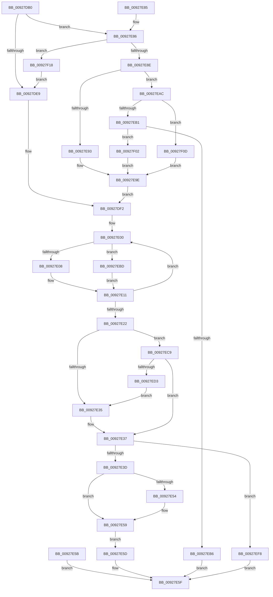

# RtlIntegerToUnicode

- RVA: `0x00927DB0`–`0x00927F23` (길이 `371` bytes)
- VA: `0x0000000140927DB0`
- 실행 섹션: `PAGE`
- PDB 이름 있음: `예`; PDB Function 태그: `아니요`
- unwind 정보 RVA: `0x0008D73C`
- 디코드: `108`개 명령, `371/371` bytes 표시
- 미해석 바이트: `0` (있으면 어셈블리에 `.byte`로 보존)

> 이 문서는 커널 이미지의 기계어와 PDB 기호를 분석해 생성했습니다. 4번과 5번은 함수 원형과 자료형을 바이너리 사용 방식에서 추정한 C 해석이며 원본 소스 복구 결과는 아닙니다.

## 1. Dependencies

- 직접 호출 지점: **2**; 고유 호출 대상: **2**
- 직접 호출자로 확인된 함수: **2**
- RIP 상대 이미지 참조: **2**

### Outgoing calls
- `0x00927E4B` → [memcpy](../../text/6C/memcpy_function_006C6840.md) (function, `0x006C6840`)
- `0x00927E67` → [_security_check_cookie](../../text/6A/_security_check_cookie_function_006AC640.md) (function, `0x006AC640`)

### Direct callers
- [sub_00927B7F](Unknown_function_00927B7F.md) at `0x00927BDE`
- [sub_00927BEB](Unknown_function_00927BEB.md) at `0x00927C5A`

### Static image references
- `0x00927DC6` → RVA `0x00E0A740` (`.data`; read)
- `0x00927DF7` → RVA `0x00B4B7D0` (`RtlpIntegerWChars`; read)

## 2. Other-region calls and transfers

- 다른 실행 섹션으로 향하는 call: **2**
  - `0x00927E4B` → [memcpy](../../text/6C/memcpy_function_006C6840.md) (`PAGE` → `.text`)
  - `0x00927E67` → [_security_check_cookie](../../text/6A/_security_check_cookie_function_006AC640.md) (`PAGE` → `.text`)
- 별도 외부 분기/꼬리 이동을 확인하지 못했습니다.

## 3. Assembly (complete function range)

```asm
00927DB0  48 89 5C 24 08                  mov qword ptr [rsp + 8], rbx
00927DB5  48 89 74 24 10                  mov qword ptr [rsp + 0x10], rsi
00927DBA  57                              push rdi
00927DBB  41 56                           push r14
00927DBD  41 57                           push r15
00927DBF  48 81 EC 80 00 00 00            sub rsp, 0x80
00927DC6  48 8B 05 73 29 4E 00            mov rax, qword ptr [rip + 0x4e2973]
00927DCD  48 33 C4                        xor rax, rsp
00927DD0  48 89 44 24 70                  mov qword ptr [rsp + 0x70], rax
00927DD5  4D 8B F1                        mov r14, r9
00927DD8  41 8B F0                        mov esi, r8d
00927DDB  44 8B D2                        mov r10d, edx
00927DDE  8B F9                           mov edi, ecx
00927DE0  83 FA 0A                        cmp edx, 0xa
00927DE3  0F 85 9D 00 00 00               jne 0x140927e86
00927DE9  45 33 FF                        xor r15d, r15d
00927DEC  41 8B CF                        mov ecx, r15d
00927DEF  45 8B C7                        mov r8d, r15d
00927DF2  4C 8D 4C 24 62                  lea r9, [rsp + 0x62]
00927DF7  4C 8D 1D D2 39 22 00            lea r11, [rip + 0x2239d2]
00927DFE  66 90                           nop
00927E00  85 C9                           test ecx, ecx
00927E02  0F 85 B5 00 00 00               jne 0x140927ebd
00927E08  33 D2                           xor edx, edx
00927E0A  8B C7                           mov eax, edi
00927E0C  41 F7 F2                        div r10d
00927E0F  8B F8                           mov edi, eax
00927E11  49 83 E9 02                     sub r9, 2
00927E15  41 0F B7 04 53                  movzx eax, word ptr [r11 + rdx*2]
00927E1A  66 41 89 01                     mov word ptr [r9], ax
00927E1E  85 FF                           test edi, edi
00927E20  75 DE                           jne 0x140927e00
00927E22  48 8D 5C 24 62                  lea rbx, [rsp + 0x62]
00927E27  49 2B D9                        sub rbx, r9
00927E2A  48 D1 FB                        sar rbx, 1
00927E2D  85 F6                           test esi, esi
00927E2F  0F 88 94 00 00 00               js 0x140927ec9
00927E35  3B DE                           cmp ebx, esi
00927E37  0F 8F BB 00 00 00               jg 0x140927ef8
00927E3D  8B FB                           mov edi, ebx
00927E3F  48 03 FF                        add rdi, rdi
00927E42  4C 8B C7                        mov r8, rdi
00927E45  49 8B D1                        mov rdx, r9
00927E48  49 8B CE                        mov rcx, r14
00927E4B  E8 F0 E9 D9 FF                  call 0x1406c6840
00927E50  3B DE                           cmp ebx, esi
00927E52  7D 05                           jge 0x140927e59
00927E54  66 46 89 3C 37                  mov word ptr [rdi + r14], r15w
00927E59  EB 02                           jmp 0x140927e5d
00927E5B  EB 02                           jmp 0x140927e5f
00927E5D  33 C0                           xor eax, eax
00927E5F  48 8B 4C 24 70                  mov rcx, qword ptr [rsp + 0x70]
00927E64  48 33 CC                        xor rcx, rsp
00927E67  E8 D4 47 D8 FF                  call 0x1406ac640
00927E6C  4C 8D 9C 24 80 00 00 00         lea r11, [rsp + 0x80]
00927E74  49 8B 5B 20                     mov rbx, qword ptr [r11 + 0x20]
00927E78  49 8B 73 28                     mov rsi, qword ptr [r11 + 0x28]
00927E7C  49 8B E3                        mov rsp, r11
00927E7F  41 5F                           pop r15
00927E81  41 5E                           pop r14
00927E83  5F                              pop rdi
00927E84  C3                              ret
00927E85  CC                              int3
00927E86  85 D2                           test edx, edx
00927E88  0F 84 8A 00 00 00               je 0x140927f18
00927E8E  83 FA 10                        cmp edx, 0x10
00927E91  75 19                           jne 0x140927eac
00927E93  B9 04 00 00 00                  mov ecx, 4
00927E98  41 B8 01 00 00 00               mov r8d, 1
00927E9E  41 D3 E0                        shl r8d, cl
00927EA1  41 FF C8                        dec r8d
00927EA4  45 33 FF                        xor r15d, r15d
00927EA7  E9 46 FF FF FF                  jmp 0x140927df2
00927EAC  83 FA 02                        cmp edx, 2
00927EAF  74 5C                           je 0x140927f0d
00927EB1  83 FA 08                        cmp edx, 8
00927EB4  74 4C                           je 0x140927f02
00927EB6  B8 0D 00 00 C0                  mov eax, 0xc000000d
00927EBB  EB A2                           jmp 0x140927e5f
00927EBD  41 8B D0                        mov edx, r8d
00927EC0  23 D7                           and edx, edi
00927EC2  D3 EF                           shr edi, cl
00927EC4  E9 48 FF FF FF                  jmp 0x140927e11
00927EC9  F7 DE                           neg esi
00927ECB  3B DE                           cmp ebx, esi
00927ECD  0F 8D 64 FF FF FF               jge 0x140927e37
00927ED3  2B F3                           sub esi, ebx
00927ED5  8B D6                           mov edx, esi
00927ED7  48 03 D2                        add rdx, rdx
00927EDA  48 8B CA                        mov rcx, rdx
00927EDD  48 D1 E9                        shr rcx, 1
00927EE0  B8 30 00 00 00                  mov eax, 0x30
00927EE5  0F B7 C0                        movzx eax, ax
00927EE8  49 8B FE                        mov rdi, r14
00927EEB  66 F3 AB                        rep stosw word ptr [rdi], ax
00927EEE  8B F3                           mov esi, ebx
00927EF0  4C 03 F2                        add r14, rdx
00927EF3  E9 3D FF FF FF                  jmp 0x140927e35
00927EF8  B8 05 00 00 80                  mov eax, 0x80000005
00927EFD  E9 5D FF FF FF                  jmp 0x140927e5f
00927F02  B9 03 00 00 00                  mov ecx, 3
00927F07  44 8D 41 FE                     lea r8d, [rcx - 2]
00927F0B  EB 91                           jmp 0x140927e9e
00927F0D  41 B8 01 00 00 00               mov r8d, 1
00927F13  41 8B C8                        mov ecx, r8d
00927F16  EB 86                           jmp 0x140927e9e
00927F18  41 BA 0A 00 00 00               mov r10d, 0xa
00927F1E  E9 C6 FE FF FF                  jmp 0x140927de9
```

## 4. C-style interpretation (structured pseudocode)

```c
__int64 __fastcall RtlIntegerToUnicode(int a1, int a2, int a3, __int64 a4)
{
    __int64 result;
    __int64 v_r14;
    __int64 v_r15;
    __int64 v_rbx;
    __int64 v_rdi;
    __int64 v_rsi;
    __int64 v_rsp;
    unsigned __int64 v_stack_m18;
    unsigned __int64 v_stack_m28;
    unsigned __int64 v_stack_m36;
    unsigned __int64 v_stack_p10;
    unsigned __int64 v_stack_p8;

    v_stack_p8 = v_rbx;
    v_stack_p10 = v_rsi;
    v_rsp = (v_rsp) - (128);
    result = (*(unsigned __int64 *)(v_rip + 5122419)) ^ (v_rsp);
    v_stack_m28 = result;
    if (a2 != 10) goto loc_00927E86;
loc_00927DE9:
    v_r15 = 0;
loc_00927DF2:
loc_00927E00:
    if (0 != 0) goto loc_00927EBD;
    a2 = 0;
loc_00927E11:
    a4 = (v_stack_m36) - (2);
    *(unsigned __int16 *)(a4) = (unsigned __int16)(*(unsigned __int16 *)(v_rip + 2243026 + a2 * 2));
    if ((unsigned int)((unsigned int)((unsigned int)((unsigned int)((unsigned int)((unsigned int)(a1)))))) != 0) goto loc_00927E00;
    v_rbx = (v_stack_m36) - (a4);
    v_rbx = (v_rbx) >> (1);
    if (sign_flag) goto loc_00927EC9;
loc_00927E35:
loc_00927E37:
    if (((unsigned int)(v_rbx)) > ((unsigned int)((unsigned int)(a3)))) goto loc_00927EF8;
    v_rdi = ((unsigned int)((unsigned int)(v_rbx))) + ((unsigned int)((unsigned int)(v_rbx)));
    result = memcpy(a4, a4, v_rdi, a4);
    if (((unsigned int)(v_rbx)) < ((unsigned int)((unsigned int)(a3)))) {
        *(unsigned __int16 *)(v_rdi + a4 * 1) = 0;
    }
    goto loc_00927E5D;
loc_00927E5D:
    result = 0;
loc_00927E5F:
    a1 = (v_stack_m28) ^ (v_rsp);
    result = _security_check_cookie(a1, a4, v_rdi, a4);
    return result;
loc_00927E86:
    if ((unsigned int)(a4) == 0) goto loc_00927F18;
    if (((unsigned int)(a4)) != 16) goto loc_00927EAC;
loc_00927E9E:
    a3 = (unsigned int)((1) << (4));
    a3 = (unsigned int)((a3) - 1);
    v_r15 = 0;
    goto loc_00927DF2;
loc_00927EAC:
    if (((unsigned int)(a4)) == 2) goto loc_00927F0D;
    if (((unsigned int)(a4)) == 8) goto loc_00927F02;
    goto loc_00927E5F;
loc_00927EBD:
    a2 = (unsigned int)(((unsigned int)(a3)) & ((unsigned int)(v_rdi)));
    v_rdi = (unsigned int)((v_rdi) >> (4));
    goto loc_00927E11;
loc_00927EC9:
    v_rsi = (unsigned int)(-(*(unsigned __int64 *)(v_stack_m18 + 40)));
    if (((unsigned int)(*(unsigned __int64 *)(v_stack_m18 + 32))) >= ((unsigned int)(v_rsi))) goto loc_00927E37;
    v_rsi = (unsigned int)((v_rsi) - ((unsigned int)(*(unsigned __int64 *)(v_stack_m18 + 32))));
    a2 = ((unsigned int)((unsigned int)(v_rsi))) + ((unsigned int)((unsigned int)(v_rsi)));
    a1 = (a2) >> (1);
    v_r14 = (a4) + (a2);
    goto loc_00927E35;
loc_00927EF8:
    goto loc_00927E5F;
loc_00927F02:
    goto loc_00927E9E;
loc_00927F0D:
    goto loc_00927E9E;
loc_00927F18:
    goto loc_00927DE9;
}
```

## 5. (Beta) C Style

```c
int64_t RtlIntegerToUnicode(int32_t Arg1, int32_t Arg2, int32_t Arg3, void *Arg4)
{
    uint8_t *arg4 = (uint8_t *)Arg4;

    int64_t result;
    int64_t local_r14;
    int64_t local_r15;
    int64_t local_rbx;
    int64_t local_rdi;
    int64_t local_rsi;
    int64_t local_rsp;
    uint64_t v_stack_m18;
    uint64_t v_stack_m28;
    uint64_t v_stack_m36;
    uint64_t v_stack_p10;
    uint64_t v_stack_p8;

    v_stack_p8 = local_rbx;
    v_stack_p10 = local_rsi;
    local_rsp = (local_rsp) - (128);
    result = (*(uint64_t *)(v_rip + 0x4E2973)) ^ (local_rsp);
    v_stack_m28 = result;
    if (Arg2 != 10) goto loc_00927E86;
loc_00927DE9:
    local_r15 = 0;
loc_00927DF2:
loc_00927E00:
    if (0 != 0) goto loc_00927EBD;
    Arg2 = 0;
loc_00927E11:
    Arg4 = (v_stack_m36) - (2);
    *(uint16_t *)(arg4) = (uint16_t)(*(uint16_t *)(v_rip + 0x2239D2 + Arg2 * 2));
    if ((uint32_t)((uint32_t)((uint32_t)((uint32_t)((uint32_t)((uint32_t)(Arg1)))))) != 0) goto loc_00927E00;
    local_rbx = (v_stack_m36) - (Arg4);
    local_rbx = (local_rbx) >> (1);
    if (sign_flag) goto loc_00927EC9;
loc_00927E35:
loc_00927E37:
    if (((uint32_t)(local_rbx)) > ((uint32_t)((uint32_t)(Arg3)))) goto loc_00927EF8;
    local_rdi = ((uint32_t)((uint32_t)(local_rbx))) + ((uint32_t)((uint32_t)(local_rbx)));
    result = memcpy(Arg4, Arg4, local_rdi, Arg4);
    if (((uint32_t)(local_rbx)) < ((uint32_t)((uint32_t)(Arg3)))) {
        *(uint16_t *)(local_rdi + arg4 * 1) = 0;
    }
    goto loc_00927E5D;
loc_00927E5D:
    result = 0;
loc_00927E5F:
    Arg1 = (v_stack_m28) ^ (local_rsp);
    result = _security_check_cookie(Arg1, Arg4, local_rdi, Arg4);
    return result;
loc_00927E86:
    if ((uint32_t)(Arg4) == 0) goto loc_00927F18;
    if (((uint32_t)(Arg4)) != 16) goto loc_00927EAC;
loc_00927E9E:
    Arg3 = (uint32_t)((1) << (4));
    Arg3 = (uint32_t)((Arg3) - 1);
    local_r15 = 0;
    goto loc_00927DF2;
loc_00927EAC:
    if (((uint32_t)(Arg4)) == 2) goto loc_00927F0D;
    if (((uint32_t)(Arg4)) == 8) goto loc_00927F02;
    goto loc_00927E5F;
loc_00927EBD:
    Arg2 = (uint32_t)(((uint32_t)(Arg3)) & ((uint32_t)(local_rdi)));
    local_rdi = (uint32_t)((local_rdi) >> (4));
    goto loc_00927E11;
loc_00927EC9:
    local_rsi = (uint32_t)(-(*(uint64_t *)(v_stack_m18 + 0x28)));
    if (((uint32_t)(*(uint64_t *)(v_stack_m18 + 0x20))) >= ((uint32_t)(local_rsi))) goto loc_00927E37;
    local_rsi = (uint32_t)((local_rsi) - ((uint32_t)(*(uint64_t *)(v_stack_m18 + 0x20))));
    Arg2 = ((uint32_t)((uint32_t)(local_rsi))) + ((uint32_t)((uint32_t)(local_rsi)));
    Arg1 = (Arg2) >> (1);
    local_r14 = (Arg4) + (Arg2);
    goto loc_00927E35;
loc_00927EF8:
    goto loc_00927E5F;
loc_00927F02:
    goto loc_00927E9E;
loc_00927F0D:
    goto loc_00927E9E;
loc_00927F18:
    goto loc_00927DE9;
}
```

### 관측된 메모리 오프셋

구조체 형식이 확인되지 않은 접근은 인자 기준의 오프셋으로만 기록했습니다.

| 기준 인자 | 오프셋 표현 | 폭 (bit) | 접근 |
|---|---:|---:|---|
| `Arg4` | `+ 0x0` | `16` | `W` |

## 6. Execution-region graph

[열기: 2D/3D 그래프와 함수 탐색 컨트롤 패널](../../../control-panel.html?section=page&rva=0x00927DB0&view=graph)

- 2D 그래프는 위에서 아래로 흐르고, 3D 그래프는 빈 공간을 드래그해 회전합니다. Shift+드래그는 이동, 휠은 확대·축소, 함수 노드 선택은 대상 보고서 이동입니다.

### Static fallback


