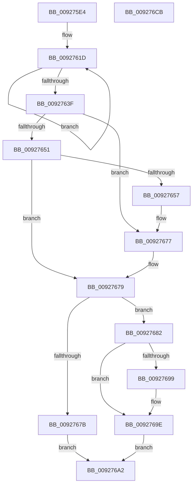

# RtlLargeIntegerToUnicode

- RVA: `0x009275E4`–`0x009276CC` (길이 `232` bytes)
- VA: `0x00000001409275E4`
- 실행 섹션: `PAGE`
- PDB 이름 있음: `예`; PDB Function 태그: `아니요`
- unwind 정보 RVA: `0x0008D5DC`
- 디코드: `70`개 명령, `232/232` bytes 표시
- 미해석 바이트: `0` (있으면 어셈블리에 `.byte`로 보존)

> 이 문서는 커널 이미지의 기계어와 PDB 기호를 분석해 생성했습니다. 4번과 5번은 함수 원형과 자료형을 바이너리 사용 방식에서 추정한 C 해석이며 원본 소스 복구 결과는 아닙니다.

## 1. Dependencies

- 직접 호출 지점: **2**; 고유 호출 대상: **2**
- 직접 호출자로 확인된 함수: **1**
- RIP 상대 이미지 참조: **2**

### Outgoing calls
- `0x00927690` → [memcpy](../../text/6C/memcpy_function_006C6840.md) (function, `0x006C6840`)
- `0x009276AD` → [_security_check_cookie](../../text/6A/_security_check_cookie_function_006AC640.md) (function, `0x006AC640`)

### Direct callers
- [sub_00927D0E](Unknown_function_00927D0E.md) at `0x00927D6D`

### Static image references
- `0x009275FB` → RVA `0x00E0A740` (`.data`; read)
- `0x0092762B` → RVA `0x00B4B7D0` (`RtlpIntegerWChars`; read)

## 2. Other-region calls and transfers

- 다른 실행 섹션으로 향하는 call: **2**
  - `0x00927690` → [memcpy](../../text/6C/memcpy_function_006C6840.md) (`PAGE` → `.text`)
  - `0x009276AD` → [_security_check_cookie](../../text/6A/_security_check_cookie_function_006AC640.md) (`PAGE` → `.text`)
- 별도 외부 분기/꼬리 이동을 확인하지 못했습니다.

## 3. Assembly (complete function range)

```asm
009275E4  4C 8B DC                        mov r11, rsp
009275E7  49 89 5B 10                     mov qword ptr [r11 + 0x10], rbx
009275EB  49 89 73 18                     mov qword ptr [r11 + 0x18], rsi
009275EF  57                              push rdi
009275F0  41 56                           push r14
009275F2  41 57                           push r15
009275F4  48 81 EC C0 00 00 00            sub rsp, 0xc0
009275FB  48 8B 05 3E 31 4E 00            mov rax, qword ptr [rip + 0x4e313e]
00927602  48 33 C4                        xor rax, rsp
00927605  48 89 84 24 B0 00 00 00         mov qword ptr [rsp + 0xb0], rax
0092760D  4D 8B F1                        mov r14, r9
00927610  41 8B F8                        mov edi, r8d
00927613  4D 8D 53 CA                     lea r10, [r11 - 0x36]
00927617  48 8B 11                        mov rdx, qword ptr [rcx]
0092761A  45 33 FF                        xor r15d, r15d
0092761D  48 8B C2                        mov rax, rdx
00927620  48 C1 EA 04                     shr rdx, 4
00927624  49 83 EA 02                     sub r10, 2
00927628  83 E0 0F                        and eax, 0xf
0092762B  48 8D 0D 9E 41 22 00            lea rcx, [rip + 0x22419e]
00927632  0F B7 04 41                     movzx eax, word ptr [rcx + rax*2]
00927636  66 41 89 02                     mov word ptr [r10], ax
0092763A  48 85 D2                        test rdx, rdx
0092763D  75 DE                           jne 0x14092761d
0092763F  48 8D 9C 24 A2 00 00 00         lea rbx, [rsp + 0xa2]
00927647  49 2B DA                        sub rbx, r10
0092764A  48 D1 FB                        sar rbx, 1
0092764D  85 FF                           test edi, edi
0092764F  79 26                           jns 0x140927677
00927651  F7 DF                           neg edi
00927653  3B DF                           cmp ebx, edi
00927655  7D 22                           jge 0x140927679
00927657  2B FB                           sub edi, ebx
00927659  8B D7                           mov edx, edi
0092765B  48 03 D2                        add rdx, rdx
0092765E  48 8B CA                        mov rcx, rdx
00927661  48 D1 E9                        shr rcx, 1
00927664  B8 30 00 00 00                  mov eax, 0x30
00927669  0F B7 C0                        movzx eax, ax
0092766C  49 8B FE                        mov rdi, r14
0092766F  66 F3 AB                        rep stosw word ptr [rdi], ax
00927672  8B FB                           mov edi, ebx
00927674  4C 03 F2                        add r14, rdx
00927677  3B DF                           cmp ebx, edi
00927679  7E 07                           jle 0x140927682
0092767B  B8 05 00 00 80                  mov eax, 0x80000005
00927680  EB 20                           jmp 0x1409276a2
00927682  8B F3                           mov esi, ebx
00927684  48 03 F6                        add rsi, rsi
00927687  4C 8B C6                        mov r8, rsi
0092768A  49 8B D2                        mov rdx, r10
0092768D  49 8B CE                        mov rcx, r14
00927690  E8 AB F1 D9 FF                  call 0x1406c6840
00927695  3B DF                           cmp ebx, edi
00927697  7D 05                           jge 0x14092769e
00927699  66 46 89 3C 36                  mov word ptr [rsi + r14], r15w
0092769E  33 C0                           xor eax, eax
009276A0  EB 00                           jmp 0x1409276a2
009276A2  48 8B 8C 24 B0 00 00 00         mov rcx, qword ptr [rsp + 0xb0]
009276AA  48 33 CC                        xor rcx, rsp
009276AD  E8 8E 4F D8 FF                  call 0x1406ac640
009276B2  4C 8D 9C 24 C0 00 00 00         lea r11, [rsp + 0xc0]
009276BA  49 8B 5B 28                     mov rbx, qword ptr [r11 + 0x28]
009276BE  49 8B 73 30                     mov rsi, qword ptr [r11 + 0x30]
009276C2  49 8B E3                        mov rsp, r11
009276C5  41 5F                           pop r15
009276C7  41 5E                           pop r14
009276C9  5F                              pop rdi
009276CA  C3                              ret
009276CB  CC                              int3
```

## 4. C-style interpretation (structured pseudocode)

```c
__int64 __fastcall RtlLargeIntegerToUnicode(__int64 a1, __int64 a2, int a3, __int64 a4)
{
    __int64 result;
    __int64 v_r10;
    __int64 v_r14;
    __int64 v_r15;
    __int64 v_rbx;
    __int64 v_rdi;
    __int64 v_rsi;
    __int64 v_rsp;
    unsigned __int64 v_stack_m18;
    unsigned __int64 v_stack_m28;
    unsigned __int64 v_stack_m36;

    *(unsigned __int64 *)(v_rsp + 16) = v_rbx;
    *(unsigned __int64 *)(v_rsp + 24) = v_rsi;
    v_rsp = (v_rsp) - (192);
    result = (*(unsigned __int64 *)(v_rip + 5124414)) ^ (v_rsp);
    v_stack_m28 = result;
    v_r15 = 0;
loc_0092761D:
    a2 = (*(unsigned __int64 *)(a1)) >> (4);
    v_r10 = (v_rsp - 54) - (2);
    result = (unsigned int)((*(unsigned __int64 *)(a1)) & (15));
    *(unsigned __int16 *)(v_r10) = (unsigned __int16)(*(unsigned __int16 *)(v_rip + 2245022 + result * 2));
    if (a2 != 0) goto loc_0092761D;
    v_rbx = (v_stack_m36) - (v_r10);
    v_rbx = (v_rbx) >> (1);
    if (!sign_flag) goto loc_00927677;
    v_rdi = (unsigned int)(-((unsigned int)(a3)));
    if (((unsigned int)(v_rbx)) >= ((unsigned int)(v_rdi))) goto loc_00927679;
    v_rdi = (unsigned int)((v_rdi) - ((unsigned int)(v_rbx)));
    a2 = ((unsigned int)((unsigned int)(v_rdi))) + ((unsigned int)((unsigned int)(v_rdi)));
    a1 = (a2) >> (1);
    v_r14 = (a4) + (a2);
loc_00927677:
loc_00927679:
    if (((unsigned int)(v_rbx)) <= ((unsigned int)((unsigned int)((unsigned int)(v_rbx))))) goto loc_00927682;
    goto loc_009276A2;
loc_00927682:
    v_rsi = ((unsigned int)((unsigned int)(v_rbx))) + ((unsigned int)((unsigned int)(v_rbx)));
    result = memcpy(v_r14, v_r10, v_rsi, a4);
    if (((unsigned int)(v_rbx)) < ((unsigned int)((unsigned int)((unsigned int)(v_rbx))))) {
        *(unsigned __int16 *)(v_rsi + v_r14 * 1) = 0;
    }
    result = 0;
    goto loc_009276A2;
loc_009276A2:
    a1 = (v_stack_m28) ^ (v_rsp);
    result = _security_check_cookie(a1, v_r10, v_rsi, a4);
    return result;
}
```

## 5. (Beta) C Style

```c
int64_t RtlLargeIntegerToUnicode(void *Arg1, int64_t Arg2, int32_t Arg3, void *Arg4)
{
    uint8_t *arg1 = (uint8_t *)Arg1;
    uint8_t *arg4 = (uint8_t *)Arg4;

    int64_t result;
    int64_t local_r10;
    int64_t local_r14;
    int64_t local_r15;
    int64_t local_rbx;
    int64_t local_rdi;
    int64_t local_rsi;
    int64_t local_rsp;
    uint64_t v_stack_m18;
    uint64_t v_stack_m28;
    uint64_t v_stack_m36;

    *(uint64_t *)(local_rsp + 0x10) = local_rbx;
    *(uint64_t *)(local_rsp + 0x18) = local_rsi;
    local_rsp = (local_rsp) - (192);
    result = (*(uint64_t *)(v_rip + 0x4E313E)) ^ (local_rsp);
    v_stack_m28 = result;
    local_r15 = 0;
loc_0092761D:
    Arg2 = (*(uint64_t *)(arg1)) >> (4);
    local_r10 = (local_rsp - 54) - (2);
    result = (uint32_t)((*(uint64_t *)(arg1)) & (15));
    *(uint16_t *)(local_r10) = (uint16_t)(*(uint16_t *)(v_rip + 0x22419E + result * 2));
    if (Arg2 != 0) goto loc_0092761D;
    local_rbx = (v_stack_m36) - (local_r10);
    local_rbx = (local_rbx) >> (1);
    if (!sign_flag) goto loc_00927677;
    local_rdi = (uint32_t)(-((uint32_t)(Arg3)));
    if (((uint32_t)(local_rbx)) >= ((uint32_t)(local_rdi))) goto loc_00927679;
    local_rdi = (uint32_t)((local_rdi) - ((uint32_t)(local_rbx)));
    Arg2 = ((uint32_t)((uint32_t)(local_rdi))) + ((uint32_t)((uint32_t)(local_rdi)));
    Arg1 = (Arg2) >> (1);
    local_r14 = (Arg4) + (Arg2);
loc_00927677:
loc_00927679:
    if (((uint32_t)(local_rbx)) <= ((uint32_t)((uint32_t)((uint32_t)(local_rbx))))) goto loc_00927682;
    goto loc_009276A2;
loc_00927682:
    local_rsi = ((uint32_t)((uint32_t)(local_rbx))) + ((uint32_t)((uint32_t)(local_rbx)));
    result = memcpy(local_r14, local_r10, local_rsi, Arg4);
    if (((uint32_t)(local_rbx)) < ((uint32_t)((uint32_t)((uint32_t)(local_rbx))))) {
        *(uint16_t *)(local_rsi + local_r14 * 1) = 0;
    }
    result = 0;
    goto loc_009276A2;
loc_009276A2:
    Arg1 = (v_stack_m28) ^ (local_rsp);
    result = _security_check_cookie(Arg1, local_r10, local_rsi, Arg4);
    return result;
}
```

### 관측된 메모리 오프셋

구조체 형식이 확인되지 않은 접근은 인자 기준의 오프셋으로만 기록했습니다.

| 기준 인자 | 오프셋 표현 | 폭 (bit) | 접근 |
|---|---:|---:|---|
| `Arg1` | `+ 0x0` | `64` | `R` |
| `Arg4` | `+ 0x0` | `16` | `W` |

## 6. Execution-region graph

[열기: 2D/3D 그래프와 함수 탐색 컨트롤 패널](../../../control-panel.html?section=page&rva=0x009275E4&view=graph)

- 2D 그래프는 위에서 아래로 흐르고, 3D 그래프는 빈 공간을 드래그해 회전합니다. Shift+드래그는 이동, 휠은 확대·축소, 함수 노드 선택은 대상 보고서 이동입니다.

### Static fallback


