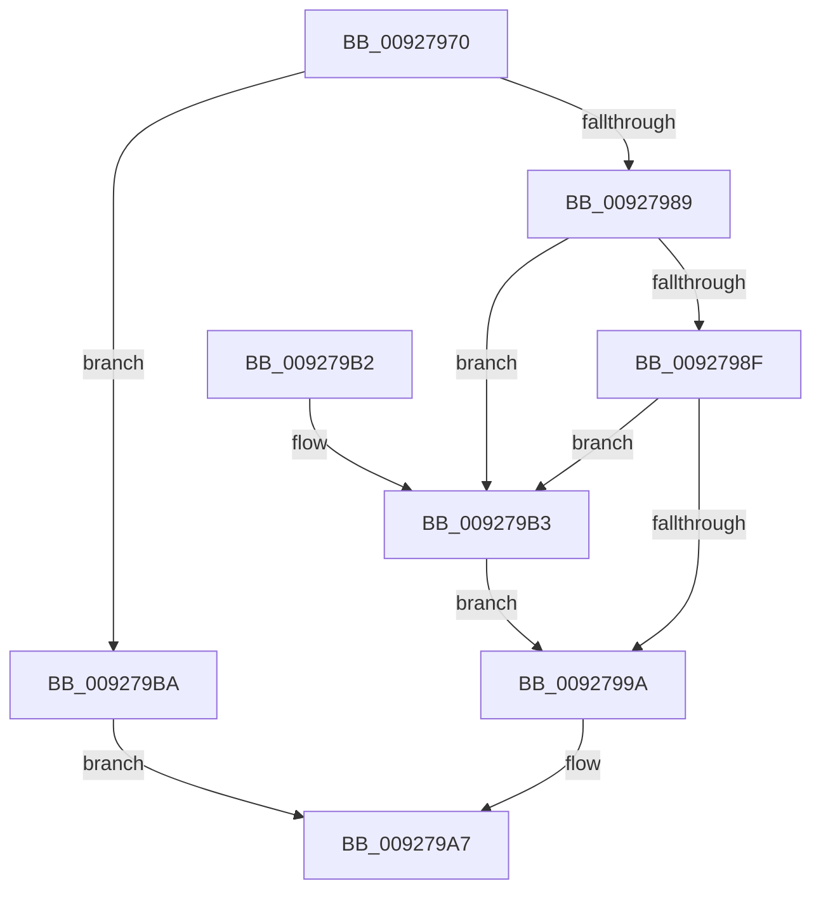

# RtlLengthSidAsUnicodeString

- RVA: `0x00927970`–`0x009279C1` (길이 `81` bytes)
- VA: `0x0000000140927970`
- 실행 섹션: `PAGE`
- PDB 이름 있음: `예`; PDB Function 태그: `아니요`
- unwind 정보 RVA: `0x0008A6D8`
- 디코드: `27`개 명령, `81/81` bytes 표시
- 미해석 바이트: `0` (있으면 어셈블리에 `.byte`로 보존)

> 이 문서는 커널 이미지의 기계어와 PDB 기호를 분석해 생성했습니다. 4번과 5번은 함수 원형과 자료형을 바이너리 사용 방식에서 추정한 C 해석이며 원본 소스 복구 결과는 아닙니다.

## 1. Dependencies

- 직접 호출 지점: **1**; 고유 호출 대상: **1**
- 직접 호출자로 확인된 함수: **2**
- RIP 상대 이미지 참조: **0**

### Outgoing calls
- `0x00927980` → [RtlValidSid](RtlValidSid_function_00929710.md) (function, `0x00929710`)

### Direct callers
- [AdtpBuildSidListString](../82/AdtpBuildSidListString_function_00822440.md) at `0x008224E2`
- [ExpWnfGetPermanentPerUserDataStoreHandle](../A7/ExpWnfGetPermanentPerUserDataStoreHandle_function_00A7A35C.md) at `0x00A7A3A3`

### Static image references
- 디코드된 RIP-relative 메모리 참조가 없습니다.

## 2. Other-region calls and transfers

- 다른 실행 섹션으로 향하는 call: **0**
- 별도 외부 분기/꼬리 이동을 확인하지 못했습니다.

## 3. Assembly (complete function range)

```asm
00927970  48 89 5C 24 08                  mov qword ptr [rsp + 8], rbx
00927975  57                              push rdi
00927976  48 83 EC 20                     sub rsp, 0x20
0092797A  48 8B FA                        mov rdi, rdx
0092797D  48 8B D9                        mov rbx, rcx
00927980  E8 8B 1D 00 00                  call 0x140929710
00927985  3C 01                           cmp al, 1
00927987  75 31                           jne 0x1409279ba
00927989  80 7B 02 00                     cmp byte ptr [rbx + 2], 0
0092798D  75 24                           jne 0x1409279b3
0092798F  80 7B 03 00                     cmp byte ptr [rbx + 3], 0
00927993  BA 1C 00 00 00                  mov edx, 0x1c
00927998  75 19                           jne 0x1409279b3
0092799A  0F B6 43 01                     movzx eax, byte ptr [rbx + 1]
0092799E  6B C8 16                        imul ecx, eax, 0x16
009279A1  03 CA                           add ecx, edx
009279A3  89 0F                           mov dword ptr [rdi], ecx
009279A5  33 C0                           xor eax, eax
009279A7  48 8B 5C 24 30                  mov rbx, qword ptr [rsp + 0x30]
009279AC  48 83 C4 20                     add rsp, 0x20
009279B0  5F                              pop rdi
009279B1  C3                              ret
009279B2  CC                              int3
009279B3  BA 24 00 00 00                  mov edx, 0x24
009279B8  EB E0                           jmp 0x14092799a
009279BA  B8 78 00 00 C0                  mov eax, 0xc0000078
009279BF  EB E6                           jmp 0x1409279a7
```

## 4. C-style interpretation (structured pseudocode)

```c
__int64 __fastcall RtlLengthSidAsUnicodeString(__int64 a1, __int64 a2)
{
    __int64 result;
    __int64 v_rsp;
    unsigned __int64 v_stack_p8;

    v_stack_p8 = v_rbx;
    v_rsp = (v_rsp) - (32);
    result = RtlValidSid(a1, a2, a3, a4);
    if (((unsigned __int8)(result)) != 1) goto loc_009279BA;
    if ((*(unsigned __int8 *)(a1 + 2)) != 0) goto loc_009279B3;
    if ((*(unsigned __int8 *)(a1 + 3)) != 0) goto loc_009279B3;
loc_0092799A:
    a1 = (unsigned int)((a1) * ((unsigned int)(*(unsigned __int8 *)(a1 + 1))));
    a1 = (unsigned int)((a1) + (28));
    *(unsigned int *)(a2) = (unsigned int)(a1);
    result = 0;
loc_009279A7:
    v_rsp = (v_rsp) + (32);
    return result;
loc_009279B3:
    goto loc_0092799A;
loc_009279BA:
    goto loc_009279A7;
}
```

## 5. (Beta) C Style

```c
int64_t RtlLengthSidAsUnicodeString(void *Arg1, void *Arg2)
{
    uint8_t *arg1 = (uint8_t *)Arg1;
    uint8_t *arg2 = (uint8_t *)Arg2;

    int64_t result;
    int64_t local_rsp;
    uint64_t v_stack_p8;

    v_stack_p8 = local_rbx;
    local_rsp = (local_rsp) - (32);
    result = RtlValidSid(Arg1, Arg2, a3, a4);
    if (((uint8_t)(result)) != 1) goto loc_009279BA;
    if ((*(uint8_t *)(arg1 + 0x2)) != 0) goto loc_009279B3;
    if ((*(uint8_t *)(arg1 + 0x3)) != 0) goto loc_009279B3;
loc_0092799A:
    Arg1 = (uint32_t)((Arg1) * ((uint32_t)(*(uint8_t *)(arg1 + 0x1))));
    Arg1 = (uint32_t)((Arg1) + (28));
    *(uint32_t *)(arg2) = (uint32_t)(Arg1);
    result = 0;
loc_009279A7:
    local_rsp = (local_rsp) + (32);
    return result;
loc_009279B3:
    goto loc_0092799A;
loc_009279BA:
    goto loc_009279A7;
}
```

### 관측된 메모리 오프셋

구조체 형식이 확인되지 않은 접근은 인자 기준의 오프셋으로만 기록했습니다.

| 기준 인자 | 오프셋 표현 | 폭 (bit) | 접근 |
|---|---:|---:|---|
| `Arg1` | `+ 0x1` | `8` | `R` |
| `Arg1` | `+ 0x2` | `8` | `R` |
| `Arg1` | `+ 0x3` | `8` | `R` |
| `Arg2` | `+ 0x0` | `32` | `W` |

## 6. Execution-region graph

[열기: 2D/3D 그래프와 함수 탐색 컨트롤 패널](../../../control-panel.html?section=page&rva=0x00927970&view=graph)

- 2D 그래프는 위에서 아래로 흐르고, 3D 그래프는 빈 공간을 드래그해 회전합니다. Shift+드래그는 이동, 휠은 확대·축소, 함수 노드 선택은 대상 보고서 이동입니다.

### Static fallback


