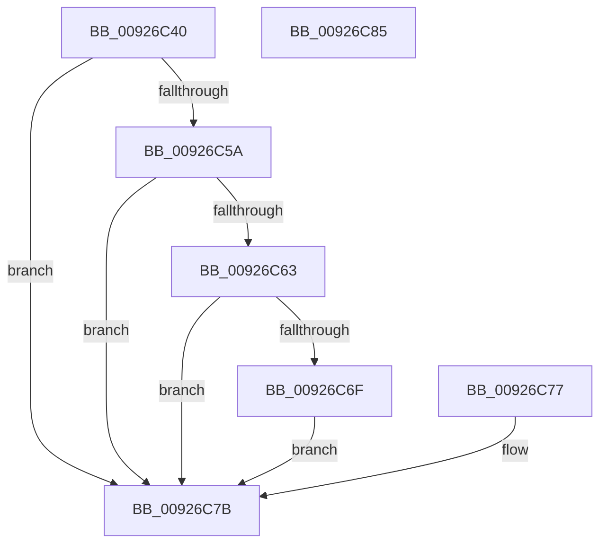

# RtlNtStatusToDosError

- RVA: `0x00926C40`–`0x00926C86` (길이 `70` bytes)
- VA: `0x0000000140926C40`
- 실행 섹션: `PAGE`
- PDB 이름 있음: `예`; PDB Function 태그: `아니요`
- unwind 정보 RVA: `0x0008D534`
- 디코드: `17`개 명령, `70/70` bytes 표시
- 미해석 바이트: `0` (있으면 어셈블리에 `.byte`로 보존)

> 이 문서는 커널 이미지의 기계어와 PDB 기호를 분석해 생성했습니다. 4번과 5번은 함수 원형과 자료형을 바이너리 사용 방식에서 추정한 C 해석이며 원본 소스 복구 결과는 아닙니다.

## 1. Dependencies

- 직접 호출 지점: **1**; 고유 호출 대상: **1**
- 직접 호출자로 확인된 함수: **10**
- RIP 상대 이미지 참조: **0**

### Outgoing calls
- `0x00926C7B` → [RtlNtStatusToDosErrorNoTeb](../../text/44/RtlNtStatusToDosErrorNoTeb_function_00448240.md) (function, `0x00448240`)

### Direct callers
- [EtwStartAutoLogger](../7B/EtwStartAutoLogger_function_007BD2F8.md) at `0x007BE1BD`
- [EtwpEnumerateAutologgerPath](../7B/EtwpEnumerateAutologgerPath_function_007BE398.md) at `0x007BE5B9`
- [LocalConvertSDToStringSD_Rev1](LocalConvertSDToStringSD_Rev1_function_00924428.md) at `0x00924517`
- [LocalConvertSDToStringSD_Rev1](LocalConvertSDToStringSD_Rev1_function_00924428.md) at `0x00924A30`
- [LocalConvertStringSDToSD_Rev1](LocalConvertStringSDToSD_Rev1_function_0092656C.md) at `0x009269D4`
- [LocalConvertStringSDToSD_Rev1](LocalConvertStringSDToSD_Rev1_function_0092656C.md) at `0x00926B0D`
- [LocalConvertStringSDToSD_Rev1](LocalConvertStringSDToSD_Rev1_function_0092656C.md) at `0x00926B6F`
- [LocalConvertStringSDToSD_Rev1](LocalConvertStringSDToSD_Rev1_function_0092656C.md) at `0x00926B91`
- [LocalConvertStringSDToSD_Rev1](LocalConvertStringSDToSD_Rev1_function_0092656C.md) at `0x00926BA7`
- [LocalConvertStringSDToSD_Rev1](LocalConvertStringSDToSD_Rev1_function_0092656C.md) at `0x00926BBF`
- [LocalConvertStringSDToSD_Rev1](LocalConvertStringSDToSD_Rev1_function_0092656C.md) at `0x00926BF7`
- [LocalGetAclForString](LocalGetAclForString_function_00927F30.md) at `0x009280F9`
- [LocalGetAclForString](LocalGetAclForString_function_00927F30.md) at `0x00928B6C`
- [LocalGetSidForString](LocalGetSidForString_function_009292B4.md) at `0x0092939E`
- [LocalGetStringForSid](../A0/LocalGetStringForSid_function_00A00328.md) at `0x00A003C8`
- [LocalConvertAclToString](../A0/LocalConvertAclToString_function_00A00408.md) at `0x00A0103E`
- [EtwpEnableAutoLoggerProvider](../A9/EtwpEnableAutoLoggerProvider_function_00A92B00.md) at `0x00A93135`
- [EtwpEnumerateKeyProviders](../AB/EtwpEnumerateKeyProviders_function_00AB029C.md) at `0x00AB03CE`

### Static image references
- 디코드된 RIP-relative 메모리 참조가 없습니다.

## 2. Other-region calls and transfers

- 다른 실행 섹션으로 향하는 call: **1**
  - `0x00926C7B` → [RtlNtStatusToDosErrorNoTeb](../../text/44/RtlNtStatusToDosErrorNoTeb_function_00448240.md) (`PAGE` → `.text`)
- 별도 외부 분기/꼬리 이동을 확인하지 못했습니다.

## 3. Assembly (complete function range)

```asm
00926C40  89 4C 24 08                     mov dword ptr [rsp + 8], ecx
00926C44  48 83 EC 28                     sub rsp, 0x28
00926C48  65 48 8B 04 25 88 01 00 00      mov rax, qword ptr gs:[0x188]
00926C51  F7 40 74 00 04 00 00            test dword ptr [rax + 0x74], 0x400
00926C58  75 21                           jne 0x140926c7b
00926C5A  80 B8 4A 02 00 00 01            cmp byte ptr [rax + 0x24a], 1
00926C61  74 18                           je 0x140926c7b
00926C63  48 8B 90 F0 00 00 00            mov rdx, qword ptr [rax + 0xf0]
00926C6A  48 85 D2                        test rdx, rdx
00926C6D  74 0C                           je 0x140926c7b
00926C6F  89 8A 50 12 00 00               mov dword ptr [rdx + 0x1250], ecx
00926C75  EB 04                           jmp 0x140926c7b
00926C77  8B 4C 24 30                     mov ecx, dword ptr [rsp + 0x30]
00926C7B  E8 C0 15 B2 FF                  call 0x140448240
00926C80  48 83 C4 28                     add rsp, 0x28
00926C84  C3                              ret
00926C85  CC                              int3
```

## 4. C-style interpretation (structured pseudocode)

```c
__int64 __fastcall RtlNtStatusToDosError(int a1)
{
    __int64 result;
    __int64 v_rsp;
    unsigned int v_stack_p8;

    v_stack_p8 = a1;
    v_rsp = (v_rsp) - (40);
    if (((*(unsigned int *)(*(unsigned __int64 *)(gs_base + (0 + 392)) + 116)) & (0x400ULL)) != 0) goto loc_00926C7B;
    if ((*(unsigned __int8 *)(*(unsigned __int64 *)(gs_base + (0 + 392)) + 586)) == 1) goto loc_00926C7B;
    if (*(unsigned __int64 *)(*(unsigned __int64 *)(gs_base + (0 + 392)) + 240) == 0) goto loc_00926C7B;
    *(unsigned int *)(*(unsigned __int64 *)(*(unsigned __int64 *)(gs_base + (0 + 392)) + 240) + 4688) = a1;
    goto loc_00926C7B;
loc_00926C7B:
    result = RtlNtStatusToDosErrorNoTeb(a1, *(unsigned __int64 *)(*(unsigned __int64 *)(gs_base + (0 + 392)) + 240), a3, a4);
    v_rsp = (v_rsp) + (40);
    return result;
}
```

## 5. (Beta) C Style

```c
int64_t RtlNtStatusToDosError(int32_t Arg1)
{
    int64_t result;
    int64_t local_rsp;
    uint32_t v_stack_p8;

    v_stack_p8 = Arg1;
    local_rsp = (local_rsp) - (40);
    if (((*(uint32_t *)(*(uint64_t *)(gs_base + (0 + 0x188)) + 0x74)) & (0x400ULL)) != 0) goto loc_00926C7B;
    if ((*(uint8_t *)(*(uint64_t *)(gs_base + (0 + 0x188)) + 0x24A)) == 1) goto loc_00926C7B;
    if (*(uint64_t *)(*(uint64_t *)(gs_base + (0 + 0x188)) + 0xF0) == 0) goto loc_00926C7B;
    *(uint32_t *)(*(uint64_t *)(*(uint64_t *)(gs_base + (0 + 0x188)) + 0xF0) + 0x1250) = Arg1;
    goto loc_00926C7B;
loc_00926C7B:
    result = RtlNtStatusToDosErrorNoTeb(Arg1, *(uint64_t *)(*(uint64_t *)(gs_base + (0 + 0x188)) + 0xF0), a3, a4);
    local_rsp = (local_rsp) + (40);
    return result;
}
```

## 6. Execution-region graph

[열기: 2D/3D 그래프와 함수 탐색 컨트롤 패널](../../../control-panel.html?section=page&rva=0x00926C40&view=graph)

- 2D 그래프는 위에서 아래로 흐르고, 3D 그래프는 빈 공간을 드래그해 회전합니다. Shift+드래그는 이동, 휠은 확대·축소, 함수 노드 선택은 대상 보고서 이동입니다.

### Static fallback


