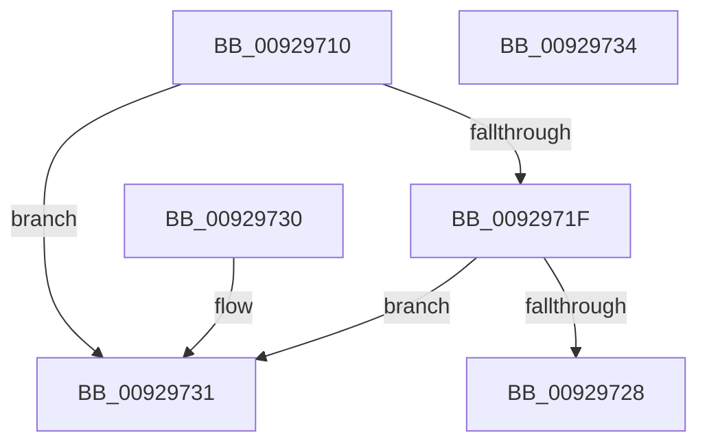

# RtlValidSid

- RVA: `0x00929710`–`0x00929735` (길이 `37` bytes)
- VA: `0x0000000140929710`
- 실행 섹션: `PAGE`
- PDB 이름 있음: `예`; PDB Function 태그: `아니요`
- unwind 정보 RVA: `0x000DB714`
- 디코드: `14`개 명령, `37/37` bytes 표시
- 미해석 바이트: `0` (있으면 어셈블리에 `.byte`로 보존)

> 이 문서는 커널 이미지의 기계어와 PDB 기호를 분석해 생성했습니다. 4번과 5번은 함수 원형과 자료형을 바이너리 사용 방식에서 추정한 C 해석이며 원본 소스 복구 결과는 아닙니다.

## 1. Dependencies

- 직접 호출 지점: **0**; 고유 호출 대상: **0**
- 직접 호출자로 확인된 함수: **36**
- RIP 상대 이미지 참조: **0**

### Outgoing calls
- 직접 디코드된 call 명령이 없습니다.

### Direct callers
- [AdtpPackageParameters](../../text/45/AdtpPackageParameters_function_00459964.md) at `0x00459B0C`
- [SepValidateCAPID](../../text/4F/SepValidateCAPID_function_004FA528.md) at `0x004FA53D`
- [SeSetTokenTamperProtection](../../text/60/SeSetTokenTamperProtection_function_00609644.md) at `0x006097E6`
- [SeSetTokenTamperProtection](../../text/60/SeSetTokenTamperProtection_function_00609644.md) at `0x006097F6`
- [SeSetTokenTamperProtection](../../text/60/SeSetTokenTamperProtection_function_00609644.md) at `0x0060982C`
- [IopCheckGetQuotaBufferValidity](../71/IopCheckGetQuotaBufferValidity_function_0071AF24.md) at `0x0071AF51`
- [IoCheckQuotaBufferValidity](../71/IoCheckQuotaBufferValidity_function_0071CFD0.md) at `0x0071D01D`
- [NtQueryQuotaInformationFile](../72/NtQueryQuotaInformationFile_function_00720FE0.md) at `0x00721300`
- [PiAuCheckClientInteractive](../73/PiAuCheckClientInteractive_function_00731284.md) at `0x007312FC`
- [RtlAddAccessFilterAce](../78/RtlAddAccessFilterAce_function_0078D210.md) at `0x0078D29B`
- [RtlAddMandatoryAccessAllowedAce](../78/RtlAddMandatoryAccessAllowedAce_function_0078D530.md) at `0x0078D575`
- [RtlAddMandatoryAppAccessAllowedAce](../78/RtlAddMandatoryAppAccessAllowedAce_function_0078D670.md) at `0x0078D6A1`
- [RtlAddMandatoryAppAccessAllowedAce](../78/RtlAddMandatoryAppAccessAllowedAce_function_0078D670.md) at `0x0078D6B6`
- [RtlAddResourceAttributeAce](../78/RtlAddResourceAttributeAce_function_0078D7F0.md) at `0x0078D893`
- [RtlpAddKnownObjectAce](../78/RtlpAddKnownObjectAce_function_0078DBB4.md) at `0x0078DBF3`
- [SepReadSingleCap](../7A/SepReadSingleCap_function_007A43E4.md) at `0x007A467D`
- [SddlAddAccessFilterAce](../7A/SddlAddAccessFilterAce_function_007A4D58.md) at `0x007A4DEE`
- [SddlAddProcessTrustLabelAce](../7A/SddlAddProcessTrustLabelAce_function_007A4F94.md) at `0x007A4FE7`
- [SddlAddScopedPolicyIDAce](../7A/SddlAddScopedPolicyIDAce_function_007A50F4.md) at `0x007A5144`
- [ExpInitFullProcessSecurityInfo](../7C/ExpInitFullProcessSecurityInfo_function_007C43D0.md) at `0x007C44D3`
- [PnpGetEnumSecurityDescriptor](../83/PnpGetEnumSecurityDescriptor_function_00831FCC.md) at `0x00832054`
- [PnpGetEnumSecurityDescriptor](../83/PnpGetEnumSecurityDescriptor_function_00831FCC.md) at `0x0083208E`
- [PnpGetEnumSecurityDescriptor](../83/PnpGetEnumSecurityDescriptor_function_00831FCC.md) at `0x008320C4`
- [PnpGetEnumSecurityDescriptor](../83/PnpGetEnumSecurityDescriptor_function_00831FCC.md) at `0x00832114`
- [DrvDbGetSecurityDescriptor](../83/DrvDbGetSecurityDescriptor_function_0083580C.md) at `0x008358AD`
- [DrvDbGetSecurityDescriptor](../83/DrvDbGetSecurityDescriptor_function_0083580C.md) at `0x008358FD`
- [DrvDbGetSecurityDescriptor](../83/DrvDbGetSecurityDescriptor_function_0083580C.md) at `0x00835949`
- [DrvDbGetSecurityDescriptor](../83/DrvDbGetSecurityDescriptor_function_0083580C.md) at `0x008359B4`
- [RtlValidSecurityDescriptor](../8B/RtlValidSecurityDescriptor_function_008BD3F0.md) at `0x008BD4DD`
- [RtlValidSecurityDescriptor](../8B/RtlValidSecurityDescriptor_function_008BD3F0.md) at `0x008BD4EB`
- [SeCaptureSid](SeCaptureSid_function_009276D4.md) at `0x009277A8`
- [RtlFormatCurrentUserKeyPath](RtlFormatCurrentUserKeyPath_function_00927820.md) at `0x00927880`
- [RtlLengthSidAsUnicodeString](RtlLengthSidAsUnicodeString_function_00927970.md) at `0x00927980`
- [RtlAddAccessAllowedAceEx](RtlAddAccessAllowedAceEx_function_009279D0.md) at `0x009279FF`
- [RtlConvertSidToUnicodeString](RtlConvertSidToUnicodeString_function_00927B30.md) at `0x00927B63`
- [LocalGetAclForString](LocalGetAclForString_function_00927F30.md) at `0x00928488`
- [RtlAddProcessTrustLabelAce](RtlAddProcessTrustLabelAce_function_00929740.md) at `0x0092978A`
- [SddlAddMandatoryAce](../9A/SddlAddMandatoryAce_function_009A98AC.md) at `0x009A98F3`
- [SeCaptureSidAndAttributesArray](../9C/SeCaptureSidAndAttributesArray_function_009C9D70.md) at `0x009C9FDA`
- [RtlEnumerateBoundaryDescriptorEntries](../9C/RtlEnumerateBoundaryDescriptorEntries_function_009CA278.md) at `0x009CA39C`
- [RtlpValidateSidBuffer](../9C/RtlpValidateSidBuffer_function_009CA484.md) at `0x009CA4AC`
- [_CmGetRegKeySecurityDescriptor](../A8/_CmGetRegKeySecurityDescriptor_function_00A83F34.md) at `0x00A83FC1`
- [_CmGetRegKeySecurityDescriptor](../A8/_CmGetRegKeySecurityDescriptor_function_00A83F34.md) at `0x00A83FF4`
- [_CmGetRegKeySecurityDescriptor](../A8/_CmGetRegKeySecurityDescriptor_function_00A83F34.md) at `0x00A8403E`
- [_CmGetRegKeySecurityDescriptor](../A8/_CmGetRegKeySecurityDescriptor_function_00A83F34.md) at `0x00A841F5`
- [_PnpGetPropertiesSecurityDescriptor](../A9/_PnpGetPropertiesSecurityDescriptor_function_00A91B8C.md) at `0x00A91BD9`
- [NtManageHotPatch](../AF/NtManageHotPatch_function_00AF8660.md) at `0x00AF89C5`
- [NtManageHotPatch](../AF/NtManageHotPatch_function_00AF8660.md) at `0x00AF8AD4`
- [PiAuCreateStandardSecurityObject](../../init/C3/PiAuCreateStandardSecurityObject_function_00C34710.md) at `0x00C34817`
- [PiAuCreateStandardSecurityObject](../../init/C3/PiAuCreateStandardSecurityObject_function_00C34710.md) at `0x00C348A6`
- [PiAuCreateUserSids](../../init/C3/PiAuCreateUserSids_function_00C34C2C.md) at `0x00C34C97`
- [PiAuCreateUserSids](../../init/C3/PiAuCreateUserSids_function_00C34C2C.md) at `0x00C34CD1`
- [PiAuCreateUserSids](../../init/C3/PiAuCreateUserSids_function_00C34C2C.md) at `0x00C34D14`
- [PiAuCreateUserSids](../../init/C3/PiAuCreateUserSids_function_00C34C2C.md) at `0x00C34D44`
- [PiAuCreateUserSids](../../init/C3/PiAuCreateUserSids_function_00C34C2C.md) at `0x00C34D85`
- [PiAuCreateUserSids](../../init/C3/PiAuCreateUserSids_function_00C34C2C.md) at `0x00C34DBC`
- [PiAuCreateUserSids](../../init/C3/PiAuCreateUserSids_function_00C34C2C.md) at `0x00C34DEF`
- [PiAuCreateUserSids](../../init/C3/PiAuCreateUserSids_function_00C34C2C.md) at `0x00C34E26`

### Static image references
- 디코드된 RIP-relative 메모리 참조가 없습니다.

## 2. Other-region calls and transfers

- 다른 실행 섹션으로 향하는 call: **0**
- 별도 외부 분기/꼬리 이동을 확인하지 못했습니다.

## 3. Assembly (complete function range)

```asm
00929710  48 B8 00 00 FF FF FF 7F 00 00   movabs rax, 0x7fffffff0000
0092971A  48 3B C8                        cmp rcx, rax
0092971D  76 12                           jbe 0x140929731
0092971F  0F B6 01                        movzx eax, byte ptr [rcx]
00929722  24 0F                           and al, 0xf
00929724  3C 01                           cmp al, 1
00929726  75 09                           jne 0x140929731
00929728  80 79 01 0F                     cmp byte ptr [rcx + 1], 0xf
0092972C  0F 96 C0                        setbe al
0092972F  C3                              ret
00929730  CC                              int3
00929731  32 C0                           xor al, al
00929733  C3                              ret
00929734  CC                              int3
```

## 4. C-style interpretation (structured pseudocode)

```c
__int64 __fastcall RtlValidSid(__int64 a1)
{
    __int64 result;

    if (a1 <= result) goto loc_00929731;
    result = (unsigned __int8)((*(unsigned __int8 *)(a1)) & (15));
    if (((unsigned __int8)(result)) != 1) goto loc_00929731;
    result = ((*(unsigned __int8 *)(a1 + 1)) <= 15) ? 1 : 0;
    return result;
loc_00929731:
    result = 0;
    return result;
}
```

## 5. (Beta) C Style

```c
int64_t RtlValidSid(int64_t Arg1)
{
    int64_t result;

    if (Arg1 <= result) goto loc_00929731;
    result = (uint8_t)((*(uint8_t *)(Arg1)) & (15));
    if (((uint8_t)(result)) != 1) goto loc_00929731;
    result = ((*(uint8_t *)(Arg1 + 0x1)) <= 15) ? 1 : 0;
    return result;
loc_00929731:
    result = 0;
    return result;
}
```

## 6. Execution-region graph

[열기: 2D/3D 그래프와 함수 탐색 컨트롤 패널](../../../control-panel.html?section=page&rva=0x00929710&view=graph)

- 2D 그래프는 위에서 아래로 흐르고, 3D 그래프는 빈 공간을 드래그해 회전합니다. Shift+드래그는 이동, 휠은 확대·축소, 함수 노드 선택은 대상 보고서 이동입니다.

### Static fallback


