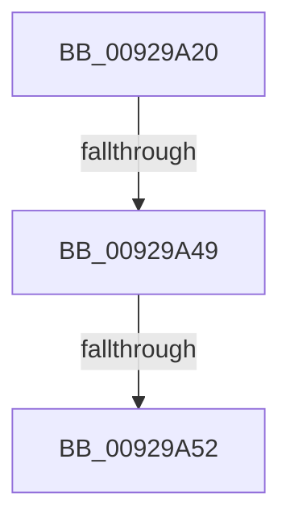

# RtlpAddKnownAce

- RVA: `0x00929A20`–`0x00929A58` (길이 `56` bytes)
- VA: `0x0000000140929A20`
- 실행 섹션: `PAGE`
- PDB 이름 있음: `예`; PDB Function 태그: `아니요`
- unwind 정보 RVA: `0x0008D978`
- 디코드: `18`개 명령, `56/56` bytes 표시
- 미해석 바이트: `0` (있으면 어셈블리에 `.byte`로 보존)

> 이 문서는 커널 이미지의 기계어와 PDB 기호를 분석해 생성했습니다. 4번과 5번은 함수 원형과 자료형을 바이너리 사용 방식에서 추정한 C 해석이며 원본 소스 복구 결과는 아닙니다.

## 1. Dependencies

- 직접 호출 지점: **0**; 고유 호출 대상: **0**
- 직접 호출자로 확인된 함수: **43**
- RIP 상대 이미지 참조: **0**

### Outgoing calls
- 직접 디코드된 call 명령이 없습니다.

### Direct callers
- [DbgkpCreateNotificationEvent](../71/DbgkpCreateNotificationEvent_function_00710480.md) at `0x007105C8`
- [DbgkpCreateNotificationEvent](../71/DbgkpCreateNotificationEvent_function_00710480.md) at `0x007105F3`
- [DbgkpCreateNotificationEvent](../71/DbgkpCreateNotificationEvent_function_00710480.md) at `0x0071061B`
- [DbgkpCreateNotificationEvent](../71/DbgkpCreateNotificationEvent_function_00710480.md) at `0x0071064A`
- [DbgkpCreateNotificationEvent](../71/DbgkpCreateNotificationEvent_function_00710480.md) at `0x00710679`
- [PiAuCheckTokenMembership](../73/PiAuCheckTokenMembership_function_00731348.md) at `0x00731434`
- [PiAuGetServiceStateSecurityObject](../73/PiAuGetServiceStateSecurityObject_function_007314F0.md) at `0x007315B7`
- [PiAuGetServiceStateSecurityObject](../73/PiAuGetServiceStateSecurityObject_function_007314F0.md) at `0x007315F6`
- [PiAuGetServiceStateSecurityObject](../73/PiAuGetServiceStateSecurityObject_function_007314F0.md) at `0x00731629`
- [PiAuGetStateDirectorySecurityObject](../73/PiAuGetStateDirectorySecurityObject_function_00731738.md) at `0x00731804`
- [PiAuGetStateDirectorySecurityObject](../73/PiAuGetStateDirectorySecurityObject_function_00731738.md) at `0x00731831`
- [PiAuGetStateDirectorySecurityObject](../73/PiAuGetStateDirectorySecurityObject_function_00731738.md) at `0x0073186F`
- [PiAuGetStateDirectorySecurityObject](../73/PiAuGetStateDirectorySecurityObject_function_00731738.md) at `0x0073189F`
- [PiAuGetStateDirectorySecurityObject](../73/PiAuGetStateDirectorySecurityObject_function_00731738.md) at `0x007318D6`
- [PiAuGetStateDirectorySecurityObject](../73/PiAuGetStateDirectorySecurityObject_function_00731738.md) at `0x00731909`
- [ObCreateKernelObjectsSD](../74/ObCreateKernelObjectsSD_function_0074D7A8.md) at `0x0074D85A`
- [ObCreateKernelObjectsSD](../74/ObCreateKernelObjectsSD_function_0074D7A8.md) at `0x0074D886`
- [ObCreateKernelObjectsSD](../74/ObCreateKernelObjectsSD_function_0074D7A8.md) at `0x0074D8B2`
- [ObpGetDosDevicesProtection](../74/ObpGetDosDevicesProtection_function_0074E2BC.md) at `0x0074E37B`
- [ObpGetDosDevicesProtection](../74/ObpGetDosDevicesProtection_function_0074E2BC.md) at `0x0074E3A1`
- [ObpGetDosDevicesProtection](../74/ObpGetDosDevicesProtection_function_0074E2BC.md) at `0x0074E3C5`
- [ObpGetDosDevicesProtection](../74/ObpGetDosDevicesProtection_function_0074E2BC.md) at `0x0074E3FE`
- [ObpGetDosDevicesProtection](../74/ObpGetDosDevicesProtection_function_0074E2BC.md) at `0x0074E438`
- [ObpGetDosDevicesProtection](../74/ObpGetDosDevicesProtection_function_0074E2BC.md) at `0x0074E472`
- [ObpGetDosDevicesProtection](../74/ObpGetDosDevicesProtection_function_0074E2BC.md) at `0x0074E4F4`
- [ObpGetDosDevicesProtection](../74/ObpGetDosDevicesProtection_function_0074E2BC.md) at `0x0074E51A`
- [ObpGetDosDevicesProtection](../74/ObpGetDosDevicesProtection_function_0074E2BC.md) at `0x0074E53B`
- [ObpCreateDefaultObjectTypeSD](../74/ObpCreateDefaultObjectTypeSD_function_0074F04C.md) at `0x0074F119`
- [ObpCreateDefaultObjectTypeSD](../74/ObpCreateDefaultObjectTypeSD_function_0074F04C.md) at `0x0074F142`
- [ObpCreateDefaultObjectTypeSD](../74/ObpCreateDefaultObjectTypeSD_function_0074F04C.md) at `0x0074F16B`
- [PfpCreateEventInternal](../75/PfpCreateEventInternal_function_00753480.md) at `0x0075356A`
- [PfpCreateEventInternal](../75/PfpCreateEventInternal_function_00753480.md) at `0x0075359A`
- [PopCreateHiberFileSecurityDescriptor](../75/PopCreateHiberFileSecurityDescriptor_function_0075D3DC.md) at `0x0075D4AB`
- [PspSessionObjectCreate](../78/PspSessionObjectCreate_function_007892A8.md) at `0x007893A4`
- [PspSessionObjectCreate](../78/PspSessionObjectCreate_function_007892A8.md) at `0x007893CD`
- [RtlAddAccessAllowedObjectAce](../78/RtlAddAccessAllowedObjectAce_function_0078D120.md) at `0x0078D14A`
- [RtlAddAccessDeniedAceEx](../78/RtlAddAccessDeniedAceEx_function_0078D180.md) at `0x0078D193`
- [RtlAddAccessDeniedObjectAce](../78/RtlAddAccessDeniedObjectAce_function_0078D1B0.md) at `0x0078D1DA`
- [RtlAddAuditAccessAce](../78/RtlAddAuditAccessAce_function_0078D410.md) at `0x0078D433`
- [RtlAddAuditAccessAceEx](../78/RtlAddAuditAccessAceEx_function_0078D450.md) at `0x0078D483`
- [RtlAddAuditAccessObjectAce](../78/RtlAddAuditAccessObjectAce_function_0078D4A0.md) at `0x0078D4F6`
- [RtlpSysVolCreateSecurityDescriptor](../79/RtlpSysVolCreateSecurityDescriptor_function_00791654.md) at `0x00791744`
- [SepInitializationPhase1](../79/SepInitializationPhase1_function_0079C580.md) at `0x0079C6A9`
- [SepInitializationPhase1](../79/SepInitializationPhase1_function_0079C580.md) at `0x0079C6CD`
- [SepInitializationPhase1](../79/SepInitializationPhase1_function_0079C580.md) at `0x0079C6EE`
- [SmKmStoreFileMakeSecurityDescriptor](../7A/SmKmStoreFileMakeSecurityDescriptor_function_007A9988.md) at `0x007A9B37`
- [SmKmStoreFileMakeSecurityDescriptor](../7A/SmKmStoreFileMakeSecurityDescriptor_function_007A9988.md) at `0x007A9B5B`
- [SmKmStoreFileMakeSecurityDescriptor](../7A/SmKmStoreFileMakeSecurityDescriptor_function_007A9988.md) at `0x007A9B7F`
- [ExpInitFullProcessSecurityInfo](../7C/ExpInitFullProcessSecurityInfo_function_007C43D0.md) at `0x007C4501`
- [NtSetUuidSeed](../7D/NtSetUuidSeed_function_007D0DD0.md) at `0x007D0F75`
- [CMFCreateSecurityDescriptor](../7D/CMFCreateSecurityDescriptor_function_007D2B10.md) at `0x007D2E7B`
- [CMFCreateSecurityDescriptor](../7D/CMFCreateSecurityDescriptor_function_007D2B10.md) at `0x007D2EBD`
- [CMFCreateSecurityDescriptor](../7D/CMFCreateSecurityDescriptor_function_007D2B10.md) at `0x007D2F28`
- [CMFCreateSecurityDescriptor](../7D/CMFCreateSecurityDescriptor_function_007D2B10.md) at `0x007D2F8E`
- [CMFCreateSecurityDescriptor](../7D/CMFCreateSecurityDescriptor_function_007D2B10.md) at `0x007D2FE9`
- [CmpAdminSystemSecurityDescriptor](../7E/CmpAdminSystemSecurityDescriptor_function_007EBED8.md) at `0x007EC03A`
- [CmpAdminSystemSecurityDescriptor](../7E/CmpAdminSystemSecurityDescriptor_function_007EBED8.md) at `0x007EC05D`
- [CmpGenerateAppHiveSecurityDescriptor](../7E/CmpGenerateAppHiveSecurityDescriptor_function_007ECEAC.md) at `0x007ECFCC`
- [CmpGenerateAppHiveSecurityDescriptor](../7E/CmpGenerateAppHiveSecurityDescriptor_function_007ECEAC.md) at `0x007ECFEE`
- [CmpGenerateAppHiveSecurityDescriptor](../7E/CmpGenerateAppHiveSecurityDescriptor_function_007ECEAC.md) at `0x007ED010`
- [CmpHiveRootSecurityDescriptor](../7E/CmpHiveRootSecurityDescriptor_function_007ED104.md) at `0x007ED3C0`
- [CmpHiveRootSecurityDescriptor](../7E/CmpHiveRootSecurityDescriptor_function_007ED104.md) at `0x007ED3E7`
- [CmpHiveRootSecurityDescriptor](../7E/CmpHiveRootSecurityDescriptor_function_007ED104.md) at `0x007ED40E`
- [CmpHiveRootSecurityDescriptor](../7E/CmpHiveRootSecurityDescriptor_function_007ED104.md) at `0x007ED435`
- [CmpHiveRootSecurityDescriptor](../7E/CmpHiveRootSecurityDescriptor_function_007ED104.md) at `0x007ED45C`
- [CmpHiveRootSecurityDescriptor](../7E/CmpHiveRootSecurityDescriptor_function_007ED104.md) at `0x007ED487`
- [MiCreatePagingFile](../7F/MiCreatePagingFile_function_007FEFF4.md) at `0x007FF3AE`
- [MiCreatePagingFile](../7F/MiCreatePagingFile_function_007FEFF4.md) at `0x007FF3DF`
- [MiCreateMemoryEventSD](../81/MiCreateMemoryEventSD_function_00810F40.md) at `0x00811016`
- [MiCreateMemoryEventSD](../81/MiCreateMemoryEventSD_function_00810F40.md) at `0x00811045`
- [MiCreateMemoryEventSD](../81/MiCreateMemoryEventSD_function_00810F40.md) at `0x00811074`
- [MiCreateMemoryEventSD](../81/MiCreateMemoryEventSD_function_00810F40.md) at `0x0081109C`
- [MiCreateMemoryEventSD](../81/MiCreateMemoryEventSD_function_00810F40.md) at `0x008110C4`
- [PnpGetEnumSecurityDescriptor](../83/PnpGetEnumSecurityDescriptor_function_00831FCC.md) at `0x00832195`
- [PnpGetEnumSecurityDescriptor](../83/PnpGetEnumSecurityDescriptor_function_00831FCC.md) at `0x008321BF`
- [PnpGetEnumSecurityDescriptor](../83/PnpGetEnumSecurityDescriptor_function_00831FCC.md) at `0x008321E9`
- [DrvDbGetSecurityDescriptor](../83/DrvDbGetSecurityDescriptor_function_0083580C.md) at `0x00835A31`
- [DrvDbGetSecurityDescriptor](../83/DrvDbGetSecurityDescriptor_function_0083580C.md) at `0x00835A56`
- [DrvDbGetSecurityDescriptor](../83/DrvDbGetSecurityDescriptor_function_0083580C.md) at `0x00835A7B`
- [ObpGetSilosRootDirectory](../83/ObpGetSilosRootDirectory_function_0083CF00.md) at `0x0083CFD7`
- [ObpGetSilosRootDirectory](../83/ObpGetSilosRootDirectory_function_0083CF00.md) at `0x0083D007`
- [SepCreateImpersonationTokenDacl](../8B/SepCreateImpersonationTokenDacl_function_008B8140.md) at `0x008B86B0`
- [PopCreateNotificationName](../91/PopCreateNotificationName_function_009121E8.md) at `0x00912267`
- [PopCreateNotificationName](../91/PopCreateNotificationName_function_009121E8.md) at `0x0091228C`
- [PopCreateNotificationName](../91/PopCreateNotificationName_function_009121E8.md) at `0x009122B1`
- [PopCreateNotificationName](../91/PopCreateNotificationName_function_009121E8.md) at `0x009122EF`
- [PiUEventInitClientRegistrationContext](../91/PiUEventInitClientRegistrationContext_function_00916A54.md) at `0x00916C0E`
- [PiUEventInitClientRegistrationContext](../91/PiUEventInitClientRegistrationContext_function_00916A54.md) at `0x00916C38`
- [PiUEventInitClientRegistrationContext](../91/PiUEventInitClientRegistrationContext_function_00916A54.md) at `0x00916C62`
- [PiUEventInitClientRegistrationContext](../91/PiUEventInitClientRegistrationContext_function_00916A54.md) at `0x00916C8C`
- [PiUEventInitClientRegistrationContext](../91/PiUEventInitClientRegistrationContext_function_00916A54.md) at `0x00916CAF`
- [BiCreateKeySecurityDescriptor](../91/BiCreateKeySecurityDescriptor_function_00916D6C.md) at `0x00916E13`
- [BiCreateKeySecurityDescriptor](../91/BiCreateKeySecurityDescriptor_function_00916D6C.md) at `0x00916E34`
- [PspAllocateAndQueryNotificationChannel](../91/PspAllocateAndQueryNotificationChannel_function_00917EE4.md) at `0x0091819C`
- [PspAllocateAndQueryNotificationChannel](../91/PspAllocateAndQueryNotificationChannel_function_00917EE4.md) at `0x009181C0`
- [LocalGetAclForString](LocalGetAclForString_function_00927F30.md) at `0x00928D73`
- [sub_00968AF6](../96/Unknown_function_00968AF6.md) at `0x009699BD`
- [sub_00968AF6](../96/Unknown_function_00968AF6.md) at `0x009699EB`
- [sub_00968AF6](../96/Unknown_function_00968AF6.md) at `0x00969A19`
- [sub_00968AF6](../96/Unknown_function_00968AF6.md) at `0x00969F2D`
- [sub_00968AF6](../96/Unknown_function_00968AF6.md) at `0x00969F5B`
- [sub_00968AF6](../96/Unknown_function_00968AF6.md) at `0x00969F89`
- [PiDevCfgGetKeySecurityDescriptor](../99/PiDevCfgGetKeySecurityDescriptor_function_00996240.md) at `0x009964ED`
- [IopCreateDefaultDeviceSecurityDescriptor](../9A/IopCreateDefaultDeviceSecurityDescriptor_function_009A5008.md) at `0x009A51A6`
- [PspAllocateAndQueryProcessNotificationChannel](../9D/PspAllocateAndQueryProcessNotificationChannel_function_009D0140.md) at `0x009D01E1`
- [ObpVerifyAccessToBoundaryEntry](../A5/ObpVerifyAccessToBoundaryEntry_function_00A5E500.md) at `0x00A5E5BC`
- [ObpVerifyAccessToBoundaryEntry](../A5/ObpVerifyAccessToBoundaryEntry_function_00A5E500.md) at `0x00A5E71F`
- [_CmGetRegKeySecurityDescriptor](../A8/_CmGetRegKeySecurityDescriptor_function_00A83F34.md) at `0x00A840E3`
- [_CmGetRegKeySecurityDescriptor](../A8/_CmGetRegKeySecurityDescriptor_function_00A83F34.md) at `0x00A84113`
- [_CmGetRegKeySecurityDescriptor](../A8/_CmGetRegKeySecurityDescriptor_function_00A83F34.md) at `0x00A8413F`
- [_CmGetRegKeySecurityDescriptor](../A8/_CmGetRegKeySecurityDescriptor_function_00A83F34.md) at `0x00A84170`
- [_PnpGetPropertiesSecurityDescriptor](../A9/_PnpGetPropertiesSecurityDescriptor_function_00A91B8C.md) at `0x00A91C42`

### Static image references
- 디코드된 RIP-relative 메모리 참조가 없습니다.

## 2. Other-region calls and transfers

- 다른 실행 섹션으로 향하는 call: **0**
- call이 아닌 외부 분기/꼬리 이동: **3**
  - `0x00929A47` → [sub_00929A7D + 0x1](Unknown_function_00929A7D.md) (`tail-transfer`)
  - `0x00929A50` → [sub_00929A7D + 0x1](Unknown_function_00929A7D.md) (`tail-transfer`)
  - `0x00929A56` → [sub_00929A7D + 0x1](Unknown_function_00929A7D.md) (`tail-transfer`)

## 3. Assembly (complete function range)

```asm
00929A20  48 89 5C 24 18                  mov qword ptr [rsp + 0x18], rbx
00929A25  55                              push rbp
00929A26  56                              push rsi
00929A27  57                              push rdi
00929A28  48 83 EC 20                     sub rsp, 0x20
00929A2C  48 8B 5C 24 60                  mov rbx, qword ptr [rsp + 0x60]
00929A31  48 B8 00 00 FF FF FF 7F 00 00   movabs rax, 0x7fffffff0000
00929A3B  41 8B E9                        mov ebp, r9d
00929A3E  41 8B F0                        mov esi, r8d
00929A41  48 8B F9                        mov rdi, rcx
00929A44  48 3B D8                        cmp rbx, rax
00929A47  76 35                           jbe 0x140929a7e
00929A49  0F B6 03                        movzx eax, byte ptr [rbx]
00929A4C  24 0F                           and al, 0xf
00929A4E  3C 01                           cmp al, 1
00929A50  75 2C                           jne 0x140929a7e
00929A52  80 7B 01 0F                     cmp byte ptr [rbx + 1], 0xf
00929A56  77 26                           ja 0x140929a7e
```

## 4. C-style interpretation (structured pseudocode)

```c
__int64 __fastcall RtlpAddKnownAce(__int64 a1, __int64 a2, int a3, int a4, __int64 a5)
{
    __int64 result;
    __int64 v_rsp;
    unsigned __int64 v_stack_p18;

    v_stack_p18 = v_rbx;
    v_rsp = (v_rsp) - (32);
    result = (unsigned __int8)((*(unsigned __int8 *)(a5)) & (15));
}
```

## 5. (Beta) C Style

```c
int64_t RtlpAddKnownAce(int64_t Arg1, int64_t Arg2, int32_t Arg3, int32_t Arg4, int64_t Arg5)
{
    int64_t result;
    int64_t local_rsp;
    uint64_t v_stack_p18;

    v_stack_p18 = local_rbx;
    local_rsp = (local_rsp) - (32);
    result = (uint8_t)((*(uint8_t *)(Arg5)) & (15));
}
```

## 6. Execution-region graph

[열기: 2D/3D 그래프와 함수 탐색 컨트롤 패널](../../../control-panel.html?section=page&rva=0x00929A20&view=graph)

- 2D 그래프는 위에서 아래로 흐르고, 3D 그래프는 빈 공간을 드래그해 회전합니다. Shift+드래그는 이동, 휠은 확대·축소, 함수 노드 선택은 대상 보고서 이동입니다.

### Static fallback


