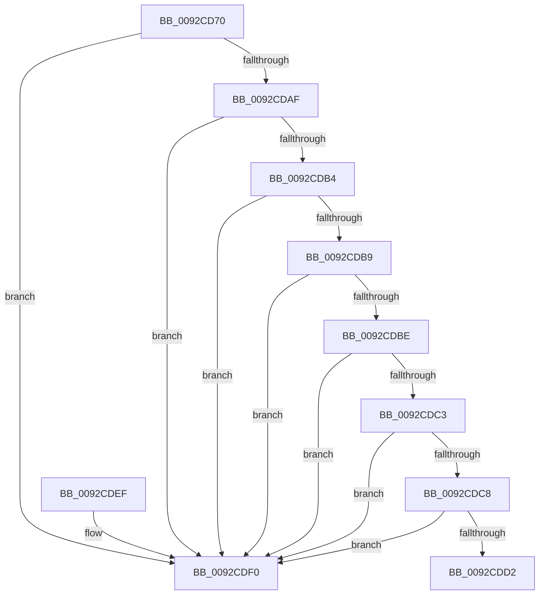

# RtlpCombineAcls

- RVA: `0x0092CD70`–`0x0092CDFD` (길이 `141` bytes)
- VA: `0x000000014092CD70`
- 실행 섹션: `PAGE`
- PDB 이름 있음: `예`; PDB Function 태그: `아니요`
- unwind 정보 RVA: `0x0008DB74`
- 디코드: `46`개 명령, `141/141` bytes 표시
- 미해석 바이트: `0` (있으면 어셈블리에 `.byte`로 보존)

> 이 문서는 커널 이미지의 기계어와 PDB 기호를 분석해 생성했습니다. 4번과 5번은 함수 원형과 자료형을 바이너리 사용 방식에서 추정한 C 해석이며 원본 소스 복구 결과는 아닙니다.

## 1. Dependencies

- 직접 호출 지점: **0**; 고유 호출 대상: **0**
- 직접 호출자로 확인된 함수: **2**
- RIP 상대 이미지 참조: **0**

### Outgoing calls
- 직접 디코드된 call 명령이 없습니다.

### Direct callers
- [sub_008BBC01](../8B/Unknown_function_008BBC01.md) at `0x008BC180`
- [RtlpNewSecurityObject](RtlpNewSecurityObject_function_0092AB50.md) at `0x0092BAD4`

### Static image references
- 디코드된 RIP-relative 메모리 참조가 없습니다.

## 2. Other-region calls and transfers

- 다른 실행 섹션으로 향하는 call: **0**
- 별도 외부 분기/꼬리 이동을 확인하지 못했습니다.

## 3. Assembly (complete function range)

```asm
0092CD70  4C 89 4C 24 20                  mov qword ptr [rsp + 0x20], r9
0092CD75  4C 89 44 24 18                  mov qword ptr [rsp + 0x18], r8
0092CD7A  55                              push rbp
0092CD7B  56                              push rsi
0092CD7C  57                              push rdi
0092CD7D  41 54                           push r12
0092CD7F  41 55                           push r13
0092CD81  41 56                           push r14
0092CD83  41 57                           push r15
0092CD85  48 83 EC 20                     sub rsp, 0x20
0092CD89  48 8B B4 24 80 00 00 00         mov rsi, qword ptr [rsp + 0x80]
0092CD91  45 33 E4                        xor r12d, r12d
0092CD94  48 8B AC 24 88 00 00 00         mov rbp, qword ptr [rsp + 0x88]
0092CD9C  4C 8B EA                        mov r13, rdx
0092CD9F  4C 8B F1                        mov r14, rcx
0092CDA2  45 8B FC                        mov r15d, r12d
0092CDA5  41 8D 7C 24 02                  lea edi, [r12 + 2]
0092CDAA  48 85 C9                        test rcx, rcx
0092CDAD  75 41                           jne 0x14092cdf0
0092CDAF  48 85 D2                        test rdx, rdx
0092CDB2  75 3C                           jne 0x14092cdf0
0092CDB4  4D 85 C0                        test r8, r8
0092CDB7  75 37                           jne 0x14092cdf0
0092CDB9  4D 85 C9                        test r9, r9
0092CDBC  75 32                           jne 0x14092cdf0
0092CDBE  48 85 F6                        test rsi, rsi
0092CDC1  75 2D                           jne 0x14092cdf0
0092CDC3  48 85 ED                        test rbp, rbp
0092CDC6  75 28                           jne 0x14092cdf0
0092CDC8  4C 39 A4 24 90 00 00 00         cmp qword ptr [rsp + 0x90], r12
0092CDD0  75 1E                           jne 0x14092cdf0
0092CDD2  48 8B 84 24 98 00 00 00         mov rax, qword ptr [rsp + 0x98]
0092CDDA  4C 89 20                        mov qword ptr [rax], r12
0092CDDD  33 C0                           xor eax, eax
0092CDDF  48 83 C4 20                     add rsp, 0x20
0092CDE3  41 5F                           pop r15
0092CDE5  41 5E                           pop r14
0092CDE7  41 5D                           pop r13
0092CDE9  41 5C                           pop r12
0092CDEB  5F                              pop rdi
0092CDEC  5E                              pop rsi
0092CDED  5D                              pop rbp
0092CDEE  C3                              ret
0092CDEF  CC                              int3
0092CDF0  4C 8B 84 24 A0 00 00 00         mov r8, qword ptr [rsp + 0xa0]
0092CDF8  BA 08 00 00 00                  mov edx, 8
```

## 4. C-style interpretation (structured pseudocode)

```c
__int64 __fastcall RtlpCombineAcls(__int64 a1, __int64 a2, __int64 a3, __int64 a4, __int64 a5, __int64 a6, __int64 a7, __int64 a8, __int64 a9)
{
    __int64 result;
    __int64 v_r12;
    __int64 v_rsp;
    unsigned __int64 v_stack_p18;
    unsigned __int64 v_stack_p20;

    v_stack_p20 = a4;
    v_stack_p18 = a3;
    v_rsp = (v_rsp) - (32);
    v_r12 = 0;
    if (a1 != 0) goto loc_0092CDF0;
    if (a2 != 0) goto loc_0092CDF0;
    if (a3 != 0) goto loc_0092CDF0;
    if (a4 != 0) goto loc_0092CDF0;
    if (a5 != 0) goto loc_0092CDF0;
    if (a6 != 0) goto loc_0092CDF0;
    if (a7 != 0) goto loc_0092CDF0;
    *(unsigned __int64 *)(a8) = 0;
    result = 0;
    v_rsp = (v_rsp) + (32);
    return result;
loc_0092CDF0:
    return result;
}
```

## 5. (Beta) C Style

```c
int64_t RtlpCombineAcls(int64_t Arg1, int64_t Arg2, int64_t Arg3, int64_t Arg4, int64_t Arg5, int64_t Arg6, int64_t Arg7, void *Arg8, int64_t Arg9)
{
    uint8_t *arg8 = (uint8_t *)Arg8;

    int64_t result;
    int64_t local_r12;
    int64_t local_rsp;
    uint64_t v_stack_p18;
    uint64_t v_stack_p20;

    v_stack_p20 = Arg4;
    v_stack_p18 = Arg3;
    local_rsp = (local_rsp) - (32);
    local_r12 = 0;
    if (Arg1 != 0) goto loc_0092CDF0;
    if (Arg2 != 0) goto loc_0092CDF0;
    if (Arg3 != 0) goto loc_0092CDF0;
    if (Arg4 != 0) goto loc_0092CDF0;
    if (Arg5 != 0) goto loc_0092CDF0;
    if (Arg6 != 0) goto loc_0092CDF0;
    if (Arg7 != 0) goto loc_0092CDF0;
    *(uint64_t *)(arg8) = 0;
    result = 0;
    local_rsp = (local_rsp) + (32);
    return result;
loc_0092CDF0:
    return result;
}
```

### 관측된 메모리 오프셋

구조체 형식이 확인되지 않은 접근은 인자 기준의 오프셋으로만 기록했습니다.

| 기준 인자 | 오프셋 표현 | 폭 (bit) | 접근 |
|---|---:|---:|---|
| `Arg8` | `+ 0x0` | `64` | `W` |

## 6. Execution-region graph

[열기: 2D/3D 그래프와 함수 탐색 컨트롤 패널](../../../control-panel.html?section=page&rva=0x0092CD70&view=graph)

- 2D 그래프는 위에서 아래로 흐르고, 3D 그래프는 빈 공간을 드래그해 회전합니다. Shift+드래그는 이동, 휠은 확대·축소, 함수 노드 선택은 대상 보고서 이동입니다.

### Static fallback


