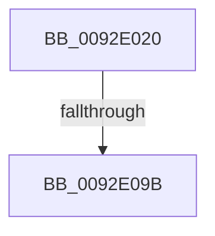

# RtlpCopyAces

- RVA: `0x0092E020`–`0x0092E0A2` (길이 `130` bytes)
- VA: `0x000000014092E020`
- 실행 섹션: `PAGE`
- PDB 이름 있음: `예`; PDB Function 태그: `아니요`
- unwind 정보 RVA: `0x0008DBF0`
- 디코드: `34`개 명령, `130/130` bytes 표시
- 미해석 바이트: `0` (있으면 어셈블리에 `.byte`로 보존)

> 이 문서는 커널 이미지의 기계어와 PDB 기호를 분석해 생성했습니다. 4번과 5번은 함수 원형과 자료형을 바이너리 사용 방식에서 추정한 C 해석이며 원본 소스 복구 결과는 아닙니다.

## 1. Dependencies

- 직접 호출 지점: **0**; 고유 호출 대상: **0**
- 직접 호출자로 확인된 함수: **2**
- RIP 상대 이미지 참조: **1**

### Outgoing calls
- 직접 디코드된 call 명령이 없습니다.

### Direct callers
- [RtlpComputeMergedAcl2](../78/RtlpComputeMergedAcl2_function_0078EA34.md) at `0x0078EB24`
- [RtlpComputeMergedAcl2](../78/RtlpComputeMergedAcl2_function_0078EA34.md) at `0x0078EC1F`
- [RtlpComputeMergedAcl2](../78/RtlpComputeMergedAcl2_function_0078EA34.md) at `0x0078ECAC`
- [RtlpInheritAcl2](RtlpInheritAcl2_function_0092D4D0.md) at `0x0092D760`

### Static image references
- `0x0092E032` → RVA `0x00E0A740` (`.data`; read)

## 2. Other-region calls and transfers

- 다른 실행 섹션으로 향하는 call: **0**
- call이 아닌 외부 분기/꼬리 이동: **1**
  - `0x0092E095` → [sub_0092E4F5](Unknown_function_0092E4F5.md) (`tail-transfer`)

## 3. Assembly (complete function range)

```asm
0092E020  40 55                           push rbp
0092E022  56                              push rsi
0092E023  57                              push rdi
0092E024  41 57                           push r15
0092E026  48 8D 6C 24 F8                  lea rbp, [rsp - 8]
0092E02B  48 81 EC 08 01 00 00            sub rsp, 0x108
0092E032  48 8B 05 07 C7 4D 00            mov rax, qword ptr [rip + 0x4dc707]
0092E039  48 33 C4                        xor rax, rsp
0092E03C  48 89 45 E0                     mov qword ptr [rbp - 0x20], rax
0092E040  48 8B 45 60                     mov rax, qword ptr [rbp + 0x60]
0092E044  40 32 F6                        xor sil, sil
0092E047  48 8B BD 98 00 00 00            mov rdi, qword ptr [rbp + 0x98]
0092E04E  45 8B F8                        mov r15d, r8d
0092E051  4C 8B 5D 58                     mov r11, qword ptr [rbp + 0x58]
0092E055  4C 8B 95 90 00 00 00            mov r10, qword ptr [rbp + 0x90]
0092E05C  48 89 45 C0                     mov qword ptr [rbp - 0x40], rax
0092E060  48 8B 45 68                     mov rax, qword ptr [rbp + 0x68]
0092E064  48 89 45 B8                     mov qword ptr [rbp - 0x48], rax
0092E068  48 8B 45 70                     mov rax, qword ptr [rbp + 0x70]
0092E06C  48 89 45 B0                     mov qword ptr [rbp - 0x50], rax
0092E070  0F B6 07                        movzx eax, byte ptr [rdi]
0092E073  2C 02                           sub al, 2
0092E075  44 88 4D 80                     mov byte ptr [rbp - 0x80], r9b
0092E079  44 89 45 A0                     mov dword ptr [rbp - 0x60], r8d
0092E07D  4C 8B C2                        mov r8, rdx
0092E080  48 89 55 98                     mov qword ptr [rbp - 0x68], rdx
0092E084  4C 8B C9                        mov r9, rcx
0092E087  48 89 4D C8                     mov qword ptr [rbp - 0x38], rcx
0092E08B  4C 89 5D A8                     mov qword ptr [rbp - 0x58], r11
0092E08F  4C 89 55 D0                     mov qword ptr [rbp - 0x30], r10
0092E093  3C 02                           cmp al, 2
0092E095  0F 87 5A 04 00 00               ja 0x14092e4f5
0092E09B  0F B7 57 04                     movzx edx, word ptr [rdi + 4]
0092E09F  45 33 D2                        xor r10d, r10d
```

## 4. C-style interpretation (structured pseudocode)

```c
__int64 __fastcall RtlpCopyAces(__int64 a1, __int64 a2, int a3, unsigned __int8 a4, __int64 a5, __int64 a6, __int64 a7, __int64 a8, __int64 a9, __int64 a10, __int64 a11, __int64 a12, __int64 a13, __int64 a14)
{
    __int64 result;
    __int64 v_r10;
    __int64 v_rsi;
    __int64 v_rsp;
    unsigned __int64 v_stack_m28;
    unsigned __int64 v_stack_m48;
    unsigned __int64 v_stack_m58;
    unsigned __int64 v_stack_m60;
    unsigned __int64 v_stack_m68;
    unsigned __int64 v_stack_m70;
    unsigned __int64 v_stack_m78;
    unsigned __int64 v_stack_m80;
    unsigned int v_stack_m88;
    unsigned __int64 v_stack_m90;
    unsigned __int8 v_stack_mA8;

    v_rsp = (v_rsp) - (264);
    result = (*(unsigned __int64 *)(v_rip + 5097223)) ^ (v_rsp);
    v_stack_m48 = result;
    v_rsi = 0;
    v_stack_m68 = a7;
    v_stack_m70 = a8;
    v_stack_m78 = a9;
    result = (unsigned __int8)((*(unsigned __int8 *)(a14)) - (2));
    v_stack_mA8 = a4;
    v_stack_m88 = a3;
    v_stack_m90 = a2;
    v_stack_m60 = a1;
    v_stack_m80 = a6;
    v_stack_m58 = a13;
    v_r10 = 0;
    return result;
}
```

## 5. (Beta) C Style

```c
int64_t RtlpCopyAces(int64_t Arg1, int64_t Arg2, int32_t Arg3, uint8_t Arg4, uint64_t Arg5, int64_t Arg6, int64_t Arg7, int64_t Arg8, int64_t Arg9, uint64_t Arg10, uint64_t Arg11, uint64_t Arg12, int64_t Arg13, void *Arg14)
{
    uint8_t *arg14 = (uint8_t *)Arg14;

    int64_t result;
    int64_t local_r10;
    int64_t local_rsi;
    int64_t local_rsp;
    uint64_t v_stack_m28;
    uint64_t v_stack_m48;
    uint64_t v_stack_m58;
    uint64_t v_stack_m60;
    uint64_t v_stack_m68;
    uint64_t v_stack_m70;
    uint64_t v_stack_m78;
    uint64_t v_stack_m80;
    uint32_t v_stack_m88;
    uint64_t v_stack_m90;
    uint8_t v_stack_mA8;

    local_rsp = (local_rsp) - (264);
    result = (*(uint64_t *)(v_rip + 0x4DC707)) ^ (local_rsp);
    v_stack_m48 = result;
    local_rsi = 0;
    v_stack_m68 = Arg7;
    v_stack_m70 = Arg8;
    v_stack_m78 = Arg9;
    result = (uint8_t)((*(uint8_t *)(arg14)) - (2));
    v_stack_mA8 = Arg4;
    v_stack_m88 = Arg3;
    v_stack_m90 = Arg2;
    v_stack_m60 = Arg1;
    v_stack_m80 = Arg6;
    v_stack_m58 = Arg13;
    local_r10 = 0;
    return result;
}
```

### 관측된 메모리 오프셋

구조체 형식이 확인되지 않은 접근은 인자 기준의 오프셋으로만 기록했습니다.

| 기준 인자 | 오프셋 표현 | 폭 (bit) | 접근 |
|---|---:|---:|---|
| `Arg14` | `+ 0x0` | `8` | `R` |
| `Arg14` | `+ 0x4` | `16` | `R` |

## 6. Execution-region graph

[열기: 2D/3D 그래프와 함수 탐색 컨트롤 패널](../../../control-panel.html?section=page&rva=0x0092E020&view=graph)

- 2D 그래프는 위에서 아래로 흐르고, 3D 그래프는 빈 공간을 드래그해 회전합니다. Shift+드래그는 이동, 휠은 확대·축소, 함수 노드 선택은 대상 보고서 이동입니다.

### Static fallback


