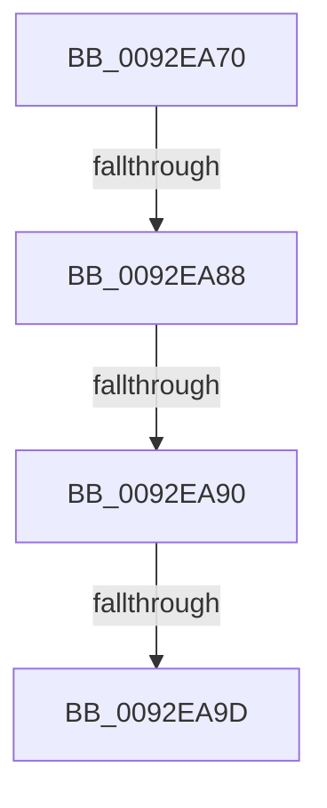

# RtlpIsDuplicateAce

- RVA: `0x0092EA70`–`0x0092EAA3` (길이 `51` bytes)
- VA: `0x000000014092EA70`
- 실행 섹션: `PAGE`
- PDB 이름 있음: `예`; PDB Function 태그: `아니요`
- unwind 정보 RVA: `0x0008DCC4`
- 디코드: `15`개 명령, `51/51` bytes 표시
- 미해석 바이트: `0` (있으면 어셈블리에 `.byte`로 보존)

> 이 문서는 커널 이미지의 기계어와 PDB 기호를 분석해 생성했습니다. 4번과 5번은 함수 원형과 자료형을 바이너리 사용 방식에서 추정한 C 해석이며 원본 소스 복구 결과는 아닙니다.

## 1. Dependencies

- 직접 호출 지점: **0**; 고유 호출 대상: **0**
- 직접 호출자로 확인된 함수: **1**
- RIP 상대 이미지 참조: **0**

### Outgoing calls
- 직접 디코드된 call 명령이 없습니다.

### Direct callers
- [RtlpGenerateInheritedAce](RtlpGenerateInheritedAce_function_0092DB80.md) at `0x0092DF04`

### Static image references
- 디코드된 RIP-relative 메모리 참조가 없습니다.

## 2. Other-region calls and transfers

- 다른 실행 섹션으로 향하는 call: **0**
- call이 아닌 외부 분기/꼬리 이동: **3**
  - `0x0092EA82` → [sub_0092EB7B + 0x8](Unknown_function_0092EB7B.md) (`tail-transfer`)
  - `0x0092EA8A` → [sub_0092EB7B + 0x8](Unknown_function_0092EB7B.md) (`tail-transfer`)
  - `0x0092EA97` → [sub_0092EB7B + 0x8](Unknown_function_0092EB7B.md) (`tail-transfer`)

## 3. Assembly (complete function range)

```asm
0092EA70  40 55                           push rbp
0092EA72  56                              push rsi
0092EA73  48 83 EC 48                     sub rsp, 0x48
0092EA77  0F B6 02                        movzx eax, byte ptr [rdx]
0092EA7A  48 8B F2                        mov rsi, rdx
0092EA7D  48 8B E9                        mov rbp, rcx
0092EA80  3C 04                           cmp al, 4
0092EA82  0F 84 FB 00 00 00               je 0x14092eb83
0092EA88  3C 08                           cmp al, 8
0092EA8A  0F 87 F3 00 00 00               ja 0x14092eb83
0092EA90  0F B6 4A 01                     movzx ecx, byte ptr [rdx + 1]
0092EA94  F6 C1 10                        test cl, 0x10
0092EA97  0F 84 E6 00 00 00               je 0x14092eb83
0092EA9D  8B 42 04                        mov eax, dword ptr [rdx + 4]
0092EAA0  F6 C1 02                        test cl, 2
```

## 4. C-style interpretation (structured pseudocode)

```c
__int64 __fastcall RtlpIsDuplicateAce(__int64 a1, __int64 a2)
{
    __int64 v_rsp;

    v_rsp = (v_rsp) - (72);
    return (unsigned int)(*(unsigned int *)(a2 + 4));
}
```

## 5. (Beta) C Style

```c
int64_t RtlpIsDuplicateAce(int64_t Arg1, void *Arg2)
{
    uint8_t *arg2 = (uint8_t *)Arg2;

    int64_t local_rsp;

    local_rsp = (local_rsp) - (72);
    return (uint32_t)(*(uint32_t *)(arg2 + 0x4));
}
```

### 관측된 메모리 오프셋

구조체 형식이 확인되지 않은 접근은 인자 기준의 오프셋으로만 기록했습니다.

| 기준 인자 | 오프셋 표현 | 폭 (bit) | 접근 |
|---|---:|---:|---|
| `Arg2` | `+ 0x0` | `8` | `R` |
| `Arg2` | `+ 0x1` | `8` | `R` |
| `Arg2` | `+ 0x4` | `32` | `R` |

## 6. Execution-region graph

[열기: 2D/3D 그래프와 함수 탐색 컨트롤 패널](../../../control-panel.html?section=page&rva=0x0092EA70&view=graph)

- 2D 그래프는 위에서 아래로 흐르고, 3D 그래프는 빈 공간을 드래그해 회전합니다. Shift+드래그는 이동, 휠은 확대·축소, 함수 노드 선택은 대상 보고서 이동입니다.

### Static fallback


