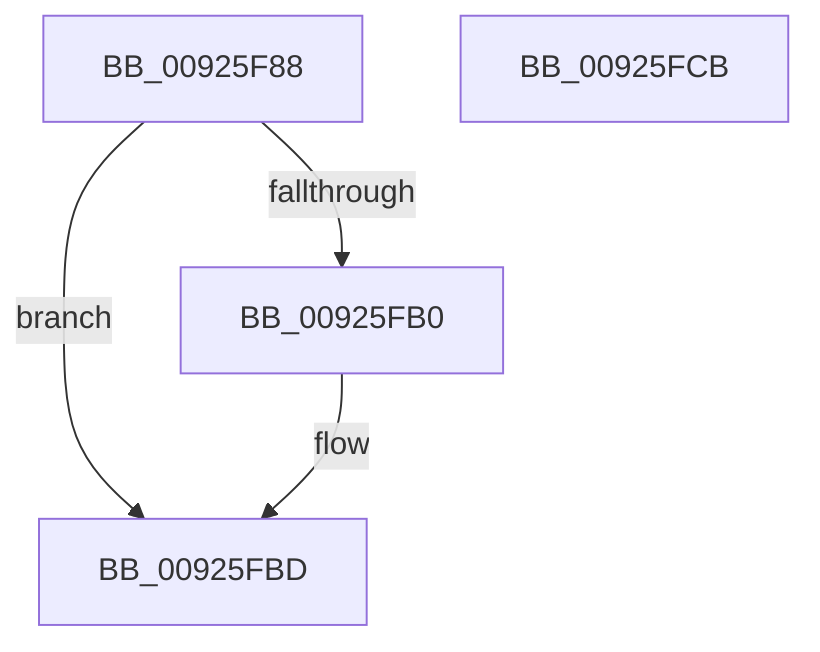

# SddlpAlloc

- RVA: `0x00925F88`–`0x00925FCC` (길이 `68` bytes)
- VA: `0x0000000140925F88`
- 실행 섹션: `PAGE`
- PDB 이름 있음: `예`; PDB Function 태그: `아니요`
- unwind 정보 RVA: `0x0005CAAC`
- 디코드: `21`개 명령, `68/68` bytes 표시
- 미해석 바이트: `0` (있으면 어셈블리에 `.byte`로 보존)

> 이 문서는 커널 이미지의 기계어와 PDB 기호를 분석해 생성했습니다. 4번과 5번은 함수 원형과 자료형을 바이너리 사용 방식에서 추정한 C 해석이며 원본 소스 복구 결과는 아닙니다.

## 1. Dependencies

- 직접 호출 지점: **2**; 고유 호출 대상: **2**
- 직접 호출자로 확인된 함수: **29**
- RIP 상대 이미지 참조: **0**

### Outgoing calls
- `0x00925FA3` → [ExAllocatePoolWithTag](../../poolcode/B8/ExAllocatePoolWithTag_function_00B82010.md) (function, `0x00B82010`)
- `0x00925FB8` → [memset](../../text/6C/memset_function_006C6C40.md) (function, `0x006C6C40`)

### Direct callers
- [SeConvertSecurityDescriptorToStringSecurityDescriptor](../../text/4A/SeConvertSecurityDescriptorToStringSecurityDescriptor_function_004A18B0.md) at `0x004A191E`
- [SeConvertStringSidToSid](../../text/4C/SeConvertStringSidToSid_function_004C6710.md) at `0x004C67FC`
- [EncodeAttributeName](../7A/EncodeAttributeName_function_007A54D0.md) at `0x007A5525`
- [LocalConvertSDToStringSD_Rev1](LocalConvertSDToStringSD_Rev1_function_00924428.md) at `0x00924725`
- [LocalConvertSDToStringSD_Rev1](LocalConvertSDToStringSD_Rev1_function_00924428.md) at `0x009249B7`
- [LocalConvertStringSDToSD_Rev1](LocalConvertStringSDToSD_Rev1_function_0092656C.md) at `0x00926AE0`
- [LocalGetAclForString](LocalGetAclForString_function_00927F30.md) at `0x0092808F`
- [LocalGetAclForString](LocalGetAclForString_function_00927F30.md) at `0x009285A8`
- [LocalGetAclForString](LocalGetAclForString_function_00927F30.md) at `0x00928995`
- [sub_0092949C](Unknown_function_0092949C.md) at `0x009295A2`
- [LocalGetStringForSid](../A0/LocalGetStringForSid_function_00A00328.md) at `0x00A00387`
- [LocalConvertAclToString](../A0/LocalConvertAclToString_function_00A00408.md) at `0x00A00484`
- [LocalConvertAclToString](../A0/LocalConvertAclToString_function_00A00408.md) at `0x00A004D8`
- [LocalConvertAclToString](../A0/LocalConvertAclToString_function_00A00408.md) at `0x00A004F1`
- [LocalConvertAclToString](../A0/LocalConvertAclToString_function_00A00408.md) at `0x00A0050E`
- [LocalConvertAclToString](../A0/LocalConvertAclToString_function_00A00408.md) at `0x00A007E9`
- [LocalConvertAclToString](../A0/LocalConvertAclToString_function_00A00408.md) at `0x00A0100D`
- [LocalpGetStringForCondition](../A0/LocalpGetStringForCondition_function_00A0122C.md) at `0x00A015B5`
- [GetPrintableOperandValue](../A0/GetPrintableOperandValue_function_00A01764.md) at `0x00A0183C`
- [GetPrintableOperandValue](../A0/GetPrintableOperandValue_function_00A01764.md) at `0x00A018E5`
- [LocalConvertSidToStringSidW](../A0/LocalConvertSidToStringSidW_function_00A0191C.md) at `0x00A01960`
- [GetPrintableAttributeName](../A0/GetPrintableAttributeName_function_00A019D0.md) at `0x00A01AA3`
- [LocalGetConditionForString](../A0/LocalGetConditionForString_function_00A01C20.md) at `0x00A01D48`
- [LocalGetConditionForString](../A0/LocalGetConditionForString_function_00A01C20.md) at `0x00A02218`
- [LocalGetConditionForString](../A0/LocalGetConditionForString_function_00A01C20.md) at `0x00A022D2`
- [GetOperandValue](../A0/GetOperandValue_function_00A024C0.md) at `0x00A0251F`
- [AppendCondition](../A0/AppendCondition_function_00A026B4.md) at `0x00A0274C`
- [GetAttributeName](../A0/GetAttributeName_function_00A02768.md) at `0x00A028B7`
- [GetOperatorIndexByName](../A0/GetOperatorIndexByName_function_00A029E0.md) at `0x00A02A5F`
- [GetStringOperandValue](../A0/GetStringOperandValue_function_00A02B74.md) at `0x00A02BD5`
- [LocalGetStringForRelativeAttribute](../A0/LocalGetStringForRelativeAttribute_function_00A02C38.md) at `0x00A0307B`
- [DecodeAttributeName](../A0/DecodeAttributeName_function_00A03460.md) at `0x00A034CD`
- [LocalpConvertStringSidToSid](../A1/LocalpConvertStringSidToSid_function_00A17490.md) at `0x00A17717`
- [LocalpConvertStringSidToSid](../A1/LocalpConvertStringSidToSid_function_00A17490.md) at `0x00A17745`
- [LocalpConvertStringSidToSid](../A1/LocalpConvertStringSidToSid_function_00A17490.md) at `0x00A17899`
- [LocalGetStringForControl](../A5/LocalGetStringForControl_function_00A55674.md) at `0x00A55748`
- [LocalGetRelativeAttributeForString](../AC/LocalGetRelativeAttributeForString_function_00AC74E4.md) at `0x00AC7835`
- [sub_00B22C34](../B2/Unknown_function_00B22C34.md) at `0x00B22CB9`
- [sub_00B22C34](../B2/Unknown_function_00B22C34.md) at `0x00B22D2E`
- [sub_00B32900](../B3/Unknown_function_00B32900.md) at `0x00B32994`
- [sub_00B32AA2](../B3/Unknown_function_00B32AA2.md) at `0x00B32B53`
- [sub_00B32AA2](../B3/Unknown_function_00B32AA2.md) at `0x00B32BD2`
- [sub_00B32AA2](../B3/Unknown_function_00B32AA2.md) at `0x00B32DBC`
- [sub_00B32F2A](../B3/Unknown_function_00B32F2A.md) at `0x00B32F4B`
- [sub_00B32FE4](../B3/Unknown_function_00B32FE4.md) at `0x00B330E0`
- [sub_00B32FE4](../B3/Unknown_function_00B32FE4.md) at `0x00B332D8`
- [sub_00B32FE4](../B3/Unknown_function_00B32FE4.md) at `0x00B33443`

### Static image references
- 디코드된 RIP-relative 메모리 참조가 없습니다.

## 2. Other-region calls and transfers

- 다른 실행 섹션으로 향하는 call: **2**
  - `0x00925FA3` → [ExAllocatePoolWithTag](../../poolcode/B8/ExAllocatePoolWithTag_function_00B82010.md) (`PAGE` → `POOLCODE`)
  - `0x00925FB8` → [memset](../../text/6C/memset_function_006C6C40.md) (`PAGE` → `.text`)
- 별도 외부 분기/꼬리 이동을 확인하지 못했습니다.

## 3. Assembly (complete function range)

```asm
00925F88  48 89 5C 24 08                  mov qword ptr [rsp + 8], rbx
00925F8D  57                              push rdi
00925F8E  48 83 EC 20                     sub rsp, 0x20
00925F92  48 8B F9                        mov rdi, rcx
00925F95  48 8B D1                        mov rdx, rcx
00925F98  B9 01 00 00 00                  mov ecx, 1
00925F9D  41 B8 53 65 53 64               mov r8d, 0x64536553
00925FA3  E8 68 C0 25 00                  call 0x140b82010
00925FA8  48 8B D8                        mov rbx, rax
00925FAB  48 85 C0                        test rax, rax
00925FAE  74 0D                           je 0x140925fbd
00925FB0  4C 8B C7                        mov r8, rdi
00925FB3  33 D2                           xor edx, edx
00925FB5  48 8B C8                        mov rcx, rax
00925FB8  E8 83 0C DA FF                  call 0x1406c6c40
00925FBD  48 8B C3                        mov rax, rbx
00925FC0  48 8B 5C 24 30                  mov rbx, qword ptr [rsp + 0x30]
00925FC5  48 83 C4 20                     add rsp, 0x20
00925FC9  5F                              pop rdi
00925FCA  C3                              ret
00925FCB  CC                              int3
```

## 4. C-style interpretation (structured pseudocode)

```c
__int64 __fastcall SddlpAlloc(__int64 a1)
{
    __int64 result;
    __int64 v_rsp;
    unsigned __int64 v_stack_p8;

    v_stack_p8 = v_rbx;
    v_rsp = (v_rsp) - (32);
    result = ExAllocatePoolWithTag(1, a1, (unsigned int)(0x64536553ULL), a4);
    if (result != 0) {
        a3 = a1;
        a2 = 0;
        a1 = result;
        result = memset(a1, a2, a3, a4);
    }
    v_rsp = (v_rsp) + (32);
    return result;
}
```

## 5. (Beta) C Style

```c
int64_t SddlpAlloc(int64_t Arg1)
{
    int64_t result;
    int64_t local_rsp;
    uint64_t v_stack_p8;

    v_stack_p8 = local_rbx;
    local_rsp = (local_rsp) - (32);
    result = ExAllocatePoolWithTag(1, Arg1, (uint32_t)(0x64536553ULL), a4);
    if (result != 0) {
        a3 = Arg1;
        a2 = 0;
        Arg1 = result;
        result = memset(Arg1, a2, a3, a4);
    }
    local_rsp = (local_rsp) + (32);
    return result;
}
```

## 6. Execution-region graph

[열기: 2D/3D 그래프와 함수 탐색 컨트롤 패널](../../../control-panel.html?section=page&rva=0x00925F88&view=graph)

- 2D 그래프는 위에서 아래로 흐르고, 3D 그래프는 빈 공간을 드래그해 회전합니다. Shift+드래그는 이동, 휠은 확대·축소, 함수 노드 선택은 대상 보고서 이동입니다.

### Static fallback


