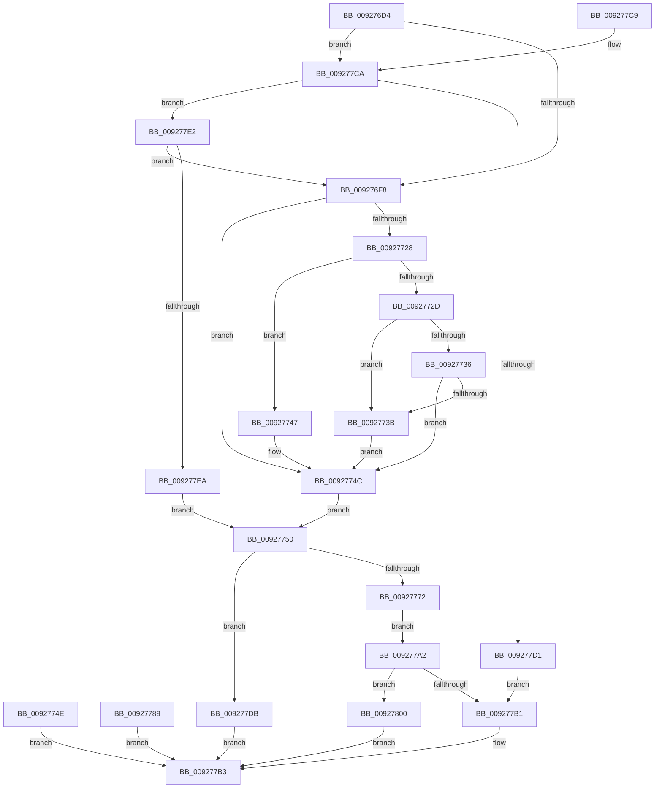

# SeCaptureSid

- RVA: `0x009276D4`–`0x00927815` (길이 `321` bytes)
- VA: `0x00000001409276D4`
- 실행 섹션: `PAGE`
- PDB 이름 있음: `예`; PDB Function 태그: `아니요`
- unwind 정보 RVA: `0x0008D614`
- 디코드: `96`개 명령, `321/321` bytes 표시
- 미해석 바이트: `0` (있으면 어셈블리에 `.byte`로 보존)

> 이 문서는 커널 이미지의 기계어와 PDB 기호를 분석해 생성했습니다. 4번과 5번은 함수 원형과 자료형을 바이너리 사용 방식에서 추정한 C 해석이며 원본 소스 복구 결과는 아닙니다.

## 1. Dependencies

- 직접 호출 지점: **8**; 고유 호출 대상: **6**
- 직접 호출자로 확인된 함수: **12**
- RIP 상대 이미지 참조: **0**

### Outgoing calls
- `0x00927719` → [RtlLengthRequiredSid](../9C/RtlLengthRequiredSid_function_009CA4D0.md) (function, `0x009CA4D0`)
- `0x00927747` → [ExRaiseDatatypeMisalignment](../89/ExRaiseDatatypeMisalignment_function_00899FD0.md) (function, `0x00899FD0`)
- `0x00927760` → [ExAllocatePoolWithTag](../../poolcode/B8/ExAllocatePoolWithTag_function_00B82010.md) (function, `0x00B82010`)
- `0x0092777B` → [memcpy](../../text/6C/memcpy_function_006C6840.md) (function, `0x006C6840`)
- `0x00927795` → [ExFreePoolWithTag](../../poolcode/B8/ExFreePoolWithTag_function_00B82870.md) (function, `0x00B82870`)
- `0x009277A8` → [RtlValidSid](RtlValidSid_function_00929710.md) (function, `0x00929710`)
- `0x009277F0` → [RtlLengthRequiredSid](../9C/RtlLengthRequiredSid_function_009CA4D0.md) (function, `0x009CA4D0`)
- `0x00927805` → [ExFreePoolWithTag](../../poolcode/B8/ExFreePoolWithTag_function_00B82870.md) (function, `0x00B82870`)

### Direct callers
- [SeAccessCheckByType](../../text/44/SeAccessCheckByType_function_00440BC8.md) at `0x00441691`
- [NtQueryWnfStateData](../90/NtQueryWnfStateData_function_00909DF0.md) at `0x0090A20F`
- [ExpNtUpdateWnfStateData](../90/ExpNtUpdateWnfStateData_function_0090A7A0.md) at `0x0090AB2D`
- [NtSecureConnectPort](NtSecureConnectPort_function_00922F20.md) at `0x0092319E`
- [AlpcpConnectPort](AlpcpConnectPort_function_00926C8C.md) at `0x00926E0D`
- [NtCreateTokenEx](../9C/NtCreateTokenEx_function_009C7C80.md) at `0x009C81A7`
- [NtCreateTokenEx](../9C/NtCreateTokenEx_function_009C7C80.md) at `0x009C8274`
- [AlpcpPortQueryConnectedSidInfo](../9C/AlpcpPortQueryConnectedSidInfo_function_009CAC3C.md) at `0x009CADFC`
- [ExpWnfCaptureScopeInstanceId](../9E/ExpWnfCaptureScopeInstanceId_function_009EC110.md) at `0x009EC1F3`
- [PspBuildCreateProcessContext](../9E/PspBuildCreateProcessContext_function_009ED6E0.md) at `0x009EE78E`
- [SepAccessCheckAndAuditAlarm](../A1/SepAccessCheckAndAuditAlarm_function_00A1AF4C.md) at `0x00A1B7C8`
- [NtCreateLowBoxToken](../AB/NtCreateLowBoxToken_function_00AB9880.md) at `0x00AB99E2`
- [NtCreateLowBoxToken](../AB/NtCreateLowBoxToken_function_00AB9880.md) at `0x00AB9CE6`
- [NtSetInformationToken](../AF/NtSetInformationToken_function_00AF0530.md) at `0x00AF096A`
- [NtSetInformationToken](../AF/NtSetInformationToken_function_00AF0530.md) at `0x00AF0AFB`

### Static image references
- 디코드된 RIP-relative 메모리 참조가 없습니다.

## 2. Other-region calls and transfers

- 다른 실행 섹션으로 향하는 call: **4**
  - `0x00927760` → [ExAllocatePoolWithTag](../../poolcode/B8/ExAllocatePoolWithTag_function_00B82010.md) (`PAGE` → `POOLCODE`)
  - `0x0092777B` → [memcpy](../../text/6C/memcpy_function_006C6840.md) (`PAGE` → `.text`)
  - `0x00927795` → [ExFreePoolWithTag](../../poolcode/B8/ExFreePoolWithTag_function_00B82870.md) (`PAGE` → `POOLCODE`)
  - `0x00927805` → [ExFreePoolWithTag](../../poolcode/B8/ExFreePoolWithTag_function_00B82870.md) (`PAGE` → `POOLCODE`)
- 별도 외부 분기/꼬리 이동을 확인하지 못했습니다.

## 3. Assembly (complete function range)

```asm
009276D4  48 8B C4                        mov rax, rsp
009276D7  48 89 58 08                     mov qword ptr [rax + 8], rbx
009276DB  48 89 70 18                     mov qword ptr [rax + 0x18], rsi
009276DF  48 89 78 20                     mov qword ptr [rax + 0x20], rdi
009276E3  41 56                           push r14
009276E5  48 83 EC 30                     sub rsp, 0x30
009276E9  48 8B D9                        mov rbx, rcx
009276EC  83 60 E8 00                     and dword ptr [rax - 0x18], 0
009276F0  84 D2                           test dl, dl
009276F2  0F 84 D2 00 00 00               je 0x1409277ca
009276F8  48 8D 41 01                     lea rax, [rcx + 1]
009276FC  48 BE 00 00 FF FF FF 7F 00 00   movabs rsi, 0x7fffffff0000
00927706  48 3B C6                        cmp rax, rsi
00927709  48 0F 43 C6                     cmovae rax, rsi
0092770D  90                              nop
0092770E  0F B6 00                        movzx eax, byte ptr [rax]
00927711  8B F8                           mov edi, eax
00927713  89 44 24 48                     mov dword ptr [rsp + 0x48], eax
00927717  8B C8                           mov ecx, eax
00927719  E8 B2 2D 0A 00                  call 0x1409ca4d0
0092771E  8B C8                           mov ecx, eax
00927720  89 4C 24 20                     mov dword ptr [rsp + 0x20], ecx
00927724  85 C0                           test eax, eax
00927726  74 24                           je 0x14092774c
00927728  F6 C3 03                        test bl, 3
0092772B  75 1A                           jne 0x140927747
0092772D  48 8D 14 0B                     lea rdx, [rbx + rcx]
00927731  48 3B D6                        cmp rdx, rsi
00927734  77 05                           ja 0x14092773b
00927736  48 3B D3                        cmp rdx, rbx
00927739  73 11                           jae 0x14092774c
0092773B  8A 06                           mov al, byte ptr [rsi]
0092773D  8B 7C 24 48                     mov edi, dword ptr [rsp + 0x48]
00927741  8B 4C 24 20                     mov ecx, dword ptr [rsp + 0x20]
00927745  EB 05                           jmp 0x14092774c
00927747  E8 84 28 F7 FF                  call 0x140899fd0
0092774C  EB 02                           jmp 0x140927750
0092774E  EB 63                           jmp 0x1409277b3
00927750  44 8B F1                        mov r14d, ecx
00927753  41 B8 53 65 53 69               mov r8d, 0x69536553
00927759  8B D1                           mov edx, ecx
0092775B  B9 01 04 00 00                  mov ecx, 0x401
00927760  E8 AB A8 25 00                  call 0x140b82010
00927765  48 8B 74 24 70                  mov rsi, qword ptr [rsp + 0x70]
0092776A  48 89 06                        mov qword ptr [rsi], rax
0092776D  48 85 C0                        test rax, rax
00927770  74 69                           je 0x1409277db
00927772  45 8B C6                        mov r8d, r14d
00927775  48 8B D3                        mov rdx, rbx
00927778  48 8B C8                        mov rcx, rax
0092777B  E8 C0 F0 D9 FF                  call 0x1406c6840
00927780  48 8B 06                        mov rax, qword ptr [rsi]
00927783  40 88 78 01                     mov byte ptr [rax + 1], dil
00927787  EB 19                           jmp 0x1409277a2
00927789  8B F8                           mov edi, eax
0092778B  33 D2                           xor edx, edx
0092778D  48 8B 5C 24 70                  mov rbx, qword ptr [rsp + 0x70]
00927792  48 8B 0B                        mov rcx, qword ptr [rbx]
00927795  E8 D6 B0 25 00                  call 0x140b82870
0092779A  48 83 23 00                     and qword ptr [rbx], 0
0092779E  8B C7                           mov eax, edi
009277A0  EB 11                           jmp 0x1409277b3
009277A2  48 8B 1E                        mov rbx, qword ptr [rsi]
009277A5  48 8B CB                        mov rcx, rbx
009277A8  E8 63 1F 00 00                  call 0x140929710
009277AD  84 C0                           test al, al
009277AF  74 4F                           je 0x140927800
009277B1  33 C0                           xor eax, eax
009277B3  48 8B 5C 24 40                  mov rbx, qword ptr [rsp + 0x40]
009277B8  48 8B 74 24 50                  mov rsi, qword ptr [rsp + 0x50]
009277BD  48 8B 7C 24 58                  mov rdi, qword ptr [rsp + 0x58]
009277C2  48 83 C4 30                     add rsp, 0x30
009277C6  41 5E                           pop r14
009277C8  C3                              ret
009277C9  CC                              int3
009277CA  80 7C 24 68 00                  cmp byte ptr [rsp + 0x68], 0
009277CF  75 11                           jne 0x1409277e2
009277D1  48 8B 44 24 70                  mov rax, qword ptr [rsp + 0x70]
009277D6  48 89 18                        mov qword ptr [rax], rbx
009277D9  EB D6                           jmp 0x1409277b1
009277DB  B8 9A 00 00 C0                  mov eax, 0xc000009a
009277E0  EB D1                           jmp 0x1409277b3
009277E2  84 D2                           test dl, dl
009277E4  0F 85 0E FF FF FF               jne 0x1409276f8
009277EA  0F B6 79 01                     movzx edi, byte ptr [rcx + 1]
009277EE  8B CF                           mov ecx, edi
009277F0  E8 DB 2C 0A 00                  call 0x1409ca4d0
009277F5  8B C8                           mov ecx, eax
009277F7  89 44 24 20                     mov dword ptr [rsp + 0x20], eax
009277FB  E9 50 FF FF FF                  jmp 0x140927750
00927800  33 D2                           xor edx, edx
00927802  48 8B CB                        mov rcx, rbx
00927805  E8 66 B0 25 00                  call 0x140b82870
0092780A  48 83 26 00                     and qword ptr [rsi], 0
0092780E  B8 78 00 00 C0                  mov eax, 0xc0000078
00927813  EB 9E                           jmp 0x1409277b3
```

## 4. C-style interpretation (structured pseudocode)

```c
__int64 __fastcall SeCaptureSid(__int64 a1, unsigned __int8 a2, __int64 a3, __int64 a4, __int64 a5, unsigned __int8 a6, __int64 a7)
{
    __int64 result;
    __int64 v_rsp;
    unsigned int v_stack_m18;
    unsigned int v_stack_p10;
    unsigned __int64 v_stack_p18;
    unsigned __int64 v_stack_p20;
    unsigned __int64 v_stack_p38;
    unsigned __int64 v_stack_p8;

    *(unsigned __int64 *)(v_rsp + 8) = v_rbx;
    *(unsigned __int64 *)(v_rsp + 24) = v_rsi;
    *(unsigned __int64 *)(v_rsp + 32) = v_rdi;
    v_rsp = (v_rsp) - (48);
    if (a2 == 0) goto loc_009277CA;
loc_009276F8:
    result = a1 + 1;
    if ((a1 + 1) >= v_rsi) { result = v_rsi; }
    v_stack_p10 = (unsigned int)(*(unsigned __int8 *)(result));
    result = RtlLengthRequiredSid((unsigned int)((unsigned int)(*(unsigned __int8 *)(result))), a2, a3, a4);
    v_stack_m18 = (unsigned int)((unsigned int)((unsigned int)(result)));
    if ((unsigned int)(result) == 0) goto loc_0092774C;
    if ((((unsigned __int8)(a1)) & (3)) != 0) goto loc_00927747;
    if ((a1 + (unsigned int)((unsigned int)(result)) * 1) > v_rsi) goto loc_0092773B;
    if ((a1 + (unsigned int)((unsigned int)(result)) * 1) >= a1) goto loc_0092774C;
loc_0092773B:
    goto loc_0092774C;
loc_00927747:
    result = ExRaiseDatatypeMisalignment((unsigned int)(v_stack_m18), a1 + (unsigned int)((unsigned int)(result)) * 1, a3, a4);
loc_0092774C:
    goto loc_00927750;
loc_00927750:
    result = ExAllocatePoolWithTag((unsigned int)(0x401ULL), (unsigned int)((unsigned int)((unsigned int)(v_stack_m18))), (unsigned int)(0x69536553ULL), a4);
    *(unsigned __int64 *)(a7) = result;
    if (result == 0) goto loc_009277DB;
    result = memcpy(result, a1, (unsigned int)((unsigned int)((unsigned int)((unsigned int)((unsigned int)(v_stack_m18))))), a4);
    *(unsigned __int8 *)(*(unsigned __int64 *)(a7) + 1) = (unsigned __int8)((unsigned int)(v_stack_p10));
    goto loc_009277A2;
loc_009277A2:
    result = RtlValidSid(*(unsigned __int64 *)(a7), a1, (unsigned int)((unsigned int)((unsigned int)((unsigned int)((unsigned int)(v_stack_m18))))), a4);
    if ((unsigned __int8)(result) == 0) goto loc_00927800;
loc_009277B1:
    result = 0;
loc_009277B3:
    v_rsp = (v_rsp) + (48);
    return result;
loc_009277CA:
    if (a6 != 0) goto loc_009277E2;
    *(unsigned __int64 *)(a7) = v_stack_p8;
    goto loc_009277B1;
loc_009277DB:
    goto loc_009277B3;
loc_009277E2:
    if ((unsigned __int8)(a1) != 0) goto loc_009276F8;
    result = RtlLengthRequiredSid((unsigned int)((unsigned int)(*(unsigned __int8 *)(*(unsigned __int64 *)(a7) + 1))), a1, (unsigned int)((unsigned int)((unsigned int)((unsigned int)((unsigned int)(v_stack_m18))))), a4);
    v_stack_p20 = (unsigned int)(result);
    goto loc_00927750;
loc_00927800:
    a2 = 0;
    result = ExFreePoolWithTag(v_stack_p8, a2, (unsigned int)((unsigned int)((unsigned int)((unsigned int)((unsigned int)(v_stack_m18))))), a4);
    goto loc_009277B3;
}
```

## 5. (Beta) C Style

```c
int64_t SeCaptureSid(void *Arg1, uint8_t Arg2, int64_t Arg3, int64_t Arg4, uint64_t Arg5, uint8_t Arg6, void *Arg7)
{
    uint8_t *arg1 = (uint8_t *)Arg1;
    uint8_t *arg7 = (uint8_t *)Arg7;

    int64_t result;
    int64_t local_rsp;
    uint32_t v_stack_m18;
    uint32_t v_stack_p10;
    uint64_t v_stack_p18;
    uint64_t v_stack_p20;
    uint64_t v_stack_p38;
    uint64_t v_stack_p8;

    *(uint64_t *)(local_rsp + 0x8) = local_rbx;
    *(uint64_t *)(local_rsp + 0x18) = local_rsi;
    *(uint64_t *)(local_rsp + 0x20) = local_rdi;
    local_rsp = (local_rsp) - (48);
    if (Arg2 == 0) goto loc_009277CA;
loc_009276F8:
    result = Arg1 + 1;
    if ((Arg1 + 1) >= local_rsi) { result = local_rsi; }
    v_stack_p10 = (uint32_t)(*(uint8_t *)(result));
    result = RtlLengthRequiredSid((uint32_t)((uint32_t)(*(uint8_t *)(result))), Arg2, Arg3, Arg4);
    v_stack_m18 = (uint32_t)((uint32_t)((uint32_t)(result)));
    if ((uint32_t)(result) == 0) goto loc_0092774C;
    if ((((uint8_t)(Arg1)) & (3)) != 0) goto loc_00927747;
    if ((Arg1 + (uint32_t)((uint32_t)(result)) * 1) > local_rsi) goto loc_0092773B;
    if ((Arg1 + (uint32_t)((uint32_t)(result)) * 1) >= Arg1) goto loc_0092774C;
loc_0092773B:
    goto loc_0092774C;
loc_00927747:
    result = ExRaiseDatatypeMisalignment((uint32_t)(v_stack_m18), Arg1 + (uint32_t)((uint32_t)(result)) * 1, Arg3, Arg4);
loc_0092774C:
    goto loc_00927750;
loc_00927750:
    result = ExAllocatePoolWithTag((uint32_t)(0x401ULL), (uint32_t)((uint32_t)((uint32_t)(v_stack_m18))), (uint32_t)(0x69536553ULL), Arg4);
    *(uint64_t *)(arg7) = result;
    if (result == 0) goto loc_009277DB;
    result = memcpy(result, Arg1, (uint32_t)((uint32_t)((uint32_t)((uint32_t)((uint32_t)(v_stack_m18))))), Arg4);
    *(uint8_t *)(*(uint64_t *)(arg7) + 0x1) = (uint8_t)((uint32_t)(v_stack_p10));
    goto loc_009277A2;
loc_009277A2:
    result = RtlValidSid(*(uint64_t *)(arg7), Arg1, (uint32_t)((uint32_t)((uint32_t)((uint32_t)((uint32_t)(v_stack_m18))))), Arg4);
    if ((uint8_t)(result) == 0) goto loc_00927800;
loc_009277B1:
    result = 0;
loc_009277B3:
    local_rsp = (local_rsp) + (48);
    return result;
loc_009277CA:
    if (Arg6 != 0) goto loc_009277E2;
    *(uint64_t *)(arg7) = v_stack_p8;
    goto loc_009277B1;
loc_009277DB:
    goto loc_009277B3;
loc_009277E2:
    if ((uint8_t)(Arg1) != 0) goto loc_009276F8;
    result = RtlLengthRequiredSid((uint32_t)((uint32_t)(*(uint8_t *)(*(uint64_t *)(arg7) + 0x1))), Arg1, (uint32_t)((uint32_t)((uint32_t)((uint32_t)((uint32_t)(v_stack_m18))))), Arg4);
    v_stack_p20 = (uint32_t)(result);
    goto loc_00927750;
loc_00927800:
    Arg2 = 0;
    result = ExFreePoolWithTag(v_stack_p8, Arg2, (uint32_t)((uint32_t)((uint32_t)((uint32_t)((uint32_t)(v_stack_m18))))), Arg4);
    goto loc_009277B3;
}
```

### 관측된 메모리 오프셋

구조체 형식이 확인되지 않은 접근은 인자 기준의 오프셋으로만 기록했습니다.

| 기준 인자 | 오프셋 표현 | 폭 (bit) | 접근 |
|---|---:|---:|---|
| `Arg1` | `+ 0x1` | `8` | `R` |
| `Arg1` | `+ 0x1` | `64` | `R` |
| `Arg7` | `+ 0x0` | `64` | `R` |
| `Arg7` | `+ 0x0` | `64` | `R/W` |
| `Arg7` | `+ 0x0` | `64` | `W` |

## 6. Execution-region graph

[열기: 2D/3D 그래프와 함수 탐색 컨트롤 패널](../../../control-panel.html?section=page&rva=0x009276D4&view=graph)

- 2D 그래프는 위에서 아래로 흐르고, 3D 그래프는 빈 공간을 드래그해 회전합니다. Shift+드래그는 이동, 휠은 확대·축소, 함수 노드 선택은 대상 보고서 이동입니다.

### Static fallback


