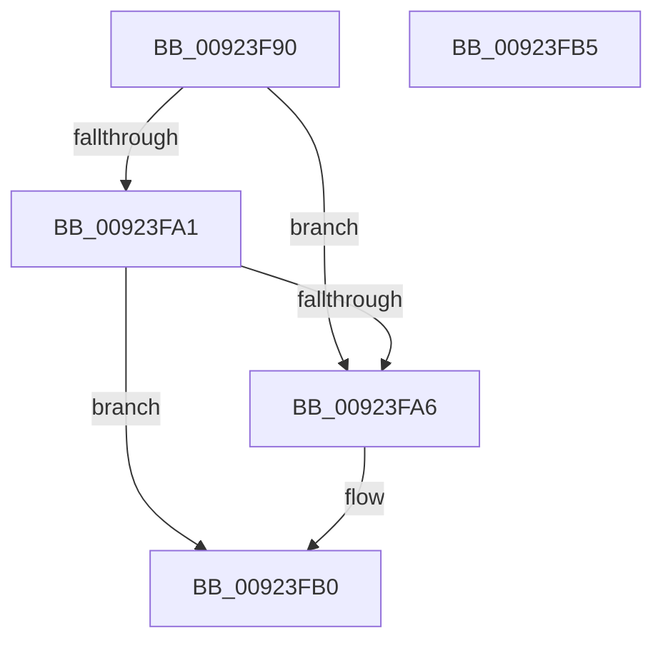

# SeDeleteClientSecurity

- RVA: `0x00923F90`–`0x00923FB6` (길이 `38` bytes)
- VA: `0x0000000140923F90`
- 실행 섹션: `PAGE`
- PDB 이름 있음: `예`; PDB Function 태그: `아니요`
- unwind 정보 RVA: `0x0005C788`
- 디코드: `11`개 명령, `38/38` bytes 표시
- 미해석 바이트: `0` (있으면 어셈블리에 `.byte`로 보존)

> 이 문서는 커널 이미지의 기계어와 PDB 기호를 분석해 생성했습니다. 4번과 5번은 함수 원형과 자료형을 바이너리 사용 방식에서 추정한 C 해석이며 원본 소스 복구 결과는 아닙니다.

## 1. Dependencies

- 직접 호출 지점: **1**; 고유 호출 대상: **1**
- 직접 호출자로 확인된 함수: **4**
- RIP 상대 이미지 참조: **0**

### Outgoing calls
- `0x00923FAB` → [ObfDereferenceObjectWithTag](../../text/2F/ObfDereferenceObjectWithTag_function_002F78E0.md) (function, `0x002F78E0`)

### Direct callers
- [AlpcpQueryTokenModifiedIdMessage](../74/AlpcpQueryTokenModifiedIdMessage_function_0074C0C0.md) at `0x0074C161`
- [AlpcpDeletePort](AlpcpDeletePort_function_00925010.md) at `0x00925155`
- [EtwpFreeLoggerContext](../9C/EtwpFreeLoggerContext_function_009C1688.md) at `0x009C17E6`
- [EtwpUpdateTrace](../AB/EtwpUpdateTrace_function_00ABCC7C.md) at `0x00ABCDFA`

### Static image references
- 디코드된 RIP-relative 메모리 참조가 없습니다.

## 2. Other-region calls and transfers

- 다른 실행 섹션으로 향하는 call: **1**
  - `0x00923FAB` → [ObfDereferenceObjectWithTag](../../text/2F/ObfDereferenceObjectWithTag_function_002F78E0.md) (`PAGE` → `.text`)
- 별도 외부 분기/꼬리 이동을 확인하지 못했습니다.

## 3. Assembly (complete function range)

```asm
00923F90  48 83 EC 28                     sub rsp, 0x28
00923F94  48 8B 49 10                     mov rcx, qword ptr [rcx + 0x10]
00923F98  83 B9 C0 00 00 00 01            cmp dword ptr [rcx + 0xc0], 1
00923F9F  74 05                           je 0x140923fa6
00923FA1  48 85 C9                        test rcx, rcx
00923FA4  74 0A                           je 0x140923fb0
00923FA6  BA 53 65 43 63                  mov edx, 0x63436553
00923FAB  E8 30 39 9D FF                  call 0x1402f78e0
00923FB0  48 83 C4 28                     add rsp, 0x28
00923FB4  C3                              ret
00923FB5  CC                              int3
```

## 4. C-style interpretation (structured pseudocode)

```c
__int64 __fastcall SeDeleteClientSecurity(__int64 a1)
{
    __int64 result;
    __int64 v_rsp;

    v_rsp = (v_rsp) - (40);
    if ((*(unsigned int *)(*(unsigned __int64 *)(a1 + 16) + 192)) == 1) goto loc_00923FA6;
    if (*(unsigned __int64 *)(a1 + 16) != 0) {
        a2 = 0x63436553ULL;
        result = ObfDereferenceObjectWithTag(*(unsigned __int64 *)(a1 + 16), a2, a3, a4);
    }
    v_rsp = (v_rsp) + (40);
    return result;
}
```

## 5. (Beta) C Style

```c
int64_t SeDeleteClientSecurity(void *Arg1)
{
    uint8_t *arg1 = (uint8_t *)Arg1;

    int64_t result;
    int64_t local_rsp;

    local_rsp = (local_rsp) - (40);
    if ((*(uint32_t *)(*(uint64_t *)(arg1 + 0x10) + 0xC0)) == 1) goto loc_00923FA6;
    if (*(uint64_t *)(arg1 + 0x10) != 0) {
        a2 = 0x63436553ULL;
        result = ObfDereferenceObjectWithTag(*(uint64_t *)(arg1 + 0x10), a2, a3, a4);
    }
    local_rsp = (local_rsp) + (40);
    return result;
}
```

### 관측된 메모리 오프셋

구조체 형식이 확인되지 않은 접근은 인자 기준의 오프셋으로만 기록했습니다.

| 기준 인자 | 오프셋 표현 | 폭 (bit) | 접근 |
|---|---:|---:|---|
| `Arg1` | `+ 0x10` | `64` | `R` |

## 6. Execution-region graph

[열기: 2D/3D 그래프와 함수 탐색 컨트롤 패널](../../../control-panel.html?section=page&rva=0x00923F90&view=graph)

- 2D 그래프는 위에서 아래로 흐르고, 3D 그래프는 빈 공간을 드래그해 회전합니다. Shift+드래그는 이동, 휠은 확대·축소, 함수 노드 선택은 대상 보고서 이동입니다.

### Static fallback


