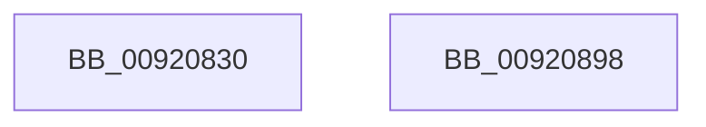

# SeDeleteObjectAuditAlarmWithTransaction

- RVA: `0x00920830`–`0x00920899` (길이 `105` bytes)
- VA: `0x0000000140920830`
- 실행 섹션: `PAGE`
- PDB 이름 있음: `예`; PDB Function 태그: `아니요`
- unwind 정보 RVA: `0x0007F83C`
- 디코드: `28`개 명령, `105/105` bytes 표시
- 미해석 바이트: `0` (있으면 어셈블리에 `.byte`로 보존)

> 이 문서는 커널 이미지의 기계어와 PDB 기호를 분석해 생성했습니다. 4번과 5번은 함수 원형과 자료형을 바이너리 사용 방식에서 추정한 C 해석이며 원본 소스 복구 결과는 아닙니다.

## 1. Dependencies

- 직접 호출 지점: **3**; 고유 호출 대상: **3**
- 직접 호출자로 확인된 함수: **3**
- RIP 상대 이미지 참조: **1**

### Outgoing calls
- `0x00920858` → [SeCaptureSubjectContext](../86/SeCaptureSubjectContext_function_0086B820.md) (function, `0x0086B820`)
- `0x00920879` → [SepAdtDeleteObjectAuditAlarm](../91/SepAdtDeleteObjectAuditAlarm_function_0091E824.md) (function, `0x0091E824`)
- `0x00920883` → [SeReleaseSubjectContext](../86/SeReleaseSubjectContext_function_0086B710.md) (function, `0x0086B710`)

### Direct callers
- [SeDeleteObjectAuditAlarm](SeDeleteObjectAuditAlarm_function_00920810.md) at `0x00920817`
- [NtMakeTemporaryObject](../A7/NtMakeTemporaryObject_function_00A7F7D0.md) at `0x00A7F850`
- [sub_00B1664A](../B1/Unknown_function_00B1664A.md) at `0x00B1672D`

### Static image references
- `0x00920872` → RVA `0x000013A8` (`.rdata`; read)

## 2. Other-region calls and transfers

- 다른 실행 섹션으로 향하는 call: **0**
- 별도 외부 분기/꼬리 이동을 확인하지 못했습니다.

## 3. Assembly (complete function range)

```asm
00920830  48 8B C4                        mov rax, rsp
00920833  48 89 58 08                     mov qword ptr [rax + 8], rbx
00920837  48 89 70 10                     mov qword ptr [rax + 0x10], rsi
0092083B  57                              push rdi
0092083C  48 83 EC 50                     sub rsp, 0x50
00920840  0F 57 C0                        xorps xmm0, xmm0
00920843  48 8B D9                        mov rbx, rcx
00920846  48 8D 48 D8                     lea rcx, [rax - 0x28]
0092084A  49 8B F8                        mov rdi, r8
0092084D  0F 11 40 D8                     movups xmmword ptr [rax - 0x28], xmm0
00920851  48 8B F2                        mov rsi, rdx
00920854  0F 11 40 E8                     movups xmmword ptr [rax - 0x18], xmm0
00920858  E8 C3 AF F4 FF                  call 0x14086b820
0092085D  4C 8B CB                        mov r9, rbx
00920860  C6 44 24 28 01                  mov byte ptr [rsp + 0x28], 1
00920865  4C 8D 44 24 30                  lea r8, [rsp + 0x30]
0092086A  48 89 7C 24 20                  mov qword ptr [rsp + 0x20], rdi
0092086F  48 8B D6                        mov rdx, rsi
00920872  48 8D 0D 2F 0B 6E FF            lea rcx, [rip - 0x91f4d1]
00920879  E8 A6 DF FF FF                  call 0x14091e824
0092087E  48 8D 4C 24 30                  lea rcx, [rsp + 0x30]
00920883  E8 88 AE F4 FF                  call 0x14086b710
00920888  48 8B 5C 24 60                  mov rbx, qword ptr [rsp + 0x60]
0092088D  48 8B 74 24 68                  mov rsi, qword ptr [rsp + 0x68]
00920892  48 83 C4 50                     add rsp, 0x50
00920896  5F                              pop rdi
00920897  C3                              ret
00920898  CC                              int3
```

## 4. C-style interpretation (structured pseudocode)

```c
__int64 __fastcall SeDeleteObjectAuditAlarmWithTransaction(__int64 a1, __int64 a2, __int64 a3)
{
    __int64 result;
    __int64 v_rsp;
    unsigned __int64 v_stack_m28;
    unsigned __int8 v_stack_m30;
    unsigned __int64 v_stack_m38;
    unsigned __int64 v_stack_p10;
    unsigned __int64 v_stack_p8;

    *(unsigned __int64 *)(v_rsp + 8) = v_rbx;
    *(unsigned __int64 *)(v_rsp + 16) = v_rsi;
    v_rsp = (v_rsp) - (80);
    *(unsigned __int64 *)(v_rsp - 40) = v_xmm0;
    *(unsigned __int64 *)(v_rsp - 24) = v_xmm0;
    result = SeCaptureSubjectContext(v_rsp - 40, a2, a3, a4);
    v_stack_m30 = 1;
    v_stack_m38 = a3;
    result = SepAdtDeleteObjectAuditAlarm(v_rip - 9565393, a2, v_stack_m28, a1);
    result = SeReleaseSubjectContext(v_stack_m28, a2, v_stack_m28, a1);
    v_rsp = (v_rsp) + (80);
    return result;
}
```

## 5. (Beta) C Style

```c
int64_t SeDeleteObjectAuditAlarmWithTransaction(int64_t Arg1, int64_t Arg2, int64_t Arg3)
{
    int64_t result;
    int64_t local_rsp;
    uint64_t v_stack_m28;
    uint8_t v_stack_m30;
    uint64_t v_stack_m38;
    uint64_t v_stack_p10;
    uint64_t v_stack_p8;

    *(uint64_t *)(local_rsp + 0x8) = local_rbx;
    *(uint64_t *)(local_rsp + 0x10) = local_rsi;
    local_rsp = (local_rsp) - (80);
    *(uint64_t *)(local_rsp - 0x28) = v_xmm0;
    *(uint64_t *)(local_rsp - 0x18) = v_xmm0;
    result = SeCaptureSubjectContext(local_rsp - 40, Arg2, Arg3, a4);
    v_stack_m30 = 1;
    v_stack_m38 = Arg3;
    result = SepAdtDeleteObjectAuditAlarm(v_rip - 9565393, Arg2, v_stack_m28, Arg1);
    result = SeReleaseSubjectContext(v_stack_m28, Arg2, v_stack_m28, Arg1);
    local_rsp = (local_rsp) + (80);
    return result;
}
```

## 6. Execution-region graph

[열기: 2D/3D 그래프와 함수 탐색 컨트롤 패널](../../../control-panel.html?section=page&rva=0x00920830&view=graph)

- 2D 그래프는 위에서 아래로 흐르고, 3D 그래프는 빈 공간을 드래그해 회전합니다. Shift+드래그는 이동, 휠은 확대·축소, 함수 노드 선택은 대상 보고서 이동입니다.

### Static fallback


