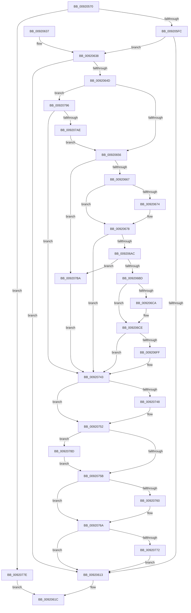

# SeTokenDefaultDaclChangedAuditAlarm

- RVA: `0x00920570`–`0x009207C1` (길이 `593` bytes)
- VA: `0x0000000140920570`
- 실행 섹션: `PAGE`
- PDB 이름 있음: `예`; PDB Function 태그: `아니요`
- unwind 정보 RVA: `0x0008B684`
- 디코드: `167`개 명령, `593/593` bytes 표시
- 미해석 바이트: `0` (있으면 어셈블리에 `.byte`로 보존)

> 이 문서는 커널 이미지의 기계어와 PDB 기호를 분석해 생성했습니다. 4번과 5번은 함수 원형과 자료형을 바이너리 사용 방식에서 추정한 C 해석이며 원본 소스 복구 결과는 아닙니다.

## 1. Dependencies

- 직접 호출 지점: **13**; 고유 호출 대상: **9**
- 직접 호출자로 확인된 함수: **1**
- RIP 상대 이미지 참조: **1**

### Outgoing calls
- `0x009205DF` → [SeCaptureSubjectContext](../86/SeCaptureSubjectContext_function_0086B820.md) (function, `0x0086B820`)
- `0x0092060A` → [SepAdtAuditThisEventWithContext](../87/SepAdtAuditThisEventWithContext_function_00870AC0.md) (function, `0x00870AC0`)
- `0x00920617` → [SeReleaseSubjectContext](../86/SeReleaseSubjectContext_function_0086B710.md) (function, `0x0086B710`)
- `0x00920642` → [SepIsAclEqual](SepIsAclEqual_function_009207C8.md) (function, `0x009207C8`)
- `0x0092069A` → [SeCaptureSecurityDescriptor](SeCaptureSecurityDescriptor_function_00929F40.md) (function, `0x00929F40`)
- `0x009206F0` → [SeCaptureSecurityDescriptor](SeCaptureSecurityDescriptor_function_00929F40.md) (function, `0x00929F40`)
- `0x0092073E` → [SepAdtSecurityDescriptorChangedAuditAlarm](../91/SepAdtSecurityDescriptorChangedAuditAlarm_function_0091E3E8.md) (function, `0x0091E3E8`)
- `0x0092074D` → [ExFreePoolWithTag](../../poolcode/B8/ExFreePoolWithTag_function_00B82870.md) (function, `0x00B82870`)
- `0x00920765` → [ExFreePoolWithTag](../../poolcode/B8/ExFreePoolWithTag_function_00B82870.md) (function, `0x00B82870`)
- `0x00920774` → [SepAuditFailed](../86/SepAuditFailed_function_0086EE20.md) (function, `0x0086EE20`)
- `0x00920783` → [SepAuditFailed](../86/SepAuditFailed_function_0086EE20.md) (function, `0x0086EE20`)
- `0x0092078F` → [ExFreePoolWithTag](../../poolcode/B8/ExFreePoolWithTag_function_00B82870.md) (function, `0x00B82870`)
- `0x0092079D` → [SepQueryTypeString](SepQueryTypeString_function_00920420.md) (function, `0x00920420`)

### Direct callers
- [NtSetInformationToken](../AF/NtSetInformationToken_function_00AF0530.md) at `0x00AF08BF`

### Static image references
- `0x00920706` → RVA `0x000013A8` (`.rdata`; read)

## 2. Other-region calls and transfers

- 다른 실행 섹션으로 향하는 call: **3**
  - `0x0092074D` → [ExFreePoolWithTag](../../poolcode/B8/ExFreePoolWithTag_function_00B82870.md) (`PAGE` → `POOLCODE`)
  - `0x00920765` → [ExFreePoolWithTag](../../poolcode/B8/ExFreePoolWithTag_function_00B82870.md) (`PAGE` → `POOLCODE`)
  - `0x0092078F` → [ExFreePoolWithTag](../../poolcode/B8/ExFreePoolWithTag_function_00B82870.md) (`PAGE` → `POOLCODE`)
- 별도 외부 분기/꼬리 이동을 확인하지 못했습니다.

## 3. Assembly (complete function range)

```asm
00920570  48 8B C4                        mov rax, rsp
00920573  48 89 58 10                     mov qword ptr [rax + 0x10], rbx
00920577  4C 89 40 18                     mov qword ptr [rax + 0x18], r8
0092057B  48 89 48 08                     mov qword ptr [rax + 8], rcx
0092057F  55                              push rbp
00920580  56                              push rsi
00920581  57                              push rdi
00920582  41 54                           push r12
00920584  41 55                           push r13
00920586  41 56                           push r14
00920588  41 57                           push r15
0092058A  48 8D 68 A9                     lea rbp, [rax - 0x57]
0092058E  48 81 EC D0 00 00 00            sub rsp, 0xd0
00920595  45 33 FF                        xor r15d, r15d
00920598  48 8D 4D AF                     lea rcx, [rbp - 0x51]
0092059C  0F 57 C0                        xorps xmm0, xmm0
0092059F  4C 89 7D 5F                     mov qword ptr [rbp + 0x5f], r15
009205A3  33 C0                           xor eax, eax
009205A5  4C 89 7D A7                     mov qword ptr [rbp - 0x59], r15
009205A9  0F 57 C9                        xorps xmm1, xmm1
009205AC  48 89 45 EF                     mov qword ptr [rbp - 0x11], rax
009205B0  0F 11 45 AF                     movups xmmword ptr [rbp - 0x51], xmm0
009205B4  41 8B FF                        mov edi, r15d
009205B7  45 8B F7                        mov r14d, r15d
009205BA  0F 11 45 BF                     movups xmmword ptr [rbp - 0x41], xmm0
009205BE  48 89 45 17                     mov qword ptr [rbp + 0x17], rax
009205C2  41 8B F7                        mov esi, r15d
009205C5  0F 11 45 CF                     movups xmmword ptr [rbp - 0x31], xmm0
009205C9  4C 89 7D 9F                     mov qword ptr [rbp - 0x61], r15
009205CD  4D 8B E1                        mov r12, r9
009205D0  0F 11 45 DF                     movups xmmword ptr [rbp - 0x21], xmm0
009205D4  48 8B DA                        mov rbx, rdx
009205D7  0F 11 4D F7                     movups xmmword ptr [rbp - 9], xmm1
009205DB  0F 11 4D 07                     movups xmmword ptr [rbp + 7], xmm1
009205DF  E8 3C B2 F4 FF                  call 0x14086b820
009205E4  48 8B 45 AF                     mov rax, qword ptr [rbp - 0x51]
009205E8  4C 8B 6D BF                     mov r13, qword ptr [rbp - 0x41]
009205EC  48 85 C0                        test rax, rax
009205EF  4C 0F 45 E8                     cmovne r13, rax
009205F3  4D 85 ED                        test r13, r13
009205F6  0F 84 82 01 00 00               je 0x14092077e
009205FC  4C 8D 4D AF                     lea r9, [rbp - 0x51]
00920600  45 33 C0                        xor r8d, r8d
00920603  B2 01                           mov dl, 1
00920605  B9 8E 00 00 00                  mov ecx, 0x8e
0092060A  E8 B1 04 F5 FF                  call 0x140870ac0
0092060F  84 C0                           test al, al
00920611  75 25                           jne 0x140920638
00920613  48 8D 4D AF                     lea rcx, [rbp - 0x51]
00920617  E8 F4 B0 F4 FF                  call 0x14086b710
0092061C  48 8B 9C 24 18 01 00 00         mov rbx, qword ptr [rsp + 0x118]
00920624  48 81 C4 D0 00 00 00            add rsp, 0xd0
0092062B  41 5F                           pop r15
0092062D  41 5E                           pop r14
0092062F  41 5D                           pop r13
00920631  41 5C                           pop r12
00920633  5F                              pop rdi
00920634  5E                              pop rsi
00920635  5D                              pop rbp
00920636  C3                              ret
00920637  CC                              int3
00920638  4C 8B 7D 7F                     mov r15, qword ptr [rbp + 0x7f]
0092063C  49 8B CC                        mov rcx, r12
0092063F  49 8B D7                        mov rdx, r15
00920642  E8 81 01 00 00                  call 0x1409207c8
00920647  33 C9                           xor ecx, ecx
00920649  84 C0                           test al, al
0092064B  75 C6                           jne 0x140920613
0092064D  48 85 DB                        test rbx, rbx
00920650  0F 85 40 01 00 00               jne 0x140920796
00920656  0F B7 45 D1                     movzx eax, word ptr [rbp - 0x2f]
0092065A  C6 45 CF 01                     mov byte ptr [rbp - 0x31], 1
0092065E  66 85 C0                        test ax, ax
00920661  0F 88 53 01 00 00               js 0x1409207ba
00920667  66 83 C8 04                     or ax, 4
0092066B  48 89 4D EF                     mov qword ptr [rbp - 0x11], rcx
0092066F  4D 85 E4                        test r12, r12
00920672  74 04                           je 0x140920678
00920674  4C 89 65 EF                     mov qword ptr [rbp - 0x11], r12
00920678  B9 F7 FF 00 00                  mov ecx, 0xfff7
0092067D  33 D2                           xor edx, edx
0092067F  66 23 C1                        and ax, cx
00920682  41 B1 01                        mov r9b, 1
00920685  66 89 45 D1                     mov word ptr [rbp - 0x2f], ax
00920689  48 8D 4D CF                     lea rcx, [rbp - 0x31]
0092068D  48 8D 45 A7                     lea rax, [rbp - 0x59]
00920691  44 8D 42 01                     lea r8d, [rdx + 1]
00920695  48 89 44 24 20                  mov qword ptr [rsp + 0x20], rax
0092069A  E8 A1 98 00 00                  call 0x140929f40
0092069F  45 33 E4                        xor r12d, r12d
009206A2  8B D8                           mov ebx, eax
009206A4  85 C0                           test eax, eax
009206A6  0F 88 97 00 00 00               js 0x140920743
009206AC  0F B7 45 F9                     movzx eax, word ptr [rbp - 7]
009206B0  C6 45 F7 01                     mov byte ptr [rbp - 9], 1
009206B4  66 85 C0                        test ax, ax
009206B7  0F 88 FD 00 00 00               js 0x1409207ba
009206BD  66 83 C8 04                     or ax, 4
009206C1  4C 89 65 17                     mov qword ptr [rbp + 0x17], r12
009206C5  4D 85 FF                        test r15, r15
009206C8  74 04                           je 0x1409206ce
009206CA  4C 89 7D 17                     mov qword ptr [rbp + 0x17], r15
009206CE  B9 F7 FF 00 00                  mov ecx, 0xfff7
009206D3  33 D2                           xor edx, edx
009206D5  66 23 C1                        and ax, cx
009206D8  41 B1 01                        mov r9b, 1
009206DB  66 89 45 F9                     mov word ptr [rbp - 7], ax
009206DF  48 8D 4D F7                     lea rcx, [rbp - 9]
009206E3  48 8D 45 9F                     lea rax, [rbp - 0x61]
009206E7  44 8D 42 01                     lea r8d, [rdx + 1]
009206EB  48 89 44 24 20                  mov qword ptr [rsp + 0x20], rax
009206F0  E8 4B 98 00 00                  call 0x140929f40
009206F5  48 8B 75 9F                     mov rsi, qword ptr [rbp - 0x61]
009206F9  8B D8                           mov ebx, eax
009206FB  85 C0                           test eax, eax
009206FD  78 44                           js 0x140920743
009206FF  49 8B 8D 98 00 00 00            mov rcx, qword ptr [r13 + 0x98]
00920706  48 8D 15 9B 0C 6E FF            lea rdx, [rip - 0x91f365]
0092070D  48 8B 45 A7                     mov rax, qword ptr [rbp - 0x59]
00920711  45 33 C9                        xor r9d, r9d
00920714  48 89 74 24 40                  mov qword ptr [rsp + 0x40], rsi
00920719  4D 8B C6                        mov r8, r14
0092071C  C7 44 24 38 04 00 00 00         mov dword ptr [rsp + 0x38], 4
00920724  48 89 44 24 30                  mov qword ptr [rsp + 0x30], rax
00920729  48 8B 01                        mov rax, qword ptr [rcx]
0092072C  48 8D 4D AF                     lea rcx, [rbp - 0x51]
00920730  48 89 44 24 28                  mov qword ptr [rsp + 0x28], rax
00920735  48 8B 45 6F                     mov rax, qword ptr [rbp + 0x6f]
00920739  48 89 44 24 20                  mov qword ptr [rsp + 0x20], rax
0092073E  E8 A5 DC FF FF                  call 0x14091e3e8
00920743  48 85 FF                        test rdi, rdi
00920746  74 0A                           je 0x140920752
00920748  33 D2                           xor edx, edx
0092074A  48 8B CF                        mov rcx, rdi
0092074D  E8 1E 21 26 00                  call 0x140b82870
00920752  48 8B 4D A7                     mov rcx, qword ptr [rbp - 0x59]
00920756  48 85 C9                        test rcx, rcx
00920759  75 32                           jne 0x14092078d
0092075B  48 85 F6                        test rsi, rsi
0092075E  74 0A                           je 0x14092076a
00920760  33 D2                           xor edx, edx
00920762  48 8B CE                        mov rcx, rsi
00920765  E8 06 21 26 00                  call 0x140b82870
0092076A  85 DB                           test ebx, ebx
0092076C  0F 89 A1 FE FF FF               jns 0x140920613
00920772  8B CB                           mov ecx, ebx
00920774  E8 A7 E6 F4 FF                  call 0x14086ee20
00920779  E9 95 FE FF FF                  jmp 0x140920613
0092077E  B9 7C 00 00 C0                  mov ecx, 0xc000007c
00920783  E8 98 E6 F4 FF                  call 0x14086ee20
00920788  E9 8F FE FF FF                  jmp 0x14092061c
0092078D  33 D2                           xor edx, edx
0092078F  E8 DC 20 26 00                  call 0x140b82870
00920794  EB C5                           jmp 0x14092075b
00920796  48 8D 55 5F                     lea rdx, [rbp + 0x5f]
0092079A  48 8B CB                        mov rcx, rbx
0092079D  E8 7E FC FF FF                  call 0x140920420
009207A2  48 8B 7D 5F                     mov rdi, qword ptr [rbp + 0x5f]
009207A6  33 C9                           xor ecx, ecx
009207A8  8B D8                           mov ebx, eax
009207AA  85 C0                           test eax, eax
009207AC  78 95                           js 0x140920743
009207AE  48 85 FF                        test rdi, rdi
009207B1  4C 0F 45 F7                     cmovne r14, rdi
009207B5  E9 9C FE FF FF                  jmp 0x140920656
009207BA  BB 79 00 00 C0                  mov ebx, 0xc0000079
009207BF  EB 82                           jmp 0x140920743
```

## 4. C-style interpretation (structured pseudocode)

```c
__int64 __fastcall SeTokenDefaultDaclChangedAuditAlarm(__int64 a1, __int64 a2, __int64 a3, __int64 a4)
{
    __int64 result;
    __int64 v_r12;
    __int64 v_r13;
    __int64 v_r14;
    __int64 v_r15;
    __int64 v_rsp;
    unsigned __int64 v_stack_p10;
    unsigned __int64 v_stack_p20;
    unsigned __int64 v_stack_p28;
    unsigned __int64 v_stack_p30;
    unsigned int v_stack_p38;
    unsigned __int64 v_stack_p40;

    *(unsigned __int64 *)(v_rsp + 16) = v_rbx;
    *(unsigned __int64 *)(v_rsp + 24) = a3;
    *(unsigned __int64 *)(v_rsp + 8) = a1;
    v_rsp = (v_rsp) - (208);
    v_r15 = 0;
    *(unsigned __int64 *)(v_rsp - 87 + 95) = 0;
    result = 0;
    *(unsigned __int64 *)(v_rsp - 87 - 89) = 0;
    *(unsigned __int64 *)(v_rsp - 87 - 17) = 0;
    *(unsigned __int64 *)(v_rsp - 87 - 81) = v_xmm0;
    *(unsigned __int64 *)(v_rsp - 87 - 65) = v_xmm0;
    *(unsigned __int64 *)(v_rsp - 87 + 23) = 0;
    *(unsigned __int64 *)(v_rsp - 87 - 49) = v_xmm0;
    *(unsigned __int64 *)(v_rsp - 87 - 97) = 0;
    *(unsigned __int64 *)(v_rsp - 87 - 33) = v_xmm0;
    *(unsigned __int64 *)(v_rsp - 87 - 9) = v_xmm1;
    *(unsigned __int64 *)(v_rsp - 87 + 7) = v_xmm1;
    result = SeCaptureSubjectContext(v_rsp - 87 - 81, a2, a3, a4);
    v_r13 = *(unsigned __int64 *)(v_rsp - 87 - 65);
    if (*(unsigned __int64 *)(v_rsp - 87 - 81) != 0) { v_r13 = *(unsigned __int64 *)(v_rsp - 87 - 81); }
    if (v_r13 == 0) goto loc_0092077E;
    a3 = 0;
    result = SepAdtAuditThisEventWithContext(142, 1, a3, v_rsp - 87 - 81);
    if ((unsigned __int8)(result) != 0) goto loc_00920638;
loc_00920613:
    result = SeReleaseSubjectContext(v_rsp - 87 - 81, 1, a3, v_rsp - 87 - 81);
loc_0092061C:
    v_rsp = (v_rsp) + (208);
    return result;
loc_00920638:
    result = SepIsAclEqual(a4, *(unsigned __int64 *)(v_rsp - 87 + 127), a3, v_rsp - 87 - 81);
    a1 = 0;
    if ((unsigned __int8)(result) != 0) goto loc_00920613;
    if (v_stack_p10 != 0) goto loc_00920796;
loc_00920656:
    *(unsigned __int8 *)(v_rsp - 87 - 49) = 1;
    if (sign_flag) goto loc_009207BA;
    result = (unsigned __int16)((*(unsigned __int16 *)(v_rsp - 87 - 47)) | (4));
    *(unsigned __int64 *)(v_rsp - 87 - 17) = 0;
    if (a4 != 0) {
        *(unsigned __int64 *)(v_rsp - 87 - 17) = a4;
    }
    a2 = 0;
    result = (unsigned __int16)((result) & ((unsigned __int16)((unsigned int)(0xFFF7ULL))));
    *(unsigned __int16 *)(v_rsp - 87 - 47) = (unsigned __int16)(result);
    v_stack_p20 = v_rsp - 87 - 89;
    result = SeCaptureSecurityDescriptor(v_rsp - 87 - 49, a2, a2 + 1, 1);
    v_r12 = 0;
    if (sign_flag) goto loc_00920743;
    *(unsigned __int8 *)(v_rsp - 87 - 9) = 1;
    if (sign_flag) goto loc_009207BA;
    result = (unsigned __int16)((*(unsigned __int16 *)(v_rsp - 87 - 7)) | (4));
    *(unsigned __int64 *)(v_rsp - 87 + 23) = 0;
    if (*(unsigned __int64 *)(v_rsp - 87 + 127) != 0) {
        *(unsigned __int64 *)(v_rsp - 87 + 23) = *(unsigned __int64 *)(v_rsp - 87 + 127);
    }
    a2 = 0;
    result = (unsigned __int16)((result) & ((unsigned __int16)((unsigned int)(0xFFF7ULL))));
    *(unsigned __int16 *)(v_rsp - 87 - 7) = (unsigned __int16)(result);
    v_stack_p20 = v_rsp - 87 - 97;
    result = SeCaptureSecurityDescriptor(v_rsp - 87 - 9, a2, a2 + 1, 1);
    if (!(sign_flag)) {
        a1 = *(unsigned __int64 *)(v_r13 + 152);
        a2 = v_rip - 9565029;
        result = *(unsigned __int64 *)(v_rsp - 87 - 89);
        a4 = 0;
        v_stack_p40 = *(unsigned __int64 *)(v_rsp - 87 - 97);
        a3 = 0;
        v_stack_p38 = 4;
        v_stack_p30 = result;
        result = *(unsigned __int64 *)(a1);
        a1 = v_rsp - 87 - 81;
        v_stack_p28 = result;
        result = *(unsigned __int64 *)(v_rsp - 87 + 111);
        v_stack_p20 = result;
        result = SepAdtSecurityDescriptorChangedAuditAlarm(a1, a2, a3, a4);
    }
    if (0 != 0) {
        a2 = 0;
        a1 = 0;
        result = ExFreePoolWithTag(a1, a2, a3, a4);
    }
    if (*(unsigned __int64 *)(v_rsp - 87 - 89) != 0) goto loc_0092078D;
loc_0092075B:
    if (*(unsigned __int64 *)(v_rsp - 87 - 97) != 0) {
        a2 = 0;
        a1 = *(unsigned __int64 *)(v_rsp - 87 - 97);
        result = ExFreePoolWithTag(a1, a2, a3, a4);
    }
    if (!sign_flag) goto loc_00920613;
    result = SepAuditFailed((unsigned int)((unsigned int)((unsigned int)((unsigned int)(result)))), a2, a3, a4);
    goto loc_00920613;
loc_0092077E:
    result = SepAuditFailed((unsigned int)(0xC000007CULL), a2, a3, a4);
    goto loc_0092061C;
loc_0092078D:
    a2 = 0;
    result = ExFreePoolWithTag((unsigned int)(0xC000007CULL), a2, a3, a4);
    goto loc_0092075B;
loc_00920796:
    result = SepQueryTypeString((unsigned int)((unsigned int)(result)), v_rsp - 87 + 95, a3, a4);
    a1 = 0;
    if (sign_flag) goto loc_00920743;
    v_r14 = 0;
    if (*(unsigned __int64 *)(v_rsp - 87 + 95) != 0) { v_r14 = *(unsigned __int64 *)(v_rsp - 87 + 95); }
    goto loc_00920656;
loc_009207BA:
    goto loc_00920743;
}
```

## 5. (Beta) C Style

```c
int64_t SeTokenDefaultDaclChangedAuditAlarm(int64_t Arg1, int64_t Arg2, int64_t Arg3, int64_t Arg4)
{
    int64_t result;
    int64_t local_r12;
    int64_t local_r13;
    int64_t local_r14;
    int64_t local_r15;
    int64_t local_rsp;
    uint64_t v_stack_p10;
    uint64_t v_stack_p20;
    uint64_t v_stack_p28;
    uint64_t v_stack_p30;
    uint32_t v_stack_p38;
    uint64_t v_stack_p40;

    *(uint64_t *)(local_rsp + 0x10) = local_rbx;
    *(uint64_t *)(local_rsp + 0x18) = Arg3;
    *(uint64_t *)(local_rsp + 0x8) = Arg1;
    local_rsp = (local_rsp) - (208);
    local_r15 = 0;
    *(uint64_t *)(local_rsp - 0x57 + 0x5F) = 0;
    result = 0;
    *(uint64_t *)(local_rsp - 0x57 - 0x59) = 0;
    *(uint64_t *)(local_rsp - 0x57 - 0x11) = 0;
    *(uint64_t *)(local_rsp - 0x57 - 0x51) = v_xmm0;
    *(uint64_t *)(local_rsp - 0x57 - 0x41) = v_xmm0;
    *(uint64_t *)(local_rsp - 0x57 + 0x17) = 0;
    *(uint64_t *)(local_rsp - 0x57 - 0x31) = v_xmm0;
    *(uint64_t *)(local_rsp - 0x57 - 0x61) = 0;
    *(uint64_t *)(local_rsp - 0x57 - 0x21) = v_xmm0;
    *(uint64_t *)(local_rsp - 0x57 - 0x9) = v_xmm1;
    *(uint64_t *)(local_rsp - 0x57 + 0x7) = v_xmm1;
    result = SeCaptureSubjectContext(local_rsp - 87 - 81, Arg2, Arg3, Arg4);
    local_r13 = *(uint64_t *)(local_rsp - 0x57 - 0x41);
    if (*(uint64_t *)(local_rsp - 0x57 - 0x51) != 0) { local_r13 = *(uint64_t *)(local_rsp - 0x57 - 0x51); }
    if (local_r13 == 0) goto loc_0092077E;
    Arg3 = 0;
    result = SepAdtAuditThisEventWithContext(142, 1, Arg3, local_rsp - 87 - 81);
    if ((uint8_t)(result) != 0) goto loc_00920638;
loc_00920613:
    result = SeReleaseSubjectContext(local_rsp - 87 - 81, 1, Arg3, local_rsp - 87 - 81);
loc_0092061C:
    local_rsp = (local_rsp) + (208);
    return result;
loc_00920638:
    result = SepIsAclEqual(Arg4, *(uint64_t *)(local_rsp - 0x57 + 0x7F), Arg3, local_rsp - 87 - 81);
    Arg1 = 0;
    if ((uint8_t)(result) != 0) goto loc_00920613;
    if (v_stack_p10 != 0) goto loc_00920796;
loc_00920656:
    *(uint8_t *)(local_rsp - 0x57 - 0x31) = 1;
    if (sign_flag) goto loc_009207BA;
    result = (uint16_t)((*(uint16_t *)(local_rsp - 0x57 - 0x2F)) | (4));
    *(uint64_t *)(local_rsp - 0x57 - 0x11) = 0;
    if (Arg4 != 0) {
        *(uint64_t *)(local_rsp - 0x57 - 0x11) = Arg4;
    }
    Arg2 = 0;
    result = (uint16_t)((result) & ((uint16_t)((uint32_t)(0xFFF7ULL))));
    *(uint16_t *)(local_rsp - 0x57 - 0x2F) = (uint16_t)(result);
    v_stack_p20 = local_rsp - 87 - 89;
    result = SeCaptureSecurityDescriptor(local_rsp - 87 - 49, Arg2, Arg2 + 1, 1);
    local_r12 = 0;
    if (sign_flag) goto loc_00920743;
    *(uint8_t *)(local_rsp - 0x57 - 0x9) = 1;
    if (sign_flag) goto loc_009207BA;
    result = (uint16_t)((*(uint16_t *)(local_rsp - 0x57 - 0x7)) | (4));
    *(uint64_t *)(local_rsp - 0x57 + 0x17) = 0;
    if (*(uint64_t *)(local_rsp - 0x57 + 0x7F) != 0) {
        *(uint64_t *)(local_rsp - 0x57 + 0x17) = *(uint64_t *)(local_rsp - 0x57 + 0x7F);
    }
    Arg2 = 0;
    result = (uint16_t)((result) & ((uint16_t)((uint32_t)(0xFFF7ULL))));
    *(uint16_t *)(local_rsp - 0x57 - 0x7) = (uint16_t)(result);
    v_stack_p20 = local_rsp - 87 - 97;
    result = SeCaptureSecurityDescriptor(local_rsp - 87 - 9, Arg2, Arg2 + 1, 1);
    if (!(sign_flag)) {
        Arg1 = *(uint64_t *)(local_r13 + 0x98);
        Arg2 = v_rip - 9565029;
        result = *(uint64_t *)(local_rsp - 0x57 - 0x59);
        Arg4 = 0;
        v_stack_p40 = *(uint64_t *)(local_rsp - 0x57 - 0x61);
        Arg3 = 0;
        v_stack_p38 = 4;
        v_stack_p30 = result;
        result = *(uint64_t *)(Arg1);
        Arg1 = local_rsp - 87 - 81;
        v_stack_p28 = result;
        result = *(uint64_t *)(local_rsp - 0x57 + 0x6F);
        v_stack_p20 = result;
        result = SepAdtSecurityDescriptorChangedAuditAlarm(Arg1, Arg2, Arg3, Arg4);
    }
    if (0 != 0) {
        Arg2 = 0;
        Arg1 = 0;
        result = ExFreePoolWithTag(Arg1, Arg2, Arg3, Arg4);
    }
    if (*(uint64_t *)(local_rsp - 0x57 - 0x59) != 0) goto loc_0092078D;
loc_0092075B:
    if (*(uint64_t *)(local_rsp - 0x57 - 0x61) != 0) {
        Arg2 = 0;
        Arg1 = *(uint64_t *)(local_rsp - 0x57 - 0x61);
        result = ExFreePoolWithTag(Arg1, Arg2, Arg3, Arg4);
    }
    if (!sign_flag) goto loc_00920613;
    result = SepAuditFailed((uint32_t)((uint32_t)((uint32_t)((uint32_t)(result)))), Arg2, Arg3, Arg4);
    goto loc_00920613;
loc_0092077E:
    result = SepAuditFailed((uint32_t)(0xC000007CULL), Arg2, Arg3, Arg4);
    goto loc_0092061C;
loc_0092078D:
    Arg2 = 0;
    result = ExFreePoolWithTag((uint32_t)(0xC000007CULL), Arg2, Arg3, Arg4);
    goto loc_0092075B;
loc_00920796:
    result = SepQueryTypeString((uint32_t)((uint32_t)(result)), local_rsp - 87 + 95, Arg3, Arg4);
    Arg1 = 0;
    if (sign_flag) goto loc_00920743;
    local_r14 = 0;
    if (*(uint64_t *)(local_rsp - 0x57 + 0x5F) != 0) { local_r14 = *(uint64_t *)(local_rsp - 0x57 + 0x5F); }
    goto loc_00920656;
loc_009207BA:
    goto loc_00920743;
}
```

## 6. Execution-region graph

[열기: 2D/3D 그래프와 함수 탐색 컨트롤 패널](../../../control-panel.html?section=page&rva=0x00920570&view=graph)

- 2D 그래프는 위에서 아래로 흐르고, 3D 그래프는 빈 공간을 드래그해 회전합니다. Shift+드래그는 이동, 휠은 확대·축소, 함수 노드 선택은 대상 보고서 이동입니다.

### Static fallback


