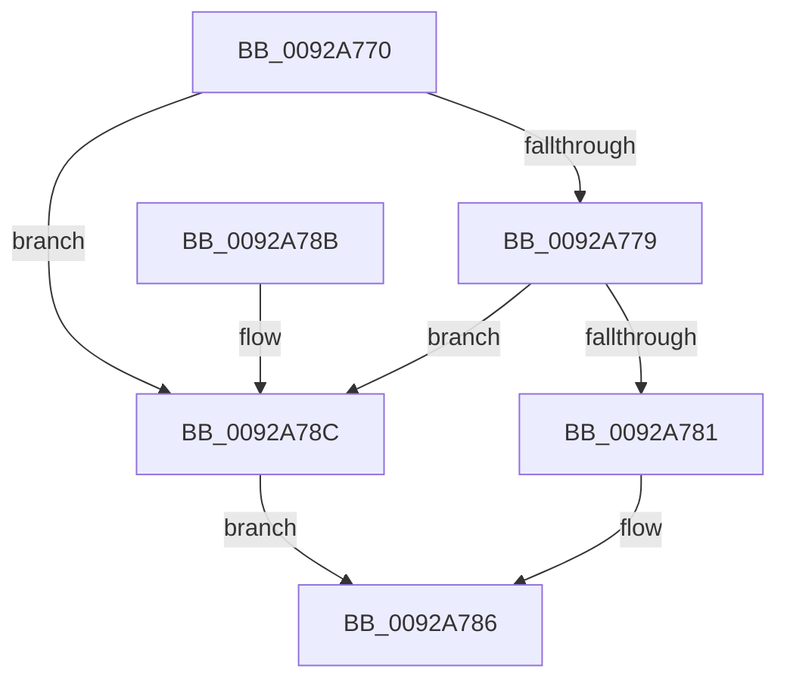

# SepCheckAcl

- RVA: `0x0092A770`–`0x0092A790` (길이 `32` bytes)
- VA: `0x000000014092A770`
- 실행 섹션: `PAGE`
- PDB 이름 있음: `예`; PDB Function 태그: `아니요`
- unwind 정보 RVA: `0x00069B1C`
- 디코드: `12`개 명령, `32/32` bytes 표시
- 미해석 바이트: `0` (있으면 어셈블리에 `.byte`로 보존)

> 이 문서는 커널 이미지의 기계어와 PDB 기호를 분석해 생성했습니다. 4번과 5번은 함수 원형과 자료형을 바이너리 사용 방식에서 추정한 C 해석이며 원본 소스 복구 결과는 아닙니다.

## 1. Dependencies

- 직접 호출 지점: **1**; 고유 호출 대상: **1**
- 직접 호출자로 확인된 함수: **1**
- RIP 상대 이미지 참조: **0**

### Outgoing calls
- `0x0092A781` → [RtlValidAcl](RtlValidAcl_function_0092A7A0.md) (function, `0x0092A7A0`)

### Direct callers
- [SeCaptureAcl](../9C/SeCaptureAcl_function_009C6A58.md) at `0x009C6B2C`

### Static image references
- 디코드된 RIP-relative 메모리 참조가 없습니다.

## 2. Other-region calls and transfers

- 다른 실행 섹션으로 향하는 call: **0**
- 별도 외부 분기/꼬리 이동을 확인하지 못했습니다.

## 3. Assembly (complete function range)

```asm
0092A770  48 83 EC 28                     sub rsp, 0x28
0092A774  83 FA 08                        cmp edx, 8
0092A777  72 13                           jb 0x14092a78c
0092A779  0F B7 41 02                     movzx eax, word ptr [rcx + 2]
0092A77D  3B D0                           cmp edx, eax
0092A77F  75 0B                           jne 0x14092a78c
0092A781  E8 1A 00 00 00                  call 0x14092a7a0
0092A786  48 83 C4 28                     add rsp, 0x28
0092A78A  C3                              ret
0092A78B  CC                              int3
0092A78C  32 C0                           xor al, al
0092A78E  EB F6                           jmp 0x14092a786
```

## 4. C-style interpretation (structured pseudocode)

```c
__int64 __fastcall SepCheckAcl(__int64 a1, int a2)
{
    __int64 result;
    __int64 v_rsp;

    v_rsp = (v_rsp) - (40);
    if (a2 < 8) goto loc_0092A78C;
    if (a2 != ((unsigned int)(*(unsigned __int16 *)(a1 + 2)))) goto loc_0092A78C;
    result = RtlValidAcl(a1, a2, a3, a4);
loc_0092A786:
    v_rsp = (v_rsp) + (40);
    return result;
loc_0092A78C:
    result = 0;
    goto loc_0092A786;
}
```

## 5. (Beta) C Style

```c
int64_t SepCheckAcl(void *Arg1, int32_t Arg2)
{
    uint8_t *arg1 = (uint8_t *)Arg1;

    int64_t result;
    int64_t local_rsp;

    local_rsp = (local_rsp) - (40);
    if (Arg2 < 8) goto loc_0092A78C;
    if (Arg2 != ((uint32_t)(*(uint16_t *)(arg1 + 0x2)))) goto loc_0092A78C;
    result = RtlValidAcl(Arg1, Arg2, a3, a4);
loc_0092A786:
    local_rsp = (local_rsp) + (40);
    return result;
loc_0092A78C:
    result = 0;
    goto loc_0092A786;
}
```

### 관측된 메모리 오프셋

구조체 형식이 확인되지 않은 접근은 인자 기준의 오프셋으로만 기록했습니다.

| 기준 인자 | 오프셋 표현 | 폭 (bit) | 접근 |
|---|---:|---:|---|
| `Arg1` | `+ 0x2` | `16` | `R` |

## 6. Execution-region graph

[열기: 2D/3D 그래프와 함수 탐색 컨트롤 패널](../../../control-panel.html?section=page&rva=0x0092A770&view=graph)

- 2D 그래프는 위에서 아래로 흐르고, 3D 그래프는 빈 공간을 드래그해 회전합니다. Shift+드래그는 이동, 휠은 확대·축소, 함수 노드 선택은 대상 보고서 이동입니다.

### Static fallback


