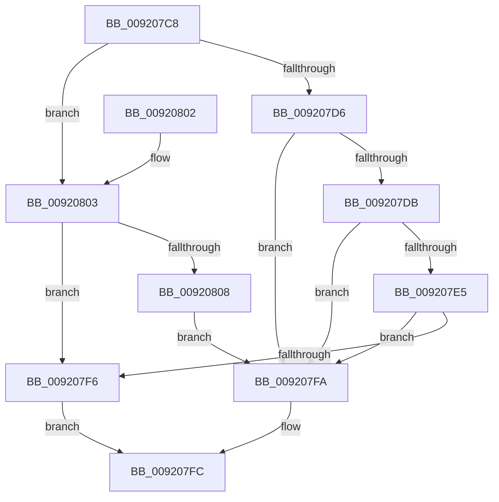

# SepIsAclEqual

- RVA: `0x009207C8`–`0x0092080A` (길이 `66` bytes)
- VA: `0x00000001409207C8`
- 실행 섹션: `PAGE`
- PDB 이름 있음: `예`; PDB Function 태그: `아니요`
- unwind 정보 RVA: `0x0005DAC8`
- 디코드: `25`개 명령, `66/66` bytes 표시
- 미해석 바이트: `0` (있으면 어셈블리에 `.byte`로 보존)

> 이 문서는 커널 이미지의 기계어와 PDB 기호를 분석해 생성했습니다. 4번과 5번은 함수 원형과 자료형을 바이너리 사용 방식에서 추정한 C 해석이며 원본 소스 복구 결과는 아닙니다.

## 1. Dependencies

- 직접 호출 지점: **1**; 고유 호출 대상: **1**
- 직접 호출자로 확인된 함수: **2**
- RIP 상대 이미지 참조: **0**

### Outgoing calls
- `0x009207E8` → [RtlCompareMemory](../../text/6B/RtlCompareMemory_function_006BA670.md) (function, `0x006BA670`)

### Direct callers
- [SeTokenDefaultDaclChangedAuditAlarm](SeTokenDefaultDaclChangedAuditAlarm_function_00920570.md) at `0x00920642`
- [sub_00B222A0](../B2/Unknown_function_00B222A0.md) at `0x00B22586`

### Static image references
- 디코드된 RIP-relative 메모리 참조가 없습니다.

## 2. Other-region calls and transfers

- 다른 실행 섹션으로 향하는 call: **1**
  - `0x009207E8` → [RtlCompareMemory](../../text/6B/RtlCompareMemory_function_006BA670.md) (`PAGE` → `.text`)
- 별도 외부 분기/꼬리 이동을 확인하지 못했습니다.

## 3. Assembly (complete function range)

```asm
009207C8  40 53                           push rbx
009207CA  48 83 EC 20                     sub rsp, 0x20
009207CE  48 8B D9                        mov rbx, rcx
009207D1  48 85 C9                        test rcx, rcx
009207D4  74 2D                           je 0x140920803
009207D6  48 85 D2                        test rdx, rdx
009207D9  74 1F                           je 0x1409207fa
009207DB  0F B7 41 02                     movzx eax, word ptr [rcx + 2]
009207DF  66 3B 42 02                     cmp ax, word ptr [rdx + 2]
009207E3  75 15                           jne 0x1409207fa
009207E5  44 8B C0                        mov r8d, eax
009207E8  E8 83 9E D9 FF                  call 0x1406ba670
009207ED  0F B7 4B 02                     movzx ecx, word ptr [rbx + 2]
009207F1  48 3B C1                        cmp rax, rcx
009207F4  75 04                           jne 0x1409207fa
009207F6  B0 01                           mov al, 1
009207F8  EB 02                           jmp 0x1409207fc
009207FA  32 C0                           xor al, al
009207FC  48 83 C4 20                     add rsp, 0x20
00920800  5B                              pop rbx
00920801  C3                              ret
00920802  CC                              int3
00920803  48 85 D2                        test rdx, rdx
00920806  74 EE                           je 0x1409207f6
00920808  EB F0                           jmp 0x1409207fa
```

## 4. C-style interpretation (structured pseudocode)

```c
__int64 __fastcall SepIsAclEqual(__int64 a1, __int64 a2)
{
    __int64 result;
    __int64 v_rsp;

    v_rsp = (v_rsp) - (32);
    if (a1 == 0) goto loc_00920803;
    if (a2 == 0) goto loc_009207FA;
    if (((unsigned __int16)(*(unsigned __int16 *)(a1 + 2))) != (*(unsigned __int16 *)(a2 + 2))) goto loc_009207FA;
    result = RtlCompareMemory(a1, a2, (unsigned int)((unsigned int)(*(unsigned __int16 *)(a1 + 2))), a4);
    if (result != (*(unsigned __int16 *)(a1 + 2))) goto loc_009207FA;
loc_009207F6:
    goto loc_009207FC;
loc_009207FA:
    result = 0;
loc_009207FC:
    v_rsp = (v_rsp) + (32);
    return result;
loc_00920803:
    if (a2 == 0) goto loc_009207F6;
    goto loc_009207FA;
}
```

## 5. (Beta) C Style

```c
int64_t SepIsAclEqual(void *Arg1, int64_t Arg2)
{
    uint8_t *arg1 = (uint8_t *)Arg1;

    int64_t result;
    int64_t local_rsp;

    local_rsp = (local_rsp) - (32);
    if (Arg1 == NULL) goto loc_00920803;
    if (Arg2 == 0) goto loc_009207FA;
    if (((uint16_t)(*(uint16_t *)(arg1 + 0x2))) != (*(uint16_t *)(Arg2 + 0x2))) goto loc_009207FA;
    result = RtlCompareMemory(Arg1, Arg2, (uint32_t)((uint32_t)(*(uint16_t *)(arg1 + 0x2))), a4);
    if (result != (*(uint16_t *)(arg1 + 0x2))) goto loc_009207FA;
loc_009207F6:
    goto loc_009207FC;
loc_009207FA:
    result = 0;
loc_009207FC:
    local_rsp = (local_rsp) + (32);
    return result;
loc_00920803:
    if (Arg2 == 0) goto loc_009207F6;
    goto loc_009207FA;
}
```

### 관측된 메모리 오프셋

구조체 형식이 확인되지 않은 접근은 인자 기준의 오프셋으로만 기록했습니다.

| 기준 인자 | 오프셋 표현 | 폭 (bit) | 접근 |
|---|---:|---:|---|
| `Arg1` | `+ 0x2` | `16` | `R` |

## 6. Execution-region graph

[열기: 2D/3D 그래프와 함수 탐색 컨트롤 패널](../../../control-panel.html?section=page&rva=0x009207C8&view=graph)

- 2D 그래프는 위에서 아래로 흐르고, 3D 그래프는 빈 공간을 드래그해 회전합니다. Shift+드래그는 이동, 휠은 확대·축소, 함수 노드 선택은 대상 보고서 이동입니다.

### Static fallback


