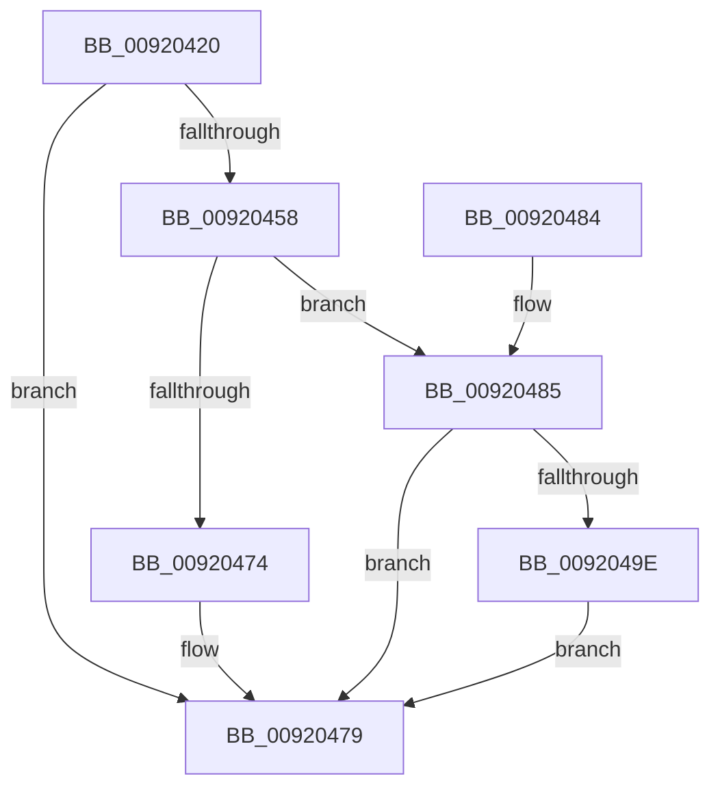

# SepQueryTypeString

- RVA: `0x00920420`–`0x009204B0` (길이 `144` bytes)
- VA: `0x0000000140920420`
- 실행 섹션: `PAGE`
- PDB 이름 있음: `예`; PDB Function 태그: `아니요`
- unwind 정보 RVA: `0x0008B624`
- 디코드: `42`개 명령, `144/144` bytes 표시
- 미해석 바이트: `0` (있으면 어셈블리에 `.byte`로 보존)

> 이 문서는 커널 이미지의 기계어와 PDB 기호를 분석해 생성했습니다. 4번과 5번은 함수 원형과 자료형을 바이너리 사용 방식에서 추정한 C 해석이며 원본 소스 복구 결과는 아닙니다.

## 1. Dependencies

- 직접 호출 지점: **4**; 고유 호출 대상: **3**
- 직접 호출자로 확인된 함수: **5**
- RIP 상대 이미지 참조: **0**

### Outgoing calls
- `0x0092044C` → [ObQueryTypeName](ObQueryTypeName_function_009204B8.md) (function, `0x009204B8`)
- `0x00920467` → [ExAllocatePool2](../../poolcode/B8/ExAllocatePool2_function_00B820F0.md) (function, `0x00B820F0`)
- `0x00920495` → [ObQueryTypeName](ObQueryTypeName_function_009204B8.md) (function, `0x009204B8`)
- `0x009204A3` → [ExFreePoolWithTag](../../poolcode/B8/ExFreePoolWithTag_function_00B82870.md) (function, `0x00B82870`)

### Direct callers
- [SepAdtObjectReferenceAuditAlarm](../79/SepAdtObjectReferenceAuditAlarm_function_0079F27C.md) at `0x0079F355`
- [sub_0086E95E](../86/Unknown_function_0086E95E.md) at `0x0086EC65`
- [SeSecurityDescriptorChangedAuditAlarm](../91/SeSecurityDescriptorChangedAuditAlarm_function_0091FC5C.md) at `0x0091FEE6`
- [SeTokenDefaultDaclChangedAuditAlarm](SeTokenDefaultDaclChangedAuditAlarm_function_00920570.md) at `0x0092079D`
- [SeOpenObjectForDeleteAuditAlarmWithTransaction](../97/SeOpenObjectForDeleteAuditAlarmWithTransaction_function_00973EC0.md) at `0x009740C6`

### Static image references
- 디코드된 RIP-relative 메모리 참조가 없습니다.

## 2. Other-region calls and transfers

- 다른 실행 섹션으로 향하는 call: **2**
  - `0x00920467` → [ExAllocatePool2](../../poolcode/B8/ExAllocatePool2_function_00B820F0.md) (`PAGE` → `POOLCODE`)
  - `0x009204A3` → [ExFreePoolWithTag](../../poolcode/B8/ExFreePoolWithTag_function_00B82870.md) (`PAGE` → `POOLCODE`)
- 별도 외부 분기/꼬리 이동을 확인하지 못했습니다.

## 3. Assembly (complete function range)

```asm
00920420  48 8B C4                        mov rax, rsp
00920423  48 89 58 08                     mov qword ptr [rax + 8], rbx
00920427  57                              push rdi
00920428  48 83 EC 30                     sub rsp, 0x30
0092042C  48 83 22 00                     and qword ptr [rdx], 0
00920430  4C 8D 48 10                     lea r9, [rax + 0x10]
00920434  83 60 10 00                     and dword ptr [rax + 0x10], 0
00920438  48 8B DA                        mov rbx, rdx
0092043B  0F 57 C0                        xorps xmm0, xmm0
0092043E  48 8D 50 E8                     lea rdx, [rax - 0x18]
00920442  45 33 C0                        xor r8d, r8d
00920445  48 8B F9                        mov rdi, rcx
00920448  0F 11 40 E8                     movups xmmword ptr [rax - 0x18], xmm0
0092044C  E8 67 00 00 00                  call 0x1409204b8
00920451  3D 04 00 00 C0                  cmp eax, 0xc0000004
00920456  75 21                           jne 0x140920479
00920458  8B 54 24 48                     mov edx, dword ptr [rsp + 0x48]
0092045C  B9 00 01 00 00                  mov ecx, 0x100
00920461  41 B8 53 65 54 6E               mov r8d, 0x6e546553
00920467  E8 84 1C 26 00                  call 0x140b820f0
0092046C  48 89 03                        mov qword ptr [rbx], rax
0092046F  48 85 C0                        test rax, rax
00920472  75 11                           jne 0x140920485
00920474  B8 9A 00 00 C0                  mov eax, 0xc000009a
00920479  48 8B 5C 24 40                  mov rbx, qword ptr [rsp + 0x40]
0092047E  48 83 C4 30                     add rsp, 0x30
00920482  5F                              pop rdi
00920483  C3                              ret
00920484  CC                              int3
00920485  44 8B 44 24 48                  mov r8d, dword ptr [rsp + 0x48]
0092048A  4C 8D 4C 24 48                  lea r9, [rsp + 0x48]
0092048F  48 8B D0                        mov rdx, rax
00920492  48 8B CF                        mov rcx, rdi
00920495  E8 1E 00 00 00                  call 0x1409204b8
0092049A  85 C0                           test eax, eax
0092049C  79 DB                           jns 0x140920479
0092049E  48 8B 0B                        mov rcx, qword ptr [rbx]
009204A1  33 D2                           xor edx, edx
009204A3  E8 C8 23 26 00                  call 0x140b82870
009204A8  48 83 23 00                     and qword ptr [rbx], 0
009204AC  33 C0                           xor eax, eax
009204AE  EB C9                           jmp 0x140920479
```

## 4. C-style interpretation (structured pseudocode)

```c
__int64 __fastcall SepQueryTypeString(__int64 a1, __int64 a2, int a3)
{
    __int64 result;
    __int64 v_rsp;
    unsigned int v_stack_p10;
    unsigned int v_stack_p48;
    unsigned __int64 v_stack_p8;

    *(unsigned __int64 *)(v_rsp + 8) = v_rbx;
    v_rsp = (v_rsp) - (48);
    a3 = 0;
    *(unsigned __int64 *)(v_rsp - 24) = v_xmm0;
    result = ObQueryTypeName(a1, v_rsp - 24, a3, v_rsp + 16);
    if (((unsigned int)(result)) != 0xC0000004ULL) goto loc_00920479;
    result = ExAllocatePool2(256, (unsigned int)(v_stack_p10), (unsigned int)(0x6E546553ULL), v_rsp + 16);
    *(unsigned __int64 *)(a2) = result;
    if (result != 0) goto loc_00920485;
loc_00920479:
    v_rsp = (v_rsp) + (48);
    return (unsigned int)(0xC000009AULL);
loc_00920485:
    result = ObQueryTypeName(a1, (unsigned int)(0xC000009AULL), (unsigned int)(v_stack_p48), v_stack_p48);
    if (!sign_flag) goto loc_00920479;
    a2 = 0;
    result = ExFreePoolWithTag(*(unsigned __int64 *)(v_stack_p8), a2, (unsigned int)(v_stack_p48), v_stack_p48);
    result = 0;
    goto loc_00920479;
}
```

## 5. (Beta) C Style

```c
int64_t SepQueryTypeString(int64_t Arg1, void *Arg2, int32_t Arg3)
{
    uint8_t *arg2 = (uint8_t *)Arg2;

    int64_t result;
    int64_t local_rsp;
    uint32_t v_stack_p10;
    uint32_t v_stack_p48;
    uint64_t v_stack_p8;

    *(uint64_t *)(local_rsp + 0x8) = local_rbx;
    local_rsp = (local_rsp) - (48);
    Arg3 = 0;
    *(uint64_t *)(local_rsp - 0x18) = v_xmm0;
    result = ObQueryTypeName(Arg1, local_rsp - 24, Arg3, local_rsp + 16);
    if (((uint32_t)(result)) != 0xC0000004ULL) goto loc_00920479;
    result = ExAllocatePool2(256, (uint32_t)(v_stack_p10), (uint32_t)(0x6E546553ULL), local_rsp + 16);
    *(uint64_t *)(arg2) = result;
    if (result != 0) goto loc_00920485;
loc_00920479:
    local_rsp = (local_rsp) + (48);
    return (uint32_t)(0xC000009AULL);
loc_00920485:
    result = ObQueryTypeName(Arg1, (uint32_t)(0xC000009AULL), (uint32_t)(v_stack_p48), v_stack_p48);
    if (!sign_flag) goto loc_00920479;
    Arg2 = 0;
    result = ExFreePoolWithTag(*(uint64_t *)(v_stack_p8), Arg2, (uint32_t)(v_stack_p48), v_stack_p48);
    result = 0;
    goto loc_00920479;
}
```

### 관측된 메모리 오프셋

구조체 형식이 확인되지 않은 접근은 인자 기준의 오프셋으로만 기록했습니다.

| 기준 인자 | 오프셋 표현 | 폭 (bit) | 접근 |
|---|---:|---:|---|
| `Arg2` | `+ 0x0` | `64` | `R` |
| `Arg2` | `+ 0x0` | `64` | `R/W` |
| `Arg2` | `+ 0x0` | `64` | `W` |

## 6. Execution-region graph

[열기: 2D/3D 그래프와 함수 탐색 컨트롤 패널](../../../control-panel.html?section=page&rva=0x00920420&view=graph)

- 2D 그래프는 위에서 아래로 흐르고, 3D 그래프는 빈 공간을 드래그해 회전합니다. Shift+드래그는 이동, 휠은 확대·축소, 함수 노드 선택은 대상 보고서 이동입니다.

### Static fallback


