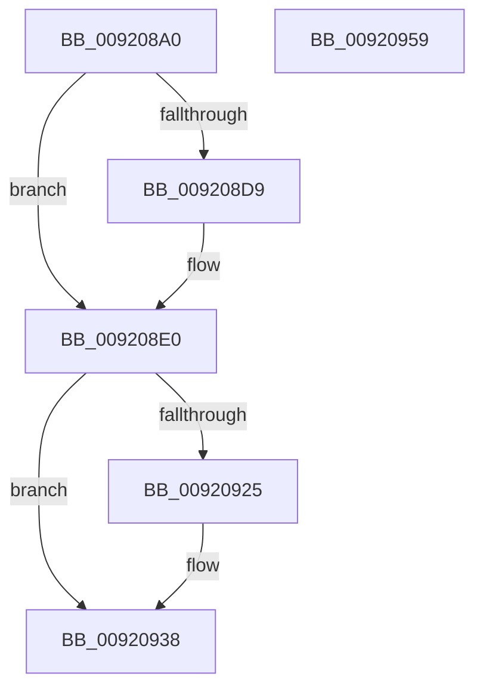

# TraceLoggingRegisterEx_EtwRegister_EtwSetInformation

- RVA: `0x009208A0`–`0x0092095A` (길이 `186` bytes)
- VA: `0x00000001409208A0`
- 실행 섹션: `PAGE`
- PDB 이름 있음: `예`; PDB Function 태그: `아니요`
- unwind 정보 RVA: `0x0007CF64`
- 디코드: `47`개 명령, `186/186` bytes 표시
- 미해석 바이트: `0` (있으면 어셈블리에 `.byte`로 보존)

> 이 문서는 커널 이미지의 기계어와 PDB 기호를 분석해 생성했습니다. 4번과 5번은 함수 원형과 자료형을 바이너리 사용 방식에서 추정한 C 해석이며 원본 소스 복구 결과는 아닙니다.

## 1. Dependencies

- 직접 호출 지점: **4**; 고유 호출 대상: **4**
- 직접 호출자로 확인된 함수: **31**
- RIP 상대 이미지 참조: **2**

### Outgoing calls
- `0x009208E8` → [PsGetCurrentServerSiloGlobals](../../text/2F/PsGetCurrentServerSiloGlobals_function_002FE1F0.md) (function, `0x002FE1F0`)
- `0x0092091A` → [EtwpRegisterKMProvider](EtwpRegisterKMProvider_function_009209A4.md) (function, `0x009209A4`)
- `0x00920933` → [EtwSetInformation](../7B/EtwSetInformation_function_007B9070.md) (function, `0x007B9070`)
- `0x00920942` → [_security_check_cookie](../../text/6A/_security_check_cookie_function_006AC640.md) (function, `0x006AC640`)

### Direct callers
- [IoInitializeLiveDump](../../text/59/IoInitializeLiveDump_function_00598B14.md) at `0x00598B66`
- [IopInitializeSystemVariableService](../../text/5A/IopInitializeSystemVariableService_function_005A0310.md) at `0x005A034D`
- [KcsanInitSystem](../../text/5A/KcsanInitSystem_function_005AF2A0.md) at `0x005AF2FC`
- [PdcInitializeETW](../../text/60/PdcInitializeETW_function_00605D30.md) at `0x00605D6A`
- [CarEtwRegister](../../text/61/CarEtwRegister_function_006179D4.md) at `0x00617A00`
- [PrExtLogToTelemetry](../../text/66/PrExtLogToTelemetry_function_00666DC4.md) at `0x00666DE4`
- [UcInitialize](../../text/69/UcInitialize_function_0069AD9C.md) at `0x0069AE3B`
- [HalpMiscInitializeTelemetry](../70/HalpMiscInitializeTelemetry_function_00707DFC.md) at `0x00707E2F`
- [PopAdaptiveStandbyInitialize](../76/PopAdaptiveStandbyInitialize_function_0076DDF8.md) at `0x0076DE5B`
- [TtmInit](../77/TtmInit_function_00776D80.md) at `0x00776DB3`
- [TtmInit](../77/TtmInit_function_00776D80.md) at `0x00776DC4`
- [RtlpCapChkTelemetryRunOnce](../79/RtlpCapChkTelemetryRunOnce_function_0079A5E0.md) at `0x0079A5F0`
- [EtwpInitializeCoverage](../7B/EtwpInitializeCoverage_function_007BA538.md) at `0x007BA566`
- [VRegSetup](../83/VRegSetup_function_0083AE90.md) at `0x0083AECD`
- [TlgRegisterAggregateProviderEx](../AD/TlgRegisterAggregateProviderEx_function_00ADBA94.md) at `0x00ADBACB`
- [TlgRegisterAggregateProviderEx](../AD/TlgRegisterAggregateProviderEx_function_00ADBA94.md) at `0x00ADBB0C`
- [TlgRegisterAggregateProviderEx](../AD/TlgRegisterAggregateProviderEx_function_00ADBA94.md) at `0x00ADBB6D`
- [BapdRecordFirmwareBootStats](../../pagelk/B7/BapdRecordFirmwareBootStats_function_00B72474.md) at `0x00B724F0`
- [CcInitializeTelemetry](../../init/BE/CcInitializeTelemetry_function_00BEE848.md) at `0x00BEE95C`
- [VmInitSystem](../../init/BE/VmInitSystem_function_00BEEEB8.md) at `0x00BEEF88`
- [VslpIumInitializeTelemetry](../../init/C2/VslpIumInitializeTelemetry_function_00C29EA0.md) at `0x00C29ECF`
- [IoInitSystemPreDrivers](../../init/C2/IoInitSystemPreDrivers_function_00C2AC3C.md) at `0x00C2B6C8`
- [IopInitializePlugPlayServices](../../init/C2/IopInitializePlugPlayServices_function_00C2F298.md) at `0x00C2FF65`
- [sub_00C368E9](../../init/C3/Unknown_function_00C368E9.md) at `0x00C368FD`
- [PopDiagInitialize](../../init/C3/PopDiagInitialize_function_00C3F2C0.md) at `0x00C3F366`
- [PopDiagInitialize](../../init/C3/PopDiagInitialize_function_00C3F2C0.md) at `0x00C3F377`
- [PopDiagInitialize](../../init/C3/PopDiagInitialize_function_00C3F2C0.md) at `0x00C3F388`
- [PopDiagInitialize](../../init/C3/PopDiagInitialize_function_00C3F2C0.md) at `0x00C3F399`
- [PopDiagInitialize](../../init/C3/PopDiagInitialize_function_00C3F2C0.md) at `0x00C3F433`
- [PopDirectedDripsDiagInitialize](../../init/C4/PopDirectedDripsDiagInitialize_function_00C43E34.md) at `0x00C43EC9`
- [SshInitialize](../../init/C4/SshInitialize_function_00C4465C.md) at `0x00C4475C`
- [PspInitPhase2](../../init/C4/PspInitPhase2_function_00C45460.md) at `0x00C45472`
- [EtwpInitialize](../../init/C4/EtwpInitialize_function_00C4DBCC.md) at `0x00C4DF87`
- [EtwpInitializeCoverageSampler](../../init/C4/EtwpInitializeCoverageSampler_function_00C4F5D4.md) at `0x00C4F607`
- [Phase1InitializationIoReady](../../init/C7/Phase1InitializationIoReady_function_00C70458.md) at `0x00C70548`
- [Phase1InitializationIoReady](../../init/C7/Phase1InitializationIoReady_function_00C70458.md) at `0x00C7059B`
- [Phase1InitializationIoReady](../../init/C7/Phase1InitializationIoReady_function_00C70458.md) at `0x00C70604`
- [SeRmInitPhase1](../../init/C7/SeRmInitPhase1_function_00C70B2C.md) at `0x00C70C09`
- [KeInitSystem](../../init/C7/KeInitSystem_function_00C71660.md) at `0x00C71A61`
- [KeInitSystem](../../init/C7/KeInitSystem_function_00C71660.md) at `0x00C71A72`
- [ObInitSystem](../../init/C7/ObInitSystem_function_00C71C7C.md) at `0x00C72317`

### Static image references
- `0x009208AF` → RVA `0x00E0A740` (`.data`; read)
- `0x009208F2` → RVA `0x00A70790` (`tlgEnableCallback`; read)

## 2. Other-region calls and transfers

- 다른 실행 섹션으로 향하는 call: **2**
  - `0x009208E8` → [PsGetCurrentServerSiloGlobals](../../text/2F/PsGetCurrentServerSiloGlobals_function_002FE1F0.md) (`PAGE` → `.text`)
  - `0x00920942` → [_security_check_cookie](../../text/6A/_security_check_cookie_function_006AC640.md) (`PAGE` → `.text`)
- 별도 외부 분기/꼬리 이동을 확인하지 못했습니다.

## 3. Assembly (complete function range)

```asm
009208A0  48 89 5C 24 10                  mov qword ptr [rsp + 0x10], rbx
009208A5  48 89 74 24 18                  mov qword ptr [rsp + 0x18], rsi
009208AA  57                              push rdi
009208AB  48 83 EC 60                     sub rsp, 0x60
009208AF  48 8B 05 8A 9E 4E 00            mov rax, qword ptr [rip + 0x4e9e8a]
009208B6  48 33 C4                        xor rax, rsp
009208B9  48 89 44 24 50                  mov qword ptr [rsp + 0x50], rax
009208BE  48 8B 41 08                     mov rax, qword ptr [rcx + 8]
009208C2  48 8D 79 20                     lea rdi, [rcx + 0x20]
009208C6  48 83 3F 00                     cmp qword ptr [rdi], 0
009208CA  48 8B D9                        mov rbx, rcx
009208CD  0F 10 40 F0                     movups xmm0, xmmword ptr [rax - 0x10]
009208D1  F3 0F 7F 44 24 40               movdqu xmmword ptr [rsp + 0x40], xmm0
009208D7  74 07                           je 0x1409208e0
009208D9  B9 05 00 00 00                  mov ecx, 5
009208DE  CD 29                           int 0x29
009208E0  48 89 53 28                     mov qword ptr [rbx + 0x28], rdx
009208E4  4C 89 43 30                     mov qword ptr [rbx + 0x30], r8
009208E8  E8 03 D9 9D FF                  call 0x1402fe1f0
009208ED  48 89 7C 24 30                  mov qword ptr [rsp + 0x30], rdi
009208F2  4C 8D 0D 97 FE 14 00            lea r9, [rip + 0x14fe97]
009208F9  41 B8 03 00 00 00               mov r8d, 3
009208FF  48 8D 54 24 40                  lea rdx, [rsp + 0x40]
00920904  48 8B 88 40 03 00 00            mov rcx, qword ptr [rax + 0x340]
0092090B  48 8B 44 24 68                  mov rax, qword ptr [rsp + 0x68]
00920910  48 89 44 24 28                  mov qword ptr [rsp + 0x28], rax
00920915  48 89 5C 24 20                  mov qword ptr [rsp + 0x20], rbx
0092091A  E8 85 00 00 00                  call 0x1409209a4
0092091F  8B F0                           mov esi, eax
00920921  85 C0                           test eax, eax
00920923  75 13                           jne 0x140920938
00920925  4C 8B 43 08                     mov r8, qword ptr [rbx + 8]
00920929  8D 50 02                        lea edx, [rax + 2]
0092092C  48 8B 0F                        mov rcx, qword ptr [rdi]
0092092F  45 0F B7 08                     movzx r9d, word ptr [r8]
00920933  E8 38 87 E9 FF                  call 0x1407b9070
00920938  8B C6                           mov eax, esi
0092093A  48 8B 4C 24 50                  mov rcx, qword ptr [rsp + 0x50]
0092093F  48 33 CC                        xor rcx, rsp
00920942  E8 F9 BC D8 FF                  call 0x1406ac640
00920947  4C 8D 5C 24 60                  lea r11, [rsp + 0x60]
0092094C  49 8B 5B 18                     mov rbx, qword ptr [r11 + 0x18]
00920950  49 8B 73 20                     mov rsi, qword ptr [r11 + 0x20]
00920954  49 8B E3                        mov rsp, r11
00920957  5F                              pop rdi
00920958  C3                              ret
00920959  CC                              int3
```

## 4. C-style interpretation (structured pseudocode)

```c
__int64 __fastcall TraceLoggingRegisterEx_EtwRegister_EtwSetInformation(__int64 a1, __int64 a2, __int64 a3)
{
    __int64 result;
    __int64 v_rsp;
    unsigned __int64 v_stack_m18;
    unsigned __int64 v_stack_m28;
    unsigned __int64 v_stack_m38;
    unsigned __int64 v_stack_m40;
    unsigned __int64 v_stack_m48;
    unsigned __int64 v_stack_m8;
    unsigned __int64 v_stack_p0;
    unsigned __int64 v_stack_p10;
    unsigned __int64 v_stack_p18;

    v_stack_p10 = v_rbx;
    v_stack_p18 = v_rsi;
    v_rsp = (v_rsp) - (96);
    result = (*(unsigned __int64 *)(v_rip + 5152394)) ^ (v_rsp);
    v_stack_m18 = result;
    v_stack_m28 = v_xmm0;
    if ((*(unsigned __int64 *)(a1 + 32)) != 0) {
        a1 = 5;
    }
    *(unsigned __int64 *)(a1 + 40) = a2;
    *(unsigned __int64 *)(a1 + 48) = a3;
    result = PsGetCurrentServerSiloGlobals(a1, a2, a3, a4);
    v_stack_m38 = a1 + 32;
    v_stack_m40 = v_stack_p0;
    v_stack_m48 = a1;
    result = EtwpRegisterKMProvider(*(unsigned __int64 *)(result + 832), v_stack_m28, 3, v_rip + 1375895);
    if ((unsigned int)(result) == 0) {
        a3 = *(unsigned __int64 *)(a1 + 8);
        a2 = result + 2;
        a1 = *(unsigned __int64 *)(a1 + 32);
        a4 = *(unsigned __int16 *)(a3);
        result = EtwSetInformation(a1, a2, a3, a4);
    }
    a1 = (v_stack_m18) ^ (v_rsp);
    result = _security_check_cookie(a1, a2, a3, a4);
    return result;
}
```

## 5. (Beta) C Style

```c
int64_t TraceLoggingRegisterEx_EtwRegister_EtwSetInformation(void *Arg1, int64_t Arg2, int64_t Arg3)
{
    uint8_t *arg1 = (uint8_t *)Arg1;

    int64_t result;
    int64_t local_rsp;
    uint64_t v_stack_m18;
    uint64_t v_stack_m28;
    uint64_t v_stack_m38;
    uint64_t v_stack_m40;
    uint64_t v_stack_m48;
    uint64_t v_stack_m8;
    uint64_t v_stack_p0;
    uint64_t v_stack_p10;
    uint64_t v_stack_p18;

    v_stack_p10 = local_rbx;
    v_stack_p18 = local_rsi;
    local_rsp = (local_rsp) - (96);
    result = (*(uint64_t *)(v_rip + 0x4E9E8A)) ^ (local_rsp);
    v_stack_m18 = result;
    v_stack_m28 = v_xmm0;
    if ((*(uint64_t *)(arg1 + 0x20)) != 0) {
        Arg1 = 5;
    }
    *(uint64_t *)(arg1 + 0x28) = Arg2;
    *(uint64_t *)(arg1 + 0x30) = Arg3;
    result = PsGetCurrentServerSiloGlobals(Arg1, Arg2, Arg3, a4);
    v_stack_m38 = Arg1 + 32;
    v_stack_m40 = v_stack_p0;
    v_stack_m48 = Arg1;
    result = EtwpRegisterKMProvider(*(uint64_t *)(result + 0x340), v_stack_m28, 3, v_rip + 1375895);
    if ((uint32_t)(result) == 0) {
        Arg3 = *(uint64_t *)(arg1 + 0x8);
        Arg2 = result + 2;
        Arg1 = *(uint64_t *)(arg1 + 0x20);
        a4 = *(uint16_t *)(Arg3);
        result = EtwSetInformation(Arg1, Arg2, Arg3, a4);
    }
    Arg1 = (v_stack_m18) ^ (local_rsp);
    result = _security_check_cookie(Arg1, Arg2, Arg3, a4);
    return result;
}
```

### 관측된 메모리 오프셋

구조체 형식이 확인되지 않은 접근은 인자 기준의 오프셋으로만 기록했습니다.

| 기준 인자 | 오프셋 표현 | 폭 (bit) | 접근 |
|---|---:|---:|---|
| `Arg1` | `+ 0x0` | `64` | `R` |
| `Arg1` | `+ 0x8` | `64` | `R` |
| `Arg1` | `+ 0x20` | `64` | `R` |
| `Arg1` | `+ 0x28` | `64` | `W` |
| `Arg1` | `+ 0x30` | `64` | `W` |

## 6. Execution-region graph

[열기: 2D/3D 그래프와 함수 탐색 컨트롤 패널](../../../control-panel.html?section=page&rva=0x009208A0&view=graph)

- 2D 그래프는 위에서 아래로 흐르고, 3D 그래프는 빈 공간을 드래그해 회전합니다. Shift+드래그는 이동, 휠은 확대·축소, 함수 노드 선택은 대상 보고서 이동입니다.

### Static fallback


