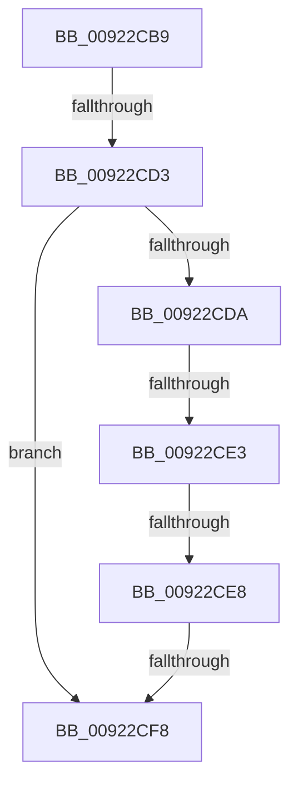

# sub_00922CB9

- RVA: `0x00922CB9`–`0x00922D0F` (길이 `86` bytes)
- VA: `0x0000000140922CB9`
- 실행 섹션: `PAGE`
- PDB 이름 있음: `아니요`; PDB Function 태그: `아니요`
- unwind 정보 RVA: `0x0008D1E8`
- 디코드: `22`개 명령, `86/86` bytes 표시
- 미해석 바이트: `0` (있으면 어셈블리에 `.byte`로 보존)

> 이 문서는 커널 이미지의 기계어와 PDB 기호를 분석해 생성했습니다. 4번과 5번은 함수 원형과 자료형을 바이너리 사용 방식에서 추정한 C 해석이며 원본 소스 복구 결과는 아닙니다.

## 1. Dependencies

- 직접 호출 지점: **0**; 고유 호출 대상: **0**
- 직접 호출자로 확인된 함수: **0**
- RIP 상대 이미지 참조: **0**

### Outgoing calls
- 직접 디코드된 call 명령이 없습니다.

### Direct callers
- 이 함수 시작 RVA로 연결되는 직접 call은 확인되지 않았습니다. 간접 호출은 완전히 역산할 수 없습니다.

### Static image references
- 디코드된 RIP-relative 메모리 참조가 없습니다.

## 2. Other-region calls and transfers

- 다른 실행 섹션으로 향하는 call: **0**
- call이 아닌 외부 분기/꼬리 이동: **4**
  - `0x00922CCD` → [sub_00922D82 + 0x4B](Unknown_function_00922D82.md) (`tail-transfer`)
  - `0x00922CDD` → [sub_00922D82 + 0x58](Unknown_function_00922D82.md) (`tail-transfer`)
  - `0x00922CE6` → [sub_00922D10](Unknown_function_00922D10.md) (`tail-transfer`)
  - `0x00922CF2` → [sub_00922D82](Unknown_function_00922D82.md) (`tail-transfer`)

## 3. Assembly (complete function range)

```asm
00922CB9  48 89 7C 24 30                  mov qword ptr [rsp + 0x30], rdi
00922CBE  BF 00 02 00 00                  mov edi, 0x200
00922CC3  48 89 96 B0 00 00 00            mov qword ptr [rsi + 0xb0], rdx
00922CCA  48 85 C0                        test rax, rax
00922CCD  0F 85 FA 00 00 00               jne 0x140922dcd
00922CD3  8B CF                           mov ecx, edi
00922CD5  48 3B D9                        cmp rbx, rcx
00922CD8  76 1E                           jbe 0x140922cf8
00922CDA  48 85 C0                        test rax, rax
00922CDD  0F 85 F7 00 00 00               jne 0x140922dda
00922CE3  48 3B DF                        cmp rbx, rdi
00922CE6  77 28                           ja 0x140922d10
00922CE8  48 8B 8E E0 00 00 00            mov rcx, qword ptr [rsi + 0xe0]
00922CEF  48 85 C9                        test rcx, rcx
00922CF2  0F 85 8A 00 00 00               jne 0x140922d82
00922CF8  48 8B 7C 24 30                  mov rdi, qword ptr [rsp + 0x30]
00922CFD  8B C5                           mov eax, ebp
00922CFF  48 8B 5C 24 40                  mov rbx, qword ptr [rsp + 0x40]
00922D04  48 8B 6C 24 48                  mov rbp, qword ptr [rsp + 0x48]
00922D09  48 83 C4 20                     add rsp, 0x20
00922D0D  5E                              pop rsi
00922D0E  C3                              ret
```

## 4. C-style interpretation (structured pseudocode)

```c
__int64 __fastcall sub_00922CB9(__int64 a1, __int64 a2, __int64 a3, __int64 a4, __int64 a5, __int64 a6, __int64 a7, __int64 a8, __int64 a9)
{
    __int64 v_rsp;
    unsigned __int64 v_stack_p30;

    v_stack_p30 = v_rdi;
    *(unsigned __int64 *)(v_rsi + 176) = a2;
    if (v_rbx <= 512) goto loc_00922CF8;
loc_00922CF8:
    v_rsp = (v_rsp) + (32);
    return (unsigned int)((unsigned int)(v_rbp));
}
```

## 5. (Beta) C Style

```c
int64_t sub_00922CB9(int64_t Arg1, int64_t Arg2, int64_t Arg3, int64_t Arg4, uint64_t Arg5, int64_t Arg6, uint64_t Arg7, int64_t Arg8, int64_t Arg9)
{
    int64_t local_rsp;
    uint64_t v_stack_p30;

    v_stack_p30 = local_rdi;
    *(uint64_t *)(local_rsi + 0xB0) = Arg2;
    if (local_rbx <= 512) goto loc_00922CF8;
loc_00922CF8:
    local_rsp = (local_rsp) + (32);
    return (uint32_t)((uint32_t)(local_rbp));
}
```

## 6. Execution-region graph

[열기: 2D/3D 그래프와 함수 탐색 컨트롤 패널](../../../control-panel.html?section=page&rva=0x00922CB9&view=graph)

- 2D 그래프는 위에서 아래로 흐르고, 3D 그래프는 빈 공간을 드래그해 회전합니다. Shift+드래그는 이동, 휠은 확대·축소, 함수 노드 선택은 대상 보고서 이동입니다.

### Static fallback


