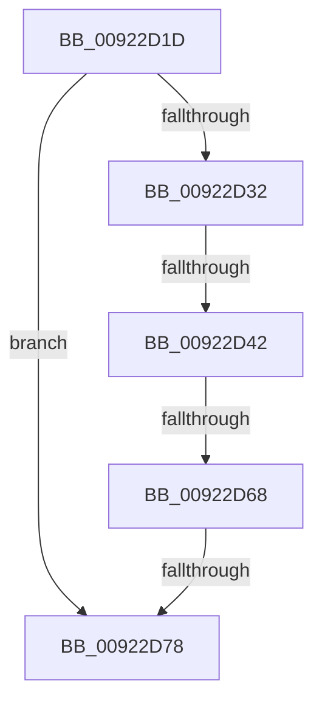

# sub_00922D1D

- RVA: `0x00922D1D`–`0x00922D82` (길이 `101` bytes)
- VA: `0x0000000140922D1D`
- 실행 섹션: `PAGE`
- PDB 이름 있음: `아니요`; PDB Function 태그: `아니요`
- unwind 정보 RVA: `0x0008D224`
- 디코드: `22`개 명령, `101/101` bytes 표시
- 미해석 바이트: `0` (있으면 어셈블리에 `.byte`로 보존)

> 이 문서는 커널 이미지의 기계어와 PDB 기호를 분석해 생성했습니다. 4번과 5번은 함수 원형과 자료형을 바이너리 사용 방식에서 추정한 C 해석이며 원본 소스 복구 결과는 아닙니다.

## 1. Dependencies

- 직접 호출 지점: **1**; 고유 호출 대상: **1**
- 직접 호출자로 확인된 함수: **0**
- RIP 상대 이미지 참조: **0**

### Outgoing calls
- `0x00922D53` → [ExAllocatePool2](../../poolcode/B8/ExAllocatePool2_function_00B820F0.md) (function, `0x00B820F0`)

### Direct callers
- 이 함수 시작 RVA로 연결되는 직접 call은 확인되지 않았습니다. 간접 호출은 완전히 역산할 수 없습니다.

### Static image references
- 디코드된 RIP-relative 메모리 참조가 없습니다.

## 2. Other-region calls and transfers

- 다른 실행 섹션으로 향하는 call: **1**
  - `0x00922D53` → [ExAllocatePool2](../../poolcode/B8/ExAllocatePool2_function_00B820F0.md) (`PAGE` → `POOLCODE`)
- call이 아닌 외부 분기/꼬리 이동: **4**
  - `0x00922D3C` → [sub_00922E15](Unknown_function_00922E15.md) (`tail-transfer`)
  - `0x00922D66` → [sub_00922DE7](Unknown_function_00922DE7.md) (`tail-transfer`)
  - `0x00922D72` → [sub_00922E15 + 0x16](Unknown_function_00922E15.md) (`tail-transfer`)
  - `0x00922D7D` → [sub_00922CB9 + 0x3F](Unknown_function_00922CB9.md) (`tail-transfer`)

## 3. Assembly (complete function range)

```asm
00922D1D  4C 89 74 24 38                  mov qword ptr [rsp + 0x38], r14
00922D22  4C 8B B6 E8 00 00 00            mov r14, qword ptr [rsi + 0xe8]
00922D29  49 8D 04 3E                     lea rax, [r14 + rdi]
00922D2D  48 3B D8                        cmp rbx, rax
00922D30  76 46                           jbe 0x140922d78
00922D32  48 8B 8E E0 00 00 00            mov rcx, qword ptr [rsi + 0xe0]
00922D39  48 85 C9                        test rcx, rcx
00922D3C  0F 85 D3 00 00 00               jne 0x140922e15
00922D42  48 2B DF                        sub rbx, rdi
00922D45  41 B8 41 6C 45 42               mov r8d, 0x42456c41
00922D4B  48 8B D3                        mov rdx, rbx
00922D4E  B9 00 01 00 00                  mov ecx, 0x100
00922D53  E8 98 F3 25 00                  call 0x140b820f0
00922D58  48 8B 4E 30                     mov rcx, qword ptr [rsi + 0x30]
00922D5C  48 89 86 E0 00 00 00            mov qword ptr [rsi + 0xe0], rax
00922D63  48 85 C0                        test rax, rax
00922D66  74 7F                           je 0x140922de7
00922D68  48 89 9E E8 00 00 00            mov qword ptr [rsi + 0xe8], rbx
00922D6F  48 85 C9                        test rcx, rcx
00922D72  0F 85 B3 00 00 00               jne 0x140922e2b
00922D78  4C 8B 74 24 38                  mov r14, qword ptr [rsp + 0x38]
00922D7D  E9 76 FF FF FF                  jmp 0x140922cf8
```

## 4. C-style interpretation (structured pseudocode)

```c
__int64 __fastcall sub_00922D1D(__int64 a1, __int64 a2, __int64 a3, __int64 a4, __int64 a5, __int64 a6, __int64 a7)
{
    __int64 result;
    __int64 v_rbx;
    unsigned __int64 v_stack_p38;

    v_stack_p38 = v_r14;
    if (v_rbx <= (*(unsigned __int64 *)(v_rsi + 232) + v_rdi * 1)) goto loc_00922D78;
    v_rbx = (v_rbx) - (v_rdi);
    result = ExAllocatePool2(256, v_rbx, (unsigned int)(0x42456C41ULL), a4);
    *(unsigned __int64 *)(v_rsi + 224) = result;
    *(unsigned __int64 *)(v_rsi + 232) = v_rbx;
loc_00922D78:
}
```

## 5. (Beta) C Style

```c
int64_t sub_00922D1D(int64_t Arg1, int64_t Arg2, int64_t Arg3, int64_t Arg4, uint64_t Arg5, uint64_t Arg6, int64_t Arg7)
{
    int64_t result;
    int64_t local_rbx;
    uint64_t v_stack_p38;

    v_stack_p38 = local_r14;
    if (local_rbx <= (*(uint64_t *)(local_rsi + 0xE8) + local_rdi * 1)) goto loc_00922D78;
    local_rbx = (local_rbx) - (local_rdi);
    result = ExAllocatePool2(256, local_rbx, (uint32_t)(0x42456C41ULL), Arg4);
    *(uint64_t *)(local_rsi + 0xE0) = result;
    *(uint64_t *)(local_rsi + 0xE8) = local_rbx;
loc_00922D78:
}
```

## 6. Execution-region graph

[열기: 2D/3D 그래프와 함수 탐색 컨트롤 패널](../../../control-panel.html?section=page&rva=0x00922D1D&view=graph)

- 2D 그래프는 위에서 아래로 흐르고, 3D 그래프는 빈 공간을 드래그해 회전합니다. Shift+드래그는 이동, 휠은 확대·축소, 함수 노드 선택은 대상 보고서 이동입니다.

### Static fallback


