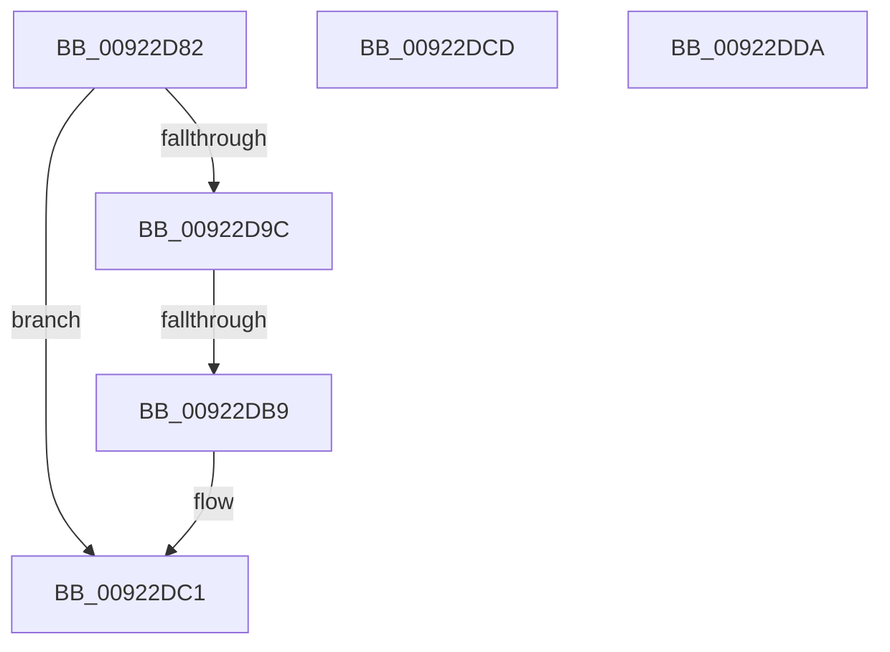

# sub_00922D82

- RVA: `0x00922D82`–`0x00922DE7` (길이 `101` bytes)
- VA: `0x0000000140922D82`
- 실행 섹션: `PAGE`
- PDB 이름 있음: `아니요`; PDB Function 태그: `아니요`
- unwind 정보 RVA: `0x0008D238`
- 디코드: `20`개 명령, `101/101` bytes 표시
- 미해석 바이트: `0` (있으면 어셈블리에 `.byte`로 보존)

> 이 문서는 커널 이미지의 기계어와 PDB 기호를 분석해 생성했습니다. 4번과 5번은 함수 원형과 자료형을 바이너리 사용 방식에서 추정한 C 해석이며 원본 소스 복구 결과는 아닙니다.

## 1. Dependencies

- 직접 호출 지점: **1**; 고유 호출 대상: **1**
- 직접 호출자로 확인된 함수: **0**
- RIP 상대 이미지 참조: **0**

### Outgoing calls
- `0x00922D87` → [ExFreePoolWithTag](../../poolcode/B8/ExFreePoolWithTag_function_00B82870.md) (function, `0x00B82870`)

### Direct callers
- 이 함수 시작 RVA로 연결되는 직접 call은 확인되지 않았습니다. 간접 호출은 완전히 역산할 수 없습니다.

### Static image references
- 디코드된 RIP-relative 메모리 참조가 없습니다.

## 2. Other-region calls and transfers

- 다른 실행 섹션으로 향하는 call: **1**
  - `0x00922D87` → [ExFreePoolWithTag](../../poolcode/B8/ExFreePoolWithTag_function_00B82870.md) (`PAGE` → `POOLCODE`)
- call이 아닌 외부 분기/꼬리 이동: **4**
  - `0x00922DB3` → [sub_00922E92](Unknown_function_00922E92.md) (`tail-transfer`)
  - `0x00922DC8` → [sub_00922CB9 + 0x3F](Unknown_function_00922CB9.md) (`tail-transfer`)
  - `0x00922DD5` → [sub_00922CB9 + 0x1C](Unknown_function_00922CB9.md) (`tail-transfer`)
  - `0x00922DE2` → [sub_00922CB9 + 0x2A](Unknown_function_00922CB9.md) (`tail-transfer`)

## 3. Assembly (complete function range)

```asm
00922D82  BA 41 6C 45 42                  mov edx, 0x42456c41
00922D87  E8 E4 FA 25 00                  call 0x140b82870
00922D8C  48 8B 4E 30                     mov rcx, qword ptr [rsi + 0x30]
00922D90  48 89 AE E0 00 00 00            mov qword ptr [rsi + 0xe0], rbp
00922D97  48 85 C9                        test rcx, rcx
00922D9A  74 25                           je 0x140922dc1
00922D9C  48 8B 96 E8 00 00 00            mov rdx, qword ptr [rsi + 0xe8]
00922DA3  48 8B 81 98 05 00 00            mov rax, qword ptr [rcx + 0x598]
00922DAA  48 03 C2                        add rax, rdx
00922DAD  48 3D 00 10 00 00               cmp rax, 0x1000
00922DB3  0F 83 D9 00 00 00               jae 0x140922e92
00922DB9  F0 48 01 91 98 05 00 00         lock add qword ptr [rcx + 0x598], rdx
00922DC1  48 89 AE E8 00 00 00            mov qword ptr [rsi + 0xe8], rbp
00922DC8  E9 2B FF FF FF                  jmp 0x140922cf8
00922DCD  48 8B 48 20                     mov rcx, qword ptr [rax + 0x20]
00922DD1  48 83 E9 28                     sub rcx, 0x28
00922DD5  E9 FB FE FF FF                  jmp 0x140922cd5
00922DDA  48 8B 78 20                     mov rdi, qword ptr [rax + 0x20]
00922DDE  48 83 EF 28                     sub rdi, 0x28
00922DE2  E9 FC FE FF FF                  jmp 0x140922ce3
```

## 4. C-style interpretation (structured pseudocode)

```c
__int64 __fastcall sub_00922D82(void)
{
    __int64 result;

    result = ExFreePoolWithTag(a1, (unsigned int)(0x42456C41ULL), a3, a4);
    *(unsigned __int64 *)(v_rsi + 224) = v_rbp;
    if (*(unsigned __int64 *)(v_rsi + 48) == 0) goto loc_00922DC1;
    result = (*(unsigned __int64 *)(*(unsigned __int64 *)(v_rsi + 48) + 1432)) + (*(unsigned __int64 *)(v_rsi + 232));
loc_00922DC1:
    *(unsigned __int64 *)(v_rsi + 232) = v_rbp;
}
```

## 5. (Beta) C Style

```c
void sub_00922D82(void)
{
    int64_t result;

    result = ExFreePoolWithTag(a1, (uint32_t)(0x42456C41ULL), a3, a4);
    *(uint64_t *)(local_rsi + 0xE0) = local_rbp;
    if (*(uint64_t *)(local_rsi + 0x30) == 0) goto loc_00922DC1;
    result = (*(uint64_t *)(*(uint64_t *)(local_rsi + 0x30) + 0x598)) + (*(uint64_t *)(local_rsi + 0xE8));
loc_00922DC1:
    *(uint64_t *)(local_rsi + 0xE8) = local_rbp;
}
```

## 6. Execution-region graph

[열기: 2D/3D 그래프와 함수 탐색 컨트롤 패널](../../../control-panel.html?section=page&rva=0x00922D82&view=graph)

- 2D 그래프는 위에서 아래로 흐르고, 3D 그래프는 빈 공간을 드래그해 회전합니다. Shift+드래그는 이동, 휠은 확대·축소, 함수 노드 선택은 대상 보고서 이동입니다.

### Static fallback


