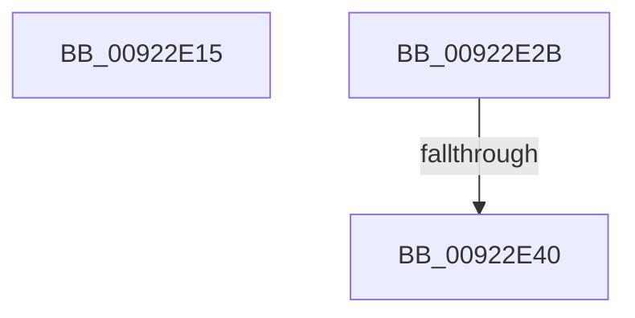

# sub_00922E15

- RVA: `0x00922E15`–`0x00922E72` (길이 `93` bytes)
- VA: `0x0000000140922E15`
- 실행 섹션: `PAGE`
- PDB 이름 있음: `아니요`; PDB Function 태그: `아니요`
- unwind 정보 RVA: `0x0008D270`
- 디코드: `20`개 명령, `93/93` bytes 표시
- 미해석 바이트: `0` (있으면 어셈블리에 `.byte`로 보존)

> 이 문서는 커널 이미지의 기계어와 PDB 기호를 분석해 생성했습니다. 4번과 5번은 함수 원형과 자료형을 바이너리 사용 방식에서 추정한 C 해석이며 원본 소스 복구 결과는 아닙니다.

## 1. Dependencies

- 직접 호출 지점: **4**; 고유 호출 대상: **3**
- 직접 호출자로 확인된 함수: **0**
- RIP 상대 이미지 참조: **0**

### Outgoing calls
- `0x00922E1A` → [ExFreePoolWithTag](../../poolcode/B8/ExFreePoolWithTag_function_00B82870.md) (function, `0x00B82870`)
- `0x00922E31` → [AlpcpChargePagedPoolQuota](AlpcpChargePagedPoolQuota_function_00922EA4.md) (function, `0x00922EA4`)
- `0x00922E4C` → [ExFreePoolWithTag](../../poolcode/B8/ExFreePoolWithTag_function_00B82870.md) (function, `0x00B82870`)
- `0x00922E66` → [AlpcpReleasePagedPoolQuota](AlpcpReleasePagedPoolQuota_function_00922EE8.md) (function, `0x00922EE8`)

### Direct callers
- 이 함수 시작 RVA로 연결되는 직접 call은 확인되지 않았습니다. 간접 호출은 완전히 역산할 수 없습니다.

### Static image references
- 디코드된 RIP-relative 메모리 참조가 없습니다.

## 2. Other-region calls and transfers

- 다른 실행 섹션으로 향하는 call: **2**
  - `0x00922E1A` → [ExFreePoolWithTag](../../poolcode/B8/ExFreePoolWithTag_function_00B82870.md) (`PAGE` → `POOLCODE`)
  - `0x00922E4C` → [ExFreePoolWithTag](../../poolcode/B8/ExFreePoolWithTag_function_00B82870.md) (`PAGE` → `POOLCODE`)
- call이 아닌 외부 분기/꼬리 이동: **3**
  - `0x00922E26` → [sub_00922D1D + 0x25](Unknown_function_00922D1D.md) (`tail-transfer`)
  - `0x00922E3A` → [sub_00922D1D + 0x5B](Unknown_function_00922D1D.md) (`tail-transfer`)
  - `0x00922E6D` → [sub_00922D1D + 0x5B](Unknown_function_00922D1D.md) (`tail-transfer`)

## 3. Assembly (complete function range)

```asm
00922E15  BA 41 6C 45 42                  mov edx, 0x42456c41
00922E1A  E8 51 FA 25 00                  call 0x140b82870
00922E1F  48 89 AE E8 00 00 00            mov qword ptr [rsi + 0xe8], rbp
00922E26  E9 17 FF FF FF                  jmp 0x140922d42
00922E2B  49 2B DE                        sub rbx, r14
00922E2E  48 8B D3                        mov rdx, rbx
00922E31  E8 6E 00 00 00                  call 0x140922ea4
00922E36  8B D8                           mov ebx, eax
00922E38  85 C0                           test eax, eax
00922E3A  0F 89 38 FF FF FF               jns 0x140922d78
00922E40  48 8B 8E E0 00 00 00            mov rcx, qword ptr [rsi + 0xe0]
00922E47  BA 41 6C 45 42                  mov edx, 0x42456c41
00922E4C  E8 1F FA 25 00                  call 0x140b82870
00922E51  48 8B 4E 30                     mov rcx, qword ptr [rsi + 0x30]
00922E55  49 8B D6                        mov rdx, r14
00922E58  48 89 AE E0 00 00 00            mov qword ptr [rsi + 0xe0], rbp
00922E5F  48 89 AE E8 00 00 00            mov qword ptr [rsi + 0xe8], rbp
00922E66  E8 7D 00 00 00                  call 0x140922ee8
00922E6B  8B EB                           mov ebp, ebx
00922E6D  E9 06 FF FF FF                  jmp 0x140922d78
```

## 4. C-style interpretation (structured pseudocode)

```c
__int64 __fastcall sub_00922E15(void)
{
    __int64 result;

    result = ExFreePoolWithTag(a1, (unsigned int)(0x42456C41ULL), a3, a4);
    *(unsigned __int64 *)(v_rsi + 232) = v_rbp;
}
```

## 5. (Beta) C Style

```c
void sub_00922E15(void)
{
    int64_t result;

    result = ExFreePoolWithTag(a1, (uint32_t)(0x42456C41ULL), a3, a4);
    *(uint64_t *)(local_rsi + 0xE8) = local_rbp;
}
```

## 6. Execution-region graph

[열기: 2D/3D 그래프와 함수 탐색 컨트롤 패널](../../../control-panel.html?section=page&rva=0x00922E15&view=graph)

- 2D 그래프는 위에서 아래로 흐르고, 3D 그래프는 빈 공간을 드래그해 회전합니다. Shift+드래그는 이동, 휠은 확대·축소, 함수 노드 선택은 대상 보고서 이동입니다.

### Static fallback


