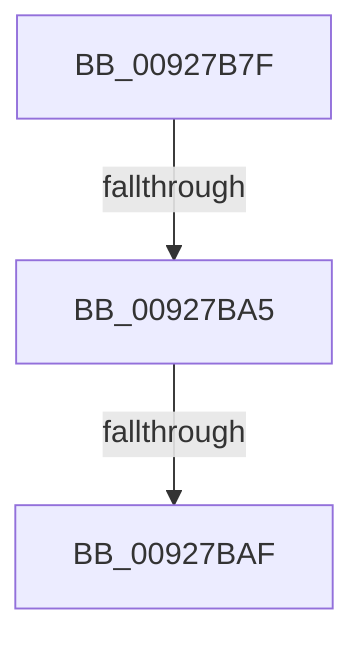

# sub_00927B7F

- RVA: `0x00927B7F`–`0x00927BEB` (길이 `108` bytes)
- VA: `0x0000000140927B7F`
- 실행 섹션: `PAGE`
- PDB 이름 있음: `아니요`; PDB Function 태그: `아니요`
- unwind 정보 RVA: `0x0008D6AC`
- 디코드: `25`개 명령, `108/108` bytes 표시
- 미해석 바이트: `0` (있으면 어셈블리에 `.byte`로 보존)

> 이 문서는 커널 이미지의 기계어와 PDB 기호를 분석해 생성했습니다. 4번과 5번은 함수 원형과 자료형을 바이너리 사용 방식에서 추정한 C 해석이며 원본 소스 복구 결과는 아닙니다.

## 1. Dependencies

- 직접 호출 지점: **2**; 고유 호출 대상: **2**
- 직접 호출자로 확인된 함수: **0**
- RIP 상대 이미지 참조: **0**

### Outgoing calls
- `0x00927B91` → [wcscpy_s](../../text/50/wcscpy_s_function_005064B0.md) (function, `0x005064B0`)
- `0x00927BDE` → [RtlIntegerToUnicode](RtlIntegerToUnicode_function_00927DB0.md) (function, `0x00927DB0`)

### Direct callers
- 이 함수 시작 RVA로 연결되는 직접 call은 확인되지 않았습니다. 간접 호출은 완전히 역산할 수 없습니다.

### Static image references
- 디코드된 RIP-relative 메모리 참조가 없습니다.

## 2. Other-region calls and transfers

- 다른 실행 섹션으로 향하는 call: **1**
  - `0x00927B91` → [wcscpy_s](../../text/50/wcscpy_s_function_005064B0.md) (`PAGE` → `.text`)
- call이 아닌 외부 분기/꼬리 이동: **3**
  - `0x00927B9F` → [sub_00927D0E](Unknown_function_00927D0E.md) (`tail-transfer`)
  - `0x00927BA9` → [sub_00927D0E](Unknown_function_00927D0E.md) (`tail-transfer`)
  - `0x00927BE5` → [sub_00927CE9](Unknown_function_00927CE9.md) (`tail-transfer`)

## 3. Assembly (complete function range)

```asm
00927B7F  48 89 9C 24 90 02 00 00         mov qword ptr [rsp + 0x290], rbx
00927B87  BA 00 01 00 00                  mov edx, 0x100
00927B8C  48 8D 4C 24 40                  lea rcx, [rsp + 0x40]
00927B91  E8 1A E9 BD FF                  call 0x1405064b0
00927B96  80 7E 02 00                     cmp byte ptr [rsi + 2], 0
00927B9A  48 8D 5C 24 48                  lea rbx, [rsp + 0x48]
00927B9F  0F 85 69 01 00 00               jne 0x140927d0e
00927BA5  80 7E 03 00                     cmp byte ptr [rsi + 3], 0
00927BA9  0F 85 5F 01 00 00               jne 0x140927d0e
00927BAF  0F B6 4E 04                     movzx ecx, byte ptr [rsi + 4]
00927BB3  4C 8D 4C 24 48                  lea r9, [rsp + 0x48]
00927BB8  0F B6 46 05                     movzx eax, byte ptr [rsi + 5]
00927BBC  BA 0A 00 00 00                  mov edx, 0xa
00927BC1  C1 E0 10                        shl eax, 0x10
00927BC4  41 B8 FC 00 00 00               mov r8d, 0xfc
00927BCA  C1 E1 18                        shl ecx, 0x18
00927BCD  03 C8                           add ecx, eax
00927BCF  0F B6 46 06                     movzx eax, byte ptr [rsi + 6]
00927BD3  C1 E0 08                        shl eax, 8
00927BD6  03 C8                           add ecx, eax
00927BD8  0F B6 46 07                     movzx eax, byte ptr [rsi + 7]
00927BDC  03 C8                           add ecx, eax
00927BDE  E8 CD 01 00 00                  call 0x140927db0
00927BE3  85 C0                           test eax, eax
00927BE5  0F 88 FE 00 00 00               js 0x140927ce9
```

## 4. C-style interpretation (structured pseudocode)

```c
__int64 __fastcall sub_00927B7F(__int64 a1, __int64 a2, __int64 a3, __int64 a4, __int64 a5, __int64 a6, __int64 a7, __int64 a8, __int64 a9)
{
    __int64 result;
    unsigned __int64 v_stack_p290;

    v_stack_p290 = v_rbx;
    result = wcscpy_s(a8, 256, a3, a4);
    result = (unsigned int)((*(unsigned __int8 *)(v_rsi + 5)) << (16));
    a1 = (unsigned int)((*(unsigned __int8 *)(v_rsi + 4)) << (24));
    a1 = (unsigned int)((a1) + ((unsigned int)(result)));
    result = (unsigned int)((*(unsigned __int8 *)(v_rsi + 6)) << (8));
    a1 = (unsigned int)((a1) + ((unsigned int)(result)));
    a1 = (unsigned int)((a1) + ((unsigned int)(*(unsigned __int8 *)(v_rsi + 7))));
    result = RtlIntegerToUnicode(a1, 10, 252, a9);
}
```

## 5. (Beta) C Style

```c
int64_t sub_00927B7F(int64_t Arg1, int64_t Arg2, int64_t Arg3, int64_t Arg4, uint64_t Arg5, uint64_t Arg6, uint64_t Arg7, int64_t Arg8, int64_t Arg9)
{
    int64_t result;
    uint64_t v_stack_p290;

    v_stack_p290 = local_rbx;
    result = wcscpy_s(Arg8, 256, Arg3, Arg4);
    result = (uint32_t)((*(uint8_t *)(local_rsi + 0x5)) << (16));
    Arg1 = (uint32_t)((*(uint8_t *)(local_rsi + 0x4)) << (24));
    Arg1 = (uint32_t)((Arg1) + ((uint32_t)(result)));
    result = (uint32_t)((*(uint8_t *)(local_rsi + 0x6)) << (8));
    Arg1 = (uint32_t)((Arg1) + ((uint32_t)(result)));
    Arg1 = (uint32_t)((Arg1) + ((uint32_t)(*(uint8_t *)(local_rsi + 0x7))));
    result = RtlIntegerToUnicode(Arg1, 10, 252, Arg9);
}
```

## 6. Execution-region graph

[열기: 2D/3D 그래프와 함수 탐색 컨트롤 패널](../../../control-panel.html?section=page&rva=0x00927B7F&view=graph)

- 2D 그래프는 위에서 아래로 흐르고, 3D 그래프는 빈 공간을 드래그해 회전합니다. Shift+드래그는 이동, 휠은 확대·축소, 함수 노드 선택은 대상 보고서 이동입니다.

### Static fallback


