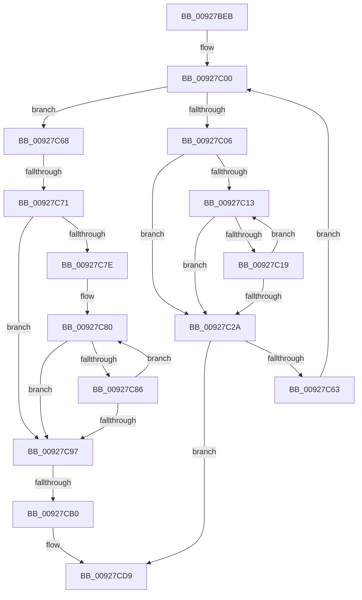

# sub_00927BEB

- RVA: `0x00927BEB`–`0x00927CE9` (길이 `254` bytes)
- VA: `0x0000000140927BEB`
- 실행 섹션: `PAGE`
- PDB 이름 있음: `아니요`; PDB Function 태그: `아니요`
- unwind 정보 RVA: `0x0008D6C0`
- 디코드: `63`개 명령, `254/254` bytes 표시
- 미해석 바이트: `0` (있으면 어셈블리에 `.byte`로 보존)

> 이 문서는 커널 이미지의 기계어와 PDB 기호를 분석해 생성했습니다. 4번과 5번은 함수 원형과 자료형을 바이너리 사용 방식에서 추정한 C 해석이며 원본 소스 복구 결과는 아닙니다.

## 1. Dependencies

- 직접 호출 지점: **2**; 고유 호출 대상: **2**
- 직접 호출자로 확인된 함수: **0**
- RIP 상대 이미지 참조: **0**

### Outgoing calls
- `0x00927C5A` → [RtlIntegerToUnicode](RtlIntegerToUnicode_function_00927DB0.md) (function, `0x00927DB0`)
- `0x00927CD0` → [RtlCopyUnicodeString](../../text/3F/RtlCopyUnicodeString_function_003FEF30.md) (function, `0x003FEF30`)

### Direct callers
- 이 함수 시작 RVA로 연결되는 직접 call은 확인되지 않았습니다. 간접 호출은 완전히 역산할 수 없습니다.

### Static image references
- 디코드된 RIP-relative 메모리 참조가 없습니다.

## 2. Other-region calls and transfers

- 다른 실행 섹션으로 향하는 call: **1**
  - `0x00927CD0` → [RtlCopyUnicodeString](../../text/3F/RtlCopyUnicodeString_function_003FEF30.md) (`PAGE` → `.text`)
- call이 아닌 외부 분기/꼬리 이동: **2**
  - `0x00927C6B` → [sub_00927D81](Unknown_function_00927D81.md) (`tail-transfer`)
  - `0x00927CAA` → [sub_00927D81 + 0x1E](Unknown_function_00927D81.md) (`tail-transfer`)

## 3. Assembly (complete function range)

```asm
00927BEB  48 89 BC 24 58 02 00 00         mov qword ptr [rsp + 0x258], rdi
00927BF3  40 32 FF                        xor dil, dil
00927BF6  4C 89 BC 24 50 02 00 00         mov qword ptr [rsp + 0x250], r15
00927BFE  66 90                           nop
00927C00  40 3A 7E 01                     cmp dil, byte ptr [rsi + 1]
00927C04  73 62                           jae 0x140927c68
00927C06  48 8D 84 24 3C 02 00 00         lea rax, [rsp + 0x23c]
00927C0E  48 3B D8                        cmp rbx, rax
00927C11  73 17                           jae 0x140927c2a
00927C13  66 83 3B 00                     cmp word ptr [rbx], 0
00927C17  74 11                           je 0x140927c2a
00927C19  48 83 C3 02                     add rbx, 2
00927C1D  48 8D 84 24 3C 02 00 00         lea rax, [rsp + 0x23c]
00927C25  48 3B D8                        cmp rbx, rax
00927C28  72 E9                           jb 0x140927c13
00927C2A  66 C7 03 2D 00                  mov word ptr [rbx], 0x2d
00927C2F  48 8D 4C 24 40                  lea rcx, [rsp + 0x40]
00927C34  48 83 C3 02                     add rbx, 2
00927C38  41 B8 00 01 00 00               mov r8d, 0x100
00927C3E  48 8B C3                        mov rax, rbx
00927C41  4C 8B CB                        mov r9, rbx
00927C44  48 2B C1                        sub rax, rcx
00927C47  BA 0A 00 00 00                  mov edx, 0xa
00927C4C  40 0F B6 CF                     movzx ecx, dil
00927C50  48 D1 F8                        sar rax, 1
00927C53  44 2B C0                        sub r8d, eax
00927C56  8B 4C 8E 08                     mov ecx, dword ptr [rsi + rcx*4 + 8]
00927C5A  E8 51 01 00 00                  call 0x140927db0
00927C5F  85 C0                           test eax, eax
00927C61  78 76                           js 0x140927cd9
00927C63  40 FE C7                        inc dil
00927C66  EB 98                           jmp 0x140927c00
00927C68  45 84 F6                        test r14b, r14b
00927C6B  0F 85 10 01 00 00               jne 0x140927d81
00927C71  48 8D 84 24 3E 02 00 00         lea rax, [rsp + 0x23e]
00927C79  48 3B D8                        cmp rbx, rax
00927C7C  73 19                           jae 0x140927c97
00927C7E  66 90                           nop
00927C80  66 83 3B 00                     cmp word ptr [rbx], 0
00927C84  74 11                           je 0x140927c97
00927C86  48 83 C3 02                     add rbx, 2
00927C8A  48 8D 84 24 3E 02 00 00         lea rax, [rsp + 0x23e]
00927C92  48 3B D8                        cmp rbx, rax
00927C95  72 E9                           jb 0x140927c80
00927C97  48 8D 44 24 40                  lea rax, [rsp + 0x40]
00927C9C  48 2B D8                        sub rbx, rax
00927C9F  0F B7 45 02                     movzx eax, word ptr [rbp + 2]
00927CA3  48 D1 FB                        sar rbx, 1
00927CA6  03 DB                           add ebx, ebx
00927CA8  3B D8                           cmp ebx, eax
00927CAA  0F 83 EF 00 00 00               jae 0x140927d9f
00927CB0  66 89 5C 24 28                  mov word ptr [rsp + 0x28], bx
00927CB5  48 8D 44 24 40                  lea rax, [rsp + 0x40]
00927CBA  66 83 C3 02                     add bx, 2
00927CBE  48 89 44 24 30                  mov qword ptr [rsp + 0x30], rax
00927CC3  48 8D 54 24 28                  lea rdx, [rsp + 0x28]
00927CC8  66 89 5C 24 2A                  mov word ptr [rsp + 0x2a], bx
00927CCD  48 8B CD                        mov rcx, rbp
00927CD0  E8 5B 72 AD FF                  call 0x1403fef30
00927CD5  33 C9                           xor ecx, ecx
00927CD7  8B C1                           mov eax, ecx
00927CD9  48 8B BC 24 58 02 00 00         mov rdi, qword ptr [rsp + 0x258]
00927CE1  4C 8B BC 24 50 02 00 00         mov r15, qword ptr [rsp + 0x250]
```

## 4. C-style interpretation (structured pseudocode)

```c
__int64 __fastcall sub_00927BEB(__int64 a1, __int64 a2, __int64 a3, __int64 a4, __int64 a5, __int64 a6, __int64 a7, __int64 a8, __int64 a9, __int64 a10, __int64 a11, __int64 a12, __int64 a13, __int64 a14, __int64 a15, __int64 a16, __int64 a17, __int64 a18, __int64 a19, __int64 a20, __int64 a21, __int64 a22, __int64 a23, __int64 a24, __int64 a25, __int64 a26, __int64 a27, __int64 a28, __int64 a29, __int64 a30, __int64 a31, __int64 a32, __int64 a33, __int64 a34, __int64 a35, __int64 a36, __int64 a37, __int64 a38, __int64 a39, __int64 a40, __int64 a41, __int64 a42, __int64 a43, __int64 a44, __int64 a45, __int64 a46, __int64 a47, __int64 a48, __int64 a49, __int64 a50, __int64 a51, __int64 a52, __int64 a53, __int64 a54, __int64 a55, __int64 a56, __int64 a57, __int64 a58, __int64 a59, __int64 a60, __int64 a61, __int64 a62, __int64 a63, __int64 a64, __int64 a65, __int64 a66, __int64 a67, __int64 a68, __int64 a69, __int64 a70, __int64 a71, __int64 a72, __int64 a73, __int64 a74, __int64 a75)
{
    __int64 result;
    __int64 v_rbx;
    __int64 v_rdi;
    unsigned __int64 v_stack_p23C;
    unsigned __int64 v_stack_p23E;
    unsigned __int64 v_stack_p250;
    unsigned __int64 v_stack_p258;
    unsigned __int16 v_stack_p28;
    unsigned __int16 v_stack_p2A;
    unsigned __int64 v_stack_p30;

    v_stack_p258 = v_rdi;
    v_rdi = 0;
    v_stack_p250 = v_r15;
loc_00927C00:
    if (0 >= (*(unsigned __int8 *)(v_rsi + 1))) goto loc_00927C68;
    if (v_rbx >= v_stack_p23C) goto loc_00927C2A;
loc_00927C13:
    if ((*(unsigned __int16 *)(v_rbx)) == 0) goto loc_00927C2A;
    v_rbx = (v_rbx) + (2);
    if (v_rbx < v_stack_p23C) goto loc_00927C13;
loc_00927C2A:
    *(unsigned __int16 *)(v_rbx) = 45;
    v_rbx = (v_rbx) + (2);
    result = (v_rbx) - (a8);
    result = (result) >> (1);
    a3 = (unsigned int)((256) - ((unsigned int)(result)));
    result = RtlIntegerToUnicode((unsigned int)(*(unsigned int *)(v_rsi + 0 * 4 + 8)), 10, a3, v_rbx);
    if (sign_flag) goto loc_00927CD9;
    v_rdi = (unsigned __int8)((v_rdi) + 1);
    goto loc_00927C00;
loc_00927C68:
    if (v_rbx >= v_stack_p23E) goto loc_00927C97;
loc_00927C80:
    if ((*(unsigned __int16 *)(v_rbx)) == 0) goto loc_00927C97;
    v_rbx = (v_rbx) + (2);
    if (v_rbx < v_stack_p23E) goto loc_00927C80;
loc_00927C97:
    v_rbx = (v_rbx) - (a8);
    v_rbx = (v_rbx) >> (1);
    v_rbx = (unsigned int)((v_rbx) + ((unsigned int)(v_rbx)));
    v_stack_p28 = (unsigned __int16)(v_rbx);
    v_rbx = (unsigned __int16)((v_rbx) + (2));
    v_stack_p30 = a8;
    v_stack_p2A = (unsigned __int16)(v_rbx);
    result = RtlCopyUnicodeString(v_rbp, a5, a3, v_rbx);
    a1 = 0;
loc_00927CD9:
    return 0;
}
```

## 5. (Beta) C Style

```c
int64_t sub_00927BEB(int64_t Arg1, int64_t Arg2, int64_t Arg3, int64_t Arg4, int64_t Arg5, uint64_t Arg6, uint64_t Arg7, int64_t Arg8, uint64_t Arg9, uint64_t Arg10, uint64_t Arg11, uint64_t Arg12, uint64_t Arg13, uint64_t Arg14, uint64_t Arg15, uint64_t Arg16, uint64_t Arg17, uint64_t Arg18, uint64_t Arg19, uint64_t Arg20, uint64_t Arg21, uint64_t Arg22, uint64_t Arg23, uint64_t Arg24, uint64_t Arg25, uint64_t Arg26, uint64_t Arg27, uint64_t Arg28, uint64_t Arg29, uint64_t Arg30, uint64_t Arg31, uint64_t Arg32, uint64_t Arg33, uint64_t Arg34, uint64_t Arg35, uint64_t Arg36, uint64_t Arg37, uint64_t Arg38, uint64_t Arg39, uint64_t Arg40, uint64_t Arg41, uint64_t Arg42, uint64_t Arg43, uint64_t Arg44, uint64_t Arg45, uint64_t Arg46, uint64_t Arg47, uint64_t Arg48, uint64_t Arg49, uint64_t Arg50, uint64_t Arg51, uint64_t Arg52, uint64_t Arg53, uint64_t Arg54, uint64_t Arg55, uint64_t Arg56, uint64_t Arg57, uint64_t Arg58, uint64_t Arg59, uint64_t Arg60, uint64_t Arg61, uint64_t Arg62, uint64_t Arg63, uint64_t Arg64, uint64_t Arg65, uint64_t Arg66, uint64_t Arg67, uint64_t Arg68, uint64_t Arg69, uint64_t Arg70, uint64_t Arg71, uint64_t Arg72, uint64_t Arg73, int64_t Arg74, int64_t Arg75)
{
    int64_t result;
    int64_t local_rbx;
    int64_t local_rdi;
    uint64_t v_stack_p23C;
    uint64_t v_stack_p23E;
    uint64_t v_stack_p250;
    uint64_t v_stack_p258;
    uint16_t v_stack_p28;
    uint16_t v_stack_p2A;
    uint64_t v_stack_p30;

    v_stack_p258 = local_rdi;
    local_rdi = 0;
    v_stack_p250 = local_r15;
loc_00927C00:
    if (0 >= (*(uint8_t *)(local_rsi + 0x1))) goto loc_00927C68;
    if (local_rbx >= v_stack_p23C) goto loc_00927C2A;
loc_00927C13:
    if ((*(uint16_t *)(local_rbx)) == 0) goto loc_00927C2A;
    local_rbx = (local_rbx) + (2);
    if (local_rbx < v_stack_p23C) goto loc_00927C13;
loc_00927C2A:
    *(uint16_t *)(local_rbx) = 45;
    local_rbx = (local_rbx) + (2);
    result = (local_rbx) - (Arg8);
    result = (result) >> (1);
    Arg3 = (uint32_t)((256) - ((uint32_t)(result)));
    result = RtlIntegerToUnicode((uint32_t)(*(uint32_t *)(local_rsi + 0x0 * 4 + 0x8)), 10, Arg3, local_rbx);
    if (sign_flag) goto loc_00927CD9;
    local_rdi = (uint8_t)((local_rdi) + 1);
    goto loc_00927C00;
loc_00927C68:
    if (local_rbx >= v_stack_p23E) goto loc_00927C97;
loc_00927C80:
    if ((*(uint16_t *)(local_rbx)) == 0) goto loc_00927C97;
    local_rbx = (local_rbx) + (2);
    if (local_rbx < v_stack_p23E) goto loc_00927C80;
loc_00927C97:
    local_rbx = (local_rbx) - (Arg8);
    local_rbx = (local_rbx) >> (1);
    local_rbx = (uint32_t)((local_rbx) + ((uint32_t)(local_rbx)));
    v_stack_p28 = (uint16_t)(local_rbx);
    local_rbx = (uint16_t)((local_rbx) + (2));
    v_stack_p30 = Arg8;
    v_stack_p2A = (uint16_t)(local_rbx);
    result = RtlCopyUnicodeString(local_rbp, Arg5, Arg3, local_rbx);
    Arg1 = 0;
loc_00927CD9:
    return 0;
}
```

## 6. Execution-region graph

[열기: 2D/3D 그래프와 함수 탐색 컨트롤 패널](../../../control-panel.html?section=page&rva=0x00927BEB&view=graph)

- 2D 그래프는 위에서 아래로 흐르고, 3D 그래프는 빈 공간을 드래그해 회전합니다. Shift+드래그는 이동, 휠은 확대·축소, 함수 노드 선택은 대상 보고서 이동입니다.

### Static fallback


