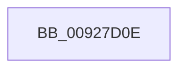

# sub_00927D0E

- RVA: `0x00927D0E`–`0x00927D77` (길이 `105` bytes)
- VA: `0x0000000140927D0E`
- 실행 섹션: `PAGE`
- PDB 이름 있음: `아니요`; PDB Function 태그: `아니요`
- unwind 정보 RVA: `0x0008D6FC`
- 디코드: `26`개 명령, `105/105` bytes 표시
- 미해석 바이트: `0` (있으면 어셈블리에 `.byte`로 보존)

> 이 문서는 커널 이미지의 기계어와 PDB 기호를 분석해 생성했습니다. 4번과 5번은 함수 원형과 자료형을 바이너리 사용 방식에서 추정한 C 해석이며 원본 소스 복구 결과는 아닙니다.

## 1. Dependencies

- 직접 호출 지점: **2**; 고유 호출 대상: **2**
- 직접 호출자로 확인된 함수: **0**
- RIP 상대 이미지 참조: **1**

### Outgoing calls
- `0x00927D1F` → [wcscat_s](../../text/50/wcscat_s_function_00506410.md) (function, `0x00506410`)
- `0x00927D6D` → [RtlLargeIntegerToUnicode](RtlLargeIntegerToUnicode_function_009275E4.md) (function, `0x009275E4`)

### Direct callers
- 이 함수 시작 RVA로 연결되는 직접 call은 확인되지 않았습니다. 간접 호출은 완전히 역산할 수 없습니다.

### Static image references
- `0x00927D0E` → RVA `0x00B055D0` (` ?? ::NNGAKEGL::`string'`; read)

## 2. Other-region calls and transfers

- 다른 실행 섹션으로 향하는 call: **1**
  - `0x00927D1F` → [wcscat_s](../../text/50/wcscat_s_function_00506410.md) (`PAGE` → `.text`)
- call이 아닌 외부 분기/꼬리 이동: **1**
  - `0x00927D72` → [sub_00927B7F + 0x64](Unknown_function_00927B7F.md) (`tail-transfer`)

## 3. Assembly (complete function range)

```asm
00927D0E  4C 8D 05 BB D8 1D 00            lea r8, [rip + 0x1dd8bb]
00927D15  BA 00 01 00 00                  mov edx, 0x100
00927D1A  48 8D 4C 24 40                  lea rcx, [rsp + 0x40]
00927D1F  E8 EC E6 BD FF                  call 0x140506410
00927D24  0F B6 4E 02                     movzx ecx, byte ptr [rsi + 2]
00927D28  4C 8D 4C 24 4C                  lea r9, [rsp + 0x4c]
00927D2D  0F B6 46 03                     movzx eax, byte ptr [rsi + 3]
00927D31  48 8D 5C 24 4C                  lea rbx, [rsp + 0x4c]
00927D36  C1 E1 08                        shl ecx, 8
00927D39  41 B8 FA 00 00 00               mov r8d, 0xfa
00927D3F  03 C8                           add ecx, eax
00927D41  0F B6 46 05                     movzx eax, byte ptr [rsi + 5]
00927D45  89 4C 24 24                     mov dword ptr [rsp + 0x24], ecx
00927D49  0F B6 4E 04                     movzx ecx, byte ptr [rsi + 4]
00927D4D  C1 E1 18                        shl ecx, 0x18
00927D50  C1 E0 10                        shl eax, 0x10
00927D53  03 C8                           add ecx, eax
00927D55  0F B6 46 06                     movzx eax, byte ptr [rsi + 6]
00927D59  C1 E0 08                        shl eax, 8
00927D5C  03 C8                           add ecx, eax
00927D5E  0F B6 46 07                     movzx eax, byte ptr [rsi + 7]
00927D62  03 C8                           add ecx, eax
00927D64  89 4C 24 20                     mov dword ptr [rsp + 0x20], ecx
00927D68  48 8D 4C 24 20                  lea rcx, [rsp + 0x20]
00927D6D  E8 72 F8 FF FF                  call 0x1409275e4
00927D72  E9 6C FE FF FF                  jmp 0x140927be3
```

## 4. C-style interpretation (structured pseudocode)

```c
__int64 __fastcall sub_00927D0E(__int64 a1, __int64 a2, __int64 a3, __int64 a4, __int64 a5, __int64 a6, __int64 a7, __int64 a8)
{
    __int64 result;
    unsigned int v_stack_p20;
    unsigned int v_stack_p24;
    unsigned __int64 v_stack_p4C;

    result = wcscat_s(a8, 256, v_rip + 1956027, a4);
    a1 = (unsigned int)((*(unsigned __int8 *)(v_rsi + 2)) << (8));
    a1 = (unsigned int)((a1) + ((unsigned int)(*(unsigned __int8 *)(v_rsi + 3))));
    v_stack_p24 = (unsigned int)(a1);
    a1 = (unsigned int)((*(unsigned __int8 *)(v_rsi + 4)) << (24));
    result = (unsigned int)((*(unsigned __int8 *)(v_rsi + 5)) << (16));
    a1 = (unsigned int)((a1) + ((unsigned int)(result)));
    result = (unsigned int)((*(unsigned __int8 *)(v_rsi + 6)) << (8));
    a1 = (unsigned int)((a1) + ((unsigned int)(result)));
    a1 = (unsigned int)((a1) + ((unsigned int)(*(unsigned __int8 *)(v_rsi + 7))));
    v_stack_p20 = (unsigned int)(a1);
    result = RtlLargeIntegerToUnicode(v_stack_p20, 256, 250, v_stack_p4C);
}
```

## 5. (Beta) C Style

```c
int64_t sub_00927D0E(int64_t Arg1, int64_t Arg2, int64_t Arg3, int64_t Arg4, uint64_t Arg5, uint64_t Arg6, uint64_t Arg7, int64_t Arg8)
{
    int64_t result;
    uint32_t v_stack_p20;
    uint32_t v_stack_p24;
    uint64_t v_stack_p4C;

    result = wcscat_s(Arg8, 256, v_rip + 1956027, Arg4);
    Arg1 = (uint32_t)((*(uint8_t *)(local_rsi + 0x2)) << (8));
    Arg1 = (uint32_t)((Arg1) + ((uint32_t)(*(uint8_t *)(local_rsi + 0x3))));
    v_stack_p24 = (uint32_t)(Arg1);
    Arg1 = (uint32_t)((*(uint8_t *)(local_rsi + 0x4)) << (24));
    result = (uint32_t)((*(uint8_t *)(local_rsi + 0x5)) << (16));
    Arg1 = (uint32_t)((Arg1) + ((uint32_t)(result)));
    result = (uint32_t)((*(uint8_t *)(local_rsi + 0x6)) << (8));
    Arg1 = (uint32_t)((Arg1) + ((uint32_t)(result)));
    Arg1 = (uint32_t)((Arg1) + ((uint32_t)(*(uint8_t *)(local_rsi + 0x7))));
    v_stack_p20 = (uint32_t)(Arg1);
    result = RtlLargeIntegerToUnicode(v_stack_p20, 256, 250, v_stack_p4C);
}
```

## 6. Execution-region graph

[열기: 2D/3D 그래프와 함수 탐색 컨트롤 패널](../../../control-panel.html?section=page&rva=0x00927D0E&view=graph)

- 2D 그래프는 위에서 아래로 흐르고, 3D 그래프는 빈 공간을 드래그해 회전합니다. Shift+드래그는 이동, 휠은 확대·축소, 함수 노드 선택은 대상 보고서 이동입니다.

### Static fallback


