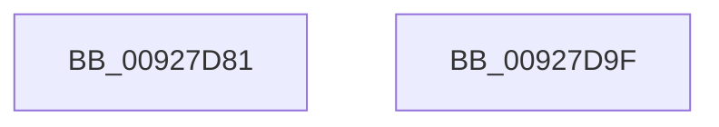

# sub_00927D81

- RVA: `0x00927D81`–`0x00927DA9` (길이 `40` bytes)
- VA: `0x0000000140927D81`
- 실행 섹션: `PAGE`
- PDB 이름 있음: `아니요`; PDB Function 태그: `아니요`
- unwind 정보 RVA: `0x0008D720`
- 디코드: `10`개 명령, `40/40` bytes 표시
- 미해석 바이트: `0` (있으면 어셈블리에 `.byte`로 보존)

> 이 문서는 커널 이미지의 기계어와 PDB 기호를 분석해 생성했습니다. 4번과 5번은 함수 원형과 자료형을 바이너리 사용 방식에서 추정한 C 해석이며 원본 소스 복구 결과는 아닙니다.

## 1. Dependencies

- 직접 호출 지점: **1**; 고유 호출 대상: **1**
- 직접 호출자로 확인된 함수: **0**
- RIP 상대 이미지 참조: **0**

### Outgoing calls
- `0x00927D89` → [RtlCreateUnicodeString](../9B/RtlCreateUnicodeString_function_009BD860.md) (function, `0x009BD860`)

### Direct callers
- 이 함수 시작 RVA로 연결되는 직접 call은 확인되지 않았습니다. 간접 호출은 완전히 역산할 수 없습니다.

### Static image references
- 디코드된 RIP-relative 메모리 참조가 없습니다.

## 2. Other-region calls and transfers

- 다른 실행 섹션으로 향하는 call: **0**
- call이 아닌 외부 분기/꼬리 이동: **2**
  - `0x00927D9A` → [sub_00927BEB + 0xEC](Unknown_function_00927BEB.md) (`tail-transfer`)
  - `0x00927DA4` → [sub_00927BEB + 0xEC](Unknown_function_00927BEB.md) (`tail-transfer`)

## 3. Assembly (complete function range)

```asm
00927D81  48 8D 54 24 40                  lea rdx, [rsp + 0x40]
00927D86  48 8B CD                        mov rcx, rbp
00927D89  E8 D2 5A 09 00                  call 0x1409bd860
00927D8E  33 C9                           xor ecx, ecx
00927D90  BA 17 00 00 C0                  mov edx, 0xc0000017
00927D95  84 C0                           test al, al
00927D97  0F 44 CA                        cmove ecx, edx
00927D9A  E9 38 FF FF FF                  jmp 0x140927cd7
00927D9F  B9 05 00 00 80                  mov ecx, 0x80000005
00927DA4  E9 2E FF FF FF                  jmp 0x140927cd7
```

## 4. C-style interpretation (structured pseudocode)

```c
__int64 __fastcall sub_00927D81(__int64 a1, __int64 a2, __int64 a3, __int64 a4, __int64 a5, __int64 a6, __int64 a7, __int64 a8)
{
    __int64 result;

    result = RtlCreateUnicodeString(v_rbp, a8, a3, a4);
    a1 = 0;
    if ((unsigned __int8)(result) == 0) { a1 = (unsigned int)((unsigned int)(0xC0000017ULL)); }
}
```

## 5. (Beta) C Style

```c
int64_t sub_00927D81(int64_t Arg1, int64_t Arg2, int64_t Arg3, int64_t Arg4, uint64_t Arg5, uint64_t Arg6, uint64_t Arg7, int64_t Arg8)
{
    int64_t result;

    result = RtlCreateUnicodeString(local_rbp, Arg8, Arg3, Arg4);
    Arg1 = 0;
    if ((uint8_t)(result) == 0) { Arg1 = (uint32_t)((uint32_t)(0xC0000017ULL)); }
}
```

## 6. Execution-region graph

[열기: 2D/3D 그래프와 함수 탐색 컨트롤 패널](../../../control-panel.html?section=page&rva=0x00927D81&view=graph)

- 2D 그래프는 위에서 아래로 흐르고, 3D 그래프는 빈 공간을 드래그해 회전합니다. Shift+드래그는 이동, 휠은 확대·축소, 함수 노드 선택은 대상 보고서 이동입니다.

### Static fallback


