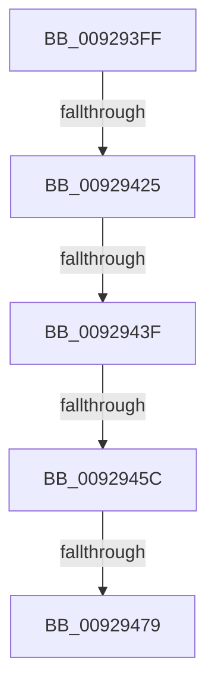

# sub_009293FF

- RVA: `0x009293FF`–`0x0092949C` (길이 `157` bytes)
- VA: `0x00000001409293FF`
- 실행 섹션: `PAGE`
- PDB 이름 있음: `아니요`; PDB Function 태그: `아니요`
- unwind 정보 RVA: `0x0008D808`
- 디코드: `33`개 명령, `157/157` bytes 표시
- 미해석 바이트: `0` (있으면 어셈블리에 `.byte`로 보존)

> 이 문서는 커널 이미지의 기계어와 PDB 기호를 분석해 생성했습니다. 4번과 5번은 함수 원형과 자료형을 바이너리 사용 방식에서 추정한 C 해석이며 원본 소스 복구 결과는 아닙니다.

## 1. Dependencies

- 직접 호출 지점: **4**; 고유 호출 대상: **1**
- 직접 호출자로 확인된 함수: **0**
- RIP 상대 이미지 참조: **4**

### Outgoing calls
- `0x00929432` → [wcsnicmp](../../text/50/wcsnicmp_function_005001C0.md) (function, `0x005001C0`)
- `0x0092944F` → [wcsnicmp](../../text/50/wcsnicmp_function_005001C0.md) (function, `0x005001C0`)
- `0x0092946C` → [wcsnicmp](../../text/50/wcsnicmp_function_005001C0.md) (function, `0x005001C0`)
- `0x00929489` → [wcsnicmp](../../text/50/wcsnicmp_function_005001C0.md) (function, `0x005001C0`)

### Direct callers
- 이 함수 시작 RVA로 연결되는 직접 call은 확인되지 않았습니다. 간접 호출은 완전히 역산할 수 없습니다.

### Static image references
- `0x0092942B` → RVA `0x00011CEC` (`.rdata`; read)
- `0x00929445` → RVA `0x00011CF4` (`.rdata`; read)
- `0x00929462` → RVA `0x00011CFC` (`.rdata`; read)
- `0x0092947F` → RVA `0x00011D04` (`.rdata`; read)

## 2. Other-region calls and transfers

- 다른 실행 섹션으로 향하는 call: **4**
  - `0x00929432` → [wcsnicmp](../../text/50/wcsnicmp_function_005001C0.md) (`PAGE` → `.text`)
  - `0x0092944F` → [wcsnicmp](../../text/50/wcsnicmp_function_005001C0.md) (`PAGE` → `.text`)
  - `0x0092946C` → [wcsnicmp](../../text/50/wcsnicmp_function_005001C0.md) (`PAGE` → `.text`)
  - `0x00929489` → [wcsnicmp](../../text/50/wcsnicmp_function_005001C0.md) (`PAGE` → `.text`)
- call이 아닌 외부 분기/꼬리 이동: **4**
  - `0x0092941F` → [sub_00929657 + 0x14](Unknown_function_00929657.md) (`tail-transfer`)
  - `0x00929439` → [sub_00929601](Unknown_function_00929601.md) (`tail-transfer`)
  - `0x00929456` → [sub_00929657](Unknown_function_00929657.md) (`tail-transfer`)
  - `0x00929473` → [sub_00929601 + 0xB](Unknown_function_00929601.md) (`tail-transfer`)

## 3. Assembly (complete function range)

```asm
009293FF  48 89 5C 24 40                  mov qword ptr [rsp + 0x40], rbx
00929404  48 89 7C 24 30                  mov qword ptr [rsp + 0x30], rdi
00929409  4C 89 74 24 28                  mov qword ptr [rsp + 0x28], r14
0092940E  45 8B F5                        mov r14d, r13d
00929411  4C 89 28                        mov qword ptr [rax], r13
00929414  C7 44 24 70 43 00 00 00         mov dword ptr [rsp + 0x70], 0x43
0092941C  4D 85 E4                        test r12, r12
0092941F  0F 84 46 02 00 00               je 0x14092966b
00929425  41 B8 02 00 00 00               mov r8d, 2
0092942B  48 8D 15 BA 88 6E FF            lea rdx, [rip - 0x917746]
00929432  E8 89 6D BD FF                  call 0x1405001c0
00929437  85 C0                           test eax, eax
00929439  0F 84 C2 01 00 00               je 0x140929601
0092943F  41 B8 02 00 00 00               mov r8d, 2
00929445  48 8D 15 A8 88 6E FF            lea rdx, [rip - 0x917758]
0092944C  49 8B CC                        mov rcx, r12
0092944F  E8 6C 6D BD FF                  call 0x1405001c0
00929454  85 C0                           test eax, eax
00929456  0F 84 FB 01 00 00               je 0x140929657
0092945C  41 B8 02 00 00 00               mov r8d, 2
00929462  48 8D 15 93 88 6E FF            lea rdx, [rip - 0x91776d]
00929469  49 8B CC                        mov rcx, r12
0092946C  E8 4F 6D BD FF                  call 0x1405001c0
00929471  85 C0                           test eax, eax
00929473  0F 84 93 01 00 00               je 0x14092960c
00929479  41 B8 02 00 00 00               mov r8d, 2
0092947F  48 8D 15 7E 88 6E FF            lea rdx, [rip - 0x917782]
00929486  49 8B CC                        mov rcx, r12
00929489  E8 32 6D BD FF                  call 0x1405001c0
0092948E  85 C0                           test eax, eax
00929490  B9 01 00 00 00                  mov ecx, 1
00929495  44 0F 44 F1                     cmove r14d, ecx
00929499  41 8B DD                        mov ebx, r13d
```

## 4. C-style interpretation (structured pseudocode)

```c
__int64 __fastcall sub_009293FF(void)
{
    __int64 result;
    __int64 v_r14;
    unsigned __int64 v_stack_p28;
    unsigned __int64 v_stack_p30;
    unsigned __int64 v_stack_p40;
    unsigned int v_stack_p70;

    v_stack_p40 = v_rbx;
    v_stack_p30 = v_rdi;
    v_stack_p28 = v_r14;
    *(unsigned __int64 *)(result) = v_r13;
    v_stack_p70 = 67;
    result = wcsnicmp(a1, v_rip - 9533254, 2, a4);
    result = wcsnicmp(v_r12, v_rip - 9533272, 2, a4);
    result = wcsnicmp(v_r12, v_rip - 9533293, 2, a4);
    result = wcsnicmp(v_r12, v_rip - 9533314, 2, a4);
    v_r14 = (unsigned int)((unsigned int)(v_r13));
    if ((unsigned int)(result) == 0) { v_r14 = 1; }
    return result;
}
```

## 5. (Beta) C Style

```c
void sub_009293FF(void)
{
    int64_t result;
    int64_t local_r14;
    uint64_t v_stack_p28;
    uint64_t v_stack_p30;
    uint64_t v_stack_p40;
    uint32_t v_stack_p70;

    v_stack_p40 = local_rbx;
    v_stack_p30 = local_rdi;
    v_stack_p28 = local_r14;
    *(uint64_t *)(result) = local_r13;
    v_stack_p70 = 67;
    result = wcsnicmp(a1, v_rip - 9533254, 2, a4);
    result = wcsnicmp(local_r12, v_rip - 9533272, 2, a4);
    result = wcsnicmp(local_r12, v_rip - 9533293, 2, a4);
    result = wcsnicmp(local_r12, v_rip - 9533314, 2, a4);
    local_r14 = (uint32_t)((uint32_t)(local_r13));
    if ((uint32_t)(result) == 0) { local_r14 = 1; }
    return result;
}
```

## 6. Execution-region graph

[열기: 2D/3D 그래프와 함수 탐색 컨트롤 패널](../../../control-panel.html?section=page&rva=0x009293FF&view=graph)

- 2D 그래프는 위에서 아래로 흐르고, 3D 그래프는 빈 공간을 드래그해 회전합니다. Shift+드래그는 이동, 휠은 확대·축소, 함수 노드 선택은 대상 보고서 이동입니다.

### Static fallback


