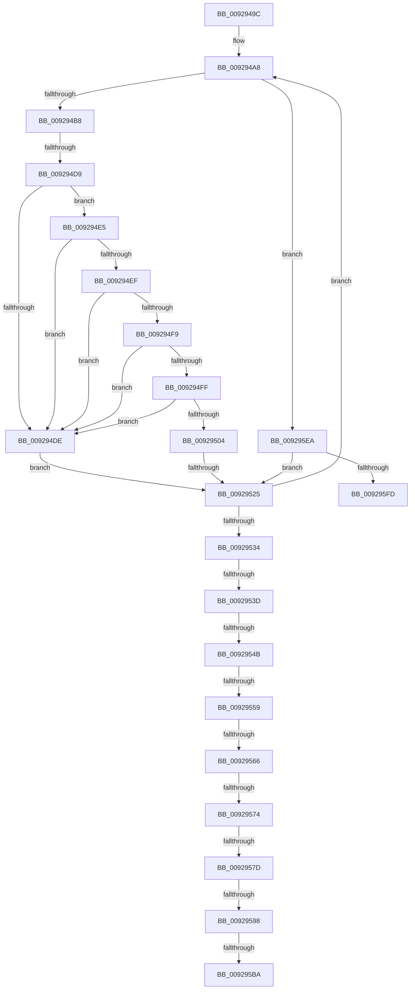

# sub_0092949C

- RVA: `0x0092949C`–`0x00929601` (길이 `357` bytes)
- VA: `0x000000014092949C`
- 실행 섹션: `PAGE`
- PDB 이름 있음: `아니요`; PDB Function 태그: `아니요`
- unwind 정보 RVA: `0x0008D824`
- 디코드: `85`개 명령, `357/357` bytes 표시
- 미해석 바이트: `0` (있으면 어셈블리에 `.byte`로 보존)

> 이 문서는 커널 이미지의 기계어와 PDB 기호를 분석해 생성했습니다. 4번과 5번은 함수 원형과 자료형을 바이너리 사용 방식에서 추정한 C 해석이며 원본 소스 복구 결과는 아닙니다.

## 1. Dependencies

- 직접 호출 지점: **8**; 고유 호출 대상: **7**
- 직접 호출자로 확인된 함수: **0**
- RIP 상대 이미지 참조: **3**

### Outgoing calls
- `0x009294CC` → [wcsnicmp](../../text/50/wcsnicmp_function_005001C0.md) (function, `0x005001C0`)
- `0x00929513` → [wcsnicmp](../../text/50/wcsnicmp_function_005001C0.md) (function, `0x005001C0`)
- `0x00929598` → [RtlLengthSid](../../text/45/RtlLengthSid_function_0045D270.md) (function, `0x0045D270`)
- `0x009295A2` → [SddlpAlloc](SddlpAlloc_function_00925F88.md) (function, `0x00925F88`)
- `0x009295C7` → [memcpy](../../text/6C/memcpy_function_006C6840.md) (function, `0x006C6840`)
- `0x009295D0` → [RtlSubAuthorityCountSid](../../text/46/RtlSubAuthorityCountSid_function_00468F10.md) (function, `0x00468F10`)
- `0x009295DD` → [RtlSubAuthoritySid](../../text/45/RtlSubAuthoritySid_function_00456D10.md) (function, `0x00456D10`)
- `0x009295F0` → [RtlEqualSid](../../text/40/RtlEqualSid_function_00400AD0.md) (function, `0x00400AD0`)

### Direct callers
- 이 함수 시작 RVA로 연결되는 직접 call은 확인되지 않았습니다. 간접 호출은 완전히 역산할 수 없습니다.

### Static image references
- `0x009294A1` → RVA `0x00E0CDF0` (`.data`; read)
- `0x009294A8` → RVA `0x00E0CDE0` (`.data`; read)
- `0x0092950C` → RVA `0x00011CE4` (`.rdata`; read)

## 2. Other-region calls and transfers

- 다른 실행 섹션으로 향하는 call: **7**
  - `0x009294CC` → [wcsnicmp](../../text/50/wcsnicmp_function_005001C0.md) (`PAGE` → `.text`)
  - `0x00929513` → [wcsnicmp](../../text/50/wcsnicmp_function_005001C0.md) (`PAGE` → `.text`)
  - `0x00929598` → [RtlLengthSid](../../text/45/RtlLengthSid_function_0045D270.md) (`PAGE` → `.text`)
  - `0x009295C7` → [memcpy](../../text/6C/memcpy_function_006C6840.md) (`PAGE` → `.text`)
  - `0x009295D0` → [RtlSubAuthorityCountSid](../../text/46/RtlSubAuthorityCountSid_function_00468F10.md) (`PAGE` → `.text`)
  - `0x009295DD` → [RtlSubAuthoritySid](../../text/45/RtlSubAuthoritySid_function_00456D10.md) (`PAGE` → `.text`)
  - `0x009295F0` → [RtlEqualSid](../../text/40/RtlEqualSid_function_00400AD0.md) (`PAGE` → `.text`)
- call이 아닌 외부 분기/꼬리 이동: **12**
  - `0x009294D3` → [sub_00929617](Unknown_function_00929617.md) (`tail-transfer`)
  - `0x0092951F` → [sub_009296E3 + 0x19](Unknown_function_009296E3.md) (`tail-transfer`)
  - `0x00929537` → [sub_00929617 + 0x1C](Unknown_function_00929617.md) (`tail-transfer`)
  - `0x00929545` → [sub_00929617 + 0x1C](Unknown_function_00929617.md) (`tail-transfer`)
  - `0x00929553` → [sub_00929617 + 0x1C](Unknown_function_00929617.md) (`tail-transfer`)
  - `0x00929560` → [sub_00929617 + 0x1C](Unknown_function_00929617.md) (`tail-transfer`)
  - `0x0092956E` → [sub_009296E3](Unknown_function_009296E3.md) (`tail-transfer`)
  - `0x00929577` → [sub_009296E3 + 0x9](Unknown_function_009296E3.md) (`tail-transfer`)
  - `0x00929592` → [sub_00929617 + 0x1C](Unknown_function_00929617.md) (`tail-transfer`)
  - `0x009295B8` → [sub_00929617 + 0x1C](Unknown_function_00929617.md) (`tail-transfer`)
  - `0x009295E8` → [sub_00929617 + 0x1C](Unknown_function_00929617.md) (`tail-transfer`)
  - `0x009295FF` → [sub_00929617 + 0x5](Unknown_function_00929617.md) (`tail-transfer`)

## 3. Assembly (complete function range)

```asm
0092949C  48 89 6C 24 38                  mov qword ptr [rsp + 0x38], rbp
009294A1  48 8D 3D 48 39 4E 00            lea rdi, [rip + 0x4e3948]
009294A8  48 8D 0D 31 39 4E 00            lea rcx, [rip + 0x4e3931]
009294AF  45 84 FF                        test r15b, r15b
009294B2  0F 85 32 01 00 00               jne 0x1409295ea
009294B8  44 8B 47 FC                     mov r8d, dword ptr [rdi - 4]
009294BC  8B EB                           mov ebp, ebx
009294BE  48 6B F5 68                     imul rsi, rbp, 0x68
009294C2  48 03 F1                        add rsi, rcx
009294C5  49 8B CC                        mov rcx, r12
009294C8  48 8D 56 02                     lea rdx, [rsi + 2]
009294CC  E8 EF 6C BD FF                  call 0x1405001c0
009294D1  85 C0                           test eax, eax
009294D3  0F 84 3E 01 00 00               je 0x140929617
009294D9  45 85 F6                        test r14d, r14d
009294DC  75 07                           jne 0x1409294e5
009294DE  48 8B 74 24 78                  mov rsi, qword ptr [rsp + 0x78]
009294E3  EB 40                           jmp 0x140929525
009294E5  4C 39 AC 24 80 00 00 00         cmp qword ptr [rsp + 0x80], r13
009294ED  75 EF                           jne 0x1409294de
009294EF  44 38 AC 24 98 00 00 00         cmp byte ptr [rsp + 0x98], r13b
009294F7  74 E5                           je 0x1409294de
009294F9  44 38 6F F0                     cmp byte ptr [rdi - 0x10], r13b
009294FD  74 DF                           je 0x1409294de
009294FF  4C 39 2F                        cmp qword ptr [rdi], r13
00929502  74 DA                           je 0x1409294de
00929504  44 8B 47 FC                     mov r8d, dword ptr [rdi - 4]
00929508  48 8D 56 02                     lea rdx, [rsi + 2]
0092950C  48 8D 0D D1 87 6E FF            lea rcx, [rip - 0x91782f]
00929513  E8 A8 6C BD FF                  call 0x1405001c0
00929518  48 8B 74 24 78                  mov rsi, qword ptr [rsp + 0x78]
0092951D  85 C0                           test eax, eax
0092951F  0F 84 D7 01 00 00               je 0x1409296fc
00929525  FF C3                           inc ebx
00929527  48 83 C7 68                     add rdi, 0x68
0092952B  83 FB 43                        cmp ebx, 0x43
0092952E  0F 82 74 FF FF FF               jb 0x1409294a8
00929534  45 85 F6                        test r14d, r14d
00929537  0F 84 F6 00 00 00               je 0x140929633
0092953D  44 38 AC 24 98 00 00 00         cmp byte ptr [rsp + 0x98], r13b
00929545  0F 84 E8 00 00 00               je 0x140929633
0092954B  4C 39 AC 24 80 00 00 00         cmp qword ptr [rsp + 0x80], r13
00929553  0F 85 DA 00 00 00               jne 0x140929633
00929559  8B 44 24 70                     mov eax, dword ptr [rsp + 0x70]
0092955D  83 F8 43                        cmp eax, 0x43
00929560  0F 83 CD 00 00 00               jae 0x140929633
00929566  44 39 AC 24 88 00 00 00         cmp dword ptr [rsp + 0x88], r13d
0092956E  0F 84 6F 01 00 00               je 0x1409296e3
00929574  45 84 FF                        test r15b, r15b
00929577  0F 85 6F 01 00 00               jne 0x1409296ec
0092957D  48 6B F8 68                     imul rdi, rax, 0x68
00929581  48 8D 05 58 38 4E 00            lea rax, [rip + 0x4e3858]
00929588  48 03 F8                        add rdi, rax
0092958B  48 8B 4F 10                     mov rcx, qword ptr [rdi + 0x10]
0092958F  48 85 C9                        test rcx, rcx
00929592  0F 84 9B 00 00 00               je 0x140929633
00929598  E8 D3 3C B3 FF                  call 0x14045d270
0092959D  8B F0                           mov esi, eax
0092959F  8D 4E 01                        lea ecx, [rsi + 1]
009295A2  E8 E1 C9 FF FF                  call 0x140925f88
009295A7  48 8B D8                        mov rbx, rax
009295AA  48 8B 84 24 A0 00 00 00         mov rax, qword ptr [rsp + 0xa0]
009295B2  48 89 18                        mov qword ptr [rax], rbx
009295B5  48 85 DB                        test rbx, rbx
009295B8  74 79                           je 0x140929633
009295BA  0F AE E8                        lfence
009295BD  48 8B 57 10                     mov rdx, qword ptr [rdi + 0x10]
009295C1  44 8B C6                        mov r8d, esi
009295C4  48 8B CB                        mov rcx, rbx
009295C7  E8 74 D2 D9 FF                  call 0x1406c6840
009295CC  48 8B 4F 10                     mov rcx, qword ptr [rdi + 0x10]
009295D0  E8 3B F9 B3 FF                  call 0x140468f10
009295D5  48 8B CB                        mov rcx, rbx
009295D8  0F B6 10                        movzx edx, byte ptr [rax]
009295DB  FF CA                           dec edx
009295DD  E8 2E D7 B2 FF                  call 0x140456d10
009295E2  C7 00 06 02 00 00               mov dword ptr [rax], 0x206
009295E8  EB 49                           jmp 0x140929633
009295EA  48 8B 17                        mov rdx, qword ptr [rdi]
009295ED  48 8B CE                        mov rcx, rsi
009295F0  E8 DB 74 AD FF                  call 0x140400ad0
009295F5  84 C0                           test al, al
009295F7  0F 84 28 FF FF FF               je 0x140929525
009295FD  8B EB                           mov ebp, ebx
009295FF  EB 1B                           jmp 0x14092961c
```

## 4. C-style interpretation (structured pseudocode)

```c
__int64 __fastcall sub_0092949C(__int64 a1, __int64 a2, __int64 a3, __int64 a4, __int64 a5, __int64 a6, __int64 a7, __int64 a8, __int64 a9, __int64 a10, __int64 a11, __int64 a12, __int64 a13, unsigned int a14, __int64 a15, __int64 a16, unsigned int a17, __int64 a18, unsigned __int8 a19, __int64 a20)
{
    __int64 result;
    __int64 v_rbx;
    __int64 v_rdi;
    __int64 v_rsi;
    unsigned __int64 v_stack_p38;

    v_stack_p38 = v_rbp;
loc_009294A8:
    if ((unsigned __int8)(v_r15) != 0) goto loc_009295EA;
    v_rsi = (v_rsi) * ((unsigned int)((unsigned int)(v_rbx)));
    v_rsi = (v_rsi) + (v_rip + 5126449);
    result = wcsnicmp(v_r12, v_rsi + 2, (unsigned int)(*(unsigned int *)(v_rip + 5126472 - 4)), a4);
    if ((unsigned int)(v_r14) != 0) goto loc_009294E5;
loc_009294DE:
    goto loc_00929525;
loc_009294E5:
    if (a16 != v_r13) goto loc_009294DE;
    if (a19 == ((unsigned __int8)(v_r13))) goto loc_009294DE;
    if ((*(unsigned __int8 *)(v_rip + 5126472 - 16)) == ((unsigned __int8)(v_r13))) goto loc_009294DE;
    if ((*(unsigned __int64 *)(v_rip + 5126472)) == v_r13) goto loc_009294DE;
    result = wcsnicmp(v_rip - 9533487, a15 + 2, (unsigned int)(*(unsigned int *)(v_rip + 5126472 - 4)), a4);
loc_00929525:
    v_rbx = (unsigned int)((v_rbx) + 1);
    v_rdi = (v_rip + 5126472) + (104);
    if (((unsigned int)(v_rbx)) < 67) goto loc_009294A8;
    v_rdi = (v_rdi) * ((unsigned int)(a14));
    v_rdi = (v_rdi) + (v_rip + 5126232);
    result = RtlLengthSid(*(unsigned __int64 *)(v_rdi + 16), a15 + 2, (unsigned int)(*(unsigned int *)(v_rip + 5126472 - 4)), a4);
    result = SddlpAlloc((unsigned int)((unsigned int)(result)) + 1, a15 + 2, (unsigned int)(*(unsigned int *)(v_rip + 5126472 - 4)), a4);
    *(unsigned __int64 *)(a20) = result;
    result = memcpy(result, *(unsigned __int64 *)(v_rdi + 16), (unsigned int)((unsigned int)((unsigned int)((unsigned int)(result)))), a4);
    result = RtlSubAuthorityCountSid(*(unsigned __int64 *)(v_rdi + 16), *(unsigned __int64 *)(v_rdi + 16), (unsigned int)((unsigned int)((unsigned int)((unsigned int)(result)))), a4);
    a2 = (unsigned int)((*(unsigned __int8 *)(result)) - 1);
    result = RtlSubAuthoritySid(result, a2, (unsigned int)((unsigned int)((unsigned int)((unsigned int)(result)))), a4);
    *(unsigned int *)(result) = 518;
loc_009295EA:
    result = RtlEqualSid((unsigned int)((unsigned int)(result)), *(unsigned __int64 *)(v_rdi), (unsigned int)((unsigned int)((unsigned int)((unsigned int)(result)))), a4);
    if ((unsigned __int8)(result) == 0) goto loc_00929525;
}
```

## 5. (Beta) C Style

```c
int64_t sub_0092949C(int64_t Arg1, int64_t Arg2, int64_t Arg3, int64_t Arg4, uint64_t Arg5, uint64_t Arg6, uint64_t Arg7, uint64_t Arg8, uint64_t Arg9, uint64_t Arg10, uint64_t Arg11, uint64_t Arg12, uint64_t Arg13, uint32_t Arg14, int64_t Arg15, int64_t Arg16, uint32_t Arg17, uint64_t Arg18, uint8_t Arg19, void *Arg20)
{
    uint8_t *arg20 = (uint8_t *)Arg20;

    int64_t result;
    int64_t local_rbx;
    int64_t local_rdi;
    int64_t local_rsi;
    uint64_t v_stack_p38;

    v_stack_p38 = local_rbp;
loc_009294A8:
    if ((uint8_t)(local_r15) != 0) goto loc_009295EA;
    local_rsi = (local_rsi) * ((uint32_t)((uint32_t)(local_rbx)));
    local_rsi = (local_rsi) + (v_rip + 5126449);
    result = wcsnicmp(local_r12, local_rsi + 2, (uint32_t)(*(uint32_t *)(v_rip + 0x4E3948 - 0x4)), Arg4);
    if ((uint32_t)(local_r14) != 0) goto loc_009294E5;
loc_009294DE:
    goto loc_00929525;
loc_009294E5:
    if (Arg16 != local_r13) goto loc_009294DE;
    if (Arg19 == ((uint8_t)(local_r13))) goto loc_009294DE;
    if ((*(uint8_t *)(v_rip + 0x4E3948 - 0x10)) == ((uint8_t)(local_r13))) goto loc_009294DE;
    if ((*(uint64_t *)(v_rip + 0x4E3948)) == local_r13) goto loc_009294DE;
    result = wcsnicmp(v_rip - 9533487, Arg15 + 2, (uint32_t)(*(uint32_t *)(v_rip + 0x4E3948 - 0x4)), Arg4);
loc_00929525:
    local_rbx = (uint32_t)((local_rbx) + 1);
    local_rdi = (v_rip + 5126472) + (104);
    if (((uint32_t)(local_rbx)) < 67) goto loc_009294A8;
    local_rdi = (local_rdi) * ((uint32_t)(Arg14));
    local_rdi = (local_rdi) + (v_rip + 5126232);
    result = RtlLengthSid(*(uint64_t *)(local_rdi + 0x10), Arg15 + 2, (uint32_t)(*(uint32_t *)(v_rip + 0x4E3948 - 0x4)), Arg4);
    result = SddlpAlloc((uint32_t)((uint32_t)(result)) + 1, Arg15 + 2, (uint32_t)(*(uint32_t *)(v_rip + 0x4E3948 - 0x4)), Arg4);
    *(uint64_t *)(arg20) = result;
    result = memcpy(result, *(uint64_t *)(local_rdi + 0x10), (uint32_t)((uint32_t)((uint32_t)((uint32_t)(result)))), Arg4);
    result = RtlSubAuthorityCountSid(*(uint64_t *)(local_rdi + 0x10), *(uint64_t *)(local_rdi + 0x10), (uint32_t)((uint32_t)((uint32_t)((uint32_t)(result)))), Arg4);
    Arg2 = (uint32_t)((*(uint8_t *)(result)) - 1);
    result = RtlSubAuthoritySid(result, Arg2, (uint32_t)((uint32_t)((uint32_t)((uint32_t)(result)))), Arg4);
    *(uint32_t *)(result) = 518;
loc_009295EA:
    result = RtlEqualSid((uint32_t)((uint32_t)(result)), *(uint64_t *)(local_rdi), (uint32_t)((uint32_t)((uint32_t)((uint32_t)(result)))), Arg4);
    if ((uint8_t)(result) == 0) goto loc_00929525;
}
```

### 관측된 메모리 오프셋

구조체 형식이 확인되지 않은 접근은 인자 기준의 오프셋으로만 기록했습니다.

| 기준 인자 | 오프셋 표현 | 폭 (bit) | 접근 |
|---|---:|---:|---|
| `Arg20` | `+ 0x0` | `64` | `W` |

## 6. Execution-region graph

[열기: 2D/3D 그래프와 함수 탐색 컨트롤 패널](../../../control-panel.html?section=page&rva=0x0092949C&view=graph)

- 2D 그래프는 위에서 아래로 흐르고, 3D 그래프는 빈 공간을 드래그해 회전합니다. Shift+드래그는 이동, 휠은 확대·축소, 함수 노드 선택은 대상 보고서 이동입니다.

### Static fallback


