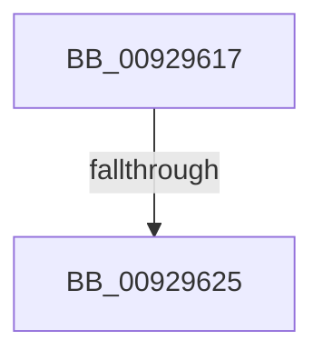

# sub_00929617

- RVA: `0x00929617`–`0x00929656` (길이 `63` bytes)
- VA: `0x0000000140929617`
- 실행 섹션: `PAGE`
- PDB 이름 있음: `아니요`; PDB Function 태그: `아니요`
- unwind 정보 RVA: `0x0008D848`
- 디코드: `17`개 명령, `63/63` bytes 표시
- 미해석 바이트: `0` (있으면 어셈블리에 `.byte`로 보존)

> 이 문서는 커널 이미지의 기계어와 PDB 기호를 분석해 생성했습니다. 4번과 5번은 함수 원형과 자료형을 바이너리 사용 방식에서 추정한 C 해석이며 원본 소스 복구 결과는 아닙니다.

## 1. Dependencies

- 직접 호출 지점: **0**; 고유 호출 대상: **0**
- 직접 호출자로 확인된 함수: **0**
- RIP 상대 이미지 참조: **1**

### Outgoing calls
- 직접 디코드된 call 명령이 없습니다.

### Direct callers
- 이 함수 시작 RVA로 연결되는 직접 call은 확인되지 않았습니다. 간접 호출은 완전히 역산할 수 없습니다.

### Static image references
- `0x00929629` → RVA `0x00E0CDE0` (`.data`; read)

## 2. Other-region calls and transfers

- 다른 실행 섹션으로 향하는 call: **0**
- call이 아닌 외부 분기/꼬리 이동: **1**
  - `0x0092961F` → [sub_0092949C + 0x98](Unknown_function_0092949C.md) (`tail-transfer`)

## 3. Assembly (complete function range)

```asm
00929617  48 8B 74 24 78                  mov rsi, qword ptr [rsp + 0x78]
0092961C  83 FB 43                        cmp ebx, 0x43
0092961F  0F 83 0F FF FF FF               jae 0x140929534
00929625  4C 6B ED 68                     imul r13, rbp, 0x68
00929629  48 8D 05 B0 37 4E 00            lea rax, [rip + 0x4e37b0]
00929630  4C 03 E8                        add r13, rax
00929633  4C 8B 74 24 28                  mov r14, qword ptr [rsp + 0x28]
00929638  49 8B C5                        mov rax, r13
0092963B  48 8B 7C 24 30                  mov rdi, qword ptr [rsp + 0x30]
00929640  48 8B 6C 24 38                  mov rbp, qword ptr [rsp + 0x38]
00929645  48 8B 5C 24 40                  mov rbx, qword ptr [rsp + 0x40]
0092964A  48 83 C4 48                     add rsp, 0x48
0092964E  41 5F                           pop r15
00929650  41 5D                           pop r13
00929652  41 5C                           pop r12
00929654  5E                              pop rsi
00929655  C3                              ret
```

## 4. C-style interpretation (structured pseudocode)

```c
__int64 __fastcall sub_00929617(__int64 a1, __int64 a2, __int64 a3, __int64 a4, __int64 a5, __int64 a6, __int64 a7, __int64 a8, __int64 a9, __int64 a10, __int64 a11, __int64 a12, __int64 a13, __int64 a14, __int64 a15)
{
    __int64 v_r13;
    __int64 v_rsp;

    v_r13 = (v_r13) * (v_rbp);
    v_r13 = (v_r13) + (v_rip + 5126064);
    v_rsp = (v_rsp) + (72);
    return v_r13;
}
```

## 5. (Beta) C Style

```c
int64_t sub_00929617(int64_t Arg1, int64_t Arg2, int64_t Arg3, int64_t Arg4, int64_t Arg5, int64_t Arg6, int64_t Arg7, int64_t Arg8, uint64_t Arg9, uint64_t Arg10, uint64_t Arg11, uint64_t Arg12, uint64_t Arg13, uint64_t Arg14, int64_t Arg15)
{
    int64_t local_r13;
    int64_t local_rsp;

    local_r13 = (local_r13) * (local_rbp);
    local_r13 = (local_r13) + (v_rip + 5126064);
    local_rsp = (local_rsp) + (72);
    return local_r13;
}
```

## 6. Execution-region graph

[열기: 2D/3D 그래프와 함수 탐색 컨트롤 패널](../../../control-panel.html?section=page&rva=0x00929617&view=graph)

- 2D 그래프는 위에서 아래로 흐르고, 3D 그래프는 빈 공간을 드래그해 회전합니다. Shift+드래그는 이동, 휠은 확대·축소, 함수 노드 선택은 대상 보고서 이동입니다.

### Static fallback


