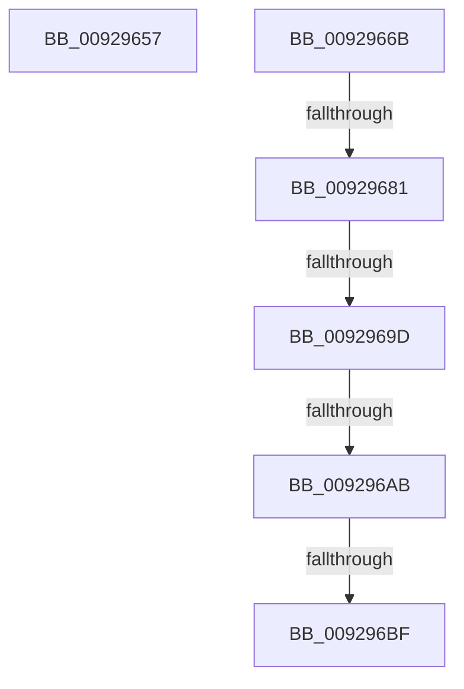

# sub_00929657

- RVA: `0x00929657`–`0x009296CB` (길이 `116` bytes)
- VA: `0x0000000140929657`
- 실행 섹션: `PAGE`
- PDB 이름 있음: `아니요`; PDB Function 태그: `아니요`
- unwind 정보 RVA: `0x0008D870`
- 디코드: `26`개 명령, `116/116` bytes 표시
- 미해석 바이트: `0` (있으면 어셈블리에 `.byte`로 보존)

> 이 문서는 커널 이미지의 기계어와 PDB 기호를 분석해 생성했습니다. 4번과 5번은 함수 원형과 자료형을 바이너리 사용 방식에서 추정한 C 해석이며 원본 소스 복구 결과는 아닙니다.

## 1. Dependencies

- 직접 호출 지점: **2**; 고유 호출 대상: **2**
- 직접 호출자로 확인된 함수: **0**
- RIP 상대 이미지 참조: **0**

### Outgoing calls
- `0x00929671` → [RtlSubAuthorityCountSid](../../text/46/RtlSubAuthorityCountSid_function_00468F10.md) (function, `0x00468F10`)
- `0x00929687` → [RtlSubAuthoritySid](../../text/45/RtlSubAuthoritySid_function_00456D10.md) (function, `0x00456D10`)

### Direct callers
- 이 함수 시작 RVA로 연결되는 직접 call은 확인되지 않았습니다. 간접 호출은 완전히 역산할 수 없습니다.

### Static image references
- 디코드된 RIP-relative 메모리 참조가 없습니다.

## 2. Other-region calls and transfers

- 다른 실행 섹션으로 향하는 call: **2**
  - `0x00929671` → [RtlSubAuthorityCountSid](../../text/46/RtlSubAuthorityCountSid_function_00468F10.md) (`PAGE` → `.text`)
  - `0x00929687` → [RtlSubAuthoritySid](../../text/45/RtlSubAuthoritySid_function_00456D10.md) (`PAGE` → `.text`)
- call이 아닌 외부 분기/꼬리 이동: **6**
  - `0x00929666` → [sub_009293FF + 0x9A](Unknown_function_009293FF.md) (`tail-transfer`)
  - `0x0092967B` → [sub_009293FF + 0x9A](Unknown_function_009293FF.md) (`tail-transfer`)
  - `0x00929697` → [sub_009293FF + 0x9A](Unknown_function_009293FF.md) (`tail-transfer`)
  - `0x009296A5` → [sub_009293FF + 0x9A](Unknown_function_009293FF.md) (`tail-transfer`)
  - `0x009296B9` → [sub_009293FF + 0x9A](Unknown_function_009293FF.md) (`tail-transfer`)
  - `0x009296C6` → [sub_009293FF + 0x9A](Unknown_function_009293FF.md) (`tail-transfer`)

## 3. Assembly (complete function range)

```asm
00929657  B9 01 00 00 00                  mov ecx, 1
0092965C  44 8B F1                        mov r14d, ecx
0092965F  89 8C 24 88 00 00 00            mov dword ptr [rsp + 0x88], ecx
00929666  E9 2E FE FF FF                  jmp 0x140929499
0092966B  48 8B CE                        mov rcx, rsi
0092966E  41 B7 01                        mov r15b, 1
00929671  E8 9A F8 B3 FF                  call 0x140468f10
00929676  0F B6 08                        movzx ecx, byte ptr [rax]
00929679  84 C9                           test cl, cl
0092967B  0F 84 18 FE FF FF               je 0x140929499
00929681  8D 51 FF                        lea edx, [rcx - 1]
00929684  48 8B CE                        mov rcx, rsi
00929687  E8 84 D6 B2 FF                  call 0x140456d10
0092968C  8B 10                           mov edx, dword ptr [rax]
0092968E  8D 82 0E FE FF FF               lea eax, [rdx - 0x1f2]
00929694  83 F8 1D                        cmp eax, 0x1d
00929697  0F 87 FC FD FF FF               ja 0x140929499
0092969D  B9 01 00 30 20                  mov ecx, 0x20300001
009296A2  0F A3 C1                        bt ecx, eax
009296A5  0F 83 EE FD FF FF               jae 0x140929499
009296AB  B9 01 00 00 00                  mov ecx, 1
009296B0  44 8B F1                        mov r14d, ecx
009296B3  81 FA 06 02 00 00               cmp edx, 0x206
009296B9  0F 85 DA FD FF FF               jne 0x140929499
009296BF  89 8C 24 88 00 00 00            mov dword ptr [rsp + 0x88], ecx
009296C6  E9 CE FD FF FF                  jmp 0x140929499
```

## 4. C-style interpretation (structured pseudocode)

```c
__int64 __fastcall sub_00929657(void)
{
    unsigned int v_stack_p88;

    v_stack_p88 = 1;
}
```

## 5. (Beta) C Style

```c
void sub_00929657(void)
{
    uint32_t v_stack_p88;

    v_stack_p88 = 1;
}
```

## 6. Execution-region graph

[열기: 2D/3D 그래프와 함수 탐색 컨트롤 패널](../../../control-panel.html?section=page&rva=0x00929657&view=graph)

- 2D 그래프는 위에서 아래로 흐르고, 3D 그래프는 빈 공간을 드래그해 회전합니다. Shift+드래그는 이동, 휠은 확대·축소, 함수 노드 선택은 대상 보고서 이동입니다.

### Static fallback


