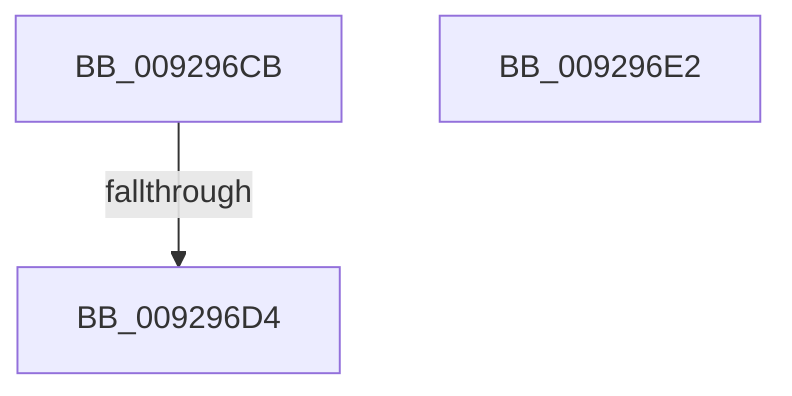

# sub_009296CB

- RVA: `0x009296CB`–`0x009296E3` (길이 `24` bytes)
- VA: `0x00000001409296CB`
- 실행 섹션: `PAGE`
- PDB 이름 있음: `아니요`; PDB Function 태그: `아니요`
- unwind 정보 RVA: `0x0008D88C`
- 디코드: `10`개 명령, `24/24` bytes 표시
- 미해석 바이트: `0` (있으면 어셈블리에 `.byte`로 보존)

> 이 문서는 커널 이미지의 기계어와 PDB 기호를 분석해 생성했습니다. 4번과 5번은 함수 원형과 자료형을 바이너리 사용 방식에서 추정한 C 해석이며 원본 소스 복구 결과는 아닙니다.

## 1. Dependencies

- 직접 호출 지점: **0**; 고유 호출 대상: **0**
- 직접 호출자로 확인된 함수: **0**
- RIP 상대 이미지 참조: **0**

### Outgoing calls
- 직접 디코드된 call 명령이 없습니다.

### Direct callers
- 이 함수 시작 RVA로 연결되는 직접 call은 확인되지 않았습니다. 간접 호출은 완전히 역산할 수 없습니다.

### Static image references
- 디코드된 RIP-relative 메모리 참조가 없습니다.

## 2. Other-region calls and transfers

- 다른 실행 섹션으로 향하는 call: **0**
- call이 아닌 외부 분기/꼬리 이동: **1**
  - `0x009296CE` → [LookupSidInTable + 0x37](LookupSidInTable_function_009293C0.md) (`tail-transfer`)

## 3. Assembly (complete function range)

```asm
009296CB  48 85 F6                        test rsi, rsi
009296CE  0F 85 23 FD FF FF               jne 0x1409293f7
009296D4  33 C0                           xor eax, eax
009296D6  48 83 C4 48                     add rsp, 0x48
009296DA  41 5F                           pop r15
009296DC  41 5D                           pop r13
009296DE  41 5C                           pop r12
009296E0  5E                              pop rsi
009296E1  C3                              ret
009296E2  CC                              int3
```

## 4. C-style interpretation (structured pseudocode)

```c
__int64 __fastcall sub_009296CB(void)
{
    __int64 result;
    __int64 v_rsp;

    result = 0;
    v_rsp = (v_rsp) + (72);
    return result;
}
```

## 5. (Beta) C Style

```c
void sub_009296CB(void)
{
    int64_t result;
    int64_t local_rsp;

    result = 0;
    local_rsp = (local_rsp) + (72);
    return result;
}
```

## 6. Execution-region graph

[열기: 2D/3D 그래프와 함수 탐색 컨트롤 패널](../../../control-panel.html?section=page&rva=0x009296CB&view=graph)

- 2D 그래프는 위에서 아래로 흐르고, 3D 그래프는 빈 공간을 드래그해 회전합니다. Shift+드래그는 이동, 휠은 확대·축소, 함수 노드 선택은 대상 보고서 이동입니다.

### Static fallback


