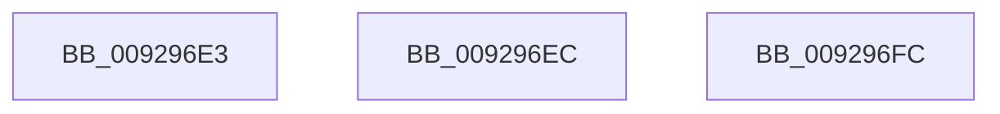

# sub_009296E3

- RVA: `0x009296E3`–`0x00929705` (길이 `34` bytes)
- VA: `0x00000001409296E3`
- 실행 섹션: `PAGE`
- PDB 이름 있음: `아니요`; PDB Function 태그: `아니요`
- unwind 정보 RVA: `0x0008D8A0`
- 디코드: `7`개 명령, `34/34` bytes 표시
- 미해석 바이트: `0` (있으면 어셈블리에 `.byte`로 보존)

> 이 문서는 커널 이미지의 기계어와 PDB 기호를 분석해 생성했습니다. 4번과 5번은 함수 원형과 자료형을 바이너리 사용 방식에서 추정한 C 해석이며 원본 소스 복구 결과는 아닙니다.

## 1. Dependencies

- 직접 호출 지점: **0**; 고유 호출 대상: **0**
- 직접 호출자로 확인된 함수: **0**
- RIP 상대 이미지 참조: **0**

### Outgoing calls
- 직접 디코드된 call 명령이 없습니다.

### Direct callers
- 이 함수 시작 RVA로 연결되는 직접 call은 확인되지 않았습니다. 간접 호출은 완전히 역산할 수 없습니다.

### Static image references
- 디코드된 RIP-relative 메모리 참조가 없습니다.

## 2. Other-region calls and transfers

- 다른 실행 섹션으로 향하는 call: **0**
- call이 아닌 외부 분기/꼬리 이동: **3**
  - `0x009296E7` → [sub_00929617 + 0x12](Unknown_function_00929617.md) (`tail-transfer`)
  - `0x009296F7` → [sub_00929617 + 0x1C](Unknown_function_00929617.md) (`tail-transfer`)
  - `0x00929700` → [sub_0092949C + 0x89](Unknown_function_0092949C.md) (`tail-transfer`)

## 3. Assembly (complete function range)

```asm
009296E3  4C 6B E8 68                     imul r13, rax, 0x68
009296E7  E9 3D FF FF FF                  jmp 0x140929629
009296EC  48 8B 84 24 A0 00 00 00         mov rax, qword ptr [rsp + 0xa0]
009296F4  48 89 30                        mov qword ptr [rax], rsi
009296F7  E9 37 FF FF FF                  jmp 0x140929633
009296FC  89 5C 24 70                     mov dword ptr [rsp + 0x70], ebx
00929700  E9 20 FE FF FF                  jmp 0x140929525
```

## 4. C-style interpretation (structured pseudocode)

```c
__int64 __fastcall sub_009296E3(void)
{
    __int64 v_r13;
    unsigned int v_stack_p70;
    unsigned __int64 v_stack_pA0;

    v_r13 = (v_r13) * (result);
}
```

## 5. (Beta) C Style

```c
void sub_009296E3(void)
{
    int64_t local_r13;
    uint32_t v_stack_p70;
    uint64_t v_stack_pA0;

    local_r13 = (local_r13) * (result);
}
```

## 6. Execution-region graph

[열기: 2D/3D 그래프와 함수 탐색 컨트롤 패널](../../../control-panel.html?section=page&rva=0x009296E3&view=graph)

- 2D 그래프는 위에서 아래로 흐르고, 3D 그래프는 빈 공간을 드래그해 회전합니다. Shift+드래그는 이동, 휠은 확대·축소, 함수 노드 선택은 대상 보고서 이동입니다.

### Static fallback


