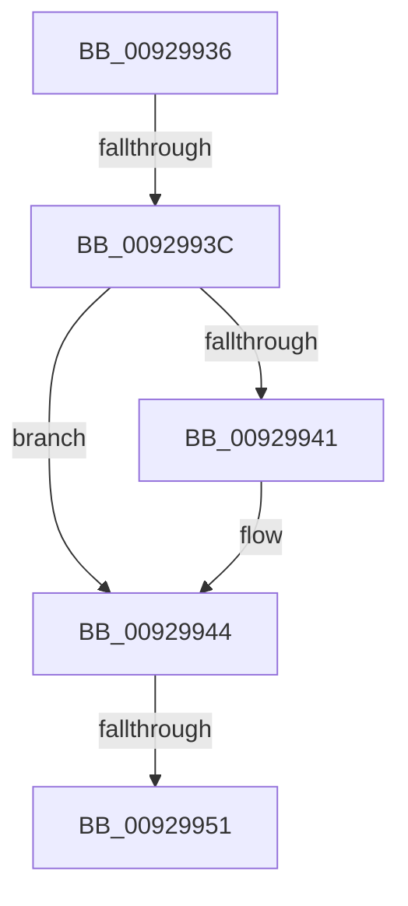

# sub_00929936

- RVA: `0x00929936`–`0x0092995A` (길이 `36` bytes)
- VA: `0x0000000140929936`
- 실행 섹션: `PAGE`
- PDB 이름 있음: `아니요`; PDB Function 태그: `아니요`
- unwind 정보 RVA: `0x0008D918`
- 디코드: `10`개 명령, `36/36` bytes 표시
- 미해석 바이트: `0` (있으면 어셈블리에 `.byte`로 보존)

> 이 문서는 커널 이미지의 기계어와 PDB 기호를 분석해 생성했습니다. 4번과 5번은 함수 원형과 자료형을 바이너리 사용 방식에서 추정한 C 해석이며 원본 소스 복구 결과는 아닙니다.

## 1. Dependencies

- 직접 호출 지점: **1**; 고유 호출 대상: **1**
- 직접 호출자로 확인된 함수: **0**
- RIP 상대 이미지 참조: **0**

### Outgoing calls
- `0x00929944` → [RtlValidAcl](RtlValidAcl_function_0092A7A0.md) (function, `0x0092A7A0`)

### Direct callers
- 이 함수 시작 RVA로 연결되는 직접 call은 확인되지 않았습니다. 간접 호출은 완전히 역산할 수 없습니다.

### Static image references
- 디코드된 RIP-relative 메모리 참조가 없습니다.

## 2. Other-region calls and transfers

- 다른 실행 섹션으로 향하는 call: **0**
- call이 아닌 외부 분기/꼬리 이동: **2**
  - `0x0092993A` → [sub_009298F8 + 0xD](Unknown_function_009298F8.md) (`tail-transfer`)
  - `0x0092994B` → [sub_00929A02](Unknown_function_00929A02.md) (`tail-transfer`)

## 3. Assembly (complete function range)

```asm
00929936  40 80 FD 04                     cmp bpl, 4
0092993A  77 C9                           ja 0x140929905
0092993C  40 3A EA                        cmp bpl, dl
0092993F  77 03                           ja 0x140929944
00929941  0F B6 EA                        movzx ebp, dl
00929944  E8 57 0E 00 00                  call 0x14092a7a0
00929949  84 C0                           test al, al
0092994B  0F 84 B1 00 00 00               je 0x140929a02
00929951  44 0F B7 47 04                  movzx r8d, word ptr [rdi + 4]
00929956  48 8D 4F 08                     lea rcx, [rdi + 8]
```

## 4. C-style interpretation (structured pseudocode)

```c
__int64 __fastcall sub_00929936(__int64 a1, unsigned __int8 a2)
{
    __int64 result;
    __int64 v_rbp;

    if (((unsigned __int8)(v_rbp)) <= a2) {
        v_rbp = a2;
    }
    result = RtlValidAcl(a1, a2, a3, a4);
    return result;
}
```

## 5. (Beta) C Style

```c
int64_t sub_00929936(int64_t Arg1, uint8_t Arg2)
{
    int64_t result;
    int64_t local_rbp;

    if (((uint8_t)(local_rbp)) <= Arg2) {
        local_rbp = Arg2;
    }
    result = RtlValidAcl(Arg1, Arg2, a3, a4);
    return result;
}
```

## 6. Execution-region graph

[열기: 2D/3D 그래프와 함수 탐색 컨트롤 패널](../../../control-panel.html?section=page&rva=0x00929936&view=graph)

- 2D 그래프는 위에서 아래로 흐르고, 3D 그래프는 빈 공간을 드래그해 회전합니다. Shift+드래그는 이동, 휠은 확대·축소, 함수 노드 선택은 대상 보고서 이동입니다.

### Static fallback


