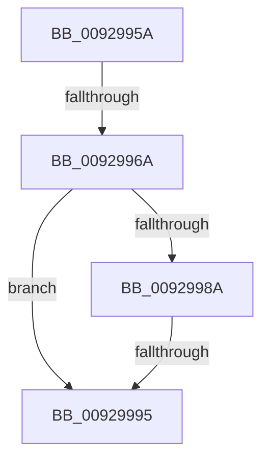

# sub_0092995A

- RVA: `0x0092995A`–`0x009299A4` (길이 `74` bytes)
- VA: `0x000000014092995A`
- 실행 섹션: `PAGE`
- PDB 이름 있음: `아니요`; PDB Function 태그: `아니요`
- unwind 정보 RVA: `0x0008D92C`
- 디코드: `21`개 명령, `74/74` bytes 표시
- 미해석 바이트: `0` (있으면 어셈블리에 `.byte`로 보존)

> 이 문서는 커널 이미지의 기계어와 PDB 기호를 분석해 생성했습니다. 4번과 5번은 함수 원형과 자료형을 바이너리 사용 방식에서 추정한 C 해석이며 원본 소스 복구 결과는 아닙니다.

## 1. Dependencies

- 직접 호출 지점: **0**; 고유 호출 대상: **0**
- 직접 호출자로 확인된 함수: **0**
- RIP 상대 이미지 참조: **0**

### Outgoing calls
- 직접 디코드된 call 명령이 없습니다.

### Direct callers
- 이 함수 시작 RVA로 연결되는 직접 call은 확인되지 않았습니다. 간접 호출은 완전히 역산할 수 없습니다.

### Static image references
- 디코드된 RIP-relative 메모리 참조가 없습니다.

## 2. Other-region calls and transfers

- 다른 실행 섹션으로 향하는 call: **0**
- call이 아닌 외부 분기/꼬리 이동: **3**
  - `0x00929968` → [sub_009299A4](Unknown_function_009299A4.md) (`tail-transfer`)
  - `0x00929993` → [sub_009299A4 + 0x17](Unknown_function_009299A4.md) (`tail-transfer`)
  - `0x0092999F` → [sub_009298F8 + 0x12](Unknown_function_009298F8.md) (`tail-transfer`)

## 3. Assembly (complete function range)

```asm
0092995A  4C 89 74 24 38                  mov qword ptr [rsp + 0x38], r14
0092995F  45 33 F6                        xor r14d, r14d
00929962  41 8B D6                        mov edx, r14d
00929965  41 3B D0                        cmp edx, r8d
00929968  72 3A                           jb 0x1409299a4
0092996A  44 0F B7 47 02                  movzx r8d, word ptr [rdi + 2]
0092996F  0F B6 53 01                     movzx edx, byte ptr [rbx + 1]
00929973  4C 03 C7                        add r8, rdi
00929976  49 3B C8                        cmp rcx, r8
00929979  49 0F 47 CE                     cmova rcx, r14
0092997D  66 83 C2 04                     add dx, 4
00929981  66 C1 E2 02                     shl dx, 2
00929985  48 85 C9                        test rcx, rcx
00929988  74 0B                           je 0x140929995
0092998A  0F B7 C2                        movzx eax, dx
0092998D  48 03 C1                        add rax, rcx
00929990  49 3B C0                        cmp rax, r8
00929993  76 26                           jbe 0x1409299bb
00929995  4C 8B 74 24 38                  mov r14, qword ptr [rsp + 0x38]
0092999A  B8 99 00 00 C0                  mov eax, 0xc0000099
0092999F  E9 66 FF FF FF                  jmp 0x14092990a
```

## 4. C-style interpretation (structured pseudocode)

```c
__int64 __fastcall sub_0092995A(__int64 a1, __int64 a2, int a3, __int64 a4, __int64 a5, __int64 a6, __int64 a7)
{
    __int64 result;
    __int64 v_r14;
    unsigned __int64 v_stack_p38;

    v_stack_p38 = v_r14;
    v_r14 = 0;
    a3 = (*(unsigned __int16 *)(v_rdi + 2)) + (v_rdi);
    if (a1 > a3) { a1 = 0; }
    a2 = (unsigned __int16)((*(unsigned __int8 *)(v_rbx + 1)) + (4));
    a2 = (unsigned __int16)((a2) << (2));
    if (a1 == 0) goto loc_00929995;
    result = ((unsigned __int16)(a2)) + (a1);
loc_00929995:
}
```

## 5. (Beta) C Style

```c
int64_t sub_0092995A(int64_t Arg1, int64_t Arg2, int32_t Arg3, int64_t Arg4, uint64_t Arg5, uint64_t Arg6, int64_t Arg7)
{
    int64_t result;
    int64_t local_r14;
    uint64_t v_stack_p38;

    v_stack_p38 = local_r14;
    local_r14 = 0;
    Arg3 = (*(uint16_t *)(local_rdi + 0x2)) + (local_rdi);
    if (Arg1 > Arg3) { Arg1 = 0; }
    Arg2 = (uint16_t)((*(uint8_t *)(local_rbx + 0x1)) + (4));
    Arg2 = (uint16_t)((Arg2) << (2));
    if (Arg1 == 0) goto loc_00929995;
    result = ((uint16_t)(Arg2)) + (Arg1);
loc_00929995:
}
```

## 6. Execution-region graph

[열기: 2D/3D 그래프와 함수 탐색 컨트롤 패널](../../../control-panel.html?section=page&rva=0x0092995A&view=graph)

- 2D 그래프는 위에서 아래로 흐르고, 3D 그래프는 빈 공간을 드래그해 회전합니다. Shift+드래그는 이동, 휠은 확대·축소, 함수 노드 선택은 대상 보고서 이동입니다.

### Static fallback


