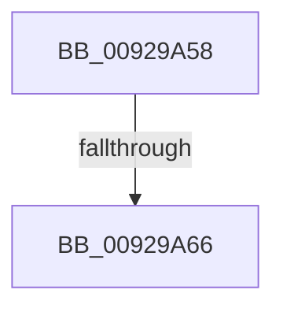

# sub_00929A58

- RVA: `0x00929A58`–`0x00929A7D` (길이 `37` bytes)
- VA: `0x0000000140929A58`
- 실행 섹션: `PAGE`
- PDB 이름 있음: `아니요`; PDB Function 태그: `아니요`
- unwind 정보 RVA: `0x0008D988`
- 디코드: `12`개 명령, `37/37` bytes 표시
- 미해석 바이트: `0` (있으면 어셈블리에 `.byte`로 보존)

> 이 문서는 커널 이미지의 기계어와 PDB 기호를 분석해 생성했습니다. 4번과 5번은 함수 원형과 자료형을 바이너리 사용 방식에서 추정한 C 해석이며 원본 소스 복구 결과는 아닙니다.

## 1. Dependencies

- 직접 호출 지점: **0**; 고유 호출 대상: **0**
- 직접 호출자로 확인된 함수: **0**
- RIP 상대 이미지 참조: **0**

### Outgoing calls
- 직접 디코드된 call 명령이 없습니다.

### Direct callers
- 이 함수 시작 RVA로 연결되는 직접 call은 확인되지 않았습니다. 간접 호출은 완전히 역산할 수 없습니다.

### Static image references
- 디코드된 RIP-relative 메모리 참조가 없습니다.

## 2. Other-region calls and transfers

- 다른 실행 섹션으로 향하는 call: **0**
- call이 아닌 외부 분기/꼬리 이동: **1**
  - `0x00929A64` → [sub_00929A91](Unknown_function_00929A91.md) (`tail-transfer`)

## 3. Assembly (complete function range)

```asm
00929A58  4C 89 74 24 40                  mov qword ptr [rsp + 0x40], r14
00929A5D  44 0F B6 31                     movzx r14d, byte ptr [rcx]
00929A61  83 FA 04                        cmp edx, 4
00929A64  76 2B                           jbe 0x140929a91
00929A66  B8 59 00 00 C0                  mov eax, 0xc0000059
00929A6B  4C 8B 74 24 40                  mov r14, qword ptr [rsp + 0x40]
00929A70  48 8B 5C 24 50                  mov rbx, qword ptr [rsp + 0x50]
00929A75  48 83 C4 20                     add rsp, 0x20
00929A79  5F                              pop rdi
00929A7A  5E                              pop rsi
00929A7B  5D                              pop rbp
00929A7C  C3                              ret
```

## 4. C-style interpretation (structured pseudocode)

```c
__int64 __fastcall sub_00929A58(__int64 a1, int a2, __int64 a3, __int64 a4, __int64 a5, __int64 a6, __int64 a7, __int64 a8, __int64 a9, __int64 a10)
{
    __int64 v_rsp;
    unsigned __int64 v_stack_p40;

    v_stack_p40 = v_r14;
    v_rsp = (v_rsp) + (32);
    return (unsigned int)(0xC0000059ULL);
}
```

## 5. (Beta) C Style

```c
int64_t sub_00929A58(void *Arg1, int32_t Arg2, int64_t Arg3, int64_t Arg4, uint64_t Arg5, uint64_t Arg6, uint64_t Arg7, int64_t Arg8, uint64_t Arg9, int64_t Arg10)
{
    uint8_t *arg1 = (uint8_t *)Arg1;

    int64_t local_rsp;
    uint64_t v_stack_p40;

    v_stack_p40 = local_r14;
    local_rsp = (local_rsp) + (32);
    return (uint32_t)(0xC0000059ULL);
}
```

### 관측된 메모리 오프셋

구조체 형식이 확인되지 않은 접근은 인자 기준의 오프셋으로만 기록했습니다.

| 기준 인자 | 오프셋 표현 | 폭 (bit) | 접근 |
|---|---:|---:|---|
| `Arg1` | `+ 0x0` | `8` | `R` |

## 6. Execution-region graph

[열기: 2D/3D 그래프와 함수 탐색 컨트롤 패널](../../../control-panel.html?section=page&rva=0x00929A58&view=graph)

- 2D 그래프는 위에서 아래로 흐르고, 3D 그래프는 빈 공간을 드래그해 회전합니다. Shift+드래그는 이동, 휠은 확대·축소, 함수 노드 선택은 대상 보고서 이동입니다.

### Static fallback


