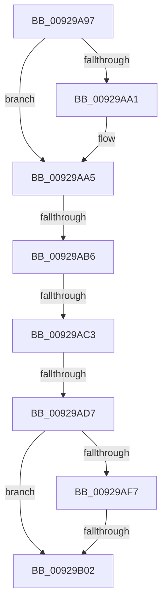

# sub_00929A97

- RVA: `0x00929A97`–`0x00929B11` (길이 `122` bytes)
- VA: `0x0000000140929A97`
- 실행 섹션: `PAGE`
- PDB 이름 있음: `아니요`; PDB Function 태그: `아니요`
- unwind 정보 RVA: `0x0008D9C8`
- 디코드: `33`개 명령, `122/122` bytes 표시
- 미해석 바이트: `0` (있으면 어셈블리에 `.byte`로 보존)

> 이 문서는 커널 이미지의 기계어와 PDB 기호를 분석해 생성했습니다. 4번과 5번은 함수 원형과 자료형을 바이너리 사용 방식에서 추정한 C 해석이며 원본 소스 복구 결과는 아닙니다.

## 1. Dependencies

- 직접 호출 지점: **1**; 고유 호출 대상: **1**
- 직접 호출자로 확인된 함수: **0**
- RIP 상대 이미지 참조: **0**

### Outgoing calls
- `0x00929AB6` → [RtlValidAcl](RtlValidAcl_function_0092A7A0.md) (function, `0x0092A7A0`)

### Direct callers
- 이 함수 시작 RVA로 연결되는 직접 call은 확인되지 않았습니다. 간접 호출은 완전히 역산할 수 없습니다.

### Static image references
- 디코드된 RIP-relative 메모리 참조가 없습니다.

## 2. Other-region calls and transfers

- 다른 실행 섹션으로 향하는 call: **0**
- call이 아닌 외부 분기/꼬리 이동: **5**
  - `0x00929AB0` → [sub_00929B62](Unknown_function_00929B62.md) (`tail-transfer`)
  - `0x00929ABD` → [sub_00929B62 + 0x1A](Unknown_function_00929B62.md) (`tail-transfer`)
  - `0x00929AD5` → [sub_00929B11](Unknown_function_00929B11.md) (`tail-transfer`)
  - `0x00929B00` → [sub_00929B11 + 0x17](Unknown_function_00929B11.md) (`tail-transfer`)
  - `0x00929B0C` → [sub_00929A58 + 0x13](Unknown_function_00929A58.md) (`tail-transfer`)

## 3. Assembly (complete function range)

```asm
00929A97  4C 89 7C 24 48                  mov qword ptr [rsp + 0x48], r15
00929A9C  44 3A F2                        cmp r14b, dl
00929A9F  77 04                           ja 0x140929aa5
00929AA1  44 0F B6 F2                     movzx r14d, dl
00929AA5  44 0F B6 7C 24 68               movzx r15d, byte ptr [rsp + 0x68]
00929AAB  8B C6                           mov eax, esi
00929AAD  83 E0 E0                        and eax, 0xffffffe0
00929AB0  0F 85 AC 00 00 00               jne 0x140929b62
00929AB6  E8 E5 0C 00 00                  call 0x14092a7a0
00929ABB  84 C0                           test al, al
00929ABD  0F 84 B9 00 00 00               je 0x140929b7c
00929AC3  44 0F B7 47 04                  movzx r8d, word ptr [rdi + 4]
00929AC8  48 8D 4F 08                     lea rcx, [rdi + 8]
00929ACC  45 33 C9                        xor r9d, r9d
00929ACF  41 8B D1                        mov edx, r9d
00929AD2  41 3B D0                        cmp edx, r8d
00929AD5  72 3A                           jb 0x140929b11
00929AD7  44 0F B7 47 02                  movzx r8d, word ptr [rdi + 2]
00929ADC  0F B6 53 01                     movzx edx, byte ptr [rbx + 1]
00929AE0  4C 03 C7                        add r8, rdi
00929AE3  49 3B C8                        cmp rcx, r8
00929AE6  49 0F 47 C9                     cmova rcx, r9
00929AEA  66 83 C2 04                     add dx, 4
00929AEE  66 C1 E2 02                     shl dx, 2
00929AF2  48 85 C9                        test rcx, rcx
00929AF5  74 0B                           je 0x140929b02
00929AF7  0F B7 C2                        movzx eax, dx
00929AFA  48 03 C1                        add rax, rcx
00929AFD  49 3B C0                        cmp rax, r8
00929B00  76 26                           jbe 0x140929b28
00929B02  B8 99 00 00 C0                  mov eax, 0xc0000099
00929B07  4C 8B 7C 24 48                  mov r15, qword ptr [rsp + 0x48]
00929B0C  E9 5A FF FF FF                  jmp 0x140929a6b
```

## 4. C-style interpretation (structured pseudocode)

```c
__int64 __fastcall sub_00929A97(__int64 a1, unsigned __int8 a2, __int64 a3, int a4, __int64 a5, __int64 a6, __int64 a7, __int64 a8, __int64 a9, __int64 a10, __int64 a11, __int64 a12, unsigned __int8 a13)
{
    __int64 result;
    __int64 v_r14;
    unsigned __int64 v_stack_p48;

    v_stack_p48 = v_r15;
    if (((unsigned __int8)(v_r14)) <= a2) {
        v_r14 = a2;
    }
    result = (unsigned int)(((unsigned int)((unsigned int)(v_rsi))) & (0xFFFFFFE0ULL));
    result = RtlValidAcl(a1, a2, a3, a4);
    a4 = 0;
    a3 = (*(unsigned __int16 *)(v_rdi + 2)) + (v_rdi);
    a1 = v_rdi + 8;
    if ((v_rdi + 8) > a3) { a1 = 0; }
    a2 = (unsigned __int16)((*(unsigned __int8 *)(v_rbx + 1)) + (4));
    a2 = (unsigned __int16)((a2) << (2));
    if (a1 == 0) goto loc_00929B02;
    result = (a2) + (a1);
loc_00929B02:
}
```

## 5. (Beta) C Style

```c
int64_t sub_00929A97(int64_t Arg1, uint8_t Arg2, int64_t Arg3, int32_t Arg4, uint64_t Arg5, uint64_t Arg6, uint64_t Arg7, uint64_t Arg8, int64_t Arg9, uint64_t Arg10, uint64_t Arg11, uint64_t Arg12, uint8_t Arg13)
{
    int64_t result;
    int64_t local_r14;
    uint64_t v_stack_p48;

    v_stack_p48 = local_r15;
    if (((uint8_t)(local_r14)) <= Arg2) {
        local_r14 = Arg2;
    }
    result = (uint32_t)(((uint32_t)((uint32_t)(local_rsi))) & (0xFFFFFFE0ULL));
    result = RtlValidAcl(Arg1, Arg2, Arg3, Arg4);
    Arg4 = 0;
    Arg3 = (*(uint16_t *)(local_rdi + 0x2)) + (local_rdi);
    Arg1 = local_rdi + 8;
    if ((local_rdi + 8) > Arg3) { Arg1 = 0; }
    Arg2 = (uint16_t)((*(uint8_t *)(local_rbx + 0x1)) + (4));
    Arg2 = (uint16_t)((Arg2) << (2));
    if (Arg1 == 0) goto loc_00929B02;
    result = (Arg2) + (Arg1);
loc_00929B02:
}
```

## 6. Execution-region graph

[열기: 2D/3D 그래프와 함수 탐색 컨트롤 패널](../../../control-panel.html?section=page&rva=0x00929A97&view=graph)

- 2D 그래프는 위에서 아래로 흐르고, 3D 그래프는 빈 공간을 드래그해 회전합니다. Shift+드래그는 이동, 휠은 확대·축소, 함수 노드 선택은 대상 보고서 이동입니다.

### Static fallback


