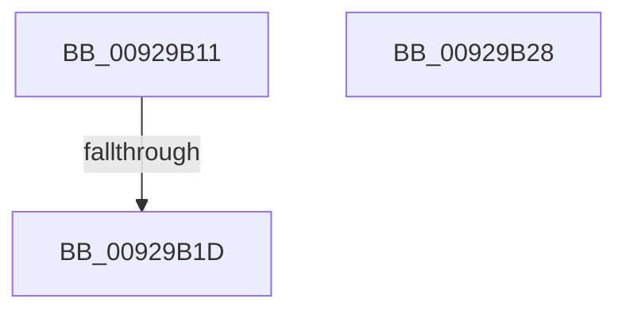

# sub_00929B11

- RVA: `0x00929B11`–`0x00929B62` (길이 `81` bytes)
- VA: `0x0000000140929B11`
- 실행 섹션: `PAGE`
- PDB 이름 있음: `아니요`; PDB Function 태그: `아니요`
- unwind 정보 RVA: `0x0008D9DC`
- 디코드: `22`개 명령, `81/81` bytes 표시
- 미해석 바이트: `0` (있으면 어셈블리에 `.byte`로 보존)

> 이 문서는 커널 이미지의 기계어와 PDB 기호를 분석해 생성했습니다. 4번과 5번은 함수 원형과 자료형을 바이너리 사용 방식에서 추정한 C 해석이며 원본 소스 복구 결과는 아닙니다.

## 1. Dependencies

- 직접 호출 지점: **1**; 고유 호출 대상: **1**
- 직접 호출자로 확인된 함수: **0**
- RIP 상대 이미지 참조: **0**

### Outgoing calls
- `0x00929B4A` → [memcpy](../../text/6C/memcpy_function_006C6840.md) (function, `0x006C6840`)

### Direct callers
- 이 함수 시작 RVA로 연결되는 직접 call은 확인되지 않았습니다. 간접 호출은 완전히 역산할 수 없습니다.

### Static image references
- 디코드된 RIP-relative 메모리 참조가 없습니다.

## 2. Other-region calls and transfers

- 다른 실행 섹션으로 향하는 call: **1**
  - `0x00929B4A` → [memcpy](../../text/6C/memcpy_function_006C6840.md) (`PAGE` → `.text`)
- call이 아닌 외부 분기/꼬리 이동: **3**
  - `0x00929B1B` → [sub_00929B62 + 0x1A](Unknown_function_00929B62.md) (`tail-transfer`)
  - `0x00929B26` → [sub_00929A97 + 0x3B](Unknown_function_00929A97.md) (`tail-transfer`)
  - `0x00929B5D` → [sub_00929A58 + 0x13](Unknown_function_00929A58.md) (`tail-transfer`)

## 3. Assembly (complete function range)

```asm
00929B11  0F B7 47 02                     movzx eax, word ptr [rdi + 2]
00929B15  48 03 C7                        add rax, rdi
00929B18  48 3B C8                        cmp rcx, rax
00929B1B  73 5F                           jae 0x140929b7c
00929B1D  0F B7 41 02                     movzx eax, word ptr [rcx + 2]
00929B21  FF C2                           inc edx
00929B23  48 03 C8                        add rcx, rax
00929B26  EB AA                           jmp 0x140929ad2
00929B28  66 89 51 02                     mov word ptr [rcx + 2], dx
00929B2C  48 8B D3                        mov rdx, rbx
00929B2F  40 88 71 01                     mov byte ptr [rcx + 1], sil
00929B33  44 88 39                        mov byte ptr [rcx], r15b
00929B36  89 69 04                        mov dword ptr [rcx + 4], ebp
00929B39  48 83 C1 08                     add rcx, 8
00929B3D  44 0F B6 43 01                  movzx r8d, byte ptr [rbx + 1]
00929B42  4E 8D 04 85 08 00 00 00         lea r8, [r8*4 + 8]
00929B4A  E8 F1 CC D9 FF                  call 0x1406c6840
00929B4F  66 FF 47 04                     inc word ptr [rdi + 4]
00929B53  4C 8B 7C 24 48                  mov r15, qword ptr [rsp + 0x48]
00929B58  33 C0                           xor eax, eax
00929B5A  44 88 37                        mov byte ptr [rdi], r14b
00929B5D  E9 09 FF FF FF                  jmp 0x140929a6b
```

## 4. C-style interpretation (structured pseudocode)

```c
__int64 __fastcall sub_00929B11(__int64 a1, int a2)
{
    __int64 result;
    unsigned __int64 v_stack_p48;

    result = (*(unsigned __int16 *)(v_rdi + 2)) + (v_rdi);
    a2 = (unsigned int)((a2) + 1);
    a1 = (a1) + (*(unsigned __int16 *)(a1 + 2));
}
```

## 5. (Beta) C Style

```c
int64_t sub_00929B11(int64_t Arg1, int32_t Arg2)
{
    int64_t result;
    uint64_t v_stack_p48;

    result = (*(uint16_t *)(local_rdi + 0x2)) + (local_rdi);
    Arg2 = (uint32_t)((Arg2) + 1);
    Arg1 = (Arg1) + (*(uint16_t *)(Arg1 + 0x2));
}
```

## 6. Execution-region graph

[열기: 2D/3D 그래프와 함수 탐색 컨트롤 패널](../../../control-panel.html?section=page&rva=0x00929B11&view=graph)

- 2D 그래프는 위에서 아래로 흐르고, 3D 그래프는 빈 공간을 드래그해 회전합니다. Shift+드래그는 이동, 휠은 확대·축소, 함수 노드 선택은 대상 보고서 이동입니다.

### Static fallback


