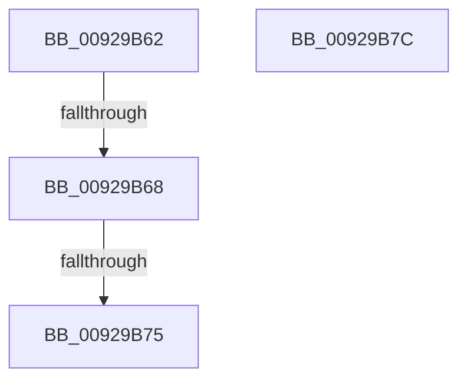

# sub_00929B62

- RVA: `0x00929B62`–`0x00929B8B` (길이 `41` bytes)
- VA: `0x0000000140929B62`
- 실행 섹션: `PAGE`
- PDB 이름 있음: `아니요`; PDB Function 태그: `아니요`
- unwind 정보 RVA: `0x0008D9F0`
- 디코드: `10`개 명령, `41/41` bytes 표시
- 미해석 바이트: `0` (있으면 어셈블리에 `.byte`로 보존)

> 이 문서는 커널 이미지의 기계어와 PDB 기호를 분석해 생성했습니다. 4번과 5번은 함수 원형과 자료형을 바이너리 사용 방식에서 추정한 C 해석이며 원본 소스 복구 결과는 아닙니다.

## 1. Dependencies

- 직접 호출 지점: **0**; 고유 호출 대상: **0**
- 직접 호출자로 확인된 함수: **0**
- RIP 상대 이미지 참조: **0**

### Outgoing calls
- 직접 디코드된 call 명령이 없습니다.

### Direct callers
- 이 함수 시작 RVA로 연결되는 직접 call은 확인되지 않았습니다. 간접 호출은 완전히 역산할 수 없습니다.

### Static image references
- 디코드된 RIP-relative 메모리 참조가 없습니다.

## 2. Other-region calls and transfers

- 다른 실행 섹션으로 향하는 call: **0**
- call이 아닌 외부 분기/꼬리 이동: **4**
  - `0x00929B66` → [sub_00929B8B](Unknown_function_00929B8B.md) (`tail-transfer`)
  - `0x00929B6F` → [sub_00929A97 + 0x1F](Unknown_function_00929A97.md) (`tail-transfer`)
  - `0x00929B7A` → [sub_00929A97 + 0x70](Unknown_function_00929A97.md) (`tail-transfer`)
  - `0x00929B86` → [sub_00929A58 + 0x13](Unknown_function_00929A58.md) (`tail-transfer`)

## 3. Assembly (complete function range)

```asm
00929B62  41 80 FF 02                     cmp r15b, 2
00929B66  75 23                           jne 0x140929b8b
00929B68  25 3F FF FF FF                  and eax, 0xffffff3f
00929B6D  85 C0                           test eax, eax
00929B6F  0F 84 41 FF FF FF               je 0x140929ab6
00929B75  B8 0D 00 00 C0                  mov eax, 0xc000000d
00929B7A  EB 8B                           jmp 0x140929b07
00929B7C  4C 8B 7C 24 48                  mov r15, qword ptr [rsp + 0x48]
00929B81  B8 77 00 00 C0                  mov eax, 0xc0000077
00929B86  E9 E0 FE FF FF                  jmp 0x140929a6b
```

## 4. C-style interpretation (structured pseudocode)

```c
__int64 __fastcall sub_00929B62(void)
{
    __int64 result;
    unsigned __int64 v_stack_p48;

    result = (unsigned int)((result) & (0xFFFFFF3FULL));
}
```

## 5. (Beta) C Style

```c
void sub_00929B62(void)
{
    int64_t result;
    uint64_t v_stack_p48;

    result = (uint32_t)((result) & (0xFFFFFF3FULL));
}
```

## 6. Execution-region graph

[열기: 2D/3D 그래프와 함수 탐색 컨트롤 패널](../../../control-panel.html?section=page&rva=0x00929B62&view=graph)

- 2D 그래프는 위에서 아래로 흐르고, 3D 그래프는 빈 공간을 드래그해 회전합니다. Shift+드래그는 이동, 휠은 확대·축소, 함수 노드 선택은 대상 보고서 이동입니다.

### Static fallback


