# sub_0092E0A2

- RVA: `0x0092E0A2`–`0x0092E24E` (길이 `428` bytes)
- VA: `0x000000014092E0A2`
- 실행 섹션: `PAGE`
- PDB 이름 있음: `아니요`; PDB Function 태그: `아니요`
- unwind 정보 RVA: `0x0008DC08`
- 디코드: `103`개 명령, `428/428` bytes 표시
- 미해석 바이트: `0` (있으면 어셈블리에 `.byte`로 보존)

> 이 문서는 커널 이미지의 기계어와 PDB 기호를 분석해 생성했습니다. 4번과 5번은 함수 원형과 자료형을 바이너리 사용 방식에서 추정한 C 해석이며 원본 소스 복구 결과는 아닙니다.

## 1. Dependencies

- 직접 호출 지점: **1**; 고유 호출 대상: **1**
- 직접 호출자로 확인된 함수: **0**
- RIP 상대 이미지 참조: **0**

### Outgoing calls
- `0x0092E15E` → [memcpy](../../text/6C/memcpy_function_006C6840.md) (function, `0x006C6840`)

### Direct callers
- 이 함수 시작 RVA로 연결되는 직접 call은 확인되지 않았습니다. 간접 호출은 완전히 역산할 수 없습니다.

### Static image references
- 디코드된 RIP-relative 메모리 참조가 없습니다.

## 2. Other-region calls and transfers

- 다른 실행 섹션으로 향하는 call: **1**
  - `0x0092E15E` → [memcpy](../../text/6C/memcpy_function_006C6840.md) (`PAGE` → `.text`)
- call이 아닌 외부 분기/꼬리 이동: **11**
  - `0x0092E0D2` → [sub_0092E268](Unknown_function_0092E268.md) (`tail-transfer`)
  - `0x0092E108` → [sub_0092E268 + 0x108](Unknown_function_0092E268.md) (`tail-transfer`)
  - `0x0092E11B` → [sub_0092E268 + 0xDC](Unknown_function_0092E268.md) (`tail-transfer`)
  - `0x0092E125` → [sub_0092E268 + 0x17](Unknown_function_0092E268.md) (`tail-transfer`)
  - `0x0092E133` → [sub_0092E268 + 0x13B](Unknown_function_0092E268.md) (`tail-transfer`)
  - `0x0092E149` → [sub_0092E268 + 0x13B](Unknown_function_0092E268.md) (`tail-transfer`)
  - `0x0092E152` → [sub_0092E268 + 0x13E](Unknown_function_0092E268.md) (`tail-transfer`)
  - `0x0092E168` → [sub_0092E4FF](Unknown_function_0092E4FF.md) (`tail-transfer`)
  - `0x0092E1AA` → [sub_0092E4FF + 0x1B](Unknown_function_0092E4FF.md) (`tail-transfer`)
  - `0x0092E1BA` → [sub_0092E4FF + 0x1B](Unknown_function_0092E4FF.md) (`tail-transfer`)
  - `0x0092E217` → [sub_0092E268 + 0x17F](Unknown_function_0092E268.md) (`tail-transfer`)

## 3. Assembly (complete function range)

```asm
0092E0A2  48 89 9C 24 40 01 00 00         mov qword ptr [rsp + 0x140], rbx
0092E0AA  41 8B CA                        mov ecx, r10d
0092E0AD  4C 89 A4 24 00 01 00 00         mov qword ptr [rsp + 0x100], r12
0092E0B5  48 8D 5F 08                     lea rbx, [rdi + 8]
0092E0B9  4C 89 AC 24 F8 00 00 00         mov qword ptr [rsp + 0xf8], r13
0092E0C1  4C 89 B4 24 F0 00 00 00         mov qword ptr [rsp + 0xf0], r14
0092E0C9  0F B7 47 02                     movzx eax, word ptr [rdi + 2]
0092E0CD  48 03 C7                        add rax, rdi
0092E0D0  3B CA                           cmp ecx, edx
0092E0D2  0F 82 90 01 00 00               jb 0x14092e268
0092E0D8  8B 8D 88 00 00 00               mov ecx, dword ptr [rbp + 0x88]
0092E0DE  4D 8D 69 08                     lea r13, [r9 + 8]
0092E0E2  48 3B D8                        cmp rbx, rax
0092E0E5  44 89 55 84                     mov dword ptr [rbp - 0x7c], r10d
0092E0E9  45 8B E2                        mov r12d, r10d
0092E0EC  41 8B D2                        mov edx, r10d
0092E0EF  49 0F 47 DA                     cmova rbx, r10
0092E0F3  41 0F B7 41 04                  movzx eax, word ptr [r9 + 4]
0092E0F8  89 55 8C                        mov dword ptr [rbp - 0x74], edx
0092E0FB  3B D0                           cmp edx, eax
0092E0FD  0F 83 0D 01 00 00               jae 0x14092e210
0092E103  41 80 7D 00 11                  cmp byte ptr [r13], 0x11
0092E108  0F 84 62 02 00 00               je 0x14092e370
0092E10E  83 F9 03                        cmp ecx, 3
0092E111  0F 84 DB 00 00 00               je 0x14092e1f2
0092E117  41 83 FF 02                     cmp r15d, 2
0092E11B  0F 85 23 02 00 00               jne 0x14092e344
0092E121  80 7D 50 00                     cmp byte ptr [rbp + 0x50], 0
0092E125  0F 85 54 01 00 00               jne 0x14092e27f
0092E12B  45 0F B7 7D 02                  movzx r15d, word ptr [r13 + 2]
0092E130  48 85 DB                        test rbx, rbx
0092E133  0F 84 6A 02 00 00               je 0x14092e3a3
0092E139  0F B7 47 02                     movzx eax, word ptr [rdi + 2]
0092E13D  45 8B C7                        mov r8d, r15d
0092E140  48 2B C3                        sub rax, rbx
0092E143  48 03 C7                        add rax, rdi
0092E146  4C 3B F8                        cmp r15, rax
0092E149  0F 8F 54 02 00 00               jg 0x14092e3a3
0092E14F  40 84 F6                        test sil, sil
0092E152  0F 85 4E 02 00 00               jne 0x14092e3a6
0092E158  49 8B D5                        mov rdx, r13
0092E15B  48 8B CB                        mov rcx, rbx
0092E15E  E8 DD 86 D9 FF                  call 0x1406c6840
0092E163  0F B6 03                        movzx eax, byte ptr [rbx]
0092E166  3C 0B                           cmp al, 0xb
0092E168  0F 83 91 03 00 00               jae 0x14092e4ff
0092E16E  F6 43 01 08                     test byte ptr [rbx + 1], 8
0092E172  75 54                           jne 0x14092e1c8
0092E174  8B 43 04                        mov eax, dword ptr [rbx + 4]
0092E177  48 8B 55 98                     mov rdx, qword ptr [rbp - 0x68]
0092E17B  85 C0                           test eax, eax
0092E17D  79 02                           jns 0x14092e181
0092E17F  0B 02                           or eax, dword ptr [rdx]
0092E181  0F BA E0 1E                     bt eax, 0x1e
0092E185  73 03                           jae 0x14092e18a
0092E187  0B 42 04                        or eax, dword ptr [rdx + 4]
0092E18A  0F BA E0 1D                     bt eax, 0x1d
0092E18E  73 03                           jae 0x14092e193
0092E190  0B 42 08                        or eax, dword ptr [rdx + 8]
0092E193  0F BA E0 1C                     bt eax, 0x1c
0092E197  73 03                           jae 0x14092e19c
0092E199  0B 42 0C                        or eax, dword ptr [rdx + 0xc]
0092E19C  25 FF FF FF 0F                  and eax, 0xfffffff
0092E1A1  89 43 04                        mov dword ptr [rbx + 4], eax
0092E1A4  0F B6 0B                        movzx ecx, byte ptr [rbx]
0092E1A7  80 F9 0A                        cmp cl, 0xa
0092E1AA  0F 87 6A 03 00 00               ja 0x14092e51a
0092E1B0  41 B8 73 06 00 00               mov r8d, 0x673
0092E1B6  41 0F A3 C8                     bt r8d, ecx
0092E1BA  0F 83 5A 03 00 00               jae 0x14092e51a
0092E1C0  8B 4A 0C                        mov ecx, dword ptr [rdx + 0xc]
0092E1C3  23 C8                           and ecx, eax
0092E1C5  89 4B 04                        mov dword ptr [rbx + 4], ecx
0092E1C8  44 0F B6 45 80                  movzx r8d, byte ptr [rbp - 0x80]
0092E1CD  41 F6 D0                        not r8b
0092E1D0  44 20 43 01                     and byte ptr [rbx + 1], r8b
0092E1D4  66 FF 47 04                     inc word ptr [rdi + 4]
0092E1D8  41 8B C7                        mov eax, r15d
0092E1DB  48 03 D8                        add rbx, rax
0092E1DE  8B 55 8C                        mov edx, dword ptr [rbp - 0x74]
0092E1E1  45 03 E7                        add r12d, r15d
0092E1E4  44 8B 7D A0                     mov r15d, dword ptr [rbp - 0x60]
0092E1E8  44 89 65 84                     mov dword ptr [rbp - 0x7c], r12d
0092E1EC  8B 8D 88 00 00 00               mov ecx, dword ptr [rbp + 0x88]
0092E1F2  41 0F B7 45 02                  movzx eax, word ptr [r13 + 2]
0092E1F7  FF C2                           inc edx
0092E1F9  4C 8B 45 98                     mov r8, qword ptr [rbp - 0x68]
0092E1FD  4C 03 E8                        add r13, rax
0092E200  4C 8B 4D C8                     mov r9, qword ptr [rbp - 0x38]
0092E204  45 33 D2                        xor r10d, r10d
0092E207  4C 8B 5D A8                     mov r11, qword ptr [rbp - 0x58]
0092E20B  E9 E3 FE FF FF                  jmp 0x14092e0f3
0092E210  41 81 FC FF FF 00 00            cmp r12d, 0xffff
0092E217  0F 87 CA 01 00 00               ja 0x14092e3e7
0092E21D  48 8B 45 D0                     mov rax, qword ptr [rbp - 0x30]
0092E221  40 F6 DE                        neg sil
0092E224  44 89 20                        mov dword ptr [rax], r12d
0092E227  1B C0                           sbb eax, eax
0092E229  25 23 00 00 C0                  and eax, 0xc0000023
0092E22E  4C 8B AC 24 F8 00 00 00         mov r13, qword ptr [rsp + 0xf8]
0092E236  4C 8B A4 24 00 01 00 00         mov r12, qword ptr [rsp + 0x100]
0092E23E  4C 8B B4 24 F0 00 00 00         mov r14, qword ptr [rsp + 0xf0]
0092E246  48 8B 9C 24 40 01 00 00         mov rbx, qword ptr [rsp + 0x140]
```

## 4. C-style interpretation (structured pseudocode)

```c
__int64 __fastcall sub_0092E0A2(__int64 a1, int a2, __int64 a3, __int64 a4, __int64 a5, __int64 a6, __int64 a7, __int64 a8, __int64 a9, __int64 a10, __int64 a11, __int64 a12, __int64 a13, __int64 a14, __int64 a15, __int64 a16, __int64 a17, __int64 a18, __int64 a19, __int64 a20, __int64 a21, __int64 a22, __int64 a23, __int64 a24, __int64 a25, __int64 a26, __int64 a27, __int64 a28, __int64 a29, __int64 a30, __int64 a31, __int64 a32, __int64 a33, __int64 a34, __int64 a35, __int64 a36, __int64 a37, __int64 a38, __int64 a39, __int64 a40)
{
    __int64 result;
    __int64 v_r10;
    __int64 v_r12;
    __int64 v_r13;
    __int64 v_rbx;
    __int64 v_rsi;
    unsigned __int64 v_stack_p100;
    unsigned __int64 v_stack_p140;
    unsigned __int64 v_stack_pF0;
    unsigned __int64 v_stack_pF8;

    v_stack_p140 = v_rbx;
    v_stack_p100 = v_r12;
    v_stack_pF8 = v_r13;
    v_stack_pF0 = v_r14;
    result = (*(unsigned __int16 *)(v_rdi + 2)) + (v_rdi);
    *(unsigned int *)(v_rbp - 124) = (unsigned int)(v_r10);
    v_rbx = v_rdi + 8;
    if ((v_rdi + 8) > result) { v_rbx = v_r10; }
loc_0092E0F3:
    *(unsigned int *)(v_rbp - 116) = (unsigned int)((unsigned int)((unsigned int)(v_r10)));
    if (((unsigned int)((unsigned int)((unsigned int)(v_r10)))) >= ((unsigned int)(*(unsigned __int16 *)(a4 + 4)))) goto loc_0092E210;
    if (((unsigned int)((unsigned int)(*(unsigned int *)(v_rbp + 136)))) == 3) goto loc_0092E1F2;
    result = (*(unsigned __int16 *)(v_rdi + 2)) - (v_rbx);
    result = (result) + (v_rdi);
    result = memcpy(v_rbx, a4 + 8, (unsigned int)((unsigned int)(*(unsigned __int16 *)(a4 + 8 + 2))), a4);
    if (((*(unsigned __int8 *)(v_rbx + 1)) & (8)) != 0) goto loc_0092E1C8;
    result = (unsigned int)(*(unsigned int *)(v_rbx + 4));
    if (sign_flag) {
        result = (unsigned int)(((unsigned int)(*(unsigned int *)(v_rbx + 4))) | (*(unsigned int *)(*(unsigned __int64 *)(v_rbp - 104))));
    }
    if (!(condition_is_above_or_equal)) {
        result = (unsigned int)((result) | (*(unsigned int *)(*(unsigned __int64 *)(v_rbp - 104) + 4)));
    }
    if (!(condition_is_above_or_equal)) {
        result = (unsigned int)((result) | (*(unsigned int *)(*(unsigned __int64 *)(v_rbp - 104) + 8)));
    }
    if (!(condition_is_above_or_equal)) {
        result = (unsigned int)((result) | (*(unsigned int *)(*(unsigned __int64 *)(v_rbp - 104) + 12)));
    }
    result = (unsigned int)((result) & (0xFFFFFFFULL));
    *(unsigned int *)(v_rbx + 4) = (unsigned int)(result);
    a1 = (unsigned int)(((unsigned int)(*(unsigned int *)(*(unsigned __int64 *)(v_rbp - 104) + 12))) & ((unsigned int)(result)));
    *(unsigned int *)(v_rbx + 4) = (unsigned int)(a1);
loc_0092E1C8:
    a3 = (unsigned __int8)(~(*(unsigned __int8 *)(v_rbp - 128)));
    v_rbx = (v_rbx) + ((unsigned int)((unsigned int)(*(unsigned __int16 *)(a4 + 8 + 2))));
    v_r12 = (unsigned int)(((unsigned int)((unsigned int)(v_r10))) + ((unsigned int)(*(unsigned __int16 *)(a4 + 8 + 2))));
    *(unsigned int *)(v_rbp - 124) = (unsigned int)(v_r12);
loc_0092E1F2:
    a2 = (unsigned int)(((unsigned int)(*(unsigned int *)(v_rbp - 116))) + 1);
    v_r13 = (a4 + 8) + (*(unsigned __int16 *)(a4 + 8 + 2));
    v_r10 = 0;
    goto loc_0092E0F3;
loc_0092E210:
    v_rsi = (unsigned __int8)(-(v_rsi));
    *(unsigned int *)(*(unsigned __int64 *)(v_rbp - 48)) = (unsigned int)(v_r12);
    result = (unsigned int)((*(unsigned __int64 *)(v_rbp - 48)) & (0xC0000023ULL));
    return result;
}
```

## 5. (Beta) C Style

```c
int64_t sub_0092E0A2(int64_t Arg1, int32_t Arg2, int64_t Arg3, void *Arg4, uint64_t Arg5, uint64_t Arg6, uint64_t Arg7, uint64_t Arg8, uint64_t Arg9, uint64_t Arg10, uint64_t Arg11, uint64_t Arg12, uint64_t Arg13, uint64_t Arg14, uint64_t Arg15, uint64_t Arg16, uint64_t Arg17, uint64_t Arg18, uint64_t Arg19, uint64_t Arg20, uint64_t Arg21, uint64_t Arg22, uint64_t Arg23, uint64_t Arg24, uint64_t Arg25, uint64_t Arg26, uint64_t Arg27, uint64_t Arg28, uint64_t Arg29, int64_t Arg30, int64_t Arg31, int64_t Arg32, uint64_t Arg33, uint64_t Arg34, uint64_t Arg35, uint64_t Arg36, uint64_t Arg37, uint64_t Arg38, uint64_t Arg39, int64_t Arg40)
{
    uint8_t *arg4 = (uint8_t *)Arg4;

    int64_t result;
    int64_t local_r10;
    int64_t local_r12;
    int64_t local_r13;
    int64_t local_rbx;
    int64_t local_rsi;
    uint64_t v_stack_p100;
    uint64_t v_stack_p140;
    uint64_t v_stack_pF0;
    uint64_t v_stack_pF8;

    v_stack_p140 = local_rbx;
    v_stack_p100 = local_r12;
    v_stack_pF8 = local_r13;
    v_stack_pF0 = local_r14;
    result = (*(uint16_t *)(local_rdi + 0x2)) + (local_rdi);
    *(uint32_t *)(local_rbp - 0x7C) = (uint32_t)(local_r10);
    local_rbx = local_rdi + 8;
    if ((local_rdi + 8) > result) { local_rbx = local_r10; }
loc_0092E0F3:
    *(uint32_t *)(local_rbp - 0x74) = (uint32_t)((uint32_t)((uint32_t)(local_r10)));
    if (((uint32_t)((uint32_t)((uint32_t)(local_r10)))) >= ((uint32_t)(*(uint16_t *)(arg4 + 0x4)))) goto loc_0092E210;
    if (((uint32_t)((uint32_t)(*(uint32_t *)(local_rbp + 0x88)))) == 3) goto loc_0092E1F2;
    result = (*(uint16_t *)(local_rdi + 0x2)) - (local_rbx);
    result = (result) + (local_rdi);
    result = memcpy(local_rbx, Arg4 + 8, (uint32_t)((uint32_t)(*(uint16_t *)(arg4 + 0x8 + 0x2))), Arg4);
    if (((*(uint8_t *)(local_rbx + 0x1)) & (8)) != 0) goto loc_0092E1C8;
    result = (uint32_t)(*(uint32_t *)(local_rbx + 0x4));
    if (sign_flag) {
        result = (uint32_t)(((uint32_t)(*(uint32_t *)(local_rbx + 0x4))) | (*(uint32_t *)(*(uint64_t *)(local_rbp - 0x68))));
    }
    if (!(condition_is_above_or_equal)) {
        result = (uint32_t)((result) | (*(uint32_t *)(*(uint64_t *)(local_rbp - 0x68) + 0x4)));
    }
    if (!(condition_is_above_or_equal)) {
        result = (uint32_t)((result) | (*(uint32_t *)(*(uint64_t *)(local_rbp - 0x68) + 0x8)));
    }
    if (!(condition_is_above_or_equal)) {
        result = (uint32_t)((result) | (*(uint32_t *)(*(uint64_t *)(local_rbp - 0x68) + 0xC)));
    }
    result = (uint32_t)((result) & (0xFFFFFFFULL));
    *(uint32_t *)(local_rbx + 0x4) = (uint32_t)(result);
    Arg1 = (uint32_t)(((uint32_t)(*(uint32_t *)(*(uint64_t *)(local_rbp - 0x68) + 0xC))) & ((uint32_t)(result)));
    *(uint32_t *)(local_rbx + 0x4) = (uint32_t)(Arg1);
loc_0092E1C8:
    Arg3 = (uint8_t)(~(*(uint8_t *)(local_rbp - 0x80)));
    local_rbx = (local_rbx) + ((uint32_t)((uint32_t)(*(uint16_t *)(arg4 + 0x8 + 0x2))));
    local_r12 = (uint32_t)(((uint32_t)((uint32_t)(local_r10))) + ((uint32_t)(*(uint16_t *)(arg4 + 0x8 + 0x2))));
    *(uint32_t *)(local_rbp - 0x7C) = (uint32_t)(local_r12);
loc_0092E1F2:
    Arg2 = (uint32_t)(((uint32_t)(*(uint32_t *)(local_rbp - 0x74))) + 1);
    local_r13 = (Arg4 + 8) + (*(uint16_t *)(arg4 + 0x8 + 0x2));
    local_r10 = 0;
    goto loc_0092E0F3;
loc_0092E210:
    local_rsi = (uint8_t)(-(local_rsi));
    *(uint32_t *)(*(uint64_t *)(local_rbp - 0x30)) = (uint32_t)(local_r12);
    result = (uint32_t)((*(uint64_t *)(local_rbp - 0x30)) & (0xC0000023ULL));
    return result;
}
```

### 관측된 메모리 오프셋

구조체 형식이 확인되지 않은 접근은 인자 기준의 오프셋으로만 기록했습니다.

| 기준 인자 | 오프셋 표현 | 폭 (bit) | 접근 |
|---|---:|---:|---|
| `Arg4` | `+ 0x0` | `8` | `R` |
| `Arg4` | `+ 0x2` | `16` | `R` |
| `Arg4` | `+ 0x8` | `64` | `R` |

## 6. Execution-region graph

[열기: 2D/3D 그래프와 함수 탐색 컨트롤 패널](../../../control-panel.html?section=page&rva=0x0092E0A2&view=graph)

- 2D 그래프는 위에서 아래로 흐르고, 3D 그래프는 빈 공간을 드래그해 회전합니다. Shift+드래그는 이동, 휠은 확대·축소, 함수 노드 선택은 대상 보고서 이동입니다.

### Static fallback

```mermaid
flowchart TD
  bb_0092E0A2[BB_0092E0A2]
  bb_0092E0D8[BB_0092E0D8]
  bb_0092E0F3[BB_0092E0F3]
  bb_0092E103[BB_0092E103]
  bb_0092E10E[BB_0092E10E]
  bb_0092E117[BB_0092E117]
  bb_0092E121[BB_0092E121]
  bb_0092E12B[BB_0092E12B]
  bb_0092E139[BB_0092E139]
  bb_0092E14F[BB_0092E14F]
  bb_0092E158[BB_0092E158]
  bb_0092E16E[BB_0092E16E]
  bb_0092E174[BB_0092E174]
  bb_0092E17F[BB_0092E17F]
  bb_0092E181[BB_0092E181]
  bb_0092E187[BB_0092E187]
  bb_0092E18A[BB_0092E18A]
  bb_0092E190[BB_0092E190]
  bb_0092E193[BB_0092E193]
  bb_0092E199[BB_0092E199]
  bb_0092E19C[BB_0092E19C]
  bb_0092E1B0[BB_0092E1B0]
  bb_0092E1C0[BB_0092E1C0]
  bb_0092E1C8[BB_0092E1C8]
  bb_0092E1F2[BB_0092E1F2]
  bb_0092E210[BB_0092E210]
  bb_0092E21D[BB_0092E21D]
  bb_0092E0A2 -->|fallthrough| bb_0092E0D8
  bb_0092E0D8 -->|flow| bb_0092E0F3
  bb_0092E0F3 -->|branch| bb_0092E210
  bb_0092E0F3 -->|fallthrough| bb_0092E103
  bb_0092E103 -->|fallthrough| bb_0092E10E
  bb_0092E10E -->|branch| bb_0092E1F2
  bb_0092E10E -->|fallthrough| bb_0092E117
  bb_0092E117 -->|fallthrough| bb_0092E121
  bb_0092E121 -->|fallthrough| bb_0092E12B
  bb_0092E12B -->|fallthrough| bb_0092E139
  bb_0092E139 -->|fallthrough| bb_0092E14F
  bb_0092E14F -->|fallthrough| bb_0092E158
  bb_0092E158 -->|fallthrough| bb_0092E16E
  bb_0092E16E -->|branch| bb_0092E1C8
  bb_0092E16E -->|fallthrough| bb_0092E174
  bb_0092E174 -->|branch| bb_0092E181
  bb_0092E174 -->|fallthrough| bb_0092E17F
  bb_0092E17F -->|flow| bb_0092E181
  bb_0092E181 -->|branch| bb_0092E18A
  bb_0092E181 -->|fallthrough| bb_0092E187
  bb_0092E187 -->|flow| bb_0092E18A
  bb_0092E18A -->|branch| bb_0092E193
  bb_0092E18A -->|fallthrough| bb_0092E190
  bb_0092E190 -->|flow| bb_0092E193
  bb_0092E193 -->|branch| bb_0092E19C
  bb_0092E193 -->|fallthrough| bb_0092E199
  bb_0092E199 -->|flow| bb_0092E19C
  bb_0092E19C -->|fallthrough| bb_0092E1B0
  bb_0092E1B0 -->|fallthrough| bb_0092E1C0
  bb_0092E1C0 -->|flow| bb_0092E1C8
  bb_0092E1C8 -->|flow| bb_0092E1F2
  bb_0092E1F2 -->|branch| bb_0092E0F3
  bb_0092E210 -->|fallthrough| bb_0092E21D
```


